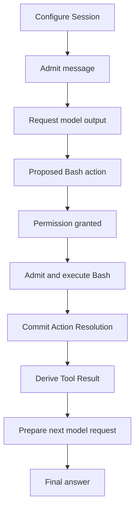
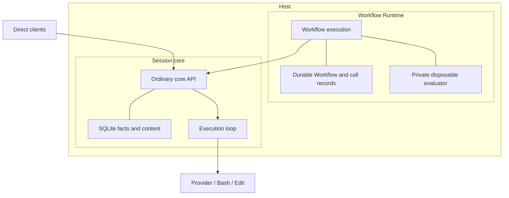
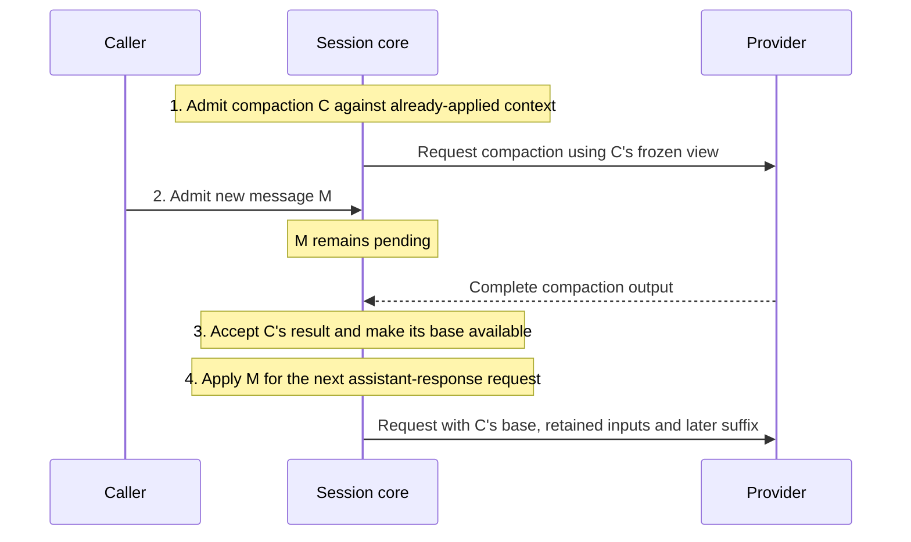
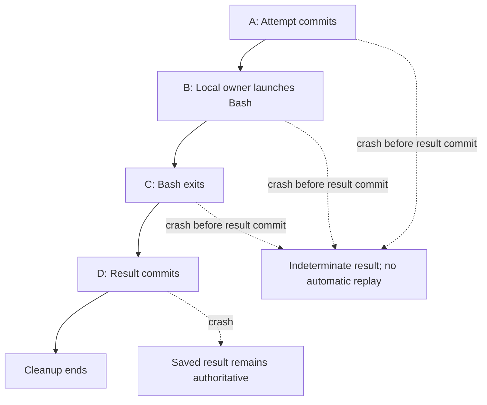

# Rui architecture

This is the accepted V1 contract, not implementation evidence; it includes accepted behavior that is not yet implemented. For runnable behavior and current limitations, see [README Status](README.md#status). [VERIFICATION.md](VERIFICATION.md) owns required evidence.

## Supported guarantees

Rui supports Linux x86-64 and macOS Apple Silicon. Recovery covers a terminated Rui process followed by restart on supported local storage. After an OS crash or power loss the canonical Store has SQLite's ACID behavior for WAL with `synchronous=FULL` (see [Store durability](#store-durability)); Rui adds no further OS-crash, power-loss or storage-device guarantee. Existing atomic publication, sync ordering, canonical-state validation and indeterminate-effect rules remain required; narrowing the recovery promise does not excuse a failing functional assertion.

Authorized commands execute with the user's privileges. Permission checks authorize exact Actions, not a filesystem, network or credential sandbox. Rui enforces its own allocation, population and accounting limits exactly. External-process CPU, elapsed-time and termination safeguards are best effort under OS scheduling and I/O; they do not promise hard interruption, descendant containment or exact physical-memory limits. Cleanup retains ownership until release is observed.

## A piece of work from start to finish

Suppose a caller wants an agent to investigate a failing test. The caller explicitly starts the Host, names a Session, configures its Workspace and sends a message. The model asks to run Bash. With the default permission mode, Rui authorizes the proposed action without asking a client. Once admitted for execution, Bash runs; Rui saves its result and asks the model for the final answer.

The caller can disconnect while this work continues. If the Host instead crashes during Bash, recovery reports an indeterminate tool result: the command may have run, so Rui does not automatically run it again. The model can investigate through fresh calls. The sections below define the exact admission, permission and recovery boundaries behind this example.

Read sequentially or jump to the owning contract:

- [Owners and identities](#owners-and-identities): who owns conversations and workflows.
- [Admission](#admission-and-public-requests) and [conversation/settings](#conversation-and-current-settings): configure, submit and recover replies.
- [Model requests](#model-requests-continuation-and-compaction): freeze inputs, retain output and compact context.
- [Tools and permission](#model-output-tools-and-permission), including [Exact Edit](#exact-edit).
- [Execution and recovery](#transactions-execution-and-recovery), then [stops and outcomes](#stops-and-terminal-outcomes).
- [Workflows](#workflow-evaluation-and-cancellation) and their [evaluator containment](#evaluator-containment).
- [Inspection and local protocol](#inspection-and-local-protocol): observe, wait and control work.
- [Host lifetime/platforms](#platforms-and-server-lifetime) and [resources/storage](#resources-storage-and-diagnostics).
- [Remaining decisions](#remaining-decisions): implementation choices and qualification still outstanding.

## Owners and identities

The explicitly started **Host** contains two owners:

| Owner | Responsibility |
| --- | --- |
| Session core | Conversations, model requests, tool authorization, execution and recovery. |
| Workflow Runtime | Workflow evaluation and cancellation through the ordinary core API. Its private disposable JavaScript evaluator computes calls from supplied facts. |

Core and Runtime transact independently and never read each other's tables. They may share a Store and process; the contract does not specify database-file count. Runtime saves an intent before calling core and records core's answer afterward. Lost replies require idempotent resubmission. Cancellation can therefore submit work before stopping it; it cannot roll back core admission. A canonical storage fault fences the whole Host, despite the independent transactions.

The **Host Store** contains canonical facts and content: the committed records that determine saved outcomes and recovery. The **Storage Owner** exclusively accesses core tables. **Content References** identify complete immutable bytes with length/digest and bounded reads. Credentials and diagnostics cannot determine semantic recovery.

| Term | Meaning |
| --- | --- |
| Local Owner | The server/Store owner. All admitted clients act for it; no per-client ACL, delegated Principal or exclusive Session ownership exists. |
| Caller / User / Agent | A Caller invokes APIs; User is the message role, whether person or agent; Agent is the model-driven decision-maker. These roles confer no additional authority. |
| Session / Session reference | One reusable linear conversation, Workspace and access scope. Its Store-allocated six-character ID addresses it within that Store. Sessions have no terminal outcome or persisted lifecycle phase. |
| Workspace | Working-directory context for relative tool paths, not a sandbox or allowed-path boundary. |
| Turn | Work from taking one or more queued User Messages for processing through a Final Answer or typed terminal outcome. At most one Turn is nonterminal per Session; callers need no Turn key. |
| Operation | One logical model request or Action. It owns its frozen inputs and execution/retry state; once resolved, it owns one immutable Resolution. |
| Attempt | One physical try of an Operation. An Attempt can become uncertain after custody loss; it is not another Operation. |
| Resolution | An Operation’s optional immutable final result. Semantic completion is independent of physical cleanup. |

Each fact has one authority. Each resident allocation has an owner, bounded population and release boundary. Core drives Sessions; Runtime drives Workflows through ordinary core calls. Clients do not sequence internal transactions, dispatch or recovery. Private driving interfaces use direct transactions and effect modules that own their resource lifetimes. Native embedding and Cloudflare Durable Objects are design probes, not SDK, ABI or deployment commitments. Abstractions require concrete consumers or invariants.

### Finding the implementation

This source map locates the existing owners; file boundaries are not part of the behavioral contract. [README Status](README.md#status) owns implementation and qualification status.

| Responsibility | Start here |
| --- | --- |
| Durable admission, settings, results and recovery | `src/store.zig`: `Store` owns SQLite transactions and canonical facts. |
| Wire vocabulary, routes and size bounds | `src/protocol.zig`: request parsing, the command table and its routes, the reply and request vocabulary, and one JSON shape per reply and request. Each writer writes its shape and each size bound is derived from that same shape. |
| Caller request capture and recovery | `src/client.zig`: typed capture, generated/explicit identity, durable records and original-byte transmission. `src/cli.zig` selects HOME/preferences and presentation. |
| Reply decoding | `src/protocol_reply.zig`: decodes each reply against its `src/protocol.zig` shape, accepting or rejecting its bytes, into facts the caller owns after the reply buffer is reused. |
| Interactive submission lifetime | `src/SessionSubmission.zig`: original Message or Decision, capture facts, same-original retries, joined Admission and release. `SessionInput` owns editing storage and loan tickets; `SessionFrontend` owns consent, presentation, reads and coordinated shutdown on a terminal its caller lends. `src/session_departure.zig` selects inspection supersession and exit policy from completed cleanup facts and freshly observed interruption. |
| Host lifetime and effect handoffs | `src/server.zig`: Host, execution slots and native orchestration. `src/execution_turn.zig` owns the shared service-turn policy. |
| Attempt bindings, launch permits and cleanup custody | `src/attempt.zig` and `src/execution.zig`: one-shot permits and generation-checked `CustodyPool` records. |
| Model request preparation, transport and interpretation | `src/model_adapter.zig` prepares requests, walking a request's neutral items and writing the pieces the Session's codec answers each with; `src/provider.zig` owns the HTTP/2 Client and response capture lifetimes and `src/transport_policy.zig` classifies finished transfers and parses `Retry-After`; `src/output_decode.zig` classifies an HTTP error body by giving it, mapped read-only, to the pinned codec's classifier, and decides the error response and report from what the classifier names, and interprets a sealed response stream by giving each event, mapped read-only, to the pinned codec's interpreter, keeping the Host's rules across items and writing the output metadata the Store imports. `src/codec_abi.zig` is the provider codec contract and `src/codecs.zig` lists the codecs this Host serves by the codec name a Session pins, dispatches at comptime to a codec's request encoder, request headers, error classifier and response interpreter, plain functions over values their caller stores; a codec's manifest names the response headers the transport observes for it (`src/codecs/responses.zig` for `openai-responses/1`, which encodes its request body, including its `parallel_tool_calls` table, its history-memo carry and its tool envelope, names its request headers, reads its error envelope and interprets its response events; `src/codecs/json.zig` is the RFC 8259 JSON reader a codec runs over a whole input, and its string decoder also serves the shell). The contract, the JSON reader and each codec are functional cores, listed in `test-logic`, so a codec imports only `std`, the contract and the reader. `src/tools.zig` defines each tool's name, description and parameter schema once. |
| Codex authentication and credential storage | `src/codex_auth.zig` sequences Host credential acquisition and local status and owns the device-login and refresh transport; `src/codex_credentials.zig` owns private records and cross-process credential leases. `src/codex_credential_policy.zig` owns the value decisions those owners follow: record format, selection, refresh claim and replacement admission. `src/codex_token_wire.zig` builds and interprets device-login and token-exchange messages and the records they produce. |
| Bash process and output lifetime | `src/bash.zig`: preparation, launch, process-group retirement, capture and cleanup. `src/BashLifecycle.zig` owns the value transitions those handles follow: process phases, pipe terminal reasons, stop reason, signaling facts and resolution. |
| Temporary storage | `src/ScratchBudget.zig` accounts for bytes; `src/named_scratch.zig` retains failed reclamation; `src/output_retention.zig` owns disposable-output retention and eviction. |
| Product defaults | `src/product_defaults.zig`: values supplied for omitted settings, namely default Active and intake capacity, fresh-Session tools and permission mode, the recommended model and compaction policy. |
| Model capability | `src/model_capability.zig`: Codex identifier syntax, the reasoning-effort grammar and the model table, one row per release-supported ID with its default effort, `max` support, parallel tool-call policy and context window. |
| Session work | `src/session_work.zig` derives each Session's work state, a functional core; `src/store.zig` reads its inputs under one Store lock. |
| Session change hint | `src/change_ring.zig`: the fixed in-memory ring of recent (Session, commit, Workspace key) entries behind Session listing's `since`. `src/store.zig` records into it where its commit counter advances. |
| Session overview | `src/Overview.zig` owns the terminal surface and its reader; `src/overview_view.zig` is its presentation core. |
| Functional cores | The `cores` list in `src/logic_tests.zig`; `src/core_boundary.zig` defines what a core may name. |

## Admission and public requests

### Names, references, IDs and idempotency keys

| Term | Meaning |
| --- | --- |
| Name | Caller-chosen stable text within a documented scope. Session names are local to a Workflow; submission names are local to a Session within a Workflow. These are not freely editable display labels: changing a name can select different work. |
| Reference | Complete value used to address an object. A Session reference is its exact six-character ID, such as `k7m2qx`, not a live handle or lookup operation. |
| ID | Runtime-assigned identity of a durable object, such as Store-wide Workflow ID `42`. Representation and allocation belong to the object's owner. |
| Idempotency key | Identifies a submission across retries so its original committed answer can be recovered. The caller supplies a Workflow creation idempotency key; direct core callers supply a core idempotency key, while Workflow Runtime saves one generated UUIDv4 with each durable submission intent. This does not promise exactly-once external effects. |
| Label | Non-identifying descriptive text. A Session has one optional Label, set through configuration: one non-blank line of 1–100 UTF-8 bytes, validated like a saved Bash description. It is freely editable, never an address, never model input and selects no work. It is distinct from a Workflow-local Name. |

Use these qualified terms consistently; do not use a tracing request ID as an idempotency key or confuse a local name with its full reference. The saved core token and the author's submission name serve different boundaries; authors do not generate or encode core tokens.

### Naming and configuring a Session

The Store allocates a Session ID when a valid creation configuration commits. An ID is exactly six random lowercase characters from `0123456789abcdefghjkmnpqrstvwxyz`, giving 30 bits of entropy. Allocation uses platform cryptographically secure randomness and an atomic unique insertion inside the configuration transaction, retrying actual collisions. There is no caller-named creation, prefix, abbreviation, checksum or alias. The ID is the address and the TUI peer label. A Session's optional Label is display text only: commands never accept it where an ID is expected, and two Sessions may share one. Possessing or guessing an ID grants no access. The Store records each Session's creation time (`created_at`, Host Unix seconds) in the creating configuration transaction.

An omitted CLI `--session` captures creation intent with an empty Session field. Accepted creation returns the allocated ID; matching idempotent replay returns that same ID without allocation. A supplied `--session ID` selects only an existing canonical ID. Unknown IDs reject as `unknown_session`, presented as `no session k7m2qx in this Store`, without creating a Session or admitting Message work. Noncanonical references, including old UUID and NUL-bearing references, reject rather than normalize.

A creation configuration requires a closed provider identity (`codex` in V1), an exact nonempty requested model string and Workspace together. It atomically establishes Session, baseline, Workspace, access scope and request answer. Omitted tools and permission mode take the product defaults, Bash and `bypass`; later configurations never reapply them.

Later configurations preserve omitted provider/model values and accept explicit equal values. A different provider or model rejects the whole update, without a revision or partial changes. This applies before, during and after work, regardless of saved continuation. Unknown providers reject without fallback.

To use another binding, create a new Session. V1 has no fork, history transfer or cross-provider handoff. The restriction belongs to configuration admission, not permanent storage immutability: Operations resolve their frozen settings revisions, and output retains its producing Operation's provenance.

Other supplied mutable fields apply in admission order; omitted fields remain unchanged. Enforce immutable Workspace/access constraints and supported Core values. An accepted fresh configuration records a revision even for equal values; matching command replay records none. Adapter-owned continuation compatibility is evaluated for the frozen model Operation, independently of the binding admission rule.

Incomplete initialization and messages to unknown Session references reject without partial Sessions. Message admission validates the command and immutable content without provider I/O; acceptance guarantees valid canonical Conversation input if the message is later selected. Configuration enqueues no message; any previously queued input remains governed by the queue invariant when changed settings make it resumable.

No separate creation, reservation, attachment or must-be-new operation is selected.

### Recovering a submission after a lost reply

A **core idempotency key** is a caller-provided value binding one state-changing caller command to core, complete inputs and original committed admission answer: acceptance or definite rejection. Message acceptance identifies one immutable admission to the Session queue; it need not identify a Turn yet. The [processing boundary](#conversation-entries-and-pending-messages) establishes the message's result binding once. Distinct messages processed in one Turn share its result.

Every state-changing caller command to core requires a stable core idempotency key: configuration, message submission, Session stop, Permission Decision and exact Model Interruption. Once committed, its inputs, admission-time selection and original admission answer never change; retries recover that decision rather than select new work. This gives callers one lost-reply recovery rule across intervening work and crashes. Reads and waits observe current facts without retained command identities. Internal driving and effect evidence retain their existing Operation/Attempt authority; this rule does not authorize replay of uncertain effects.

All callers share one Store-wide core idempotency-key domain. Atomically bind the key, target, operation kind, complete canonical inputs and original acceptance/definite rejection with the mutation. Target and kind are bound inputs, not lookup scope; changing either or the inputs conflicts. Recovery requires authorization; a key grants no access.

Core requires an exact UTF-8 string of at most 128 bytes and does not interpret or validate UUID syntax. An empty supplied string remains an identity, not a request to generate one. Runtime and client helpers default to lowercase, hyphenated UUIDv4 text (36 ASCII bytes), generated with platform cryptographically secure randomness. Core enforces bindings rather than assuming tokens are unique; separate clients choosing the same string share one identity.

Recover matching admission answers before checking current conditions; changed inputs conflict without replacement. Every new command needs a fresh key, even with equal inputs. V1 accepts securely generated UUIDv4’s probabilistic uniqueness: core detects mismatched reuse but cannot distinguish a retry from a new command with the same key and inputs.

Retrying old configuration cannot revert later settings; retrying a message recovers the same admission, without enqueueing it again, changing an established result binding or reviving excluded input. An unbound admission remains the same queued work until core takes it for processing. A rejection before Session initialization remains rejected afterward.

Typed results distinguish committed acceptance/rejection, proven key conflict, and failure to establish a trustworthy answer. Conflict preserves the original binding. Invocation/storage failure, malformed envelopes without usable identity and failed commits cannot claim a saved rejection or answer.

Acknowledgment follows durable commit, without provider dispatch or final-answer delay. Configuration completes at admission. Message acceptance completes queue admission; processing and the final result may remain pending.

Observation by core idempotency key returns one of these results:

| Result | Meaning |
| --- | --- |
| Absent | No authoritative answer is recorded. |
| Original rejection | The committed rejection, even if current conditions now permit the command. |
| Original acceptance | The committed acceptance plus current progress for that command. Messages expose queue status, their processing binding/result or exclusion; stops follow their saved selection. |

Progress never rewrites the admission answer. Scalar observations suffice; batching is optional, and reads or waits cannot require every notification.

Before transmission, direct clients durably retain the destination Store, operation, exact key and captured inputs. Immutable retained content references may replace inline payloads; mutable paths or digests alone cannot. Retry helpers reuse that record, not a new token. In-memory retention supports recovery only while the client survives. Recover an uncertain reply by identity, not by guessing from content.

Direct caller capture enforces the decoded per-value content boundary while streaming, before publication or transmission. A stable OS-held lock per record owns capture, recovery and no-overwrite publication. Revisiting that record removes its prior incomplete temporary under the lock; killing a writer releases the lock. The empty lock file remains to preserve one lock inode across openers. This does not reclaim captures at abandoned distinct record paths or legacy PID-named temporaries. A complete published record survives a subsequent directory-sync failure and remains available for recovery, but that uncertain publication returns no transmissible captured owner and cannot automatically send.

The client owns command-specific configuration, Message and Permission Decision capture with a closed choice between a caller-selected generated-record directory and an explicit record/key (including an empty key). Capture pins a read-only reader of its temporary inode before publication, retains that reader across the final flush/rename/directory sync, and transfers its owned record handle only after durable publication; it never reselects the public pathname during that handoff. The CLI announces the saved identity before transmitting the original streamed record bytes; announcement failure leaves the record recoverable without sending. Send failure retains the handle's bounded identity for the caller. Fresh generated recovery opens one record, validates its complete syntax and consumed binding fields, then transmits that same reader's original bytes, never current preferences or mutable source files. This binding reader is not the Host's ordered ingress grammar or domain validator: configuration content stays opaque to Client, and Store still decides admission. An explicit repeat send starts at byte zero even after a lost reply. Closing the handle releases its descriptor, not its saved name; callers close before later observation/waiting. This is one reader per active capture/recovery, fixed content windows and bounded metadata, not a payload tree or request registry. Generated recovery decodes only configuration, Message and Permission Decision records; Session stop and Model Interruption keep their explicit record/retry routes.

Client also owns typed decoding of these five mutation replies before callers interpret admission. One fixed-storage parse validates the complete bounded envelope, consumed-field duplicates, operation/status/replay semantics, echoed Session and control target, and Message decoded length/domain-separated digest and queue admission against the pinned capture. Invalid or mismatched replies are unconfirmed invocations, not durable rejection or proof of noncommit; retain the original recovery key. A canonical invocation failure retains its independent Host-fence authority. Typed facts, original request identity/target and bounded invocation status/type/code are owned values that survive capture closure and response-buffer reuse. CLI renders human and semantic JSON output from this one result, never the raw Host mutation envelope; malformed or mismatched responses expose the typed diagnostic and original request context, not an unvalidated claimed outcome. Outer member order, whitespace, equivalent escapes and unknown fields are not output authority. The receive buffer remains necessary for validation; this is no payload copy/cache or memory-savings claim. Exact domain content and Action argument strings remain unchanged. CLI owns display and workflow, including its existing recoverable-error behavior and fatal canonical-error terminal cleanup. A later worker must delegate to this same operation decoder when integrated, retaining its own custody/lifecycle. Listing/following local handles uses a metadata-only identity projection that cannot authorize transmission and does not scan historical payloads.

Client owns keyed observation and result decoding for checking **one submitted request**, independently of local capture availability. Its owned facts validate the queried key and expose the original operation kind and Session; selected Message callers additionally check these against their saved address. The original admission remains `accepted` even when later work fails or is cancelled. A terminal Message result takes precedence over coarser queue/progress hints; failed/completed processing must carry its Turn/Operation/Attempt binding, while stop-excluded input has a cancelled result without an invented Turn. Supported metadata for CLI and planned workflow consumers is:

| Observation | Supported facts |
| --- | --- |
| Common | Key; absent, accepted or rejected admission; kind, original Session and rejection code when present |
| Configure | Accepted revision and created flag |
| Message | Input text length/digest reference; queue status/admission; scalar Turn/Operation/Attempt; terminal status/code or answer text reference; progress status and nullable actionable Action |
| Session stop | Original selected nullable Turn, admission cutoff and pending/completed semantic completion |
| Model Interruption / Permission Decision | Original Session/Turn/Operation or Action/decision, including retained rejected targets |

One bounded parse validates the entire keyed envelope, consumed duplicates, string-only named statuses/kinds, canonical decimal IDs, content-reference syntax and operation applicability. An omitted field is distinct from invalid present null; only required nullable selection/progress fields accept null. Unknown extensions are syntax-validated and discarded, not retained as a DOM or emitted through ordinary output. Strings belong to fixed-storage facts; returned string slices borrow that value until it leaves scope, independently of receive-buffer reuse. Human and semantic JSON render these same facts. Read failures retain bounded HTTP status/type/code and the queried key; unavailable/failed observation never undoes an earlier admission or proves noncommit. Successful answer and Action-content reads still stream exact domain bytes through fixed windows; partial read failure cannot claim a complete answer. Full's closed inventory remains a separate streamed report. Current and attention snapshot consolidation remain subsequent Client work; [Session-list facts](#public-operations) preserve real Store snapshot cursors, and explicit unconfigured behavior remains unchanged. New supported metadata requires an intentional typed contract, not automatic unknown-field passthrough.

Within the mutation envelope, omittable consequential fields accept a typed value when present, never explicit JSON null: null is not absence and cannot bypass invocation/answer exclusivity or operation applicability. Session-stop `selection.turn` is the exception: it is required but nullable to represent no selected Turn; omission is malformed. Unknown extension values remain syntax-validated without becoming outcome authority.

Global `request list` enumerates filename-valid generated handles even when their record is unreadable or unsupported. Session-local `/requests` filters readable supported identities by recorded Store and Session. Neither listing transmits requests or establishes Host work status.

Runtime saves exact submission identity, captured inputs and one UUIDv4 in its existing intent transaction before core invocation, then records the answer independently; resubmit with that immutable token after lost replies. Core knows no Workflow membership/cancellation. This provides recoverable admission, not exactly-once effects. Controls use the same saved-key protocol; their owners retain command-specific validation, target selection and completion semantics. An original acceptance is immutable even while its completion progresses. A fresh key requests a fresh decision against current state; it does not override an already-settled target.

Retain authoritative intents, retry bindings and content required for original-answer recovery without independent expiration in V1, including after terminal completion. Storage exhaustion cannot silently discard recovery history. This recovery contract assumes committed authoritative history survives; independent database rollback, Store replacement or loss of one owner's history is not ordinary crash recovery. Detectable missing/corrupt authoritative state must not be treated as fresh work.

### Example: acceptance and answer arrive separately

A caller submits “Investigate the failing test” with core idempotency key `message-1`. Core commits acceptance, but the connection closes before the reply arrives. Resending the same identity and inputs recovers that acceptance and its original work; it does not submit another message. The final answer may still be pending. Even after the Session has done newer work, `message-1` remains bound to its original result. A deliberate second submission uses a new identity.

The [workflow identity example](#example-conversation-workflow-and-call-identities) shows how Runtime supplies these identities for workflow calls.

## Conversation and current settings

### Conversation entries and pending messages

**Conversation** is the immutable ordered history of User text, assistant text, Tool Calls, Tool Results and System Instructions. Each entry records its exact causal source and applicable Turn. No edit, deletion or compaction rewrites history. An admitted User Message and its Conversation entry are distinct: **projection** means appending the admitted message to this history. Admission can precede projection, as the pending-message rules below specify.

Messages are immutable admissions ordered within their Session. An admission waiting for processing has no result-producing Turn binding. When no Turn is active, core takes the queued admission-order prefix to begin a Turn; admission of new input may perform that transition in the same transaction. The oldest selected message initiates the Turn. During active work, later admissions wait for its next input boundary without changing Conversation or a frozen model request.

At an input boundary, core selects all eligible pending messages through the observed admission cutoff. One transaction:

1. Rechecks eligibility, stop authority and the parent Turn.
2. Binds the selected prefix to that Turn and appends its Conversation entries.
3. Admits the next assistant-response model Operation and its manifest.

Late selection cannot overwrite a saved stop. Rollback commits none of these changes; input beyond the cutoff stays queued. Each selected message receives that Turn's final text, schema-validated value or typed failure. Its binding is final, with no automatic requeue. Stop or cancellation may instead exclude unselected input and supply cancellation through the controlling fact, without inventing a Turn.

**Queue invariant:** eligible queued input or a completely settled Tool Call group awaiting continuation makes a resumable Session runnable. No additional message is needed. Eligible input is admitted, unselected and not excluded by stop or cancellation. Ordinary continuation and effect-settlement preconditions still apply.

Core discovers work from committed facts after admission, input boundaries, terminal settlement, prerequisite changes and restart. Lost notifications cannot lose work. Eligible candidates receive eventual admission under sustained competition according to [capacity and selection progress](#capacity-and-selection-progress). A finite workload drains when prerequisites become satisfied and admitted lifecycles finish and release capacity. There is no public cross-Session winner order or individual wall-clock wait bound.

Unavailable capacity retains work without execution resources or spinning. A blocked prerequisite leaves input queued. An admitted Operation failure settles selected input through its Turn; a required canonical failure follows the shutdown boundary. Runnable state is derived, not stored as a Session phase, wake receipt or per-Session worker.

Compaction uses already-applied context and leaves pending messages alone. No model-created conversational Input Request exists; permission decisions are separate control facts, not messages. Successful settlement requires no pending applicable message, actionable permission, unresolved Operation or admitted effect, and atomically releases occupancy.

### Selecting current settings

A **Session Context Revision** records persistent configuration from sparse caller updates. Its storage representation is private. It includes provider/model binding, instructions, Tool Catalog, context policy, reasoning defaults, optional output schema, Permission Mode, default output limits and the Session Label.

The revision does not give every setting the same application boundary:

| Setting | Selection boundary |
| --- | --- |
| Model inputs | Model Operation admission. |
| Permission Mode | Child Action admission, when core authorizes the action. |
| Resource limits | The owning execution or resource scope. |
| Host settings | Host startup, outside Session configuration. |
| Label | Presentation only. It takes effect at commit and no Operation freezes it. |

No separate settings store or applied-state machinery is required. Session identity, Workspace/access scope and the V1 provider/model binding are fixed under [configuration admission](#naming-and-configuring-a-session); other supported settings are mutable. Core validates updates atomically. The adapter must establish continuation compatibility for the exact frozen Operation without changing Conversation membership. Revisions do not add provider capabilities.

Defaults apply only when establishing a Session:

| Field | Initially omitted | Explicit value | Later omitted |
| --- | --- | --- | --- |
| Instructions | Empty text | `instructions: ""` selects empty text | Preserve existing value |
| Tools | Bash only | `tools: []` offers no tools | Preserve existing value |
| Permission Mode | `bypass` | `ask` or `bypass` | Preserve existing value |
| Output Schema | Text answers | `outputSchema: null` clears the schema | Preserve existing value |
| Label | No Label | `label: null` clears the Label | Preserve existing value |

Omission never clears a field. Settings are ordinary JavaScript data captured at each configure invocation, before later caller mutation. Each Session evolves independently; sharing a settings object creates no shared configuration entity.

The CLI spells a Label `--label TEXT` (the Session's name or title, shown in lists and `/status`) on `session start`, `session configure` and interactive `/configure`, and clears it with `--label ""`: the empty string is the one spelling that can never be a Label. A Session can label itself from Bash with `--store "$RUI_STORE" --session "$RUI_ADDRESS"`, and its collaboration context names that command so a model asked to rename its Session finds it. Every Label change is a revision like any other configuration change. A Label-only revision adds no Conversation entry and changes no model input. Configuration carries no sender, so any client that can reach the Store may relabel any Session, as it may already reconfigure it.

Codex **Reasoning Effort** is an optional persistent Session override. Its closed grammar is `none`, `low`, `medium`, `high`, `xhigh` and `max`. Configuration accepts an explicit value only when the exact model's pinned catalog entry advertises it. Unsupported values reject the whole update. `none` is a literal effort, not a reset, and no currently listed model advertises it. Catalog-only values such as `ultra` do not expand Rui's grammar or trigger a fallback. Catalog support is source metadata, not account entitlement or live backend qualification.

With no override, a new Session uses the catalog default. The pinned Codex catalog gives `gpt-6-astra`, `gpt-6.1-sol` and `gpt-5.6-sol` a `low` default; the other five release-supported models default to `medium`. All eight advertise `low`, `medium`, `high` and `xhigh`. All except `gpt-5.5` also advertise `max`. An unknown exact binding has no inferred default: without an override, Rui omits `reasoning` and leaves the provider's effective effort unknown. An explicit effort on that binding rejects because Rui has no support evidence. This preserves exact-model syntax without guessing capabilities from model families.

On an existing Session, omission preserves the override and explicit `null` clears it to catalog default. The CLI spells the reset `--reasoning-effort default`; `--reasoning-effort VALUE` selects an override for `session configure`, initial `session start` and interactive `/configure`. Current inspection reports nullable effective `reasoning_effort` and `reasoning_effort_override`; `/status` identifies a Session override, catalog default or absent catalog value. Each model Operation, including compaction and continuation, freezes the resolved effort at admission. Replacement Attempts and reopened historical views emit that stored value without consulting later Session settings or catalog policy. Persisted values outside the closed grammar are corruption. There is no per-Message override, automatic effort downgrade or model substitution.

New requests select one committed revision and resolve settings at or before it. No Turn-wide configuration copy, temporary override layer, cross-call lock or historical revision precondition exists. Configuration and subsequent messages can interleave with other clients; later message failure does not roll back configuration.

Queued messages do not capture model settings at message admission. At the next assistant-response input boundary, selected messages use the effective model context selected for that request. For example, while a request is active, admit “review this code,” then configure “focus on security”: if that configuration commits before the next request's selection boundary, the queued review uses it. A configuration committed after that boundary affects later requests; it cannot alter the admitted Operation or its replacement Attempts. Instruction updates remain ordered canonical Conversation facts under the rule below. This model-input boundary does not define when action permission policy changes take effect; authorization follows its own contract.

### Recording and rendering instruction updates

Every successfully admitted explicit instruction update appends an immutable System Instruction to the canonical Conversation, including intermediate reversals and fresh equal values: A→B→A records B and the second A; A→A is an update. Matching request replay adds nothing; omitting instructions creates no update. Identical bytes may share content storage without collapsing distinct entries.

At model Operation admission, core freezes the canonical historical boundary and effective instructions selected for that Operation. The provider adapter owns provider- and model-specific projection of those immutable facts. It may append one wire block per entry, coalesce or lower entries, or use another supported representation, provided the resulting request preserves effective instruction authority and canonical history remains unchanged. No universal wire-block count or placement is a core guarantee.

Commit each configuration revision and its explicit instruction entry atomically. Rollback appends neither. Operation admission and replay derive from canonical originating-update references and the initial baseline, including compaction-covered entries, not text equality or a separate queue/applied flag/receipt. Already-admitted Operations and replacement Attempts retain their frozen historical view; later configuration cannot rewrite it.

With unchanged adapter rules, reconstruction produces equivalent provider input. A deliberate adapter-rule change may alter provider rendering from the same canonical facts without changing their authority, the Operation boundary or Conversation. Adapters should preserve stable provider prefixes where supported, but provider cache layout does not redefine canonical history.

Model-visible time/date/timezone/Workspace binds the adapter's immutable instruction rendering for the admitted Operation; tool observations belong to results. No automatic polling/clock refresh or Turn-environment reconstruction on retry.

### Text and structured answers

An optional persistent **Output Schema** selects a model-generated structured Final Answer; absence selects text. The producing request freezes it. The adapter translates to a supported provider mechanism and validates response/schema in the bounded validation path; workflows receive that value without a second interpretation. Unsupported schemas, refusal, incomplete generation and invalid output fail explicitly. No prose conversion, repair call, per-caller schema or reinterpretation under later settings is permitted.

## Model requests, continuation and compaction

### Operations and frozen requests

An **Operation** is one model request or Action, owning its exact descriptor, causal source and current execution/retry facts. Its optional **Resolution** is its immutable final result; the Operation ID also identifies that result. A retry is another [Attempt](#admitting-an-attempt) of the same Operation; a model request admitted against new context or settings is a new Operation.

Each model Operation owns one immutable **Model Request Manifest** binding its protocol operation, provider and exact requested model through its frozen Session settings revision, historical input view, reasoning/output limits and output contract. References/digests identify canonical content; runtime facts retain their original rendering references. Session facts and Operation admission share one committed per-Session order on their owning records, without a duplicate payload log. The Operation's admission position fixes its historical boundary. Accepted model output, call rejection and Action Resolution become available at their acceptance positions, not a producing Operation's earlier admission position. Historical visibility does not bypass pending-input applicability, expose an incomplete Tool Result group or change Conversation/tool-call order.

Replacement Attempts retain that historical view. With unchanged adapter rules, they reconstruct equivalent request semantics; meaningless JSON spelling need not match. The caller may deliberately change adapter selection/rendering rules between Attempts, so identical requests across such a change are not promised. This does not mutate historical Session settings, provider binding, output contract, saved effect authorization or retry accounting, or permit unsupported continuation. No frozen adapter implementation/version is required. Credentials, endpoints, sockets, transport and nonsemantic headers remain late-bound.

### Agent identity and peer composition

Every assistant-response and compaction request includes Rui-owned context containing the Session's bare six-character ID. The adapter derives the address from the originating Operation, including on replacement Attempts. It reconstructs this context after compaction and normal Host restart, separately from user instructions. The address is not a PID, execution slot, Workspace or provider continuation identifier, and grants no additional authority.

The collaboration context adds only the Session's own address, a pointer to installed `rui --help`, the command that sets its own Label, and how to start and message other Sessions and get their answers back (ask for a report sent to this address, or read the saved result by its request handle). Scoped help and errors describe command syntax, model selection and recovery. The general agent preamble, Workspace fact and caller-authored Session instructions remain unchanged. Shared text files own context wording; request builders and fixtures independently encode their supplied facts. Ordinary Bash runs in the environment of the terminal that last sent the Session work, with the running Host executable's directory first on `PATH`, `RUI_ADDRESS` (the bare Session ID) and `RUI_STORE` (the canonical Store selector); [Bash environment](#bash-environment) owns the rule. Bash never inherits the Host's own environment or credentials. No identity tool, peer tool, alternate CLI-path variable or bundled skill is required.

Agents compose ordinary Session configuration and Message admission through the CLI, and the Host records who sent each Message. `rui session send --to k7m2qx` takes one exact canonical ID, without JSON. Anonymous human and script sends may select `--store PATH` or use their ordinary Store defaults. A peer destination is always in the trusted sender's Store, before HOME preferences; an explicit Store override must canonicalize to that same Store or reject before capture. Incomplete or malformed peer environment rejects without anonymous or default-Store fallback, including with an explicit Store selector. Store selection is canonicalized without changing Session bytes. A Session may send to itself.

Each Action receives an opaque Host-issued `RUI_SENDER_HANDLE` in its Bash environment. The CLI captures that handle and the sender's Store and ID in the request. The Host resolves a fresh sender from its own live Action handle and requires the full address to match. An unknown, stale or mismatched handle saves an `invalid_sender_handle` rejection and creates no sender Activity. A present invalid handle never becomes an anonymous send. Human and script sends without any peer fields remain anonymous. The Host retires the handle on observed process exit, accepted stop or Action resolution; opening the Store retires all handles from the previous Host. The handle is private identity evidence, not model context or additional permission authority.

Recovery retransmits the saved sender and handle without reading the environment again. Exact committed replays return their saved answer before live-handle validation. The full sender address and handle are part of the Message's semantic digest, so reusing a key with a different sender or handle conflicts. An accepted Message saves its nullable sender on the admission, and the send takes a position in the sender's sequence. A rejected send from an authenticated sender saves its position there too. Each Session's Activity therefore orders the Messages it sent and their refusals among its other facts.

The model adapter renders a peer Message's sender as a separate leading input part. It contains only the sender's bare ID, marked as not instructions, and the fact that the answer is stored as this request's result and is not delivered to the sender. The Message's own text follows unchanged. Sending a report requires an explicit Message admission. The receiving Session uses the existing input boundaries, pending-prefix selection, stop exclusions and original-result guarantees. There is no separate inbox, callback, parent-child ownership or resident waiter for a future reply. Dormant peers retain only saved facts.

Peer composition supports one Host, which owns one Store. Peer CLI sends cannot select a foreign Store. The Host independently rejects unknown or mismatched sender handles before delivery, including forged wire requests. There is no cross-Host authentication, RPC, issuer startup, foreign Store read or claimed-sender mode. Remote-machine routing and distributed storage are outside this contract.

### Retaining accepted output

Retain accepted model output in provider order as immutable **Model Output Items** owned by the resolved Operation, in Rui's neutral form plus a provider bag. The neutral form is what Rui understands: each item's kind and phase, its ordered text parts with decoded text, and a call's name, call ID and arguments. The bag keeps every other member exactly as received, including IDs, status, encrypted continuation and unknown fields; each part keeps its own bag for annotations and other part members. Item-level `created_by` is dropped at import. A field is neutral only in exactly the expected shape; anything else stays in the bag. Commit Resolution, items and applicable Conversation entries atomically. The provider codec rebuilds replay input from the neutral form and bags, writing each item canonically; the prompt cache matches what the model sees after the provider parses the request, so a rebuilt item parses equal to the received one. Persist neither the raw item, a second replay copy nor a serialized request body. The Host-local [history memo](#history-memo) is the only other copy of request bytes: when a request seals, its encoded input span is copied into a derived, non-durable scratch file for its Session, rebuilt from the Store on any mismatch or restart. Preserve unknown open fields within known items. Private reasoning, encrypted material, signatures and compaction items remain opaque and inaccessible through generic content reads.

Each assistant message has its own Conversation entry at its output item's stream position. The entry names its producing Operation and item ordinal. Its public text is the message's text: every `output_text` and `refusal` part's decoded text back to back, saved once as one row at import. Each text part keeps only its length, so its text is the next that many bytes of that row, and replay reads the parts in order as ranges of it. The item certifies that text separately from the Operation's selected answer. Public reads check that exact binding, Session, Turn and Attempt. Equal text may share content without sharing message identity. Replay rebuilds each message with its phase and every part, not only its public text.

Unknown consequential discriminators—item, content block, Action subtype, compaction variant or terminal status—produce `unsupported_provider_output` with bounded typed rejection and necessary request/causal provenance, without Conversation, continuation or effects. Complete rejected payloads are optional diagnostic detail, not mandatory permanent history. Raw HTTP/SSE framing, token deltas and partial/interrupted/late output remain scratch, never continuation authority.

Sealed-response validation failures retain at most 512 UTF-8 bytes of rejection classification on the producing model Operation's Resolution: a local typed reason, validation stage, capture byte offset and optional output index. Available HTTP request correlation remains on that Operation. An HTTP status failure likewise records the request correlation the provider returned, or none. A scheduled retry records none; the Attempt that settles the Operation, including one that exhausts retries, decides it. The settlement type separates failures without a provider answer, which record only a code, from answered failures (an HTTP error status, or a sealed success that never reached validation), which must supply the provider's correlation, and from validation or settlement rejections, which must also supply their classification. Save these facts in the same Attempt-checked terminal transaction; an import or commit failure follows canonical rollback/fencing rather than silently losing required provenance. Full Session inspection exposes the classification and nullable Operation `request_id` after scratch disposal and restart. Neither is a Turn answer, Conversation entry or continuation item. Classification copies no provider text, arguments, private continuation or arbitrary discriminator values; an offset does not make the discarded capture retrievable. Identifying an unfamiliar wire discriminator can still require an explicitly authorized private capture. Existing failures are not retroactively populated.

### Choosing and validating compacted context

**Model Context** is an optional selected Compaction Base followed by one complete ordered suffix of canonical host input and accepted model Operation results, with the binding-specific retained inputs below. A **Compaction Base** is the derived role of an accepted compaction result selected within a later Operation's view. Its producing Operation's admission position is the covered frontier: compaction uses that Operation's historical view, and later applicable inputs form the suffix. The result's ownership identifies this boundary without a separate input list or coverage record. Derive prior bases within that view; retain no durable copied request body, checkpoint row or permanent history of failed Attempts. The [history memo](#history-memo) is keyed by the selected anchor and never selects or certifies a base. Provider caches/previous-response IDs are optional only when their loss permits local reconstruction.

User Messages have no token-admission quota and are never silently split or truncated. The configured **Compaction Trigger** estimates pressure, anchoring on provider usage where available and estimating newly appended content; it is not a content ceiling. Before pending input is applied, compaction may cover only existing context; afterward, the next assistant-response request includes all pending messages and instructions, including arrivals during compaction.

The provider capability owns model-specific policy defaults. Session configuration stores only nullable overrides for `compaction_trigger` and `output_reservation`. An omitted update preserves the override. Explicit `null` resets it to provider/model policy, spelled `default` in the CLI. Triggers are positive token counts; output reservation is nonnegative extra heuristic headroom, not a provider output limit. Current inspection and `/status` show effective values and whether each value is a Session override. Current inspection also reports `context_estimate`: the estimated tokens the next model call starts from (accepted usage since the compaction base, uncovered bytes / 4 and output reservation), read by the same facts purpose selection reads, when that selection would compare it with the trigger. It is null without a trigger and when the next call's purpose does not depend on it: a Session's first call, the call after a compaction, a recovery compaction and context unchanged since the last compaction. So whenever it is shown, it reaches the trigger exactly when a model call admitted at that moment compacts, and the Session line's `0% left` means that. `/status` shows it beside the trigger, and the conversation's Session line shows the share of the trigger it leaves. Resolve policy once before purpose selection and freeze the effective values on the admitted Operation. Later settings or capability changes cannot change its purpose or retry policy.

The Store keeps usage in Rui's form: four counts, uncached input, cache read, cache write and output, each a whole SQLite integer, all present or all absent. Pressure is their sum, saturating at its maximum. The Responses provider maps uniquely named top-level `input_tokens` and `output_tokens`, with `input_tokens_details.cached_tokens` as the cache read (zero when its details are absent or null) and zero cache writes, which Responses does not bill. A provider total is not a count. A missing, invalid or duplicate count, or a cache read above the input, leaves usage absent, and pressure falls back to retained-context estimates; a missing counter is not zero.

Codex's eight exact [release-supported model IDs](#supported-model-ids) default to a 244,800-token trigger and zero extra output reservation. Each has a 272,000-token window in the [pinned Codex catalog](https://github.com/openai/codex/blob/970111f6cb62cc02fe36a82ea7d71b37a2889c97/codex-rs/models-manager/models.json); its client derives the trigger at 90% of that window. Unknown models have no inferred automatic trigger. An explicit override enables one without claiming a model capacity or entitlement. Pressure uses valid usage from the latest accepted same-binding output plus estimates for appended input and extra reservation; without valid usage it estimates retained context. The threshold fires at equality. The assistant successor of a compaction applies pending input even if the estimate remains above the threshold. Provider-reported overflow still permits recovery without a configured trigger; unchanged context after an accepted base, or overflow during compaction itself, fails with `ResourceExceeded` instead of repeating compaction.

Overflow recovery applies only within an active Turn. A terminal Turn's overflow does not force compaction in a new Turn; evaluate proactive pressure independently. The compaction-successor exemption follows the same pending input even if compaction fails before projection. A Session stop excludes that pending prefix, so the exemption does not suppress proactive checks for later work.

Context overflow reported before accepted output or effects resolves the rejected Operation without removing its applied input. Local preparation and remote overflow use the same compaction policy unless their evidence changes trustworthy retry behavior. Compaction covers that context; continuation gets a new Operation and manifest, not an equal-manifest retry. There is no separate compaction-attempt limit, aggregate Turn request allowance or whole-Turn deadline.

Select the newest accepted base in the current lineage, then validate that exact base and complete suffix:

| Owner | Validation |
| --- | --- |
| Core | Lineage, completeness, content/digests and stored format. |
| Adapter | Demonstrated wire compatibility. |

Both checks must pass; no validity flag is stored. Failed or unresolved compaction cannot replace a base. Unsupported or incompatible selected material fails `continuation_unavailable`, without falling back to an older base or reconstructing from visible Conversation. Missing or corrupt required canonical state fences the Host instead of failing only the Operation.

Configuration changes do not prevalidate or discard saved continuation. Request preparation validates the frozen Operation's selected recipe. Codex initially restricts continuation to the same requested model binding and records requested/served-model evidence; actual provider qualification requires adapter evidence even though V1 configuration admission fixes the Session binding. Incompatible continuation fails that Operation with `continuation_unavailable`, without replaying it or dropping private meaning. If complete retained input still cannot fit, fail with `ResourceExceeded` under terminal-settlement rules. Never discard pending instructions to fit or impose a durable-history limit.

### Example: compaction coverage and availability

C covers the historical view fixed at step 1. Acceptance at step 3 makes the base usable; it does not expand coverage to include M. The [Codex recipe](#response-owned-compaction) specifies which covered host inputs and output items the provider request retains.

### Adapter historical reads

Core supplies an Operation-bound read-only view for request preparation. Only the Storage Owner accesses SQLite; adapters receive no connection or caller-chosen cutoff predicates. The view provides:

- historical settings, applicable host inputs and accepted model results;
- complete model output in provider order, including private objects with no Conversation projection;
- each Tool Call's sole rejection or Action Resolution, complete terminal coverage at the manifest boundary, and derived Tool Results streamed in call order;
- a compaction anchor identifying its producing Operation and item ordinal, with traversal from that item through the end of the same output.

Core owns visibility, source relationships and structural coverage. The adapter owns provider interpretation, context selection and wire encoding.

One output item grammar judges each item once, at import, and also checks the Operation there: a compaction item outside a compaction Operation, or a call inside one, is unsupported output. The Store saves each accepted item with the replay rule the grammar judged: whether it is a reasoning item whose private `reasoning_text` content is not replayed. The Store format fixes the grammar, so a change to what it accepts or omits is a new format, and replay applies the saved rule without judging again. A Tool Call binds its Tool Results through its admission certificate, which the Store checks while it discovers each tool group. Replay verifies every part's text and every bag against its digest as it copies them; a message's text parts must cover its text exactly, in order, and the text's digest is checked when the last of them reaches its end. Every item and every part has a bag, an empty one when nothing is left over, and an item saves its part count, so replay also fences on a missing bag, a missing part, a part whose array or kind does not fit its item, or an array whose parts are not contiguous. Corruption fences the Store. Once continuation is unavailable, later output items are not read.

For managed Codex, derive one opaque cache-affinity value from the Store selector and exact Session reference, not from an Operation, Attempt or current configuration revision. The Responses codec receives it in the settings item and asks for its lowercase hex form as `session-id` on every transfer, including tool continuations, retries and fresh-Host reconstruction, and sends `originator: rui` to identify the client. Different Session references or Store selectors yield separate affinity values without another durable identity or a raw Session name/path in the headers; recreating a Store at the same selector deliberately derives the same value for the same reference. Neither header is canonical authority, a provider-retention promise or a prerequisite for cache-independent reconstruction. A cold-prefix native comparison found immediate reuse with `session-id` but not with `prompt_cache_key` alone; this selects the tested header without claiming a 100-Session cache-hit target.

Managed Codex also keeps the pinned client's per-Turn sticky routing ([client contract](https://github.com/openai/codex/blob/968835997714baaff199cfed5f89a2c65d8ca77d/codex-rs/core/src/client.rs#L256-L283)). The first `x-codex-turn-state` value in a successful (2xx) response to a Turn's request is that Turn's routing state. Every later request of the same Turn sends it unchanged: retries, replacement Attempts, tool continuations and in-Turn compaction. A later value in the same Turn, any value on an interim or error response, and an empty, non-printable-ASCII or over-4,096-byte value are ignored rather than failing the transfer. No other Turn sends the value. It belongs to the account and FedRAMP binding that received it. Refresh keeps that binding; observing another binding while preparing a request clears every cached Turn and advances a Host-local routing epoch, matching the pinned owner-change rule rather than Rui's per-refresh credential generation. A transfer delivers the value as its headers arrive, under its launch epoch, so it cannot repopulate the table after an owner change, even if the original account later returns. The value is Host process memory, not canonical state: the Store never holds it, a fresh Host starts every Turn without it, and a table bounded by execution capacity replaces the least recently used Turn. Losing it only loses stickiness, because every request carries complete reconstructed input.

Use closed semantic variants and opaque view-scoped handles, not storage rows or a generic query language. Generic content access cannot open private continuation; the provider view grants the appropriate private reads without implying wire compatibility. One shared, pointer-stable preparation owner retains the admitted Operation/Attempt binding, historical view and active reader, charged scratch, encoder/replay cursor and cleanup state. There is at most one such owner across all execution slots; it is resumable orchestration state, not durable authority, a worker or a prepared-request queue. Borrowed record metadata expires on reader advance; opaque handles remain stable until view release, and payload reads use bounded caller buffers. No SQLite transaction spans adapter processing or network activity. Historical retention must preserve referenced versions through required recovery; an expired or foreign handle is programmer misuse, while missing/corrupt content and resource/storage failures are explicit failures.

Preparation advances under both byte and item allowances, then returns to the **lifecycle-service boundary**. This boundary reconciles accepted controls, advances Bash preparation/processes and services due ordinary and retained cleanup.

Each execution turn services that boundary before and after admission, consumes at most one provider completion, services the boundary again, then advances preparation once before deciding whether to wait. Both scanned source bytes and emitted or copied bytes consume the byte allowance, even when replay discards a field. Retained items and discarded replay fields consume the item allowance. Large scans and many small items must therefore yield. Every turn gives preparation a bounded progress opportunity, so finite work drains without a completion burst or large history monopolizing orchestration.

Control publication is a hint. The lifecycle owner also reconciles canonical control facts on its bounded fallback cadence, so a lost or coalesced hint can delay but cannot suppress cancellation. The Store advances an in-memory commit generation whenever a locked entry point changed rows, before releasing its lock; the fallback skips its control reads, and each turn skips its Bash, message and tool-continuation admission scans, while the generation (and, for the scans, the free-slot count and which shared preparation owners are open) is unchanged since the last read found nothing. An Action Attempt loses custody without a saved outcome only after dispatch is fenced or the Host is shutting down, and neither admits work again, so uncertain Actions come only from an earlier Host; the lifecycle owner stops scanning for them once a scan after startup finds none. Retry admission depends on time and keeps its one-second poll. Nothing wakes the lifecycle owner for new work, so it waits at most 100 ms between turns, 25 ms while Bash runs; transport readiness and the HTTP/2 Client's own timers end a wait sooner. A control always commits before its hint, so a lost hint still moves the generation. Before transport handoff it rechecks superseding controls; stop or shutdown cancels preparation, closes readers and prevents launch. Canonical read faults fence dispatch. Ordinary read, encode, write or seal failure settles the admitted Attempt under existing policy. Scratch unlink or other unconfirmed reclamation retains actionable custody and accounting and blocks unsafe reuse; established cleanup releases it exactly once. Restart derives work only from canonical Store facts and removes owned scratch before admission or refuses startup. No preparation cursor, queue position or completion hint is durable.

Preparation writes the complete provider request into charged scratch before transport can consume it. Stream large strings, opaque objects and unknown open fields; do not decode complete payloads or retain an item-count-sized collection. Preserve exact historical order, and rebuild each item from its neutral form and bags so that it parses equal to the item the provider sent, minus only demonstrated non-replayable fields. Source integrity, output completion and scratch sealing must succeed before the existing atomic transport handoff. Partial read, write or capacity failure cannot expose an incomplete request. Unlinked scratch files (ingress request content, provider request, response capture, response metadata, decoded event data and Session reports) are flushed from Rui's buffers and length-checked at seal or before use, but not fsynced. They never outlive the Host process, so a sync adds no crash durability; durability lives in the Store. A write error still fails at write time, and a later read error fails the call that reads it.

Model transport is Rui's own HTTP/2 client in `src/h2/`, built on pinned nghttp2 and OpenSSL. It is a separate build module that imports nothing from Rui. The execution owner drives it on its own thread; nothing in it runs on its own except short-lived name-lookup and SecTrust threads.

Concurrent Codex Attempts to one origin share a lazily established connection pool. The client opens another connection only when the peer's SETTINGS_MAX_CONCURRENT_STREAMS is full, and never holds more connections than streams. One stream, sealed request file and response capture remain owned by each Attempt; a connection, TLS session or stream has no semantic authority.

HTTPS requires ALPN `h2`, checked after the peer is trusted, so an untrusted peer reports `untrusted_peer` before any HTTP/2 refusal. A missing `h2` reports `provider_http2_required` before any request byte is sent. Loopback `http://` uses h2c by prior knowledge; there is no HTTP/1.1 route, so local fixtures serve h2c. The one automatic resend is a stream the server proved it did not process (REFUSED_STREAM, or above a GOAWAY's last stream id); it goes back to its origin's queue and is sent again from byte 0 within the same Attempt. Any other failure goes to the ordinary Attempt transport-failure owner, which decides replacement and allowance. Cancelling or failing one stream sends RST_STREAM for that stream only and leaves siblings independently owned. Every request carries `accept-encoding: identity`, since nothing decodes a content coding, and a final head naming any other coding ends the stream `encoded_response`, which the Attempt treats as invalid provider headers. SNI and the certificate name check use the host without a fully qualified name's trailing dot. The client's SETTINGS advertise a 64 KiB header list limit, at or below which its own header block check always passes.

Request bodies are read from the sealed scratch file within the peer's window, never copied into a per-request buffer. Header values that every request shares, the managed credential and the fixed fields, are referenced rather than copied per stream: the Host keeps one copy of each credential in use, wiped and freed when its last Transfer ends. The request's scratch charge retires once its body is fully sent and the response has started, since until then a refused stream may be sent again; a long response does not hold it. Each stream grants 16 KiB of receive credit, and the connection window is that times the streams it carries. Every socket read lands in one shared 16 KiB buffer; the response body bytes for a stream are written from it straight to that Attempt's capture file and charged to shared scratch, and the stream's window reopens only after that write returned. Rui therefore holds no pending capture queue: in-flight response bytes are bounded by the open windows.

Writes are synchronous on the execution owner. A disk that stalls on a write pauses the whole Host until it returns; this is the accepted trade for no writer thread and no queued capture bytes. A failed write, or scratch exhaustion, ends only that stream, and its Attempt settles with `response_write_failed` or `response_scratch_exhausted`.

Inactivity is per stream, in one shared timer list, with one PING per quiet connection. A stream that has made no progress for the provider inactivity interval ends on its own; a slow sibling that keeps progressing is not affected.

Native completion is response readiness. When a stream finishes, the execution owner seals the capture in the same turn and settles from the sealed bytes. A control cancels the stream immediately and releases its custody in the same turn; there is no drainage condition to wait for. The Host consumes the finished outcome for Attempt settlement and custody.

Transport retains the completed scratch through its cleanup boundary. The [adapter-view experiments](research/README.md#provider-wire-contract) support this shape, not production qualification.

#### History memo

The history in a request's `input` array is one contiguous span, a pure function of the Session's history below the Operation's admission position, the selected compaction anchor and the requested model; history below an admission position never changes. When a request seals, the execution owner copies that span's exact bytes from the sealed request into the Session's memo file and records their 64-bit Wyhash digest, appending only the bytes after a span the memo itself supplied. That copy is part of preparation: it yields in chunks under the preparation byte allowance, so a large history never blocks controls, Bash, provider completions or cleanup, and preparation hands the request on only after the copy ends. A preparation stopped or failed during the copy keeps no memo and removes its file like an eviction. Process memory keeps only a fixed-size index entry: Session, requested model and anchor, with the producing admission position, the last covered history position, the codec's carry (its encoder state where the span ends, a value of the codec's own type; for `openai-responses/1`, one byte: whether the next input item takes a comma), the tool-group scan position, the span length and the digest. When the next request of that Session selects the same model and anchor and its frozen view contains the producing admission position, preparation opens the file, requires exactly the recorded length, and reads it into the request through the request writer in bounded chunks, hashing as it goes, in place of re-reading and re-encoding the covered entries; it then closes the file and encodes only later entries. The copied bytes count only once the whole span matches the recorded digest. The copy consumes the byte allowance and scratch charge like any other emitted bytes and the request stays byte-identical to a full rebuild.

The span is append-only by construction: request N+1 of a Session begins with request N's span. The span is everything the codec writes for the history items, up to the `history_end` item; whatever depends on being last, such as closing the `input` array, comes at or after it. A codec's state at each history-element boundary is exactly its carry: before every history element and before `history_end` the shell resumes the codec's whole state from the last carry, whether the previous element ended in it or a memo supplied it, so a memo copy continues exactly as a rebuild does.

Any other case rebuilds the span from the Store, which remains the only authority: no memo, another anchor or model, an older frozen view such as a retry of an earlier Operation, a Host restart, eviction, a memo file that is missing, unreadable, not exactly its recorded length or whose content does not match its digest, or a read failure while copying. The rebuild then writes from the span start over the partial copy, which is truncated and uncharged when truncation succeeds and otherwise stays charged until the request closes. A failure writing the request itself fails the preparation as for any other emitted byte. A failure while keeping a memo drops it and leaves the sealed request untouched. Losing a memo never fails an Operation or fences the Host. The memo is derived, never durable and never read by recovery. Covered entries and their tool-call groups are read, authenticated and validated once, when a request first encodes them; a later request that uses the memo skips only that work, and checks the memo's content against its digest instead. Every request still checks its Attempt, settings, the complete accepted-output population and base selection. The table holds at most one memo per unit of Active Capacity in an index preallocated at Host start, one named scratch file `history-memo-<slot>-1.tmp` per occupied slot, and 1 GiB of memo file bytes in total, replacing the least recently used Session; a larger span is not kept. A slot's file bytes stay counted until its removal is confirmed or its file is rewritten; later stores retry unconfirmed removals. Those bytes have their own bound instead of a shared scratch charge, because shared scratch accounting is the Host's observable owned-work total and returns to zero at idle. The memo holds no descriptor between requests: one is open only while a preparation copies from it or writes its sealed span into it, after closing its request writer, within the serial model preparation's descriptor excess. Eviction and Host stop delete the file and replacement rewrites it; startup removes any left by a crash with other owned scratch. Sessions are durable and have no end event, so an idle Session's memo lasts until eviction or Host stop.

#### Prefix seal

The provider caches requests by their prefix, so a Host that encodes the same history differently, after an upgrade or through a bug, would lose a Session's cache without any sign. Each Session therefore stores one 56-byte prefix seal: the anchor and admission position of the view whose fully rebuilt span it records, that span's length and its SHA-256. Every full rebuild of a span, under the same anchor and with a view containing the sealing view, must begin with exactly the sealed bytes. After the request seals, preparation hashes the span from the sealed request in chunks under the preparation byte allowance, handing each chunk on to the memo being written, so the span is read once; a mismatch, or a span shorter than the seal, fails the Attempt `encoding_drift` before anything is sent, keeps no memo, and leaves the seal in place. A memo copy is this Host's own earlier encoding and is not hashed again. The seal is replaced by the whole span once a rebuilt span is at least twice the sealed length, so a Session writes its seal a logarithmic number of times per anchor and the seal always covers at least half of a rebuilt span; between replacements a rebuild hashes only the sealed bytes. A seal of another anchor does not bind and is replaced; one of a later view, as when an earlier Operation is retried, neither binds nor is replaced. The write is its own transaction, checked against the current Attempt; it records a deterministic encoding, so a request that is never sent still leaves a valid seal. The seal covers the history span, not the request's settings and instructions before it: those follow the Session's current revision, and a legitimate settings change must not read as drift.

### Codex wire binding

Every request sets `text.verbosity` to `low` and sends an explicit `parallel_tool_calls` boolean. The [pinned Codex request builder](https://github.com/openai/codex/blob/970111f6cb62cc02fe36a82ea7d71b37a2889c97/codex-rs/core/src/client.rs#L1079-L1118) disables parallel calls for its Responses-lite models despite their advertised parallel capability. Rui follows that effective field policy: `true` for exact `gpt-5.5`, `false` for the other seven release-supported IDs and unknown IDs. This does not select the Responses-lite route, headers or schema. Managed requests identify the client with `User-Agent: rui/<rev>`, where `<rev>` is the build's full Git revision or `unknown` for a source archive. These are source-parity settings, not live backend qualification.

The [pinned evidence](research/README.md#provider-wire-contract) selects the ChatGPT Codex `POST /backend-api/codex/responses` route with `store:false`, `stream:true` and explicit `include:["reasoning.encrypted_content"]`. Freeze the requested model string and behavior-affecting request settings in the manifest. Rebuild the full local input recipe; neither `previous_response_id` nor a provider conversation is required. Explicit inclusion avoids depending on changing defaults. Render a non-null frozen effort, whether from a catalog default or Session override, as top-level `"reasoning":{"effort":"VALUE"}`. A null frozen effort omits the entire `reasoning` field, never sending `none`, `null` or `{}` as a default. A replacement Attempt reconstructs the originating Operation's effort even if the Session or catalog has since changed. Provider rejection is that Operation's visible failure, without automatic effort downgrade or model substitution. Render the frozen baseline once as top-level `instructions`; render later applicable instruction updates in canonical order as `developer` input messages, not a second baseline or a flattened final update. This follows the first-party managed Responses builder; it does not by itself prove the live backend accepts Rui's complete recipe. A reasoning summary is optional visible explanation, not the private reasoning needed for continuation.

The adapter prefixes top-level `instructions` with Rui's local coding-agent role and the immutable Session Workspace from the Operation-bound historical settings, followed by the saved baseline under `Session instructions:`. Render Workspace as a JSON string literal labeled as path data, with its quotes and escapes preserved after decoding the outer request. Directory-name newlines must remain escaped path content rather than instruction-section boundaries; Bash still receives the exact saved path. This runtime context does not modify saved Session instructions or append Conversation entries. Replay reads neither the Host's cwd nor the caller's current directory. Tool definitions own filesystem/cwd behavior and timeout selection; timeout results own the effective budget and recovery guidance. Static prompt text is an adapter rule, not a copied per-Operation setting.

Accept completed items in provider output order, not token-delta arrival order. `response.output_item.done` supplies complete items, including final encrypted content; an added item can still be incomplete and establishes only index/kind/ID agreement with its done item, not content agreement. Require successful `response.completed` before settlement. The managed route can send an empty `response.completed.output` after completed stream items; this does not discard those items, while any nonempty terminal output must match all of them in order, kind, ID and exact raw item bytes, including unknown open fields and JSON spelling. Failed, incomplete, disconnected or contradictory streams cannot publish a successful candidate. Keep response ID, provider request correlation when supplied, terminal status, usage and reported model evidence with the producing Operation/execution; none is a replay input item.

Null response `usage` or `model` means absent evidence, like an omitted field. Other malformed values and duplicate consumed fields still reject. Header model evidence remains independent when the body model is absent.

Decode SSE before interpreting provider JSON: ignore one leading UTF-8 BOM, accept CR, LF and CRLF line endings, ignore comments and unknown fields, and strip at most one space after a field's colon. A colonless `data` field supplies an empty value. Join each event's `data` values with exactly one LF and dispatch only at a blank line; never concatenate JSON fragments without that LF. Empty or malformed JSON data, pending data at EOF, contradictory completion and late output still reject. `[DONE]` is recognized only as a complete decoded payload after successful completion.

SSE events outside `response.output_item.*` that are not recognized completion or failure events are notifications, including `response.metadata` and future event kinds. Rui validates their JSON envelope and string `type`, then ignores them without granting answer, tool, completion or permission authority. Unknown `response.output_item.*` events reject as unsupported. Known output items, terminal status, malformed JSON, incomplete streams and late output retain their strict validation.

For the V1 text/function subset, the replay item is rebuilt from the neutral form and its bags: `type` first, then role and phase for a message or name, call ID and arguments for a call, then the part arrays, then the item bag. Item-level `created_by` is never saved, and a reasoning item's `reasoning_text` content parts are not written. Preserve the following fields when supplied, including absence versus null and all unknown fields inside supported open records, through the bags:

| Record | Values retained for replay |
| --- | --- |
| `reasoning` | `type`, `id`, `summary` (ordered `summary_text` records with their `text`), exact `encrypted_content`, `status` and provider metadata. An empty `content` array replays unchanged. A `content` array of `reasoning_text` records stays in canonical output as private evidence but is never replayed, following the [pinned first-party serializer](https://github.com/openai/codex/blob/968835997714baaff199cfed5f89a2c65d8ca77d/codex-rs/protocol/src/models.rs#L1611-L1618); `encrypted_content` carries the continuation. Empty summaries do not justify dropping the item; absent or empty encrypted continuation fails `continuation_unavailable` for this binding. |
| Assistant `message` | `type`, `id`, `role`, `status`, `phase`, ordered `content`; `output_text` retains `text`, annotations and log probabilities; `refusal` retains its text and remains a refusal under the output contract. Preserve `commentary`, `partial_answer` or `final_answer` phase when present; absence is not a fabricated phase. |
| `function_call` | `type`, `id`, `call_id`, `name`, exact JSON-string `arguments`, `status` and supported metadata. Host-produced `function_call_output` uses that exact `call_id` and the canonical Tool Result. Item ID and call ID are distinct. |
| `compaction` | `type`, `id`, exact nonempty `encrypted_content` and supported metadata. The item remains private. |

IDs and item statuses are input-supported fields, not response-only merely because the provider supplied them. Do not turn assistant `output_text` into user `input_text`, decode/re-encode opaque bag members, reorder calls, or discard annotations. The first-party SDK also removes its own `parsed`/`parsed_arguments` conveniences; Rui receives raw wire JSON and creates none, so an unknown raw field with that name is not automatically disposable. Reasoning text stays in the Store as private parts even though replay omits it. Transport framing, response envelopes, usage and correlation remain producing-response evidence rather than being appended to `input`.

The Codex source also recognizes legacy reasoning `text` and `compaction_summary` variants; V1 rejects them pending replay evidence rather than normalizing or dropping them. Close consequential variants before accepting any output: item/content type, role, phase, status, annotation variant and Action control. V1 accepts only its text/function tool catalog, not provider-hosted tools, tool programs, namespaced tools or encrypted function arguments. Known controls requesting those meanings (`caller:program`, asynchronous execution, a nonempty namespace or encrypted arguments) reject as `unsupported_provider_output`; preserving an unknown open field does not authorize an effect. Provider metadata cannot fabricate host-owned tool records, permissions, instruction updates or completed work. Reject provider-supplied `cell_id`, `executed_tool_calls` or `tool_calls_complete` in `internal_chat_message_metadata_passthrough` rather than promoting them to local authority. Preserve other open metadata privately with its provider provenance.

Requested identity and served identity are separate facts. Retain the exact requested string plus available `openai-model` HTTP header, `openai-model`/`x-openai-model` response-header metadata and response-body model; missing served evidence stays absent. Differences between these sources are evidence, not an output rejection. Retain each exact value with its source rather than rewriting it into the requested identity or fabricating agreement. Malformed metadata and conflicting duplicate values for one header still reject. The initial compatibility rule permits the same requested binding and replay format with retained local material; aliases are not resolved by stripping dates or matching families. Source examples and synthetic fixtures establish serialization/reconstruction, not backend decryption or lossless cross-model reasoning. No cross-model continuation is qualified. A provider rejection of saved continuation fails explicitly, without retrying after deleting reasoning. Native same-model qualification exists for exact `gpt-6-luna` on Linux x86-64 and macOS arm64; other models remain unqualified.

### Authentication and transport lifetime

The V1 model adapter owns Codex request grammar, output interpretation, managed-route headers and authentication policy; the shared transport owns the HTTP/2 Client, sealed bytes and caller-selected response-header observations. Core stores no credentials; Host schedules acquisition and holds an opaque credential lease through the final launch check without interpreting its contents. Resume uses persisted provider binding, without fixture/provider substitution. Refresh preserves account binding; decoded trusted-TLS-peer token claims are routing metadata, not independently verified identity. Encode provider strings with one bounded JSON encoder including all required control escapes and worst-case expansion. Before header reuse reject NUL/CR/LF/other ASCII controls and non-ASCII token/account bytes. Accept header-safe opaque access tokens as well as compact tokens; when a token has compact syntax, require three nonempty segments and validate any consumed `exp` claim. The pinned first-party login tests accept opaque tokens without `exp`, so treating it as mandatory would reject supported exchanges. Account IDs are nonempty opaque exact strings, not UUIDs. No independent token/account length quota, JWT verification/JWKS/discovery or generic OAuth framework; bounded credential/encoding owners fail explicitly on exhaustion.

`rui auth login codex` uses the pinned device-code flow and installs one global account in an owner-only `~/.config/rui/codex.json`, or an absolute path selected by `RUI_CODEX_CREDENTIAL_FILE`. `rui host serve --provider codex` activates the fixed HTTPS subscription endpoint; it cannot be combined with a development endpoint or private CA. A Host serves only the providers it names; model admission skips Sessions of any other provider, and `host_info` reports each provider's route. Configuration and saved-result inspection need no credential. The credential file and stable lock live in the same private directory, reject symlinks, wrong ownership and permissive modes, and carry a closed versioned format. There is no Session account binding or Codex CLI credential fallback.

`rui auth login openai` reads one line from stdin (unechoed on a terminal) and installs it as an owner-only `~/.config/rui/openai.key`, or the absolute path `RUI_OPENAI_KEY_FILE` names; it then fills only an unset provider default, as Codex login does. `--provider openai` reads that key once at startup and sends it as `authorization: Bearer` only to `https://api.openai.com/v1/responses`, or to `BASE/responses` when `RUI_OPENAI_BASE_URL` names an OpenAI-compatible `https://` base URL with a host and no credentials, query or fragment (an invalid one fails `host serve --provider openai`, and an auto-started Host then starts without OpenAI), with no ChatGPT account header. It speaks the same Responses codec and model catalog as Codex, so a Session's request body is the same on either. A missing or unreadable key fails startup. A 401 on the key is final, `provider_api_key_rejected`, with no refresh or resend; the Session and overview say to save a new key and restart the Host, which keeps the key it started with. An auto-started Host adds `--provider openai` whenever a usable key is saved.

The credential owner serializes mutations across Hosts and login processes. Login advances a generation. A compact access token with `exp` refreshes at or within 300 seconds of expiry; otherwise Rui refreshes eight days after the last successful exchange. The ID token does not determine expiry.

Refresh follows these steps under one stable exclusive lock:

1. Durably replace `ready` with `refresh_pending`.
2. Perform the remote exchange.
3. Verify the same account ID and FedRAMP routing claim, then durably install the replacement. A changed claim leaves the record pending and requires explicit login.

The exchange runs on Rui's HTTP/2 client, which counts a request as sent once its HEADERS frame is packed for a connection, before any of its bytes reach the socket. If request preparation fails, or the exchange ends before that point (URL, resolution, connection, TLS or verification failure, a peer that does not speak HTTP/2, or the connect or total timeout), restore `ready` at the same generation under that lock. The failed acquisition still returns an error; a later acquisition can refresh. Counting at packing rather than at a successful write means a partial or failed send is never taken as unsent. Every failure after packing, including a timeout, a lost connection, an interrupted or failed wait and a received rejection body, leaves the record pending. Refresh error bodies distinguish `refresh_token_expired`, `refresh_token_reused` and `refresh_token_invalidated` as `provider_refresh_token_expired`, `provider_refresh_token_reused` and `provider_refresh_token_invalidated`. Unknown bodies retain the generic authentication failure. No response text enters these codes.

A competing Host waits outside Store/Host launch locks, then reads the committed generation. A claimant crash releases the lock but leaves `refresh_pending`. Explicit login is required rather than retrying a possibly consumed token. Remote rotation and local replacement are not one transaction.

File replacement writes a same-directory temporary, syncs it, atomically renames it and syncs the directory. Abandoned temporaries are never authority. A stable shared lock and immutable record protect the final model launch check: waiting work selects the latest generation, while launched work retains copied headers until its stream is collected or cancelled.

One Host-wide authentication worker constructs each Lease in final storage and lends its pointer through header copying and launch. It wipes and releases the Lease before another acquisition or shutdown. File and network waits occur outside Store/Host launch locks. Failed load, refresh or save returns an explicit authentication/backend failure, with no model request or alternate backend. Rui-owned private buffers and native header copies are released after their last consumer; this guarantee excludes native TLS copies.

The worker's credential and network descriptors can coexist with Bash spawn and admitted clients; startup budgets them independently of the serial execution transition. Per-transfer HTTP version, connection reuse and hashed correlation are opt-in test-phase traces, not routine Host stderr output: diagnostic backpressure must not be required for ordinary settlement. All Host warnings and traces use the [shared optional stderr contract](#shared-optional-stderr); diagnostic loss has no canonical authority.

Credential preparation does not grant another model dispatch. The one exception is a stale managed token. When the model endpoint answers a managed Attempt with HTTP 401, the Store first claims the Operation's single forced refresh, which requires an absent claim and an open replacement allowance. The Attempt stays uncertain while it holds the claim. The authentication worker then refreshes under the credential lock, but only while the committed generation still equals the rejected lease's generation:

- A committed refresh settles the Attempt as `provider_http_401` with the provider's correlation and makes one replacement Attempt due immediately within the existing allowance. No backoff or jitter applies.
- If another Host or a login has already advanced the generation, the Attempt fails as answered, with no refresh and no replacement.
- A refresh failure saves its own authentication code, such as `provider_authentication_failed` for a record that requires login, and also sends no replacement.

A second 401, a stop, a crash after the claim, or restart recovery never refreshes the same Operation again. Transport authentication failures, other HTTP statuses and unmanaged endpoints keep the ordinary failure policy. DNS/TLS/library/capture failures likewise retain their distinct cause and launch uncertainty; cancellation requests local teardown without asserting remote termination. Transport owns callback/header/request lifetimes through teardown and exposes neither credentials nor native mutable handles to core settlement.

### Response-owned compaction

V1 selects the current Codex client's evidenced response route: a compaction Operation appends a request-only `{"type":"compaction_trigger"}` to its frozen complete context and uses ordinary Responses streaming. The trigger is derived from the manifest's protocol operation, never a Conversation entry or accepted output item. The source demonstrates this path; absence of a standalone call in that client does not prove that the subscription server rejects `/responses/compact`. Generic API documentation does not establish subscription endpoint availability. V1 depends on neither that endpoint nor automatic `context_management` support.

Require a completed response with exactly one nonempty supported compaction item for explicit compaction. Store the complete ordered output once on that Operation. The base anchor is its Operation ID and the compaction item's ordinal within that canonical output.

Derive the replacement recipe from the covered original host User/System Instruction inputs in their original order, then the slice from that item through the end of the same output, then the complete later suffix. Retained host inputs are existing canonical references recovered through the source recipe, including earlier bases; never copies or a newly stored request body. This derives from the subscription client's retained user/developer input shape; retaining every host input without truncation is Rui policy awaiting live qualification. It avoids assuming that the encrypted item alone replaces those inputs. If retained inputs cannot fit, fail explicitly.

No separate replay object, checkpoint relation or copied compacted window is needed. A compaction Operation produces no tool execution or Conversation projection; an unexpected Action rejects the candidate. Its producing Operation's admission position fixes the covered frontier, including the prior base and all already-applied inputs/results within that historical view. Result acceptance determines when the new base becomes available, not what it covered. Pending messages and later instruction updates remain outside that frontier and appear once in subsequent context.

Keep call/result pairs intact when selecting the frontier. Missing/duplicate compaction, unknown compaction variants, truncated output and unresolved/failed compaction cannot advance it. If a supported assistant-response protocol later enables automatic compaction, its base must likewise be a slice of that producing Operation, retaining every item after the anchor; it cannot invent a separate compaction result or drop later calls. That route needs its own capability evidence before enablement. Do not copy another client's message truncation, local-summary or model-fallback policy. The encrypted item is provider-produced compressed context, not a promise of verbatim model recall; canonical Conversation remains unchanged.

## Model output, tools and permission

### Accepting an answer or tool calls

A valid model response contains assistant messages, ordered Tool Calls, or both. Assistant text remains visible in output-item stream order, including before and among calls. Before atomic admission, validate the complete provider candidate: terminal agreement, supported consequential variants, item order, required field types, nonempty required provider identities and unique item/call identities must establish exact trustworthy call envelopes. A malformed or contradictory envelope rejects the complete candidate; no message, call, rejection result or Action is admitted. Preserve each trustworthy call's exact item ID, call ID, name, raw argument string, originating ordinal and supported provider metadata.

An assistant message's `phase` is absent, null, `commentary`, `partial_answer` or `final_answer`. Both `commentary` and `partial_answer` produce visible non-final text. One `final_answer` selects the Operation's canonical answer text. Without any phased messages, the last assistant message selects the answer. Earlier messages remain separate visible text; Rui neither hides non-final text nor concatenates messages into an answer. More than one `final_answer` is malformed. Unknown phases are unsupported. A phased response without a final answer requires Tool Calls to continue, including when phased and unphased messages are mixed. Tool Calls retain their existing continuation and settlement requirements; a phase cannot complete a Turn with unresolved calls.

The `partial_answer` item shape follows a [pinned first-party Codex SSE fixture](https://github.com/openai/codex/blob/970111f6cb62cc02fe36a82ea7d71b37a2889c97/codex-rs/codex-api/src/sse/responses.rs#L759-L798). This synthetic fixture is not a live provider capture or executed upstream-test evidence. Its `end_turn:false` sampling continuation does not change Rui's requirement for a final answer or Tool Calls.

A completed response without calls can select an empty answer. Empty or Unicode-whitespace-only selected text produces an empty Request result and completes the Turn when no queued input remains. Inspection and the TUI expose completion, not failure. Nonblank selected text becomes the Request result byte-exact, including surrounding whitespace. Raw provider items and Conversation message projections remain unchanged. Missing selected messages, malformed envelopes and incomplete streams still reject.

A **Tool Call** is one trustworthy model-proposed invocation. Classify every Tool Call against the proposing model Operation's frozen Tool Catalog in the same admission transaction. An unknown tool, malformed argument JSON, wrong argument shape or deterministic descriptor failure receives an immutable bounded rejection result owned by that model call. Its derived Tool Result identifies the unknown tool or invalid arguments without exposing parser, storage, permission-policy or approval-audit internals. It creates no Action, Permission Request, Authorization, Attempt, custody or dispatch authority. Do not repair, coerce or reinterpret the arguments. Valid siblings remain admissible; candidate import still commits every prefix, call, classification, rejection and Action consequence together or none.

Each applicable Tool Call creates one child **Action Operation**, the unit of executable work whose permission and result core owns, linked to its model parent and stable call ordinal. Keeping rejected calls outside Action preserves the invariant that every Action has a canonical executable descriptor. No Step/group entity is required. Actions run and settle independently, including within one Workspace.

Bash arguments require `description` alongside `cmd` and `timeout_ms`. The description is nonblank, single-line, valid UTF-8, and at most 100 decoded UTF-8 bytes. Validation counts decoded bytes, not JSON spelling, characters, or display columns. Missing or invalid descriptions receive the ordinary invalid-arguments rejection; Rui does not repair, fabricate, or accept a compatibility form. The original argument string remains canonical and unchanged.

The tool schema guides descriptions toward a base verb, concrete target, and useful scope, in sentence case without trailing punctuation. It recommends 40–60 characters and excludes status, safety, and success claims. These are wording guidance, not prose-quality validation. Observed state and outcomes come from core facts, never the model's description.

Each call rejection or Action Resolution owns its canonical result content and Conversation acceptance position; siblings settle independently and never rewrite one another. Once every Tool Call has exactly one outcome, the next model Operation may start without another user message. Its frozen core-owned historical view joins each original call to that outcome and derives one provider `function_call_output` with the exact call ID in original call order. The complete group precedes input selected at the same boundary. No copied Tool Result, result batch or publication marker is durable authority. Physical completion order cannot reorder provider input. Call rejection, Action denial, failure, cancellation and uncertainty all produce results.

### Authorizing exact actions

The model-visible **Tool Catalog** contains definitions/schema/result contracts, not execution authority. Its only current tool is `bash`; Session configuration selects Bash or no tools. CLI `--tools` accepts exactly `bash` or `none`; the public configuration and report arrays contain exactly `["bash"]` or `[]`. Removed `edit`, combinations, duplicates and alternate spellings reject rather than aliasing another selection. Classify proposed Tool Calls against the proposing model Operation's frozen Tool Catalog, not the latest Session configuration. Removing Bash while that model request runs changes future model requests, not the applicability of its Bash proposal. A later Operation that was not offered Bash can still contain a trustworthy Bash call envelope, but classification saves its rejection result and creates no Action. Execution still requires the exact Action authorization below.

Core owns and enforces Permission Mode per Session. Workflow Runtime configures the Sessions it uses through the ordinary Session configuration API, as other authorized clients do; clients present exact Permission Requests and submit decisions. Mode persists across client disconnect, Host restart and later Session reuse until explicitly changed. Bypass therefore permits unattended progress without a connected approver; ask retains unanswered requests durably for a later client, without a resident client or per-Session worker.

Sharing a Session shares its permission policy under ordinary configuration ordering. Concurrent use by multiple Workflows is technically possible but is not an intended V1 usage pattern and has no coordination or isolation guarantee; it adds no Workflow-local grant, policy copy or lifetime. One retained policy and one application boundary keep unattended work explainable without coupling authority to connection lifetime.

**Authorization** durably permits one exact validated Action. At applicable-Action admission select current Session Permission Mode, default `bypass`, and save descriptor plus configuration provenance. Rejected Tool Calls never consult permission policy.

`ask` creates one immutable Permission Request; `bypass` directly creates Authorization. Siblings admitted together share that view. Permission Decisions allow once or deny one exact request/Operation/descriptor under Local Owner authority; server access never implies bypass.

Later mode changes neither answer pending requests, revoke existing authorizations nor stop running actions. Model-request settings do not authorize later Actions. Recovery reuses saved permission facts, not current mode; rollback creates none. Authorization may wait for capacity without an Attempt. No Workspace isolation, global Action serialization or concurrent-writer coordination is promised.

An authorized Bash command runs as the user and can access the user's files, network and credentials. The authorization protocol is not a sandbox. Evaluator capability restrictions below apply to that evaluator interface, not arbitrary authorized commands.

### Exact Edit

Edit execution is unimplemented and `edit` is absent from the current Tool Catalog and configuration. The following contract describes future execution, not an available tool.

#### Proposal and line coordinates

`edit` accepts one existing-file path and a nonempty replacement list. Each entry supplies one-based start-inclusive/end-exclusive whole-line coordinates, expected text and replacement text, all against the same execution-input state. Reject overlap; adjacent nonempty ranges are allowed. Combine insertions sharing a position or lying inside/at another replacement boundary. No search, relocation, fuzzy matching, replace-all, multi-file batch, file creation/deletion/rename/mode change or whole-file freshness guard exists. Empty replacement deletes text, not the file.

LF separates lines; CR in CRLF remains exact. An empty file has zero lines; a final nonempty unterminated segment is a line; trailing LF adds none. For N lines require `1 <= start <= end <= N+1`. `[4,7)` selects lines 4–6; `[4,4)` inserts before 4 with empty expected text; `[N+1,N+1)` appends, including `[1,1)` in an empty file. Expected text includes selected terminators. Replacement bytes are literal: no normalization or implicit newline; appending to an unterminated line joins it unless replacement begins with LF. Insertion checks position only; replace adjacent context to demand text freshness.

#### Preview and authorization

Save/display the submitted proposal after shape validation without reading target. Preview is proposed snippets/coordinates, not verified current content. Authorization binds exact path/ranges/text. Bash supplies reads and file/directory creation: number before slicing to preserve coordinates (`cat -n -- file | sed -n '40,80p'`); display numbers are not expected bytes and truncated output is no snapshot. Missing Edit targets fail. Ordinary absolute/relative filesystem access applies without Git tracking, repository membership or Workspace containment rules.

#### Checked copyback and cleanup

After authorization and Attempt admission, Edit:

1. Opens the existing target without creating or truncating it.
2. Checks eligibility and every expected slice while streaming the complete edited output into charged, immediately unlinked scratch.
3. Copies the completed output through the same target handle, then sets final length and flushes.

A mismatch, read failure or scratch failure before step 3 leaves the target untouched. Edit never pretruncates or rename-replaces the inode; empty output makes truncation the first mutation. A partial write, truncate or flush failure may change bytes. Report actual evidence or uncertainty, not rollback or false success.

The canonical descriptor is read-only. Keep its readers, the same target handle and the one output scratch through their final consumers and pending I/O, closing before custody release. Completed scratch is copyback input only. Cancellation/partial copyback cannot release a buffer still used by I/O; read failures after mutation cannot claim not-applied.

Edit owns target/scratch/buffers/offsets/cleanup within one trusted in-process module, with bounded service turns and no worker pool or separate timeout. No complete line/file/edit-list residence, source snapshot or durable replay backup is required. Preserve opened-target semantics and safe handle eligibility, not guessed universal inode identity; concurrent writers/path replacement remain caller-coordinated. Unselected content is preserved from execution input, not isolated against later writers. Core owns permission/outcome; Edit has no SQLite/credentials or retry policy. After custody loss, discard scratch and return indeterminate without automatic inspection, replay or repair.

## Transactions, execution and recovery

### Canonical state and transactions

Canonical relations are the source of truth, not a second lifecycle image. Relational constraints enforce identities, parentage, ordering, at-most-once message selection and projection, one active Turn per Session, one terminal Turn outcome, one optional final Resolution per Operation, exact request bindings and content publication with its first durable reference. No ledger/reducer image, permanent Completion, separate Resolution ID, cached lifecycle phase or shadow frontier duplicates authority.

One meaningful mutation owns one cohesive function. It validates bounded syntax/content, reserves custody if admitting execution, then enters `BEGIN IMMEDIATE`. Inside the transaction it performs bounded current-state checks and guarded writes, then verifies affected rows. State-dependent checks stay inside. Only after commit may it release the consequence. Rollback releases unused reservation and grants no dispatch. Private helpers may simplify calculation/query mechanics without a mandatory classifier framework.

Every Store entry point runs its locked body through one canonical access that declares the body's ordinary outcomes, such as a missing Session, a stale binding or a superseding control; a declared outcome the body cannot return fails to compile. The Store returns ordinary outcomes unchanged and fences itself on every other error from the body, including a failed SQLite step, before the caller sees it. Argument checks before the lock return without fencing. A caller may still escalate an ordinary outcome, such as a stale settlement, to a dispatch fence.

### Store format and upgrades

SQLite `PRAGMA user_version` is the Store's format version. The Host accepts only schema 46, which has no migration (41 let a failed, overflowed or retry-exhausted Turn outcome reference its report content; 42 saves each Model Output Item's replay rule, judged once at import, and replaces raw items with the neutral form: `model_output_item` keeps kind, phase, part count and an item bag; `model_output_part` keeps each part's array, kind, text and part bag; no answer or string projection tables remain; and content payloads are non-null with their recorded length; 43 certifies a Tool Call by its name, call ID and arguments only, since the provider item ID lives in the item bag, stores usage as four neutral counts beside the provider's report, pins each Session's codec (`openai-responses/1` for `codex`) and optional codec options of at most 512 bytes at creation, checks a provider label's syntax instead of a provider list, so adding a provider is no format change, and keeps each Session's [prefix seal](#prefix-seal); 44 stores a message's text once, as the item's message text row, with each text part keeping only its length into it, while a reasoning part keeps its own private row; 45 orders the index of Messages without a Session sender by Admission position; 46 keeps each Session's [read-through position](#new-since-you-looked), names each Tool Call's Session on its row, and indexes every Activity row source by Session and position, so an Activity page is a range seek whatever the history's length): a Store at any earlier version is rejected as unsupported, and its users must reset it. The schema writes each closed value set as fixed literals, so the Store format never silently follows a code enum, and changing a set is a format change that needs a new version. Provider labels and codec names are open by design (Divyansh, 2026-10-31 provider-plugin design): the schema checks their syntax, and a Host refuses a label or codec it does not serve. Sessions store a Label and creation time. A Session's codec and codec options are part of its immutable binding; a read for a Session whose pinned codec or options this Host cannot build requests with fences rather than re-encoding under another grammar. The Store records the Host Unix second at which each state-bearing fact committed: a Turn outcome; a model Operation's Attempt admission, retry scheduling and resolution, exactly one of which is set, matching its state; an Action's authorization, first launch and resolution; and a Session stop, a refused send and a Conversation entry. CHECKs tie each time's nullness to its row's state, so no writer can leave a stale or missing time. A Turn's state is `outcome_code`, so `outcome_at` is tied to it rather than to `outcome_position`: Session work reads the time of a Turn whose code is set, and the position is a separate claim that activity revalidation requires exactly when the code is set, so a valid Store has all three together. `turn.continuation_operation_id` stores one derived fact: the current Operation of an active Turn that can continue without input, because that Operation resolved as `answer`, `compacted` or `context_overflow`, or every one of its tool calls was rejected or had its Action resolved. One Store helper owns the column: it evaluates that predicate and sets the column inside every transaction that can make it true. It is stored because it keys the `turn_tool_continuation` partial index, so tool continuation selection walks only ready Turns in Operation order instead of every active Turn. The index holds at most one entry per Session, its active Turn. Admitting the Turn's next Operation moves `operation_id` past the stored value, which retires the index entry without a clearing write, and a CHECK keeps the stored value at or below `operation_id`. When neither selection finds work, the Store checks every active Turn's stored fact against the predicate and fences on any disagreement, because a missed write would leave the Turn waiting forever. A partial index holds each recipient's Messages without a Session sender by Admission position, and the stop-exclusion index is ordered by cutoff and then position. Three partial indexes that are empty in a valid Store let activity revalidation prove that no row lacks its position without reading history. Four lifecycle CHECKs are null-total, because SQLite accepts a CHECK that evaluates to NULL. Each model Operation's retry allowance derives from `attempt_ordinal`, its sole durable Attempt ordinal, and its uncertainty from an absent Resolution with a zero `retry_due_at_ms`, so neither has a column of its own. An Action stores one permission fact, `authorized`, set only when the Action is proposed under a `bypass` revision or an accepted `allow_once` decision names it; it is stored because it keys the admission index, which cannot see revisions or decisions. A denial is the `denied` Resolution, which a CHECK keeps apart from `authorized`. Configuration revisions, like Sessions, accept only `permission_mode` 0 (`ask`) and 1 (`bypass`). `model_operation.auth_refresh_claimed` records that an Operation has used its one credential refresh. Without that fact, a 401 after a refreshed 401 and an intervening transient failure would leave the same saved row as a first 401 after two transient failures, so no rule could allow exactly one refresh per Operation. Sessions, configuration revisions and model Operations store nullable reasoning effort. The format admits initial configuration revisions under their first Message command and saves configuration rejection codes for initial Messages. Session IDs are six lowercase Crockford characters, with nullable, unique Action sender handles. Saved tool masks are restricted to no tools or Bash, without an unavailable-tool rejection code or Edit catalog entry. The format retains per-message public text certificates on Model Output Items and the exact source item ordinal on assistant Conversation entries, content metadata before its payload, nullable nonnegative usage counts and selected-Turn stop indexes. There is no backward compatibility by default: migrations, old-Store readers, dual formats and compatibility aliases require Divyansh's explicit authorization. An unsupported Store must fail promptly in foreground and detached startup, naming the Store, found and supported versions, and recovery options without modifying saved work.

Model Operation outcomes record output facts (`answer`, `tool_proposals`, `compacted`) independently of whether the Turn completes or continues; a completed Turn still records `completed`. Provider failure classes preserve ordinary, context-overflow and retryable facts, with Turn and compaction policy deciding continuation inside the Store transaction. Provider adapters own grammar and interpretation. The Store owns identity, provenance, proposal authentication and atomic publication of immutable neutral items and provider bags with certified public text; tool classification is a pure decision invoked inside that transaction.

Usage counts sit beside the retained private raw usage report, which keeps provider detail such as reasoning tokens. The provider parser admits only counts within SQLite's signed integer range, and their sum saturates at its maximum, preserving every compaction-threshold decision. Served-model observations are one opaque bounded `model_evidence` BLOB: version byte `1`, followed by three little-endian unsigned 16-bit byte lengths and their exact UTF-8 bytes, in body, `openai-model`, `x-openai-model` order. A zero length means that source was absent; requested identity is never substituted. The adapter certifies each valid source independently even when their values differ. The maximum certificate is 775 bytes (three sources of at most 256 bytes each). The Store persists these bytes without interpreting provider grammar. Older Stores are rejected, not replayed through an old reader or migrated.

Recovery is an explicit choice: use a compatible build at the original Store path, or back up the stopped Store and select a separate fresh Store. Rui never automatically recreates an incompatible Store. Store identity binds the canonical original path; moving or copying its directory does not relocate that identity. Restoring a backup requires exclusive access to the original path and preservation of any replacement Store before restoration. The [recovery instructions](docs/store-reset.md) leave the original Store untouched.

When migrations are implemented after stability, the Host runs them at startup under its Store ownership lock, after an explicitly approved backup of the stopped Store. At that stage, the installer will only check and report compatibility. Today both installers replace the command through one shell owner, `rui_publish` in [release/publish.sh](release/publish.sh), and then report only facts that need action. A first install reports the installed version, its location and the first command to run. An update or reinstall reports the replaced and new versions and that saved work and sign-in were kept. Any install also reports three conditions. If the selected Store's format is one the new build cannot open, it says nothing was changed and offers two choices: a build that still opens the Store, and the [reset guide](docs/store-reset.md). The format comes from the `user_version` bytes of the Store's database header, or from the replaced release's version while that header is unwritten. If a Host is running, it gives a command that can stop it, using the replaced build when only that build can reach the Host, or a status command when the Host does not answer. If `PATH` does not select the new `rui`, it says how to fix that, and it mentions `hash -r` and `rehash` only when another `rui` comes first on `PATH`. The report opens no SQLite connection, starts or stops nothing and prints no command output. It omits a fact it cannot read and says on stderr when it cannot check the Host. Nothing after the rename fails the installation. Compatibility is still enforced when a Host starts.

A release version has the form `0.S.N`. `S` is the `schema_version` of the released commit, and `N` counts earlier releases with the same schema. Without migrations, the Store format is the only compatibility question an update raises, so the version answers it and nobody chooses version numbers. The release workflow publishes each promoted `stable` SHA at most once, and versions never decrease. A build reports `unreleased` unless its commit has a matching release tag. The release installer uses the source installer's layout: each complete build gets its own directory under `~/.local/lib/rui`, and a rename replaces the command links. Once migrations keep old Stores usable across format changes, Rui should switch to ordinary semantic versioning. [Issue #523](https://github.com/DivyanshGolyan/rui/issues/523) records the approved decision and unresolved conversion and relocation work; it does not authorize a migration or reset now.

Development test Stores and associated configure captures are recreated for changed formats, not migrated. This does not authorize recreating user Stores. The unreleased wire label is `4`: it changed when each Message began carrying its sender's environment and the Activity page began carrying `read_through` and `beyond_unseen` beside the `mark_read` request. The Store records the wire label it was created with in `store_meta` and opens only at the current one. It has one canonical configure shape, which includes the omission-aware provider and Label fields, and one canonical Message shape, whose creating form may carry `require_model` (digest domain `rui/core/message/v4`). Pre-provider captures are not accepted or defaulted to Codex.

### Admitting an attempt

An **Attempt** is one admitted physical try of an Operation, identified by that Operation and a fresh ordinal. Its admission records that execution may happen; it does not prove preparation or launch occurred.

**Execution Evidence** is what the local execution owner reports at terminal delivery. It is transient, not a saved Resolution. Attempt identity and evidence require no durable per-try history.

Unresolved Operations distinguish no Attempt, admitted uncertainty, and retryable model failure with future eligibility.

Admission atomically checks applicability, absent Resolution and due policy, records fresh ordinal, consumes allowance and replaces eligibility with uncertainty. Retryable settlement saves current failure/accounting/eligibility.

Final Resolution/content is immutable; further admission/acceptance rejects. Action denial, stop or interruption need no invented Attempt. A rejected model Tool Call is not an Action and has no Resolution or Attempt. Diagnostics require no permanent failed-try history.

For example, invalid Bash arguments create a call-bound rejection result without an Action. Denying a valid proposed Bash Action resolves its Action Operation without an Attempt. A temporary model failure can settle one Attempt while leaving the Operation unresolved and eligible for another Attempt. Neither that failed try nor the later retry creates a new Operation. A Resolution ends the Operation; the Turn may still need other Operations or complete terminal coverage before it can continue or finish.

### Launching once and retaining cleanup ownership

Only the invocation committing fresh Attempt admission receives a **Dispatch Permit**: volatile permission to launch that Attempt once. Recovery cannot recreate that permit because the previous process may already have launched the effect.

Every live resource has exactly one cleanup owner until its last possible use ends. **Physical Custody** is the content-free record of that responsibility: keep execution resources alive through safe cleanup. A saved outcome, cancellation or rejection does not shorten their lifetime. Custody confers no permission to launch or decide an Operation's result.

The local owner orders completion/interruption, prevents further terminal-result acceptance, and suppresses an unconsumed permit or detaches active transport. Terminal evidence delivery is at most once; suppress duplicate/stale delivery before custody reuse, without historical-payload comparison or a generic late-result arbiter.

Host infrastructure suppression may discard unlaunched local work and retain cleanup custody, but it creates no user stop, interruption or Resolution. At the final synchronized handoff, Store authority first revalidates the canonical permit/control facts, **Host launch authority** then applies only local launch preconditions without creating semantic authority, and only then may the effect launch. Every later control or settlement rechecks its own canonical authority.

### Effect interfaces and evidence

One reactor multiplexes provider streams and subprocess pipes. Effect modules own handles, bounded windows and charged scratch, never SQLite or permission/retry policy. After commit, adapters materialize outbound requests from manifests/content into unlinked scratch; execution streams output to scratch. No transaction spans request construction, provider/process execution, target mutation or delivery. Only private report-scratch and workflow visibility-metadata writes may occur under their owning read transactions; finish them before delivery/evaluation.

Core invokes private provider/Bash/Edit interfaces through closed effect-specific inputs and evidence. No public provider module or generic dispatch registry is required. A provider's wire format is a codec, pinned per Session by name and version, behind one value contract (`src/codec_abi.zig`): plain values, with no calls back into the Host, no file access and no state the Host does not store, so the same contract can later run a codec outside the Host's address space; the built-in codecs are linked in natively. To encode a request the shell gives the codec one neutral item at a time, with Rui's text named by handle, and writes the literal and content pieces the codec answers with through its own request cursors under the preparation allowance before it asks for the next item. The codec's encoder state is a small value of the codec's own type that the shell stores, and it holds the codec's carry. Before each history element and `history_end` the shell resumes the codec from its carry, also a value of the codec's type, which the shell kept after the previous element or took from a history memo, so a memo copy and a rebuild continue identically. A built-in codec is trusted Host code: a piece naming a handle the item lacks, or more pieces than an item holds, is a Host defect caught by assertion and tested over the codec's whole item domain, not a runtime failure. A codec that cannot encode a request declines it, which fails the Attempt `provider_codec_failed`: nothing is sent before the request seals, so the Attempt settles unanswered and its request scratch is released. Request headers come from two owners. The codec writes its own once per request from the frozen settings, which carry the Session's affinity, into the prepared request's own bounded storage: at most 8, whose values total at most 192 bytes. Each name is a tag of the codec's constant `RequestHeader` enum, so the request stores only its index and the 192 bytes count values alone. Each name is a lowercase token that names no field the Host or h2 writes itself (`content-type`, the credential's `authorization` and `chatgpt-account-id`, `user-agent`, `x-openai-fedramp`, `x-codex-turn-state`, and h2's `content-length`, `accept-encoding`, `host` and connection fields) and no earlier header, and each value is printable ASCII without a leading or trailing space; a built-in codec's headers are tested against these rules over its settings domain rather than checked at runtime. The Host writes the rest: a transfer sends `content-type`, then the codec's headers in the codec's order, then the credential path's `authorization` and `chatgpt-account-id`, `user-agent`, `x-openai-fedramp` when the binding is FedRAMP and the Turn's `x-codex-turn-state` when it has one. A route without a credential sends the codec's headers and no credential-path fields. To classify an HTTP error body, the shell maps the sealed body read-only and gives it whole, as one slice, to the classifier of the codec the request was encoded with, with scratch the shell lends for that call and the classifier writes before it reads. The classifier writes its answer into one value the shell lends: context overflow, or else the error's code with a quota's reset time when given, and the report's `code` and `message` parts as ranges of the body with a pinned escape. The map shares the capture's page cache, so it makes no second copy of the body. The shell alone decides the failure. It reads only 4xx and 5xx bodies; it takes a quota only at HTTP 429, then context overflow, then a refusal at any status; it maps each code through `transport_policy`'s closed `Quota` and `Refusal` sets, so a code it does not know narrows nothing; and it decodes, bounds and control-strips the report itself. Every narrowing settles as a failure that no retry can fix, so a codec can narrow a failure but never make one retryable. A body the classifier cannot read names nothing, so the status rule decides alone; a report range outside the body is a Host defect caught by slice bounds, not a runtime failure. A sealed body shorter than its recorded length, or one that fails to map, stays `response_read_failed`. To interpret a response, the shell maps the sealed capture read-only, frames its SSE lines and writes each event's data to charged event-data scratch, which it maps read-only once at the capture's length, which decoded data never exceeds, so each event reaches the codec whole as one slice of that map, however large; a failure to map it fails the response `response_data_failed`, as a failed write does. The codec answers each event with one value, in scratch the shell lends and the codec writes before it reads: an event it ignores, a stream's end, an added item's identity, an accepted output item, the completed response or the provider's failure, or the reason it rejects the event; an output item and the completed response name cursors from which the shell asks for their bag members and parts one at a time, each a range of the event. The codec's stream state is a small value the shell stores between events. The shell keeps every rule across items and events: it decodes and hashes what the codec names, keeps the answer selection and the call and compaction counts, records metadata and evidence, compares the completed output list with the item records it wrote, mapped read-only, and maps each reason to its rejection. An execution receives its admitted Operation/Attempt binding, one-shot permit, immutable input readers and local cancellation control; it cannot choose another descriptor or read current Session settings to replace saved inputs. Keep the permit distinct from the read access needed for validation or permission preview. The reserved execution owner retains this binding before fallible post-commit preparation begins; preparation, authentication and launch failures remain attributable to that Attempt under its failure or canonical-shutdown rule. Starting execution does not wait for its terminal outcome.

| Consumer | Input and returned evidence |
| --- | --- |
| Provider preparation/transport | The Operation-bound historical view supplies lowering inputs; transport consumes only the completed request scratch and late-bound credentials/transport settings. Return sealed capture with observed HTTP/protocol termination and available response correlation, or a typed preparation/transport failure. HTTP success alone is not a model candidate. |
| Provider interpretation | Read the sealed capture and producing request's wire/output contract in the serial workspace. Return complete provider-validated output ranges and exact trustworthy call envelopes, or typed rejection when the wire contract cannot form a trustworthy candidate. It cannot look up the Tool Catalog, validate executable descriptors, admit Actions, grant permission, choose retries or finish a Turn. |
| Bash execution | Read the saved command, Workspace and admitted execution settings. Return process termination, capture completeness and sealed output readers for core's Action settlement. Process exit alone does not establish complete capture or descendant cleanup. |
| Edit execution | Read the exact authorized proposal through bounded readers. Return successful checked copyback, established failure before mutation, or failure/uncertainty after mutation may have begun. Target/scratch ownership and mutation rules remain with [Exact Edit](#exact-edit). |

Local execution ownership supplies Operation/Attempt provenance; provider IDs and payload fields cannot retarget evidence. Use distinct evidence variants for sealed output, known failure and effect-specific outcomes, carrying only fields meaningful to that case. Preserve available observations needed for classification, including valid Retry-After, without converting them into retry authority. Preserve HTTP dates as absolute Unix deadlines through body transfer; delta-seconds retain their delay from failure settlement. At settlement core chooses the later of normal backoff, the greatest valid delta delay and the greatest valid absolute date, using checked arithmetic. It then adds positive random jitter of 1 through one quarter of that Attempt's configured backoff in milliseconds, with a minimum upper bound of 1 ms. Addition saturates at the maximum representable deadline instead of wrapping or shortening the provider floor. A provider delta that cannot produce a representable settlement deadline is ignored without suppressing normal backoff or a valid date. Duplicate headers retain these two fixed-size constraints separately; elapsed body-transfer time must not extend an absolute date. Core checks the still-current unresolved Attempt and applicable stop/interruption facts at settlement. Rejected or stale delivery has no semantic consequence; its local owner still completes cleanup. Transport and tools cannot resend or relaunch an Operation behind core's retry accounting.

### Validating and importing output

Owned sealed sources retain their contents and extent from handoff through the last reader. Sealing stops producer writes and fixes extent/integrity; it establishes stability, not protocol validity or publication authority.

After terminal seal, one shared serial validation/import workspace parses complete output sequentially. No validation worker or manually yielding parser is selected without measured need. Variable items use ranges into sealed source and one sequential unlinked metadata file, traversed through fixed windows, not resident item collections or per-item files. Validation-only reasoning strings undergo complete JSON string/type validation without retaining decoded copies; encrypted content must remain nonempty. Their decoded text is saved once as private parts; the neutral form and bags are the canonical retention and replay source.

Charge metadata growth; retain source/metadata through cleanup. Post-commit request-materialization failure remains evidence for the admitted Attempt. Complete provider-envelope validation and Core call classification precede incremental atomic import of content, Resolution/current retry facts and consequences. Late validation/classification/import failure cannot publish partial success.

Caller content enters as a sealed source at its first semantic reference: import verifies length/digest/type/stable bytes; there is no independent public content-publication operation or staged Content Reference. Bounded memory does not bound SQLite/import or validation elapsed time.

Sealed-source handoff grants bounded reads through the last range read and import commit/rollback. Validation metadata contains source-bound ranges, never independent content handles, and expires with the serial workspace. Finishing settlement ends core's evidence reads; it does not report physical cleanup or return execution custody. Partial capture, failed seal or terminal disagreement permits only typed failure handling, never promotion of fragments as complete output.

Captures waiting for the serial workspace remain with occupied execution custody, without another growing payload queue. Import creates canonical Content References only at commit. Scratch closes after its final consumer, while callbacks may retain custody longer. Interruption/rejection fences publication before cleanup.

### Commit boundaries and crash recovery

Recovery uses committed facts only; it cannot establish an outcome or permission to execute from temporary artifacts, diagnostics or caller-supplied evidence. The committing owner alone publishes semantic consequences. Attempt admission transfers one-shot launch authority, not canonical-state ownership, to the reserved execution owner. Terminal delivery hands sealed evidence to core validation/import under the ownership and sealing rules above. A live owner can report a known failure before launch; after custody loss, recovery uses committed uncertainty even if launch never happened.

These restart rules cover process crashes; [Store durability](#store-durability) states the Store's OS-crash and power-loss behavior. Retain transactional and file-publication ordering for consistent observed success and failure; no storage-hardware guarantee follows from a completed sync call.

| Boundary | Commit meaning and retained owner | Next consumer / recovery |
| --- | --- | --- |
| Validation rejects or transaction rolls back | No attempted mutation or dispatch authority survives. Input/scratch and unused reservation remain with their local owner for release. Previously committed facts remain authoritative. | Core may handle later requests after known rollback; canonical storage faults follow shutdown below. |
| Configuration/message admission commits, reply is lost | Core owns the original request answer and its admitted configuration/work. Client connection resources confer no execution ownership. | Direct caller or Runtime repeats exact core idempotency key/inputs to recover that answer. |
| Workflow intent commits, core reply is absent | Runtime owns exact submission intent; core independently owns any committed answer. Neither transaction rolls back the other's work. | Runtime resubmits through the ordinary core API, then saves the answer in its own transaction, including during cancellation recovery. |
| Authorization commits, no Attempt exists | Core owns permission and eligibility; there is no permit, live effect or reserved waiting execution. | Core's ordinary capacity selection rechecks applicability before Attempt admission. |
| Attempt commits, launch has not occurred | Core owns consumed allowance and uncertainty; only the committing invocation holds the one-shot permit and reserved custody. | That local owner may prepare/launch once or suppress launch and deliver a known failure. Fresh-process recovery cannot distinguish this boundary from lost running custody. |
| Post-commit preparation fails | Attempt admission remains committed. Local owner retains incomplete scratch and custody for disposal and reports typed failure; it cannot refund admission or redispatch. | Core settles under existing failure/retry policy. A canonical read/save fault instead fences dispatch. If failure was not saved before custody loss, recover the admitted uncertainty. |
| Output is sealed but not imported | Execution/validation owners retain evidence and scratch; core still has no accepted result. Validation and import publish all required content and consequences together or none. | Live core validates and settles once. A fresh process ignores lost/uncommitted capture and follows committed Operation facts. |
| Model Attempt remains uncertain | No accepted result exists for that Attempt. Scratch, credentials and transport status cannot change the saved meaning. | Core may admit a policy-authorized replacement with the historical manifest and conserved allowance; duplicate cost remains possible. |
| Bash/Edit Attempt remains uncertain | No durable fact proves the external outcome, including whether launch/mutation began. | Core saves an indeterminate Tool Result without automatic replay or required target inspection. Agent may investigate with fresh ordinary calls. |
| Outcome commits, resources remain live | Core's result is authoritative; local custody still owns callbacks, handles and scratch needed for safe release. | Observers consume the saved result; local cleanup releases custody independently. Stop completion follows its selected semantic obligations, not provider/billing termination. |
| Required canonical read/save fails | The affected owner cannot establish new semantic facts; independent core/Runtime transactions do not provide a degraded-service mode. Host fences dispatch and retains local cleanup ownership. | Effect-aware shutdown; explicit restart after repair reacquires Store ownership and recovers each owner's committed facts. Never fabricate durable failure, stop completion or occupancy release. |

External bytes cannot prove authorship. Uncertainty alone requires neither User intervention nor Turn termination; SQLite cannot transact external effects.

### Store durability

The Host opens the Store database with `locking_mode=EXCLUSIVE`, `journal_mode=WAL`, `synchronous=FULL` (with `fullfsync` on macOS) and a 4-MiB `journal_size_limit`. Each commit appends to `rui.sqlite3-wal` and syncs it before the transaction returns, so an acknowledged commit survives a process crash and, under SQLite's WAL `FULL` contract, an OS crash or power loss on storage that honors sync. Automatic checkpoints copy committed pages into `rui.sqlite3` and truncate a grown WAL to the limit; a clean close checkpoints and deletes the WAL. A crash leaves committed frames only in the WAL until the next open replays them, so the database file alone is not a Store: copy or restore the whole Store directory, including any `-wal` file.

Exclusive locking means the Host holds the database file lock from its first read until close and keeps the WAL index in its own memory, so no `-shm` file exists. No other process, including `sqlite3` or another Host, can read the Store while a Host owns it; external inspection waits for the Host to stop. The WAL name needs four bytes beyond the database path, within the eight reserved for the former rollback journal.

### Retries and timeouts

Sealed SSE `error` and `response.failed` events classify exact provider codes. Overload, rate limits and unknown codes are temporary failures. Known quota, request and policy failures (`transport_policy.Refusal`) are permanent refusals, in an event or an HTTP error body at any status, and each saves its own `provider_<code>` failure code; exact context overflow retains its compaction path. A clean framed close without `response.completed` is a temporary connection failure. Malformed JSON or framing, explicit incomplete generation and contradictory completion remain permanent output failures. No failed prefix becomes accepted output. Scheduled retries save no rejection content; exhaustion retains only the settling Attempt's diagnostic and request correlation in the existing Resolution.

HTTP 429 with exact `error.code` of `usage_limit_reached`, `insufficient_quota` or `usage_not_included` is a permanent quota refusal, not a temporary rate limit. Each retains its distinct `provider_` failure code, recognized provider code and optional nonnegative integer `resets_at` timestamp in the existing Resolution diagnostic and failed-response record. Missing, null, invalid or duplicate reset metadata stays absent without making the quota refusal retryable. Provider prose is not copied into the diagnostic. Other HTTP 429 responses retain their temporary status classification unless their code is a known refusal.

A terminal model failure, context overflow that compaction cannot help, and retry exhaustion also keep the settling Attempt's **report**: the provider's own words, `code: message`, from its error event or HTTP error body (`code`, else an error object's `type`; `message`, else a bare `detail`). Each part keeps at most its first 256 bytes, cut at a whole UTF-8 scalar and marked `…`; control bytes read as spaces. The report is the failed Turn outcome's public content, shown by the conversation view beside a reason and one next step for the failure's class. It is display text only: classification, retries and continuation never read it, and an absent or malformed field leaves it out. Two settlements have no response body in hand and keep none: a 401 whose credential generation advanced during its forced refresh, and exhaustion recovered after a restart. The view's next step comes from `failure_class`, one functional core that the overview's provider band also reads.

Retry temporary connection failures, body inactivity, rate limits and temporary server failures within frozen-request allowance. Permanent requests/output errors, unfixable authentication (including a model 401 after the Operation's one forced refresh), canonical storage and deterministic continuation failures are not blind-retry candidates. Overflow uses compaction, never repeated compaction that cannot make input fit. Local admission/preparation time is not provider-response inactivity. A stream waiting for a connection or for the peer's stream limit consumes the Attempt's inactivity interval. Rui never pauses a response locally, so there is no local pause to exclude. Persist used allowance, as the Attempt ordinal, and eligibility, with the Unix second the current state began: Attempt admission, retry scheduling or resolution. Restart, configuration and compaction cannot reset accounting or rewrite admitted timeout/saved results. Session work reads expose a waiting retry's due time, last failure code and ordinal, and a quota failure's saved reset time. These are saved facts, not predictions of discovery latency. Provider timeout ends local waiting, not remote processing. Retry exhaustion obeys Turn-settlement obligations. Host policies load at startup, with no live reload.

### Bash lifecycle and capture

The lifecycle is monotone across preparation, natural exit, timeout, stop, shutdown and capture failure. Its physical facts remain independent from each other and from semantic settlement: process exit never abbreviates reaping, group absence, pipe capture, custody release or result commit.

#### Preparing a command

After Attempt admission, one shared preparation workspace creates the two output captures, then incrementally decodes canonical arguments into an in-memory command of at most 122,880 bytes (120 KiB) of decoded UTF-8. Bash receives it as `bash -c <command> bash`, so `$0` is `bash`, diagnostics read `bash: line N:` and Bash can replace itself with an eligible final command. A longer command settles before launch as `spawn_failed` with an explicit size message; it is never truncated or written to a file. The bound stays below Linux's 128 KiB per-argument limit, which counts the terminating NUL, and leaves 8 KiB for the shell path, environment and pointers under the kernel's 128 KiB small-stack floor; if the OS still refuses the arguments with `E2BIG`, for example because the environment is large, the Action settles as `spawn_failed` with a message naming the command's and the environment's sizes in bytes and the number of variables. Launch uses `posix_spawn`: the child leads a new session, so also a new process group with no controlling terminal, and starts with an empty signal mask and every signal at its default action, so signals the Host inherited as ignored or its thread blocked never reach the tool. A prompt that opens `/dev/tty`, such as sudo's, fails at once even under a foreground Host instead of stopping in the background of its terminal. Other Host descriptors reach Bash only if they lack close-on-exec. Whether Bash execs in place depends on the installed Bash (5.1+ also optimizes the last command of `;`, `&&` and `||` lists; macOS's 3.2 only a lone simple command) and is never required: the direct child, its process group and every lifecycle fact stay the same either way. When it does, the reaped leader is the final command, so a final command ended by a signal reports `Signal: N` instead of Bash's exit 128+N. Its lightweight custody slot retains the Action/Attempt binding but no inline payload-sized state. Each orchestration pass consumes bounded input so existing process owners, controls and cleanup progress while a large descriptor is prepared. Stop or shutdown cancels this workspace before launch. No second Bash preparation starts until it releases or transfers ownership; permission and capacity waits consume no Bash execution time.

The existing Bash tool accepts optional `stdin`, a string or null. Stdin is empty unless set. Missing or null preserves the child-opened `/dev/null` path without an input file. A string supplies its exact decoded UTF-8 bytes, including NUL and trailing newlines, through a private unlinked scratch file opened read-only as fd 0 at offset zero, followed by EOF. Invalid UTF-8 and non-string/non-null values reject without coercion. The Host never inserts input into `cmd`, argv or an environment value. The tool description says: "Put text payloads in stdin, never inside cmd." This composes with `rui session send --to ID`, `rui session start`, `git commit -F -` and `cat >file`. The provider's strict schema lists nullable `stdin` in `required`, as required by that API; Rui also accepts omission as part of the tool contract.

Decoded stdin is bounded to 122,880 bytes, reusing the existing command preparation ceiling rather than adding an unbounded per-execution payload. Oversize input settles as `spawn_failed` with the byte limit before launch. The existing canonical Action arguments retain the original JSON and exact input for inspection, continuation and recovery; there is no new persisted representation or Store-format change. Permission preview shows the complete command and supplied literal input through terminal escaping. Input is ordinary private Action content, not a credential transport, and is never copied into diagnostics or automatically exported.

Preparation streams decoded input through a fixed 16 KiB window into the existing shared scratch budget, reserving each increment before writing and retaining its charge on partial failure. Both private aliases are close-on-exec; only the read-only alias is duplicated onto child fd 0. The execution retains the writer and full charge until original-group retirement, including timeout, stop and infrastructure shutdown. Reclamation truncates before closing and releasing the charge, so a descendant outside that group cannot retain uncharged input storage; failure retains the owner and charge for cleanup. Failed or cancelled preparation reclaims the same owner before launch. There is no stdin pipe, feeder, polling or EPIPE handling, and stdout/stderr drainage is unchanged. Input is never published as a scratch output or copied into a payload-sized execution buffer. Null-input executions retain the previous resource path.

The Bash definition tells the model that each call starts in the Session Workspace, relative paths resolve there, and absolute paths can access outside it. It recommends scoped filesystem inspection before broader searches. It also says Bash has no terminal, so a prompt that flags or stdin cannot answer goes to the user to run in their own terminal, never retried in Bash. `timeout_ms:null` selects the Host default; a positive representable override replaces it. The description recommends the default unless the work needs a different total elapsed budget, explains that output does not reset the deadline, and distinguishes expiry from a background handle. A saved `timed_out` result reports the execution's effective millisecond budget, preserves its output excerpt, and directs the model to inspect partial effects before retrying, then narrow or lengthen safe repeatable work. An interrupted search cannot establish absence. This guidance changes neither deadline policy nor automatic-replay rules.

##### Bash environment

Bash runs in the environment of the `rui` client that last brought the Session work, never the Host's. Every `/v1/message` exchange carries the sending process's environment ahead of its record: the header `X-Rui-Environment-Bytes: N`, then a body of `N` bytes of `NAME=VALUE\0` entries followed by the unchanged record bytes, so `Content-Length` is `N` plus the record's length. The client forwards every variable whose name is not empty, has no `=` and does not start with `RUI_`, and whose value has no NUL; it forwards nothing else and never truncates. An environment over 64 KiB is refused before connecting, naming its size, the limit and its three largest variables, and the capture stays recoverable. The Host refuses before admission a Message with no header (400 `environment_required`), one over 64 KiB (413 `environment_too_large`, from the header alone) and malformed entries, a repeated name, a repeated or unreadable header, a header that claims the whole body (a record is never empty) or the header on another route (400 `invalid_environment`). It strips any `RUI_` name the entries still hold. Configure, stop, interruption and permission-decision exchanges carry no environment. The environment never enters the Store, caller request records, digests, logs or diagnostics, and `rui request recover` sends the recovering process's environment.

The Host keeps one environment per Session in a [capped register](#resident-memory-invariant) (`src/SessionEnvironments.zig`). Intake reads a Message's environment straight into the one allocation the register keeps, so a Message costs one allocation and no copy; whatever the register does not keep is freed right after admission. The Store calls the intake back after a fresh Message commits and before it releases its lock, and the intake offers the environment with its rank: a person's Message outranks a peer's, and between equal origins the later Store admission wins. The register keeps the highest rank, so its value depends only on what the Store admitted, not on which intake worker ran first. A peer's Message never displaces a person's environment and fills a Session that holds none. A replayed admission installs nothing. Execution sees a new Turn only after the Store lock is released, so the Turn's first Bash already sees its environment. Lock order is the Store lock, then the register's leaf mutex; execution takes the register's mutex alone, and the register neither allocates nor frees under it. Launch copies the Session's environment before launch authority; if that copy cannot be allocated, the Action settles as `spawn_failed` before launch. The pure `environment.childBlock` builds the child's block from that copy, with this `rui`'s directory leading `PATH` once and `RUI_ADDRESS`, `RUI_STORE` and `RUI_SENDER_HANDLE` set by the Host. A directory containing `:` cannot be one PATH entry, so Bash then finds only the environment's own commands.

When the register holds no environment for the Session, after a Host restart or after the register replaced it, Bash gets the OS system `PATH` and the Host's `HOME` when it is absolute, both read once at Host start. On macOS the system `PATH` is `/etc/paths`, then each file in `/etc/paths.d` in name order without repeats, as `path_helper` builds it; on Linux, or when those files are unreadable or too long, it is `/usr/local/bin:/usr/bin:/bin:/usr/sbin:/sbin`. The next Message from a person or peer fills the Session again. No login shell runs and no rc file is read.

#### Facts tracked independently

Terminal child status, signaling authority, original-group absence, each pipe's terminal reason and semantic Resolution are independent facts. A successful signal, reaped leader or pipe EOF proves none of the others. A signaling attempt may fail independently; once read-only observation establishes original-group absence and the remaining release conditions hold, that failure does not retain custody or fence admission. The anchored original process group is the cancellation scope; descendants that establish another process group or session are outside it. Expiry begins retirement, but `timed_out` is saved only after trustworthy retirement and capture. Custody loss before settlement recovers as indeterminate rather than timeout.

On macOS, a group containing only exited, unreaped processes can return `EPERM` from group signaling. This is indistinguishable from permission denial at that syscall boundary. Preserve the observation separately from other signal errors in the lifecycle. A Tool Result exists only after the child is reaped and a read-only probe observes the original group absent (`ESRCH`); a probe `EPERM` keeps the group present until the cleanup watchdog fences. So a group-signal `EPERM` behind a saved result had no live targets, and the result carries no retirement note: confirmed retirement is not news. Other signal failures remain visible as a warning, and unconfirmed retirement never produces a result. Neither category permits early reap or substitutes for the release predicates.

Non-consuming child observation and final reap must agree on the same eight-bit process exit status. macOS `waitid` can expose a wider exit value than `waitpid` retains; interpret its low byte at the native boundary before recording terminal status or comparing the two observations.

Lifecycle policy uses the owner's explicit service-time observation. Pipe reads and writes report progress or capture-failure intent; they do not choose termination time or grace. The owner applies that intent at its supplied observation, and the native path samples again after a potentially blocking pipe operation. The first termination transition fixes the 100 ms grace and cleanup watchdog; repeated stop, failure or shutdown requests do not extend either deadline. Deterministic owner tests supply time directly and never consult a global clock.

#### Retiring the original process group

Observe a launched direct child without reaping; TERM the anchored original process group, wait 100 ms, KILL that group and any still-live direct child, retire nonzero signaling authority, reap the direct child exactly once, then establish original-group absence with read-only probes.

#### Finishing output capture

After group absence, snapshot each open pipe's queued bytes once, drain exactly that finite tail through the shared scratch budget, then verify EOF or record incomplete capture. If the cleanup watchdog expires before group absence can be confirmed, make the same finite-tail transition independently of child-reap or group-probe progress. This prevents an escaped productive writer from consuming scratch forever, but capture cutoff is not proof of retirement. Detached writers cannot extend cleanup indefinitely, and the original process group remains the portable containment boundary.

#### Releasing custody

Release execution custody only after the child is reaped, signaling is retired, group absence is established, and each pipe handle is closed with an honest terminal reason recorded—EOF, finite-tail incomplete capture or capture failure. Delivery references must be gone, and scratch must be released or transferred. Unconfirmed reap, group or removal state remains ineligible for release and slot reuse. A committed Resolution remains independently usable while local cleanup continues.

#### When cleanup cannot finish

If retirement cannot be established before the cleanup watchdog, fence Bash admission and retain unreusable custody rather than fabricate physical completion. Normal execution and shutdown use one shallow owner-progress pass for active Bash and retained Bash cleanup owners. A failed cleanup pass is not progress; retry at low frequency while retaining the Store lease and custody until the same owner establishes release.

Timeout and retry values live in the [resource table](#resources-storage-and-diagnostics).

### Example: a crash between launch and saved result

A crash at A, B or C leaves an admitted Attempt without a saved result. Recovery cannot distinguish those points from the committed facts, so Bash receives an indeterminate result and is not automatically replayed. At D, the saved result is authoritative even if cleanup was unfinished. A live owner that establishes a pre-launch failure can report that evidence; it becomes a recovery fact only when core saves it. Model replacement follows the retry policy above and may incur duplicate cost.

## Stops and terminal outcomes

### Stopping selected work

A **Session stop** selects current work once. Its saved selection prevents that work from advancing; it does not close the reusable Session. The transaction binds the core idempotency key, Session reference, active Turn (if any), queued admission cutoff and admission answer with stop authority. The saved fact excludes unselected input through that cutoff, including between failure and successor admission. Input after the cutoff is not selected by this stop. Earlier committed results remain unchanged.

Acknowledgment confirms that Rui saved the stop intent and selection, not that the selected work has finished. With no active Turn, the queued-input exclusion commit completes the stop. Otherwise completion requires the selected Turn's terminal outcome and atomic occupancy release, including every selected Action's terminal outcome and complete derived Tool Result coverage.

Stop completion follows no future work and proves neither remote provider termination nor the end of billing. Model transport may still retain custody for local cleanup. Stop completion and safe resource release are different facts.

Matching retries recover the original selection/answer, including idle stops; observation follows that selection. A fresh stop needs a fresh key. Callers retain key and exact inputs before sending, without managing Turn identity or coordinating Session reuse for retries. Concurrent Session use remains outside the expected workflow.

### Interrupting one model operation

An exact **Model Interruption** targets one unresolved model Operation, validates owner, parentage and applicability, and commits an `Interrupted` Resolution with exact target/provenance. It does not stop the Session or decide its next Operation. Continue only for independently admitted applicable messages; otherwise derive cancelled Turn outcome. Actions have no independent interruption command. Session stop instead interrupts unresolved model work with causal stop provenance. Neither path accepts partial/late continuation or retries interrupted work.

Persist an accepted Session stop as its command key, Session, optional selected Turn and admission cutoff; derive excluded messages from those facts. Persist every exact-interruption target, including rejected targets, as Session, Turn and Operation under its core command. An interrupted model Operation carries the causing command key if and only if its Resolution is `Interrupted`. Do not add a selected Operation or completion flag to a stop, a stop identifier, a second Turn-outcome identity, per-message stop flags or a uniqueness constraint that would prevent independent stops from selecting the same Turn.

Stop resolves unattempted Actions without execution. Active Bash receives best-effort process-group interruption. Edit can stop without changes before mutation; afterward retain custody for safe execution, observation and cleanup, without rollback promises. Lost custody yields indeterminate result. Every accepted Tool Call still has one terminal outcome from which core derives its call-ordered result. Pending messages/permissions selected by stop/cancellation become inapplicable through those facts, not per-item lifecycle flags.

### Failing and continuing a Turn

A definitive inability to continue fails a Turn only after no unresolved Operation/effect, actionable permission or missing terminal outcome can change its meaning. Unselected queued messages do not prevent failure and do not inherit its outcome. Atomically save the unique typed outcome for the Turn's selected messages and release Session occupancy. No earlier failure-intent stage is needed. Every selected message has already been projected with a model Operation; an Operation-caused failure references that resolved Operation rather than copying evidence. Tool errors, retryable failures, recoverable overflow and direct interruption do not automatically fail the Turn.

After occupancy release, the [queue invariant](#conversation-entries-and-pending-messages) drives a successor from any eligible pending input in admission order. No additional submission or public resume call is required. The failed Turn and its selected messages keep their recorded outcomes; untouched queued messages receive the outcome of the Turn that later takes them for processing. With no eligible pending input, failure starts no more work. New input after failure enters the same queue. Continuation retains saved conversation without reprojecting earlier messages or automatically replaying failed or uncertain effects.

Required missing/corrupt/incompatible continuation must still be repaired before work can proceed; new input cannot bypass validation.

### Reading message applicability

Inspection derives message `applied` from projection; `not applied` from absent projection plus applicable stop/cancellation authority; otherwise `pending` while unselected. Application means entry into model context, not provider consumption. Keep unapplied content and reason inspectable. Established processing bindings and exclusions are final; untouched admissions remain pending under their original identities across another Turn's failure. A command fixed to the old Turn rejects. Crash alone is neither failure nor cancellation.

### Example: pending input after failure or stop

Suppose message A is being processed and B is admitted while its model request runs:

| What happens next? | What happens to B and its caller? |
| --- | --- |
| A's Turn fails before B is selected. | B remains queued and drives the next resumable Turn automatically. Its caller waits for that processing Turn's result. No C is needed. |
| B arrives after A's Turn fails. | B becomes runnable under the same queue rule. No extra wake is needed; B receives its processing Turn's result. |
| The next input boundary selects and projects B into a model Operation before the Turn fails. | B receives that Turn's failure and is not automatically queued again. |
| A stop or cancellation excludes B before selection. | B's caller receives cancellation; B remains readable as not applied and does not revive. |

If C arrives while B still waits, preserve admission order; if B already started a successor, C waits for its next input boundary. Retrying B's original idempotency key never adds another B. A crash reopens committed queue/selection facts without inventing a terminal outcome.

## Workflow evaluation and cancellation

### Workflow identity and saved calls

A **Workflow** is one durable submitted computation, from acceptance through its terminal outcome. It owns immutable JavaScript source, Workspace, semantics and limits, together with its evolving progress, saved calls/results and outcome. Reevaluation, operation retries and Host restart continue the same Workflow. There is no separate Workflow Definition or versioned program entity; source is part of the Workflow. The selected Workspace is a live place for agents to work, not a frozen snapshot of its files.

A caller **Workflow creation idempotency key** creates or reattaches that Workflow when exact creation inputs match. Workflow Runtime owns a separate Store-wide creation-key domain; equal text in the core-admission domain does not collide. The caller-provided value permits at most 128 UTF-8 bytes, preserved exactly; reject overflow without truncation or normalization before Workflow acceptance. This is an independent bound, not an allowance for nested Session references or submission names. Changing source, Workspace, semantics or limits requires a new key and a new Workflow; reusing a key with changed creation inputs conflicts. The new Workflow may deliberately reuse existing Sessions.

A **Workflow ID** is a Store-wide integer allocated when Workflow creation commits and never reassigned to another committed Workflow. Workflow Runtime uses it for stable Session-reference and submission namespacing; core receives only opaque keys and has no Workflow lookup dependency. The caller Workflow creation idempotency key recovers creation after a lost reply; it is not the internal Workflow ID. Workflow IDs use the positive signed-64 range; exact integer allocation remains an implementation choice under nonreuse.

The planned derivation of core Session references from Workflow-local names is incompatible with Store-allocated random IDs. Names cannot create or address a core Session. Allocation and binding semantics remain unresolved for the later Workflow Session-call slice; existing canonical IDs remain reusable and grant no access authority.

A **Submission name** is author-provided stable text scoped to one Session within one Workflow, up to 128 UTF-8 bytes without truncation or normalization. This bounds the name, independently of the core key. Complete call identity is Workflow ID, full Session reference and Submission name. Runtime finds that identity’s intent and saved core token or creates an intent with a UUIDv4. The intent already retains author identity and inputs, so the token needs no composite encoding or separate registry. Core receives only Session reference, token, operation and inputs.

Configuration and messages share this scope. Matching identity/inputs recover the original submission; changed kind/inputs conflict. Separate submissions to the same Session in one Workflow need distinct names, even through different local aliases. Different Sessions may share a name; a new Workflow may reuse the same Session and name for new work.

Enforce unique author identities and tokens among Runtime intents. Concurrent equal-identity creation compares complete inputs and converges on the committed intent; losers never dispatch candidates. Resolve token collisions before publication with bounded regeneration. Entropy failure or exhaustion fails creation without weak-random fallback; existing intents need no randomness. Committed tokens remain immutable, even after core conflict. Cross-caller collisions follow the [core key rule](#recovering-a-submission-after-a-lost-reply); no registry, tuple encoder or lookup round trip is needed.

Workflow source is one JavaScript module with a direct `export default async function` declaration (named or anonymous, non-generator). The evaluator invokes that function with a capability object as its sole argument; its fulfillment is the Workflow Output. The complete source is authored for each submission, including values chosen for that computation; V1 has no separate initial runtime arguments. Helpers and ordinary module statements may appear around the declaration, but imports, re-exports and dynamic imports are unavailable. A default expression, arrow, alias, class or synchronous/generator function is not a Workflow entry. The function name and parameter spelling have no semantic role. Module statements run only during evaluation, never validation.

Before accepting a new Workflow, Workflow Runtime compiles the exact captured source under the selected JavaScript semantics without executing author code or admitting Session calls. Reject invalid syntax, unsupported constructs and statically provable violations of the selected entry-point/call contract with precise diagnostics; do not infer invalidity from naming style, computed keys, shadowed functions or uncertain control flow. No verb requirement or custom lint framework is selected. Runtime validation still checks actual call arguments, complete generated keys and repeated-call bindings. Recover an existing matching Workflow before new-source validation; changed creation inputs conflict without replacing it.

The evaluator supplies syntax, entry and import checks. Workflow creation and Session-call bindings are separate implementation slices; see [current status](README.md#status). A creation-only slice must not execute Session calls. Before first evaluation, validate any Workflow admitted by that slice against the complete binding-aware call policy. Failure admits no Session calls and does not change the committed creation identity. New-Workflow admission must apply the full policy once bindings are available.

Pre-acceptance validation uses the bounded evaluator lifecycle owner and its applicable memory/CPU/elapsed limits, sharing its serialization with ordinary evaluations. Captured source stays ingress-owned and charged through validation and admission or rejection; release compilation state and child resources safely, retaining no VM or bytecode cache. Compilation/resource failure admits no Workflow or Session work. No database transaction is held across compilation; the creation transaction rechecks the caller key and binds the exact validated source and other creation inputs.

Workflow creation commits the Workflow creation idempotency key and complete bound creation inputs before acknowledgment or execution of author code. A client durably retains the destination Store, key, exact captured source bytes and other creation inputs before transmission; repeating creation with equal inputs attaches to the same Workflow, including after terminal completion or Host restart. Capturing source from a file happens once per submission: recovery uses the saved bytes even if the file changes, while submitting its edited contents with a new key creates a new Workflow. Changed creation inputs conflict without replacing the original. A lost reply is not a reason to choose a fresh Workflow creation idempotency key. Attachment observes saved work; it neither restarts a terminal Workflow nor retains an evaluator or connection on its behalf.

Workflow Runtime owns Workflow creation inputs, generations, saved calls/results, cancellation and output. Submission names preserve exact text and use an unambiguous Workflow-and-Session namespace, not workflow name/content, invocation counter, code location or input hash. Authors derive stable keys/call inputs/order from source and original result identities or positions, not branch completion order. Equal-key conflicts are detected; accidental new keys cannot always be distinguished from intentional work. Pre-acceptance diagnostics do not prove arbitrary shared-mutation determinism or stable computed identities; historical Promise-delivery replay is not promised.

### JavaScript Session functions

Expose public declaration types for workflow authors, including `SessionSettings`, `ToolName` (`"bash"`) and `PermissionMode` (`"ask" | "bypass"`). Runtime values remain plain objects, arrays and strings; no settings class, constructor or runtime enum object is required. Workspace, instructions and model identifiers are strings; Output Schema is structured data. Declaration files provide editor guidance without adding TypeScript execution or transpilation. Keep declarations aligned with the public contract rather than exposing storage/provider internals. Runtime validates actual values regardless of editor type checking.

The workflow-facing functions below are unimplemented and use positional submission names. Their planned allocation-binding contract is incompatible with the approved Store-allocated random Session IDs: synchronous, mutation-free `session(name)` cannot derive an ID that `configure(existingReference, ...)` then creates. Caller-named creation is not supported. Replacement allocation and binding semantics remain unresolved for the later Workflow Session-call slice; the table records the conflicting plan, not an allocation guarantee.

| Function | Contract |
| --- | --- |
| `session(name)` | Superseded allocation-binding plan: synchronously derive a Session reference without a server call or durable mutation. Replacement semantics are unresolved. |
| `configure(sessionReference, submissionName, settings)` | Planned Promise resolving to `undefined` after configuration commits, or rejecting on failure. The old first-configuration creation assumption is incompatible with existing-ID-only updates; creation binding is unresolved. Enqueues no message or new work. |
| `sendMessage(sessionReference, submissionName, text)` | Returns a Promise that remains pending while the admitted message is queued, then delivers its processing Turn's final text or schema-validated value, rejecting on that processing failure or stop/cancellation exclusion. Uses current Session settings without a per-message override; unknown Sessions reject. |

Both mutating functions are planned to accept an exact full Session ID. Reusing an existing Session passes its inspected ID unchanged; the first-creation API is unresolved. Submission names follow the Workflow-and-Session scope above; verb phrases are examples, not a validation rule. Matching replay recovers the original configuration acknowledgement or message outcome rather than reapplying settings or submitting another message. Final text and schema-validated values follow the existing output contract; a shared Turn can provide the same result to multiple submissions.

### Example: conversation, Workflow and call identities

A Workflow with key `review-42` uses `session("reviewer")` and a message call keyed `review-tests`:

| Identity | What it selects in this example |
| --- | --- |
| Session reference | The reusable reviewer conversation's Store-allocated ID. How `session("reviewer")` binds that ID is unresolved. |
| Workflow creation idempotency key `review-42` | Caller identity for creating or recovering this Workflow with its exact source and other creation inputs. |
| Workflow ID | Store-wide integer identifying the committed Workflow and its coordinator namespace. |
| Submission name `review-tests` | This submission to the reviewer Session within the Workflow. Runtime uses Workflow ID, full Session reference and Submission name to recover the intent and its saved core token. |

Reevaluation recovers the same Session and submission. A fresh Workflow creates a different Session from the same local name; to reuse the earlier conversation, pass its inspected ID unchanged. Reusing a Session does not reuse an earlier submission or restart its Workflow.

### Reevaluating from saved results

An **Evaluation** is one invocation of the Workflow's JavaScript program against a fixed set of saved results/failures. Many Evaluations may advance one Workflow; an Evaluation is not a new Workflow. Each sees that fixed set for its entire lifetime. Its **Evaluation Generation** binds source, semantics, limits and that **Visibility Snapshot**. Later results belong to a later evaluation; they do not invalidate the current one. Generation/cancellation checks still govern publication.

Evaluate from source, return all encountered calls plus root waiting/value/failure, then discard the heap. No retained Promise graph, bytecode, continuations or second dependency interpreter exists.

Functions, loops, helpers, `Promise.all` and `Promise.allSettled` compose work; `Promise.race`/`Promise.any` cannot expose physical completion order. References/calculation/awaits need no separate keys. Configuration Promises acknowledge commit; message Promises follow the same admission through queueing to its established processing result or exclusion. Awaited configuration is a real dependency that may need another evaluation.

The returned root determines completion. Fulfilled roots need not wait for unrelated calls, but encountered calls must undergo validation/admission before success publication. Their admitted Session work may outlive the Workflow without reopening it; unawaited JS continuations disappear. Pending roots publish their complete encountered unresolved-call set, without Promise-reachability analysis. Rejected roots follow failure handling; prior admissions remain real.

For example, a workflow configures two named Sessions, awaits both acknowledgments, then submits keyed review messages and joins their Promises in input order. If only the second answer is visible, reevaluation recovers the same calls and the join remains pending. Once both are visible, a keyed summary message consumes those original answers, even if either Session has since done newer work. A rejected message follows ordinary JavaScript catch/allSettled behavior or rejects the root; rejection alone does not invoke Workflow cancellation or stop other admitted work. Runtime supplies recorded facts; only the evaluator executes the author's join and branch logic.

### Validating and publishing encountered calls

Capture each call's inputs at invocation, before later JS mutation, with strict-data checks. Validate complete evaluator output, known bindings and repeated complete call-identity consistency before new intents. Equal replay is read-only; new calls retain encounter order and independently recheck generation/cancellation before intent commit. Core checks core idempotency key/access/Session state independently. Preserve committed prefixes after failure/crash; never claim batch rollback. Atomically publish complete dependencies or terminal output with final generation/cancellation checks. Dependencies unresolved in the Visibility Snapshot remain recorded even if results arrive during evaluation/publication.

### Selecting the next evaluation

Use one asynchronous pull loop until a concrete cost justifies replacement under the [algorithm obligations](#capacity-and-selection-progress).

Rediscover eligible Workflows from canonical facts and choose any legal candidate: a new Workflow, an interrupted generation, or a suspended Workflow with a newly available unresolved dependency. Relative selection order is unspecified. A whole join need not finish before reevaluation. Revalidate terminality/cancellation/generation. Finish one evaluation's outcome handling and physical cleanup, service ready host work, immediately recheck; only no eligible work arms one shared one-second timer. Do not queue missed ticks. Already-considered unchanged results cannot keep a suspended Workflow eligible, while new dependency visibility and interrupted generations remain discoverable. No completion hook, ready queue, subscription registry or per-waiter callback/payload is required. On crash, abandon interrupted calculations and capture current original results in a fresh generation; retain committed calls, fence stale publication, never reconstruct historical first visibility. Terminal Workflows do not reevaluate.

### Preparing a fixed visibility snapshot

Within Runtime's own read transaction, capture available keys, tags and immutable result references into charged private metadata scratch; this read view defines visibility and begins the Evaluation's preparation ownership. End it before result-body materialization and evaluation.

Materialize every captured result body through its owning bounded interface, finishing DB access before each scratch write and servicing other work between windows. Check cancellation/staleness during those service turns. No core-table join or new lease is required. Native lookup reads only prepared immutable descriptors and decodes a result when an invocation requests it; decoding does not imply that the returned Promise is awaited. Construct decoded values with own data properties without invoking author-defined accessors during decoding. Separate invocations produce separate decoded values; reawaiting one Promise keeps JS identity. No decoded-answer or prepared-input cache spans Evaluations. Successful null and saved call failure remain distinct ordinary values. Missing/corrupt required canonical content follows the Host storage-fault fence; scratch, prepared-input, handoff or decoding failure is an Evaluation failure and cannot publish success. User-held decoded values still consume heap.

V1 completes canonical input preparation before child execution. This eager copy is the selected algorithm, not the semantic contract: fixed visibility, bounded ownership and evaluator isolation are the retained guarantees. Copying unused bodies costs scratch/I/O, but bounds memory and avoids a live coordinator-to-evaluator read protocol within the child deadline. Runtime uses ordinary core APIs; the evaluator receives no core/SQLite access or status/decoded-answer cache. Reconsider immutable lazy reads only if representative integration attributes scratch exhaustion, accepted target misses or unacceptable Workflow latency/backlog to eager preparation; a high prepared/read ratio alone is insufficient. Any replacement preserves visibility, ownership bounds, control service and child-deadline meaning.

### Owning evaluator input and output

Runtime owns prepared saved-result input and captured output through the evaluation lifecycle. The child receives prepared immutable result/failure descriptors for native lookup when a capability is invoked; it passes only the capability object to the entry. Preparation streams into charged scratch with no descriptor/file per visible result or call. Derive a bounded descriptor set for the selected representation; traverse ranges/metadata through windows as result count grows.

Finish input writes/integrity checks and recheck cancellation/staleness before spawning with completed read-only input. Partial preparation releases its artifacts and starts no child. Compile-only validation uses the same serialized supervision without output scratch; any child stdout is an error. Preparation time is measured separately; the child elapsed deadline starts only after successful spawn.

The pinned worker owns strict-data serialization. The parent checks framing, end marker, EOF and normal exit before allowing success, but does not independently parse complete output. A worker defect can therefore deliver a complete invalid result to the consumer.

Before child work, the evaluator's charged scratch owner creates output, acquires a read-only alias, removes the name and closes the scratch directory. Failed removal retains the name and custody for retry and fences reuse. Startup removes canonical named leftovers after a preparation crash. Evaluation and publication use anonymous handles; consumer success requires no later removal.

The parent submits framed body slices through a fallible append callback and checks exit under an independent watchdog. The scratch owner, not the parent, owns the descriptor and budget. Output survives the last intent and dependency/outcome transaction; its charge releases after the final handle closes. Cancellation, stale generation, failure and shutdown terminate/reap as needed, then close pipes, input, output and metadata after pending I/O ends. Restart discards abandoned artifacts and evaluates fresh saved facts.

### Cancelling a Workflow

Workflow cancellation proceeds in this order:

1. Durably fence new evaluations and calls.
2. Recover every unanswered saved submission with its original inputs and record all answers. This may configure Sessions or start work before stopping it. That effect/cost window is accepted; cancellation is not rollback.
3. Traverse distinct Sessions from accepted message calls in bounded batches. Promptly request ordinary stops before awaiting their completions. References, configuration and reads alone create no stop targets.
4. Finish only after submissions and required stops resolve. Committed completion ends propagation.

Core has no Workflow fence. Before sending a stop, Runtime commits a cancellation-owned intent containing exact inputs and one core UUIDv4, unique per cancellation and Session. This transaction is independent of core admission. Intent population is bounded by distinct accepted-message Sessions; intents and recovered answers survive completion under the retry-history retention rule. Allocation or commit failure leaves cancellation unfinished and sends no unsaved stop.

After crash, traversal recovers the same intents and keys, including successful or idle stops, and observes their original completion. Concurrent traversal must converge on one intent, not allocate another token. A definitive core-key conflict is a nonretryable command error: retain the intent and fence, do not report success, and neither endlessly resend nor replace the key. No automatic collision repair, propagation receipt, durable cursor or idle-check registry is required.

A stop selects work only when core first admits it. Saving its identity cannot retroactively fence a Session. Other Workflows observe the stop without becoming cancelled.

Sessions remain reusable, and any authorized local client with a reference can technically submit work. Coordinated concurrent writing through multiple clients or Workflows is not an intended usage pattern and receives no isolation or cancellation-protection guarantee: a delayed ordinary stop may select work another client placed in the Session. Rui adds no Session ownership, writer lock or transfer protocol.

### Evaluator containment

One evaluator lifecycle includes child execution, output handoff/publication or failure handling, and child/pipe cleanup before another begins. Model/tool work and controls remain concurrent; waiting Workflows retain no evaluator.

The native evaluator requires default SIGCHLD handling without `SA_NOCLDWAIT` and rejects an incompatible disposition before spawn. Its caller preserves that disposition and exclusive wait ownership through cleanup; the evaluator never changes process-wide signal handling. Parent acceptance, parent failure and watchdog deadline/cancellation share one serialized terminal decision. Accepting complete output and normal child exit checks the original deadline and retires monitoring atomically; a delayed watchdog observation cannot replace that decision or an earlier committed failure. Watchdog signaling failure or inability to reap can still make the call report failure. Cancellation callbacks run outside the decision mutex. Child acceptance does not replace the Runtime's cancellation/generation check at publication. The parent terminates failed work before joining the watchdog and reaping.

Give the child an empty environment, three explicit stdio pipes and only selected read-only prepared-input descriptors; close writable input handles first and enforce inheritance through construction/close-on-exec. Native bridge may positional-read those descriptors; JS gets no paths, raw descriptors, imports, FFI, filesystem, network, processes, storage, credentials, clock or randomness. No pathname opens or SQLite access are allowed. This is not protection after arbitrary native-code execution.

CPU protection covers native decoding, compilation, JS/job draining and encoding. Elapsed lifetime spans successful spawn through protocol completion and exit; queue wait, external work and parent preparation/publication have their own ownership. Derive cooperative checks and kernel backstop from policy/OS granularity. Deadline expiry begins termination; retain resources until pipes close and child is reaped. Unexplained signals are not specific resource diagnoses. Exhaustion cannot publish partial success.

Engine allocation/accounting limits remain exact. OS CPU and lifetime backstops are best-effort runaway protection: scheduler delay or blocked I/O may exceed elapsed limits. A returning overrun is failure, not renewed allowance or successful enforcement; unresolved processes and readers retain cleanup ownership.

Use small evaluator-only extensions at a pinned QuickJS revision for bounded UTF-8 string construction and the Workflow entry/import compiler policy. Apply the policy to a generated translation unit without modifying the dependency archive; compile-only validation inspects parser-owned facts, not unlinked module namespace bindings or a second source scanner. Disable dynamic compilation before author code runs. Keep engine-layout access behind its native interfaces and require compatibility checks on dependency or build-configuration upgrades. The research prototype is not production integration or platform qualification.

Bound native allocations/stack separately from engine heap; reuse temporary storage only after references expire. The native stack bound is 1 MiB: Linux sets the child soft/hard `RLIMIT_STACK`; macOS creates the bounded Mach-O stack and guard at exec, and the worker verifies the main-thread stack size before reading source. Failure prevents evaluation. Darwin rejects limit changes for custom stacks, and successful limit readback alone does not establish protection after shrinking an ordinary stack. Source may need contiguous storage within budget. Workflow Output is a streamed strict-data value without a separate serialized-size cap. No independent source/result-byte, entry/request-count or microtask quotas merely to preserve fixed tables; use bounded allocation/transfer and CPU/lifetime checks. The worker rejects invalid types/prototypes/accessors/cycles and nonfinite numbers; its object-key enumeration emits unique keys. Retain exact-binding, arithmetic, recursion and diagnostic checks at their owning boundaries. No process pool, numeric descriptor-ceiling scan, exit-time whole-buffer wiping, fixed address-space quota or RSS polling killer is selected. Internal capacities must qualify promised workloads, not silently redefine them.

The pinned compiler currently needs one contiguous native source allocation. Its 64 MiB allocation budget includes the terminating byte and is independent of the 16 MiB engine heap; source that cannot fit fails validation without truncation or execution. This is a resource bound on that concrete allocation, not a separate Workflow source-field rule. Source and engine allocations can overlap (up to approximately 80 MiB of these two logical budgets, not a measured process footprint); qualify actual workloads before changing the native budget or compilation representation.

## Inspection and local protocol

### Public operations

The adapter exposes Session configuration/messages, keyed result reads, observations/history/wait, permission, exact Model Interruption and stops, plus Workflow create/attach/inspect/cancel. Driving is internal, not public `advance`.

#### CLI modes and commands

The live human conversation mode handles input, approvals and resume while attached. The non-interactive mode serves agents and scripts: mutations return admission receipts, reads observe once and content reads explicitly stream saved bytes. There is no `exec`, `follow` or `wait-session` command and no compatibility waiting mode. Caller scripts that need to wait repeat one-shot `request inspect` or `session inspect` and read answers with `request read-result`; no non-interactive command waits for future agent completion.

The CLI uses shallow resource-first commands with one canonical spelling per operation:

| Resource | Operations |
| --- | --- |
| `session` | `start`, `configure`, `send`, `inspect`, `list`, `stop`, `interrupt-model`, `read-conversation`, human `resume` |
| `request` | `inspect`, `recover`, `read-result`, `list` |
| `action` | `inspect`, `allow`, `deny`, explicit saved-content reads |
| `host` | `start`, `stop`, `status`, `serve` |
| `defaults` | `inspect`, `configure` |
| `auth` | explicit operator `login` |
| `model` | optional read-only `list` |

`request` means a submitted caller command, not a provider model request. Inspection observes once. Recovery retransmits original captured intent with its original identity and may admit it if it never committed. A keyed result read streams only the originally bound terminal public answer, without private provider items. Request listing enumerates local captures, not Store-wide work history. Existing explicit Store/key/record routes and exact hex selectors remain available. Renaming introduces no new runtime entity or authority, deeper command hierarchy or compatibility aliases.

#### Configuration and input

Fresh `session configure` without a Session selector captures creation intent and concrete resolved Workspace/provider/model/defaults before transmission; the Store allocates the ID at commit and the accepted reply returns it. Fully explicit settings bypass unused preferences. The CLI checks every supplied or resolved model against the [release-supported list](#supported-model-ids) before capture, input reads or Session mutation. A rejected model diagnostic names the ID and lists the supported IDs. Addressed configuration preserves the exact canonical ID and sparse update inputs; an unknown ID rejects without creating a Session, even with a complete configuration. It does not probe existence, inherit the configuring agent's settings or apply creation defaults to an existing peer. `session send` requires an already configured Session. A later send failure does not undo accepted configuration.

`session start` captures one Message mutation with fresh-Session configuration and an empty requested Session ID. Initial configuration accepts scalar settings but no instruction or schema content values, preserving the existing ingress content and descriptor bounds. Inside one Store transaction, it validates the sender and configuration, allocates an ID through the same collision-safe allocator as configure, and admits the first Message to that new ID. Its successful stdout is the six-character ID plus newline, an admission receipt rather than execution or completion. Replay returns the original allocated ID, Message admission and result even after cancellation or restart; changed creation settings or Message bytes conflict with the original request key. Rejection creates no Session. Any canonical failure rolls back allocation, revision and Message together. This is not a configure/send wrapper. It uses the existing Message endpoint, captured request kind and observation/result contracts.

CLI Message text comes only from stdin for `session start` and `session send`. Instructions come only from stdin through `session configure --instructions -`. File-valued text/instructions flags and inline or positional Message operands are unsupported, including after `--`. A start cannot also read separate instructions; it uses fresh defaults, and explicit instruction changes require a separate configure operation. Complete UTF-8 bytes, NULs and trailing newlines remain unchanged under existing content bounds. Empty Message stdin refuses before capture publication or admission. Empty instruction stdin is an explicit empty update. Reject unknown options, duplicate singleton options even when equal, conflicting selectors and two consumers of stdin before capture or transmission. An option value spelling `--help` remains data. Domain validation and saved rejection stay with the existing owners.

Mutation input failures report their actual stage and cause, including stdin read, input parsing, content-file read, capture, Store resolution, endpoint construction, connect, upload and admission-response validation. Missing input or endpoint paths never imply that no Host serves the selected Store. Failure after upload begins leaves admission unconfirmed; inspection or recovery must retain the original identity.

#### Help and prerequisites

Root help (`rui --help` or `rui -h`), resource help and operation help succeed with useful stdout and zero exit without a Host, credentials, preferences, TTY or state changes. Invalid invocation is nonzero with a stderr diagnostic and relevant help path. Command/option definitions own syntax and scoped help; public types and goldens own semantic fields. There is no second catalog, generic JSON-command input mode, schema generator or registry. Ordinary non-interactive calls never implicitly start a Host, sign in or enter setup. The receiving Host owns provider authentication and refresh; client-local credential readiness is not a peer-admission prerequisite.

#### Session listing

The protected `POST /v1/list-sessions` read enumerates the Store's accepted, configured Sessions, including those with no Messages and none in local request captures. The public client `listSessions` streams one complete JSON page to caller-owned output, not through client SQLite. Request fields are `version`, `kind`, canonical `store`, `workspace` (exact canonical stored path or `null` for all), and string-valued `after`/`ceiling` (both `"0"` initially). A first page may also carry `since`, an opaque token from an earlier reply. Response `session_list` has up to eight `sessions`, then `delta`, a new `since` token, and `next` as either `null` or a continuation. Each row has exact `reference`, `workspace`, `provider`, `model`, `tools` and `permission_mode`; nullable `label`; `created_at`; configuration `revision`; activity `end`; nullable `first_message` (position, admission, `admitted_at`, nullable Session `sender` and content reference); `work`, the Session's [Session work](#work-state-and-wait-conditions) state with `since` and that state's facts plus the latest Turn, Operation and first actionable Action; and `peers.from_person_at`, the admission time of the latest Message without a Session sender. `work` is the same value that activity pages, Current and Message progress carry. With `since`, the Host answers one of three `delta` values. `not_modified` means no row has changed on this Host since the token; it is answered before any Store entry, lock or scratch, and never while the Store is fenced. `changed` returns only the Sessions in the request's scope whose rows may have changed since the token, read fresh, in reference order, eight per page; its continuation carries the same `since`, the first page's `through` and the last `after_reference`, and a continuation the hint no longer covers restarts as a `full` first page. `full` is the ordinary traversal in creation order, when `since` is absent, too old or from another Host opening (a Host opens its Store once, so an opening is one Host instance); its continuation carries `after`/`ceiling` without `since`. Each page's token covers its own rows, and a traversal reports its first page's token. A reply may include Sessions that did not change; it never omits one that did. Reuse the same workspace filter with `next`; a new traversal begins with zero/zero. The first read fixes a rowid high-water mark while under the Store lock; accepted later configurations may update existing summaries but newly created Sessions do not enter the traversal. Sessions are not deleted, so rowids retain creation order. The Workspace index and rowid keyset visit only the next nine matching rows, not the dormant population; no mutable last-activity order or second Session registry exists. The one exception is in memory: the Host keeps a fixed ring of its most recent 4,096 (Session, commit counter, Workspace key) entries, recorded where its commit counter advances, by every write path for each Session it touched. A Workspace's key is the rowid of its first Session; Workspaces are immutable and Sessions are not deleted, so the key never changes. A writer reads it with two seeks when it first touches a Session, inside its own transaction, so a failed read fails that entry point and fences the Store like any other canonical read; nothing is read after the commit. An entry point that touches more than four Sessions, or rolls back after changing rows (a Session it created no longer exists), forgets everything before it. A `changed` page reads the asked Workspace's key with one seek, makes one pass over the ring's entries in memory, and then reads only the rows it shows, at most eight; Sessions in other Workspaces never reach SQLite, however many changed. Like the [history memo](#history-memo), the ring is derived, never durable and never read by recovery: it is a hint that answers `since`, may report spurious changes, restarts with the Host, orders nothing a reader can observe and grants nothing; overflow or restart degrades to `full`. In test builds, SQLite triggers record every Session whose rows an entry point changed, and the Store panics when that entry point did not record it. Each row's work, first Message and `from_person_at` are derived under the same Store lock from that Session's own indexed rows, by a fixed number of seeks that does not grow with its history. Nothing is cached or persisted as a Session phase. `end` says where a forward activity read resumes. Full or current inspection of a chosen reference remains a separate observation. Each list page is fully captured into charged, unlinked scratch under the Store lock, then delivered with no SQLite cursor or transaction held over a slow client; disconnect and release close that owner. The eight-row bound limits worst-case escaped workspace/reference/model/label/description/code output without truncating any identity or fact. The worst-case row size is derived at compile time from the fields' bounds and must fit a 32-KiB budget. Concurrent captures follow the live-exchange resource contract. `rui session list [--store PATH] [--all] [--since TOKEN]` selects the explicit/saved/HOME Store and filters by canonical cwd unless `--all`. It collects the rows of bounded pages in unlinked scratch, not memory, and prints one complete JSON value with the traversal's `delta` and `since` once the last page is read. A failed page prints nothing and exits nonzero. A changed traversal that restarts as `full` drops the rows it collected, so each Session appears once. This read never starts a Host, imports local records or selects a Session for resume.

Client interprets each list exchange as owned `SessionListReply` facts: a complete eight-row-bounded page or a validated HTTP status/type/code read failure. Rows retain the exact reference, Workspace, model and Label strings, named provider, closed tools, Permission Mode, times, first Message, Session work and `from_person_at`; slices borrow the fact value independently of scratch/reply-buffer reuse. Validation also checks that the Label is valid, that each work state carries exactly its own facts, that the first Message's sender is a canonical reference, and that `delta` and `since` are present, with no rows on `not_modified` and the request's own token echoed there. `SessionTraversal` in `src/protocol_reply.zig` owns one traversal's cursor, ceiling and `since`. Validation requires the version/type, all row fields and explicit nullable `next`, rejects consumed duplicates and duplicate references/tools, checks every row against the requested Workspace, and requires a full page plus increasing canonical signed-SQLite cursor positions with the same continuation ceiling. Non-null `next` requires `after < ceiling`: a ninth matching row must exist beyond the eighth row's position. A full final page with `next:null` remains valid, as does a request cursor at its ceiling for an empty terminal probe. Unknown extensions are syntax-validated and discarded. CLI human and semantic JSON output use these facts only after the whole page validates, never raw Host spelling or unknown metadata; failure is nonzero and cannot establish absence, rejection or noncommit. The typed decoder requires the body at file offset zero and consumes exactly `[0, report.bytes)`, rejecting zero, malformed/truncated promised input and physical EOF before the promise ends; backing-file bytes beyond that range are ignored without changing the borrowed file. Transport writes start at the destination's current offset, without rewind or truncation; callers place each body appropriately, and the CLI uses fresh scratch. Caller-owned unlinked report scratch, one 4-KiB input window and 12-KiB parser scratch support maximum escaped configured fields; exhaustion fails explicitly, without truncation. There is no Session registry, resident population/history cache, new transport exchange or successful partial page. Current/attention and Full remain separate report families.

#### Store selection and defaults

Human `rui session resume` enters an already configured Session and retains its address within the interactive process; `/status` displays its effective Workspace, permission mode and Label. Every destination-bearing command selects its Store by explicit `--store`, then the private saved default, then `$HOME/.local/share/rui/store`. Explicit selection does not read preferences. Scripts can pin destinations with `--store`. Existing Stores use the private canonical validator, including supported aliases. `host serve` may create a missing selected explicit or HOME Store. A missing or invalid saved Store fails rather than selecting another. Captured requests retain their recorded Store across preference edits.

`rui defaults inspect` reads defaults without writing; `rui defaults configure` saves explicit Store/provider/model edits. A saved Store is the global default for commands without `--store` (captured requests keep their recorded Store), so `defaults configure --store` names it on stderr; stdout and exit status are unchanged. Interactive `/setup` keeps the same future-default capability. These edits never change an existing Session's saved binding or permission mode. An explicitly edited Store is validated and canonicalized before publication, allowing replacement of a deleted saved Store. An unchanged saved Store retains syntax validation but its availability is checked only when selected for work. Independent provider/model inspection or publication does not require an unused Store to exist or fit. Inspection reports unavailable prospective destinations without selecting an alternate. HOME and the private preference path must still be valid. Interactive defaults output escapes dynamic fields without changing stored bytes. `/setup` and `/configure` accept double-quoted values and escaped quotes, backslashes or spaces without shell expansion; invalid quoting rejects before mutation.

The versioned private file under `$HOME/.config/rui/preferences` contains only these three optional values, not credentials, Session lists or work status. Only `codex` is selectable as a provider in this slice. The CLI owns the bounded file of at most 1,024 bytes, validates private ownership/access and format on read, and serializes updates under a private lock. Publication writes/syncs a same-directory temporary file before atomic rename and directory sync, including HOME and `.config` parent entries on first creation. A failed pre-rename save retains the previous complete value; post-rename sync failure reports uncertainty. Inspection creates neither directory nor file.

#### Human entry and authentication

On a terminal, bare `rui` (optionally `--store`, `--provider`, `--model`) opens the **Session overview** of every Session in the Store; each row shows its Workspace. The overview is Rui's primary terminal surface: a client view over Session listing and host information, not a Host entity, registry or report. It neither creates nor resumes a Session. It captures canonical cwd before starting/attaching the selected Host (default Active Capacity 100), and resolves only a locally usable supported provider for Sessions it may start; an unavailable or ambiguous choice offers each provider (Codex login, an OpenAI API key, or saving a ready one as the default) or deferral, without creating a Session. A running Host that does not serve the chosen provider is reported, not restarted. When all three selectors are explicit, unreadable future defaults cannot block the overview, even after login fails to save them; otherwise the post-login choice rereads future defaults. A ready existing Host retains its actual capacity/capabilities; no model capability prevents opening the overview without restarting it.

The overview refreshes about once a second with `session list` `since`, keeping its rows and replacing those reported changed, and it pauses refreshes while a conversation is open. A row's mark pulses when the mark changes, so when the row starts, finishes, fails, stops or begins waiting; a state change under the same mark, such as working to Bash and back, holds still. Each row keeps the second its mark last changed, carried across listings while the mark is the same. Until three seconds after that second, which shows as about two seconds once the listing reports it, the mark steps through itself and `· ∙ •`, one frame per 140 ms of the monotonic clock, then holds still. The change second sets each pulse's phase, so marks that changed apart pulse apart. Only a Unicode, colour screen pulses, and a row faded while the Host does not answer holds still. The core ticks as each pulse ends, the overview wakes for frames only while a pulsing mark is on screen, and each frame writes only the cells that changed. Enter on a row opens that Session's conversation; Ctrl-X sends an ordinary `session stop` for the selected row, with the same capture and recovery as the CLI command. Every input takes one route: the shell's line editor applies it with the overview's one key table (`keys` in `src/overview_view.zig`), and the core steps with the outcome and the draft as it then stands. No key is caught ahead of the editor. While a start awaits its answer the composer is frozen: the table's keys still act, nothing edits, and a failed start keeps its text. Enter's start effect borrows only until the next step; the shell copies its text and held settings into one allocation its job owns, so Esc may clear the draft and the settings while the start runs. The rules table says which work states Ctrl-X may stop: pending, working, retrying, Bash and approval. Ctrl-X on such a row opens a confirm prompt in the core's state; a second Ctrl-X returns the `stop` effect, Esc only cancels, and any other input cancels before it acts. Every start and stop is an entry in the core's request ledger (`State.requests`) until a definite answer removes it; a full ledger refuses new requests and evicts nothing, and departure prints every entry still left. A stop's answer asks for a listing at once, so `■ stopped` follows within one refresh. While a stop of a row is in flight or unconfirmed, the row reads `Stopping…` and takes no other stop; Ctrl-X then names the stop's recovery. A retry that has fallen due reads as the pending work it became in its words, mark and colour alike. Divyansh approved this on 2026-10-31 (front-end plan PR 3, mock CFWmXwCYELhK15T7LnR6ZF). Ctrl-X, then Ctrl-X again, stops the open Session from the conversation, exactly as on the overview (Divyansh approved this on 2026-10-31, front-end plan PR 5). The conversation hands each input, as Ctrl-X or another, to the overview that lent it the terminal, with the work the conversation shows in place of a row's, and the overview's core decides it with the same prompt, ledger and worker, so a Session not yet listed stops too. Esc or Ctrl-G with the prompt open only cancels it, any other input cancels it and acts, and Ctrl-X before the conversation's first read says the Session stops once it opens. While a conversation is open no tick runs and the worker starts only stops: a listing's next page and first-line reads wait for the overview. A job already running when the terminal was lent is answered there, so a stop never waits behind it. A canonical Store failure in the overview's own step or job then ends the overview as it does there, with no guidance to resume the Session. A canonical Store failure in any overview read or request ends the overview after the terminal is restored. Keys are read while output waits for terminal credit, so Ctrl-C still leaves. Ctrl-D on an empty composer, or Ctrl-C, leaves the overview, and the Detached notice names the command that opens it again.

The overview paints its own look; the conversation and the shell keep the terminal's. `overview_view` holds the two Khadi skins as data, one palette table each, and `render` names only roles (text colours and grounds). The shell asks the terminal for its background with OSC 11, followed by DA1 so that a terminal without OSC 11 ends the wait, and waits at most 200 ms before the first frame; an answer that comes later still applies. The core chooses night unless the answer is light. Each frame clears every line to the skin's ground, draws its spans in 24-bit colour under `COLORTERM=truecolor` or `24bit` and in the nearest 256-colour entries otherwise, and ends in an SGR reset, so no exit path has colours to restore. `NO_COLOR` frames carry no colour at all: the band and the selection are reverse video. The shell feeds each keypress's time as an event; the core keeps it with the Host restarts seen since, and the "Since you looked" line is derived from them and the rows.

Typing in the overview's composer and pressing Enter starts a new Session with that text as its first Message, through one captured `session start` command: atomic configuration plus Message admission with the full Workspace, exact provider/model, Bash and `bypass` unless the composer's `/configure` start settings select otherwise. The Store returns the allocated ID, and the overview opens that Session. The same enumerable handle recovers that ID after a lost reply; a second Enter is a new intent, so a start whose reply is lost clears the composer, says in the overview that the start is unconfirmed, and names its recovery command after the terminal is restored. Successful Host startup and request receipts stay out of normal output; `/status` and `/requests` in a conversation expose binding and recovery records. A capture failure creates no transmissible intent and keeps the composer's text. Non-TTY entry rejects before Store, Host or request mutation. Existing explicit Session entry and scripted commands retain their saved permission modes.

The overview composer captures a `require_model` condition in its `session start` Message command, not an observed Host instance. A Message command that creates a Session may carry it; a Message to an existing Session may not, and ingress rejects it. The receiving Host supplies its actual model capability to the Store's atomic creating admission; for a new key, missing capability is a saved rejection with no Session. An identical key replays its saved acceptance or rejection regardless of later Host capability, and changing the condition with the same key conflicts. Low-level configuration without the condition remains available for offline setup. This closes Host replacement between preflight and submission without binding Store-wide recovery to a particular process.

Bare `rui` accepts no initial Message operand. Terminal input goes through the overview composer, which is a conversation's line editor: it edits, rejects and ends lines as a draft does. The overview keeps Esc, Ctrl-C and Ctrl-X, and the arrows, Home and End select rows while the composer is empty; Up and Down past a draft's lines select rows too. Before Enter, its `/configure` edits only the start settings of the Session that Enter will start. Scripts use `session start` with stdin. A first word naming a former top-level command (for example `configure`, `message` or `recover`) is refused with its resource-first replacement before capture, Host contact or terminal entry.

`rui session resume [--store PATH] ID` re-enters that exact six-character Session ID without changing its settings. Noncanonical, unknown or conflicting selectors reject without submission. Session hex selectors are unsupported. Generated commands retain the bare ID and ordinary shell quoting for other arguments. Resume never guesses a Session: to reopen one without its ID, run bare `rui` and press Enter on its row. Resume opens the Session inside the overview, so Esc at its latest view shows every Session. Resume validates the existing Store before attaching to or starting its Host; it does not create an alternate Store.

Human prospective new-Session provider resolution chooses an explicit supported provider before a saved preference, then a sole locally usable supported provider; otherwise it requests a choice. Non-interactive fresh configuration resolves defaults without interactive choice or a client-local credential requirement; with no explicit or saved provider it uses `product_defaults.provider` (`codex`). An unavailable saved provider stays selected for repair, never falls back. Within the selected provider an explicit valid model wins over its saved pin, then its recommended exact model. Codex owns the local identifier syntax: 1–256 printable non-space ASCII bytes, including `=`. Syntax validation remains separate from Rui's [release-supported list](#supported-model-ids), account entitlement and live qualification. The CLI checks release support before new-Session creation or an explicit default-model save. Old pins remain readable and clearable, never substituted. The built-in providers are Codex and OpenAI; they share one catalog and the recommended model `gpt-6.1-sol`. `rui defaults inspect` shows the prospective choice or unsupported-model status, each provider's local Rui-owned credential state (`local_credentials` in JSON) and separately the selected Store's actual readable Host capabilities. It never refreshes, contacts a provider, creates a Host/Session or imports another CLI's credentials. The bare-entry provider chooser can begin Codex device login or defer; explicit `rui auth login codex` uses the same publication rule. Conversation `/login` does not invoke this chooser. Denial/expiry leaves preferences unchanged. After secure credential installation, explicit `rui auth login codex`, like saving an OpenAI key, atomically fills only its own provider when no provider default exists; choosing a provider in the bare-entry chooser saves it as the default, leaving the model unpinned and preserving an existing choice even if unsupported. Failure of that independent preference save is reported without claiming credential rollback. Local usability is not proof of remote acceptance. Existing Sessions retain their exact saved binding despite changed preferences, recommendations or credentials.

Setup observes local credential readiness once before a save and supplies that capability to provider/model resolution under the preference lock; a model-only update with no saved provider can choose the sole locally usable provider. It resolves edits against the original saved provider/model pair, so replacing a provider clears its old model without persisting a recommendation; Store-only edits preserve stale provider/model values without checking current capability support. Local inspection opens a credential snapshot without blocking on a private non-file path. Configured and renewal-due credentials are locally usable; renewal due does not require fresh login. An opaque token becomes renewal due eight days after its last successful exchange, and a token with known expiry becomes renewal due at that timestamp. A pending refresh remains refresh-required and unavailable for prospective selection. Inspection performs no refresh or remote call; dispatch retains the authentication owner's refresh rules.

Preference updates express Store/provider keep-or-set and model keep/set/clear intent through the locked application owner. Only explicit choices are saved; an absent model inherits the recommendation when a new Session is configured. Keep retains a pin for the unchanged provider. `rui defaults configure --clear-model` and `/setup --clear-model` remove only the saved model; they are mutually exclusive with `--model`, including when flags are repeated or reversed. Clear preserves the saved provider, even an unsupported one, unless an explicit `--provider` replaces it; it never discovers a provider or persists a recommended replacement model. Login fills only an unset provider, not a model pin. Clear must pass the same HOME, syntax, private-file and atomic-publication checks as other edits, without checking an unused Store's availability. Store/provider clearing is outside this unit.

During a bare-entry device exchange, the CLI owns SIGINT through credential installation and the prospective preference outcome, then restores the previous handler before continuing fresh-Session selection. One-shot login owns the same scoped handler without resetting a chooser's pending cancellation. Login preflight inspects the existing atomic credential snapshot without taking the refresh lock; only publication, after winning the cancellation gate, acquires the exclusive credential lock and rereads the current generation. Rejected provider-choice input starts neither login nor a Session; incomplete escape/input timeout or terminal cleanup failure remains fatal. The device code and post-install future-default failure are written to the verified terminal stdout, independently of redirected stderr. Cancellation and the start of credential publication compete at one atomic gate: an interrupt that wins leaves credentials and provider preferences unchanged; once publication wins, a later interrupt cannot claim cancellation or rollback. After installation, missing HOME or a failed preference save is reported as a separate future-default failure, not credential rollback. No nested conversation login owner is retained.

Interactive input uses the single conversation-first frontend described under [staged persistent input](#staged-persistent-input). It captures each exact Message before transmission and observes Host activity without a separate per-prompt follow loop or follow reminders. Permission presents one exact Action's description and complete decoded Bash command above an Allow once / Deny choice that a fresh Enter confirms; queued chat, typeahead and marked paste authorize nothing. The durable decision retains that exact target for Host revalidation. One-shot `action inspect` JSON retains the Action ID, opaque call ID and complete arguments, escaping every non-ASCII code point so control and bidirectional characters cannot disguise the proposal on a terminal; `/inspect-action` also prints executable `rui action allow`/`deny` commands. `/configure` changes settings for this Session (including its immutable Workspace check). Instructions require a separate one-shot `session configure --instructions -`; schema input uses a file path rather than terminal stdin. `/status` and `/requests` retain diagnostics and recovery handles; `/setup` edits only future defaults. `/wait` and `/login` are unsupported within the conversation; explicit operator authentication remains separate. Re-entry uses Host facts, not local saved-request guesses. An unknown Session requires explicit configuration before entry. Terminal input and output are required; redirection rejects rather than silently changing semantics. Exit, interruption or a disconnected caller never cancels Host work.

**Bounded CLI editor (native terminal-display qualification pending):** The editor owns draft bytes, grapheme cursor and rendering within the frontend's terminal lifetime. One terminal byte stream per invocation owns keyboard and paste decoding: draft resets, bank switches and an Action's choice never replace it, terminal replies reach the screen before any editor, an X10 mouse report is framed whole, the sequence that interrupts an OSC is kept, and an editor that did not see a paste begin rejects its remainder. Its caller supplies storage: up to 65,536 UTF-8 bytes for a Message. Validated submission borrows complete bytes; [staged persistent input](#staged-persistent-input) owns sealing, next-draft custody and Admission. The editor retains no message history or approval. Strict UTF-8 and stateful extended-grapheme segmentation govern edits, including deletion joining previously separate clusters; byte count governs the limit, and uncertain cell widths cannot justify cursor movement. Ctrl-D exits only an empty draft; otherwise it deletes the following grapheme or does nothing at the end. Marked multiline paste is one Message; ordinary Enter submits when permitted by the submission owner. An over-limit, malformed or unsafe draft rejects in full even if later shortened. Incomplete UTF-8 or marked paste times out and ends the caller after restoration, preventing delayed tails from becoming another Message or decision. The stream, not either terminal reader, owns these deadlines: 80 ms after a bare ESC and 2 s after other incomplete input, counted from the last byte read. Once a deadline passes, the input expires before another byte is read, even one already queued. If cursor placement cannot be established safely, decline the edit explicitly without a request and direct the caller to one-shot `session send --to ID < FILE`. Restore terminal settings and reset each owned mode independently on all exits, reporting unconfirmed cleanup rather than success after I/O failure. Only a fresh Enter at an Action's Allow once / Deny choice may decide it; the Host alone validates that exact target. Input custody prevents pre-choice typeahead or marked paste from authorizing it while preserving the next draft. The provider chooser remains a separate terminal reader, decoding through the same stream and editor. Option/Command-Backspace may be consumed by the terminal; only supported received sequences are promised. No Host/Workflow input policy, completion or configurable keymap is added, and recalling sent Messages keeps no history of its own.

An incomplete CSI or SS3 sequence also times out and ends the caller, rather than treating its delayed tail as Message text; bare ESC alone may expire without rejecting the draft. Each screen has one key table over the keys in `src/keymap.zig`: Esc, Ctrl-C, Ctrl-D, Ctrl-G, Ctrl-N, Ctrl-O, Ctrl-P, Ctrl-R, Ctrl-X, Up, Down, Shift-Up, Shift-Down, PgUp, PgDn, Home, End and Ctrl-End. The editor edits with such a key while the draft gives it a use (Up and Down with a draft line in that direction; Home, End and Ctrl-D with any draft) and otherwise returns the screen's action for it, or nothing where the table binds nothing. A rejected draft changes no key's meaning. In a conversation End on an empty draft returns to the latest view and never leaves, while Esc and Ctrl-G also return to the overview from there, and Ctrl-X stops the Session as on the overview. Recalling sent Messages (approved 2026-10-31; keys chosen 2026-11-01): in a conversation Ctrl-P on an empty draft brings back the newest Message the person sent, for editing, and Ctrl-P again goes further back; Ctrl-N goes forward, and past the newest the draft is empty again. Up, Down and the wheel keep scrolling, and no history file is kept. As built, only Messages without a Session sender come back. Each step asks the Host for the one such Message before or after the shown one's Activity position, at the end its first step read, through `POST /v1/person-message`, then reads that Message's content alone; the client keeps that position and the draft, never a list or copy of Messages. One the draft cannot hold as typed text (over 65,536 bytes, or holding a control character) is passed over with a notice. Text that begins with `/` comes back with a second one, so Enter sends it again. Steps are read one at a time: presses made while one is read add up and opposite ones cancel. Each edit, clear or send of the draft makes it an ordinary one and drops the presses not yet read, and a step shows only on the draft it began from. On a typed draft Ctrl-P says to empty the draft first, even while a step is read. Ctrl-P past the oldest says `No earlier message.` While an Action's choice holds the input, Ctrl-P and Ctrl-N do nothing and presses not yet read are dropped; a step already read still lands on the draft. Any other Ctrl key is a control character and rejects the draft. Any Alt, Super, Hyper or Meta chord with no binding, on a character, a control or a named key such as an arrow, is dropped as it arrives, with a notice, and the draft stays: ESC followed by a key (Option as Meta, an Esc pressed just before a key, or a chord tmux re-encodes that way) and Kitty Alt chords, even with associated text, never insert the bare key, reject the draft or send it. ESC before a key that starts no sequence is Alt on that key as decoded alone: ESC ^H is Alt-Backspace, ESC CR (which arrives as ESC LF under ICRNL) is Alt-Enter, and ESC before a multibyte scalar drops that scalar; a combining mark or joined scalar that arrives after it is ordinary text. Alt-Enter adds a line like Shift-Enter and Alt-J in every form (ESC CR, ESC LF, Kitty `CSI 13;3u` and `CSI 27;3;13~`) and never sends: Ghostty sends Shift-Enter as ESC CR. A bare Esc that expires (80 ms) before Enter is Esc, then Enter, which sends. Every binding needs its exact modifiers: a Kitty key that reports Shift is never its unshifted binding, even when its associated text or shifted key equals the base key, so Ctrl-Shift-J does not send and Ctrl-Shift-R does not recover. ESC ESC is Esc, and the second ESC starts whatever follows: an Esc just before a marked paste or an arrow keeps that input whole, so an ESC ESC arrow (urxvt Meta-arrow) is Esc then that arrow. ESC before P, X, ], ^ or _ begins a terminal string, never typed text. A pending ESC before Ctrl-C or Ctrl-D is discarded, so those still interrupt or end input. A terminal path can change a key before Rui reads it: tmux delivers Shift-Enter as Enter and Hyper or Meta chords as their bare keys, so while a draft is composed inside tmux the status says `In tmux, Shift-Enter sends · Alt-J adds a line`, and `/help` says so too. At an Action's choice any chord is refused, spends freshness and authorizes nothing. Shift alone stays text. An xterm modifyOtherKeys key (`CSI 27 ; modifier ; code ~`, which Ghostty's legacy table sends for modified Enter without being asked) decodes as the Kitty key with the same modifiers and no associated text, so its bindings mean the same: Shift-Enter adds a line, Ctrl-A moves to the line start, Ctrl-J sends, an unbound Alt or Super chord is dropped and an unbound Ctrl key rejects the draft as its Kitty form does. Shift with a printable code inserts nothing in this form. Ctrl-R recovers in its raw, Kitty and modifyOtherKeys forms alike, never from pasted text; at an Action's choice it is refused, spends freshness and authorizes nothing, and while approval is paused it waits for the Action, keeping the draft. A malformed key in a supported form is a key whose meaning was lost, so it fails closed: a Kitty modifier outside 1–256 or event type outside 1–3, a key, alternate key or associated-text value that is not a Unicode scalar, associated text over the decoder's 128 bytes, or a modifyOtherKeys field outside its form rejects the draft at its line end, or is refused at once at an Action's choice, as malformed UTF-8 is, rather than being ignored so that the text typed around it stands. A sequence naming a key Rui does not know is still ignored. Inside marked paste any ESC other than the end marker rejects the paste, and an end marker beginning at a later ESC, as in ESC ESC `[201~`, still ends it.

The separate provider-choice reader finalizes its prompt by attempting bracketed-paste disable with stdout drainage and exact saved-attribute restoration independently, then reports restoration failure before disable/drain failure before the original input result. Input and output may be different terminals: drain stdout after writing its disable sequence, retrying interrupted drainage, then attempt input restoration even if that cleanup effect failed. Restoration uses `TCSAFLUSH`: discard unread input from the completed prompt before restoring canonical mode. Immediate restoration on Darwin can instead set `PENDIN`, leaving the saved attributes unequal. Neither accepted provider input nor a new provider prompt is released while cleanup is unconfirmed. Output drainage confirms kernel transmission, not emulator interpretation, and can block; input decoding deadlines do not bound that reader's cleanup. It retains its separate post-render fresh-choice drain/flush. Conversation consent and restoration instead use the persistent owner below.

The provider chooser applies every decoded key through the editor and repaints its short line after each edit; Backspace in any encoding deletes a grapheme. An unbound chord or a combining mark with nothing to join prints a notice, then shows the prompt and the unchanged choice again. A malformed key rejects the choice at Enter. The editor does not promise linear total work for arbitrary Unicode editing.

#### Caller capture and recovery

Non-interactive mutations are prompt-free and independent of TTY. Their destinations are captured exactly, with explicit Action targets where required. A direct-core mutation generates a fresh core key and durably captures its complete inputs in one private, enumerable caller record before transmission. Pre-send recovery notices use stderr; failed announcement prevents original transmission but leaves the capture recoverable. A fresh client can inspect or recover that original request, or create a fresh record for new intent. Recovery does not reread changed files or preferences, reapply settings or retarget an established result. A recovered Message carries the recovering process's environment, never one saved with the record, because the record never holds one. The explicit-key/record commands remain available. Records are recovery custody, not a Session directory, job database, dispatch queue or work-status authority.

If the caller exits before delivering its generated handle, enumeration still finds the capture. Enumeration alone cannot reliably correlate one concurrent invocation when every notice and receipt was lost. Callers requiring pre-known identity use the existing explicit key/record capability. Missing or unreadable capture never proves noncommit. No automatic retry or fresh-key replacement follows from a failed process exit.

#### Client transport and observations

Client's typed `Requests` borrows `std.Io` and an optional caller-pinned `Cancellation`; existing top-level `std.Io`/File APIs forward with cancellation absent. Each invocation owns one socket through return and borrows its inputs, captured reader, sink and reply storage until then; a caller using a worker retains them through return/join before reuse or destruction. Stop ends only the local exchange with `Cancelled`, never revokes Host import/committed work, deletes captured intent, or turns known acceptance into rejection. At socket service points, observed stop precedes timeout/error; an already completely framed and delivered response remains complete without a retrospective stop check.

Cancellation-aware connect/write/read waits use nonblocking sockets and at most 100-ms polling quanta, not an end-to-end return bound. After mutation upload completes, five seconds without response progress expires the local exchange, including the silent first-byte phase. Timeout leaves an unconfirmed outcome with the original recovery identity; it does not cancel admitted work. Large uploads and streaming reads retain separate 60-second transfer inactivity. Only positive byte progress renews inactivity, not polling, `AGAIN` or interruption. Progressing transfers have no minimum rate or total deadline. Source-file and synchronous sink work are not preemptible. Result, inspection and Session-list streaming use existing 4-KiB windows; a synchronous sink consumes or copies each borrowed window before returning. Partial delivery is not a complete response. Host discovery keeps its separate absolute deadline.

The direct client owns selected-Message interpretation: a Store/Session/key address needs no local capture, and observation validates the wire envelope, exact key, command kind and Session binding before returning typed admission/outcome, failure code and optional progress/Action facts. The selected terminal outcome takes precedence over queue and progress hints; missing progress stays absent, never fabricated runnable work. Non-200, absent, malformed or mismatched observations remain read errors, not saved work failures. Observation uses [Client's supported fixed-storage facts](#recovering-a-submission-after-a-lost-reply); returned code slices borrow the observation value until it leaves scope, independently of reply-buffer reuse. Output renders those facts, not unknown extensions; completed answer bytes keep their streamed read path. The human frontend owns live observation and transient status based on queue, progress status and Action presence. The exact Action ID remains the attention target without periodic reminders. Current inspection and keyed observations are separate coherent snapshots, not a combined transaction or re-selection rule. No reader substitutes a successor's result for the originally selected Message.

Client also owns Current interpretation: validate exactly the promised offset-zero body before returning explicit unconfigured or fixed owned settings, work, selection, ten recent bindings and execution metadata. Effective reasoning effort and its nullable override are required fields; null effective effort means the exact binding has no catalog value and no override. Every unresolved/resolved Action, rejected call and actionable permission retains its identities, authorization/outcome and complete content-reference metadata through synchronous traversal of the same caller-owned immutable capture; row slices expire at callback return. No collection cap or resident population results. Supported semantic JSON discards unknown extensions, scans the capture once for validation and four more times for its grouped attention arrays, trading approximately five input traversals for fixed storage and independence from JSON object field order. Scratch remains pinned through rendering/return; failure cannot publish a successful partial observation. Full's existing streaming consumer and inventory remain unchanged.

#### Supported model IDs

`model_capability.models` is the single compiled-in table of model IDs this Rui release accepts through CLI configuration, one row per ID with every per-model fact Rui uses. `rui session configure --help`, unsupported-model errors and the Host-start stale-default notice render that same table, and the help's effort exceptions derive from it. Adding support requires one table-row release change. `product_defaults.recommended_model` must name a row; the build checks this. IDs are exact and case-sensitive, without aliases, prefix matching or inferred providers. The list comes from pinned public Codex source metadata, not a live availability check. Inclusion claims neither account entitlement nor cross-model continuation qualification. Session binding and normal provider rejection remain unchanged.

Only the Host that acquires the Store lease checks its saved future-Session model default at startup. If the pin is outside the list, it emits one bounded advisory naming the pin and supported IDs, with `rui defaults configure --model ID` and `--clear-model` repair instructions. Detached `host start` forwards that startup notice; attaching to an already-running Host does not repeat it. Startup leaves the pin and existing Sessions unchanged. Missing or unreadable future defaults do not prevent a Host from serving existing saved work. An invalid saved pin rejects fresh CLI creation before capture rather than falling back to the recommendation.

There is no model-list command, network discovery, authenticated catalog, cache or Host catalog API. Help needs no Host or credentials. Clients do not read credentials for peer configuration. Persisted model syntax and transport encoding remain independent of the compiled list, so inspection, original-request recovery and existing Session work preserve exact saved bindings.

### Staged persistent input

Explicitly addressed `rui session resume` and a Session opened from the overview use one conversation-first `SessionFrontend`, without a compatibility alias. The overview owns the terminal and lends it to that frontend. It holds no existing Session's draft or submission state; its composer's draft and start settings belong to the Session it has not yet started. The former preview replaces the parallel per-prompt conversation and interactive allow/deny/later loop; one-shot commands, the provider/login chooser and diagnostics retain their own contracts. This consolidation changes no Store selection, capture format, backend or Host authorization rule. Fresh Sessions use Bash and `bypass`; existing Sessions retain their saved bindings and permission modes. Sessions started from the overview composer are fresh Sessions. Explicitly ask-configured Sessions use the same allow-once/deny path, without special fresh-Session behavior.

The frontend's caller owns the terminal and lends it. The caller creates the screen and `SessionTerminal`, installs the SIGINT and SIGTERM handlers and passes the cancellation they stop. `SessionFrontend.run` draws until the person leaves or a signal arrives, and returns how it stopped: `detached`, `interrupted` or `returned`. It returns `returned` only when nothing would be lost or dismissed: no draft, pending Action, sub-view, running command or unresolved submission. The overview then closes the frontend, which joins its reader, and draws again without restoring the terminal or printing a notice. It never restores the terminal or prints the Detached notice. Its caller restores the terminal, lets the frontend join its borrowers and write the guidance that follows restoration, then prints the notice from that outcome. A frontend that stops running never cancels Host work. It stops waiting on its own client borrowers: the reader, the Admission wait and a running slash command, which observes the stop as an interruption. A Message or Decision the Host received keeps running there; one whose capture or admission is unconfirmed keeps its saved record, and the guidance names its recovery key. A command the Host received completes there, and the output it wrote before the stop follows restoration. No borrower is joined while the terminal is raw, except the reader of a conversation that returned to the overview: with no command or submission running, it waits at most for the transport's cancellation poll.

One invocation owns two 65,536-byte draft banks with independent grapheme cursors and one same-size command snapshot. Submission seals the original bank while the other remains editable through capture and Admission. A second Enter cannot create replacement intent while the original is unresolved. Only a joined, validated Host acceptance releases the submitted bank. A definite rejection remains retained until explicit `/discard`; slash commands are entered as composition text, so replacing that text is the caller's own edit. Malformed or oversized completed input clears only the active composition. Incomplete input remains fatal after terminal cleanup.

`SessionSubmission` owns this invocation's original intent and the existing Admission `ClientTask`, borrowing the editor's immutable loan without another payload buffer. Capture publication, Admission and worker lifetime remain independent facts. `SessionInput` validates loan tickets but stores no Admission state. `SessionFrontend` selects consent and presents owner facts without sequencing capture, reopen validation, retry identity or release. Exit cancels both borrowers; the caller restores the terminal; then the frontend joins both and acknowledges output. It retains the pinned saved-record reader for recovery. Acceptance or explicit rejected-intent discard releases the original; final invocation cleanup closes any remaining reader. Joining alone is not final disposal.

The caller owns the sealed Message or selected Decision before fallible reservation and reserves one key before asynchronous canonical capture. If reservation or the first worker launch fails, or initial cancellation wins before capture entry, that intent remains definitely unsent; after restoration the caller says it may be submitted again, without stale accepted guidance or an unpublished recovery handle. The original and next draft stay separate until invocation exit. Failed or cancelled recovery cannot make an existing uncertain original definitely unsent. The submission owner's capture truth survives worker and captured-reader retirement: capture entry makes publication uncertain until confirmed, and confirmed publication is not inferred from a still-open handle. Ctrl-R and matching `/recover KEY` retry that original Store, Session, key and complete Message bytes, never the next draft. Capture failure precedes send. Recovery first opens and validates a published record; only absent publication permits canonical capture of the same reserved intent. A pinned captured reader survives send and join. Uncertain transmission cannot release the draft or permit discard. Each Client borrower has one join and, for streaming activity, one acknowledged 4-KiB delivery window. Workers never write the terminal. No per-Session draft cache or local work-status database exists.

Deferred recovery names the current submission's reserved key. Idle or rejected recovery gestures create no request. A request made during Admission may recover that same original if it becomes unconfirmed, but acceptance or discard cannot transfer the request to a later submission.

After restoration and joined Admission settlement, detachment reports any unresolved original with its exact recovery key, even when local cancellation itself succeeds. A later fatal observation or failed detach notice reports the last accepted intent through `rui request inspect KEY` for a Message, or `rui request recover KEY` for the same saved Permission Decision admission. Explicit `request read-result` reads the Message's saved answer after completion. Guidance preserves its exact handle and selectors. A current unresolved original takes precedence over that accepted fallback. Joined read borrowers transfer structured HTTP status, type and code into one bounded frontend owner, independent of worker reuse. Recoverable history/details preparation presents terminal-safe diagnostics through ordinary transcript output without losing the draft or older cursor. The frontend retains the diagnostic until successful presentation; fatal fallback runs only after quiescence. Read errors grant no admission or absence certainty. Optional stderr diagnostics are bounded and nonblocking; reporting failure never replaces restoration or the original error.

Opening captures Current and the newest backward page of at most 16 Activity rows before content presentation. It freezes older Conversation navigation at that page's end, then renders the Activity rows chronologically in one content pass. Only a successfully joined opening starts forward catch-up at the captured end. Later appends cannot enter the opening or older traversal. Current supplies status and attention; it is not a pending-input inventory. Messages a person or script sent that wait at the opening's end show dimmed above the input, in the queued row, as they would live. Divyansh approved "A queued message shows dimmed above the input" on 2026-10-31 (front-end plan). The page's own `queued` report says how many wait and which is newest, and the row reads that one's first line; a refused or unreadable line fails the read like a refused page. The opening's page leaves them out, except the oldest when nothing holds the queue, which it shows unlabelled as live output would at its Admission; each other shows live as its row once taken, and any a stop excludes, that one included, shows labelled at the stop. The opening says no count of its own. Otherwise its page shows each of its Messages once, collapsed like any other Message and labelled as of its end, and a transcript lists older ones at the page's seam: those not applied at its end, except those that wait. The opening reads no Activity rows before its page, whatever the history. Which older Messages the seam lists is known only by reading them, so the first transcript that reaches the seam searches back to the history's first position, one Message per step; where it found none below, later searches stop.

The conversation frontend is one full-screen libvaxis interface with a composer; there is no inline renderer or renderer selection. Interactive entry requires a terminal and refuses `TERM=dumb` with guidance before changing any Host or Session state. A User Message is a block: `›` at the margin, dim body text, and its Host-written admission time as `HH:MM` in a right sidenote margin at 60 columns and wider. Assistant prose starts at column 0 without speaker labels. A Message over 1,024 bytes, 4 non-blank lines or 12 lines from its first to its last non-blank line shows its first two non-blank lines and a dim `┄ N more lines` row; `/details` shows it whole. Tool activity follows the conversation's last line. It shows at most the three oldest calls awaiting permanent presentation, fewer on short terminals, with an exact overflow count and `/status` guidance. A displayed call retains its complete wrapped description and outcome explanation; calls that do not fit the physical-row budget count in overflow rather than showing a misleading clipped prefix. This display bound does not cap execution. While work is under way, the conversation says what it is doing now, and says nothing once the work ends. Call rows keep their places, in issue order. While the work is a running Bash call, that call's own row carries the clock, `• Run zig build test-store · 42s`, found by the call's Operation and ordinal, never by its text. Any other work is the conversation's last line: `• Starting · 3s`, `• Waiting · 12s` while a model Attempt is in flight, `! Rate limited · retry 2 in 18s` (another retry cause reads `Provider error`) and `Stopping…`; so is a running call whose row is not shown, which reads `Running a command` without a description. The time counts from the state's `since`, against the terminal's clock. A browsed page or transcript keeps the line under its shown text, so above the status when the page is full. The line takes a row after the input, status and overflow rows and before call rows, which the overflow row then counts; with no row left it is dropped rather than refusing the terminal. While a permission prompt is open the Action's instructions speak instead. An overview row of work under way says the same words beside its own age column, so it adds only a retry's countdown, and takes its tone; one functional core, `work_line`, holds the wording and tone for both. The overview's group headings carry no counts and no line counts its rows: the rows and the headline say it. Divyansh approved this on 2026-10-31 (front-end plan PR 3, mock CFWmXwCYELhK15T7LnR6ZF). A Message a person or script sends while work is under way waits dimmed right above the status and the input's rule, as one row with the newest such Message's first line, cut to fit, and `queued`, or `N queued`, at the right, until it shows as its conversation row; a Message a stop excluded shows labelled `! Stopped before it ran · send it again to run it` before `! Session stopped.`. Divyansh approved that row and those labels on 2026-10-31 (front-end plan PR 3, mock CFWmXwCYELhK15T7LnR6ZF). The Host reports how many wait and the newest on each Activity page (`queued`), and the row reads that Message's first line at its Admission position, which holds that Admission alone, never by text; it keeps the line with that Message's admission ID and shows it only while the Host names that Message newest. A Message sent when the work does not hold the queue and no older one waits is taken next, so live output shows it at once as its Admission, and never its row again, however long a pending Session takes to start it (as after Ctrl-R recovery). Any other waits in the row, which shows only in the latest view, whenever the Host reports a Message waiting that live output has not shown, whatever the work is doing, and counts only those; live output shows a waiting Message only when it is the oldest, so at most that one is left out; until its row, its stop or the queued row shows it, the send reads `Sent`. It is the first row dropped when rows run short, before any draft row, and the frame that drops it, or a browsed page, says `Sent` instead; it leaves in the frame that shows the Message as its row or at its stop; `queued_line` fits the row. A stop shows the Messages that waited just before it, searching the Activity rows from the oldest one's position the previous page reported, which is at most one model step back because waiting input joins the work at its next input boundary. Every page carries `queued`: the field came with wire version 3, and a frontend and Host on different wire versions refuse each other as incompatible. Normal desktop widths are the design target; narrower terminals wrap the same interface, never omit an approval command or decision label. Opening adds no configuration banner or command tutorial. Bash bypass mode retains its safety warning. Routine capture, reserved keys, proposal fields, resize notices and repeated attention prose stay out of the transcript. Unconfirmed or rejected submissions retain actionable notices. Explicit `/status` and `/requests` retain detailed diagnostics, including the current reserved recovery key even before publication; reservation does not prove capture or acceptance.

The interface preserves the shell's previous screen; conversation output does not enter native scrollback or remain after exit, so terminal search covers only the shell. This trade-off is accepted for one library-owned renderer. It retains a bounded latest view (256 KiB each for live text and a selected inspection). PgUp/PgDn, Shift-PgUp/PgDn, Up/Down beyond the draft's lines and the mouse wheel scroll it; Esc, Ctrl-G, End on an empty draft or scrolling past the end returns to the latest view, or to a pending Action. At the latest view, Esc, Ctrl-G or End on an empty draft returns to the overview when nothing would be lost or dismissed: no pending Action, sub-view, running command or unresolved submission; a draft keeps the conversation open, and the status line says to clear it first. Sending a Message returns to the latest view, where it and its reply appear, and a page asked for before it no longer opens over it. With nothing said yet, scrolling up reaches `Start of conversation`. Scrolling up from live text freezes a transcript copy that starts at the first retained read boundary. A boundary pairs a live offset with the Conversation cursor before it (an Admission or call row is no Conversation cursor) and is valid only if no Conversation item at or after its cursor showed before its offset. `session_reads.Marks` owns that rule: the opening's start is one, and a later page records each item it shows that follows the conversation row of every Message shown so far as its Admission. A stop answers every Message up to its cutoff, since each has its row by then or never will, and a read whose stop shows queued Messages before its line keeps no boundary before that stop. A page that reaches its snapshot's end with every shown Message rowed also records its output's end with that end as its cursor, even when it shows nothing: every later item, a tool result included, takes a fresh position after that end. An incomplete page, or one after which a shown Message still awaits its row, records no end, and a later boundary at the same offset replaces the earlier cursor. Every admitted Message stays reachable exactly once, by admission ID rather than content, across older pages, the retained copy, a listing between them and the queued row: a Message a person or script sent shows at its Admission when it is taken next, otherwise in the input's queued row until it is applied, then as its row, or until a stop excludes it, then as a labelled echo at the stop, even after it showed at its Admission; no listing shows it while it is queued. `session_reads.Record` keeps the Messages live output shows after the newest boundary (the opening's, the newest 64 live ones and the position span of live ones dropped beyond that), and `session_reads.plan` decides how a transcript lists them. Above its copy, a transcript lists each Message whose echo left the view, newest first and collapsed as live output shows it; then the gap label, if any; then, at its boundary's seam, Messages admitted before the boundary and not applied at its cursor's end, except one a person or script sent that is still queued there; then older pages. The listing reads one Message per step through the existing Activity page and content reads, and is cancellable like any older page. A seam's range is read at its boundary's end. The span of dropped live echoes is read at its newest echo's position, and each person's or script's Message in it is judged by the newest Message live output showed while it waited, before the span and after it, since that decides whether the Message showed at its Admission or as its row; `session_reads.listed` owns that rule. Each listed Message is labelled as of its read: `! Stopped before it ran · send it again to run it`, `Queued` while the Session's work holds its queue (any [work state](#work-state-and-wait-conditions) progress but `runnable`, as the newest page read reports it), or an unlabelled `›` row otherwise. A pending Session acts at once, so a `Queued` label would be stale by its next frame. The opening labels another Session's queued Messages by the same rule from its own page. Live output labels only a Message a stop excluded: it shows another Session's Message as its Admission, whose later pages show what became of it, and a person's or script's at its Admission or as its row. The listing has no controls; it never resends, executes or approves anything. Reaching the transcript's top loads the preceding canonical Conversation page in place, keeping the rows in view and applying rows requested while it loaded, until `Start of conversation`. When no boundary remains in view (one page exceeded it, or a Message still awaited its row), the transcript says `Earlier rows left this view.` above the retained rows, and older pages continue before the newest boundary that left: everything before that boundary stays reachable, while rows after it that left the view, including a Message whose row followed it before another Message's row arrived, are the gap the label names. A boundary's offset is where its item's text begins in live output, which keeps text but not the styling the read staged; a saved page larger than the view keeps its newest whole lines and says so. `/history` jumps to the transcript's top. Ctrl-O opens the lowest collapsed Message the latest frame drew, live or in the transcript, as a Message page: it is read from the Store and shows only if its length and digest match. The page shows the whole text up to the 256-KiB view, then says how many lines it did not show in full; a saved row's page names its exact raw export. Esc, Ctrl-G or Ctrl-O returns to the same view and rows. Each collapsed block keeps its Message's identity while it stays in the copy; a block whose identity is no longer held says so and opens nothing. A page asked for before a send, Esc, Ctrl-G or a newer Ctrl-O never opens. A Message page never shows or decides an Action. Display eviction does not delete saved work. Wheel motion arrives as arrow keys through alternate scroll mode 1007, which Rui enables only when the terminal reports it present and reset, and restores on exit; opening never waits for that report. libvaxis `Window.print` lays out and wraps all text: words wrap at spaces, and continuation rows hang under leading spaces and a list or role marker, up to half the width. Rui's pinned vaxis patch keeps wide clusters, window-wide words and words crossing a style change off the row edge. `ConversationViewport` keeps retained bytes, styles and the first row in view as a logical line and row within it; `TerminalFrame` budgets regions and counts the Action rows a frame delivers; `SessionScreen` owns libvaxis cells and bounded allocations; and `SessionTerminal` alone owns terminal modes and output. libvaxis's own TTY owner is not used: restoration must attempt every step without waiting on a drain, wait at most one bounded second for output credit, and restore descriptor flags exactly. Resize keeps the first browsed line in view and preserves draft bytes and logical cursor; an Action restarts from its top. Text uses existing width behavior unless a terminal reports Unicode mode 2027 already enabled. The renderer neither enables that mode nor requires Kitty graphics, mouse reporting or a particular emulator.

The interface supports at most 49,152 terminal cells, including 24 × 2048 and 192 × 256. It checks geometry before allocating grids. Larger startup or resize geometry reports `TerminalTooLarge`, restores terminal configuration and gives shrink guidance. Cells, retained grapheme allocations and frame bytes share 32 MiB, raised from the extraction's initial 16-MiB limit to accommodate dense Unicode and per-cell SGR at that geometry. Resize retires old grids before allocating replacements; the native allocation high-water includes transient frame and resize allocations and platform page rounding. Content that exceeds the budget fails explicitly without changing saved work. Standalone zero-width output clusters, clusters wider than eight cells and clusters longer than 64 bytes become visible Unicode escapes in the display copy; a run of one repeated scalar is escaped once with its count. Unrepresentable input edits are declined explicitly; an unrepresentable marked paste rolls back to the preceding draft and caret. Canonical bytes and accepted composer byte offsets remain unchanged; a draft tab displays as one space.

`/status`, `/requests`, `/help`, `/history` and `/details` render selected inspections without changing the draft. `/status` is rendered by the next settled live read from that read's own Current capture, and shows in the same step as that read's history and composer status, so the page never disagrees with them. While the page is on screen, each settled live read renders it again only if its contents would change, and replaces it in place: the reader's position, highlighted option, notice and consent are kept. A live read's failure is the same failure with or without `/status`. A requested `/status` is a read, not a command: until it shows, a visible Action choice still takes its fresh decision, and a later `/history`, `/details` or inspection request replaces it. Complete Action inspection is staged in an independent unlinked file before choice readiness. Approval requires every Action row to have been displayed since adoption or the last resize or width-mode change. A tall Action pages from its top and shows `Action continues · PgDn`, and the input row reads `PgDn reads the rest` in place of the choice, until that condition holds. Repeated paging, line scrolling or wheel input between frames cannot move past the first unseen row; only rows a delivered frame drew count. While approval is paused the input row is the draft, not the choice: typing edits the retained draft, inspection commands remain available, Enter explains that the Action needs a decision and keeps the draft, and returning to the Action requires fresh input. Nothing typed while paused can authorize. Reading the final page requires fresh input after the completed prompt. A preview over 256 KiB cannot authorize an Action in this UI; exact one-shot inspection and decision commands remain available, including in the restored main-screen detach or fatal-renderer notice. Marked paste never grants permission. `/configure`, `/setup`, `/result KEY` and `/inspect-action` run on the reader worker once the current read finishes; editing continues, but a Message waits for the command. Their unchanged CLI owners write complete stdout and stderr to the inspection scratch file. Output of up to two lines becomes a notice under the input without the CLI's `Rui: ` prefix, with `rui: ` diagnostics marked `!`; longer output opens as an inspection page under the `Browsing · Esc returns` heading. The Session screen stays in place and no command reads terminal input. `/discard`, `/recover KEY`, `/wait` and `/login` answer with a notice; an unknown command shows `! Unknown command /NAME · /help`, and a known one given an argument it does not take shows its usage, as `! Usage: /copy [code|file]`.

A command list appears when you type "/", built from the same table the command parser uses. /effort and /rename are short forms of /configure. (Divyansh approved this on 2026-10-31, front-end plan row 6.)

One table, `slash_commands.zig`, holds each command's name, argument shape and one-line description; the draft's parser, the command runner, the list and `/help`'s command lines read it, and `/wait` and `/login` stay out of the list and `/help`. The list shows while the draft is one line that starts with one `/` and holds no space yet: a row for each command the word starts, in the rows right above the input that a growing draft would take, under the rule, so the input never moves; at most a third of the screen, less the input's own row. When more match than fit, the last row says `+N more · type to narrow`, unless the list has only one row, which then shows the first match. It goes on the first space, on Enter and when nothing matches. Esc or Ctrl-G, when the latest frame showed the list, closes only the list until the draft changes; otherwise they do what they always did. Tab adds the matching names' common start, and a space after a whole name that takes an argument; in any other draft, or over a partial character or a rejected draft, Tab does what it always did. The arrows keep scrolling the conversation. `/effort` alone shows `Efforts: low · [medium] · high · xhigh · /effort LEVEL switches`, the efforts the Session's model supports with the one in force bracketed, from the Session line's facts. `/effort LEVEL` runs `/configure --reasoning-effort LEVEL` and `/rename NAME` runs `/configure --label` with the rest of the line as one value, each decoded as `/configure` decodes its words, so `/rename "lane four"` and `/rename lane four` both name the Session `lane four`. They have the same checks and the same messages, except that a line that does not parse shows the usage of the command typed.

`/copy` sends the last answer, as its Markdown, to the terminal's clipboard through OSC 52 and `/copy code` sends that answer's last complete fenced block without its final line ending, both streamed with no extra memory; `/copy file` is the fallback, and `Sent to clipboard` shows under the input until the next key (Divyansh approved this on 2026-10-31, front-end plan PR 6a). Each reads the newest assistant answer after the current read, like `/details`. The reader stages its exact bytes, bound to their length and digest, in the frontend's unlinked scratch file; the UI then writes `ESC ] 52 ; c ;`, the base64 of those bytes a 3 KiB window at a time, and `ESC \`, between frames, so no frame splits the sequence and neither the answer nor its base64 is ever whole in memory. The terminal owns the open sequence. A write asked for while it is open, such as enabling alternate scroll when a pumped key brings the terminal's report, waits for it to end. After a failure or an interruption partway, the next write, or restoration on leaving, sends CAN first, which abandons the sequence rather than setting part of it. At most 75,000 bytes go to the clipboard: their base64 is 100,000 bytes, the most hterm's `osc52.sh` sends. Over that nothing is written and the notice says `Too large for the clipboard · /copy file`. Rui cannot see whether the terminal took the bytes. Inside tmux the sequence goes out unwrapped, like Rui's other terminal sequences, and reaches the outer terminal only with `set-clipboard on`, so there the notice reads `Sent to clipboard · tmux needs set-clipboard on`, and `/help` says so too. `/copy file` writes the last answer as it arrives to an exclusively created mode 0600 temporary file beside `rui-ID-answer.md` in the directory Rui runs in, then renames it over that name, so an earlier file or a link there is replaced and a link's target is never followed or changed. If the read fails the temporary file is removed and the name keeps what it had. It says `Saved to ./rui-ID-answer.md`. Before the first answer each says `No answer to copy yet.`; `/copy code` on an answer with no complete fenced block says `No code block in the last answer.` A failed copy says `! Copy unavailable; draft retained.`, or `! This directory is not writable; draft retained.` when `/copy file` cannot write there. Non-TTY conversation invocation is refused; one-shot and pipe commands keep their existing contracts.

On short layouts, the renderer can remove the spacer and shorten overflow to `+N · /status`. It budgets the actual undisplayed population after selecting complete call previews. Optional spacing and overflow wording yield before ordinary status. Only after trying those alternatives may genuine row pressure shorten the bounded status view. Approval requires the whole choice on the input row (`› Allow once` and `Deny`, shortened to `Allow` and then `A` and `D` only when narrower than 25 and 20 columns) and its hint under it (`←→ choose · enter confirms`, shortened to `←→ · enter` when it does not fit). If required instructions, overflow and input cannot fit, the renderer fails before emitting a clipped prompt and restores terminal configuration.

Peer Messages show as one upright, dim line each, never with `›`: `← k7m2qx · first line` for a Message from a peer, `→ k7m2qx · first line` for one this Session sent, and `! → k7m2qx — Failed` for a send its target refused. The line keeps one row and ends in `…` when it does not fit. A Message with more than its line shows (a later non-blank line, or a first line past 200 bytes) ends in `…` too, and Ctrl-O opens it like a collapsed user block. Its admission time goes in the right margin as on a user block; below 60 columns it does not show. The label is the complete canonical ID, never an abbreviation or separate identity. Pages and Message selection retain that same ID, without abbreviation metadata. No colour carries meaning: the glyphs do. The Conversation pages that transcripts read hold received Messages only, so an older page shows `←` lines and no `→` lines; the Bash call that sent remains.

Tool markers distinguish observed facts: `•` means unresolved, not proof that execution started; `?` means approval is required; `✓` means succeeded; `!` means failure or uncertainty with an explanation. Denied and rejected calls use neutral presentation with explicit outcome wording, distinct from execution failure. Glyphs and spacing remain readable without color. Each call receives one permanent contextual outcome, with its unchanged label when available, and no permanent start line. Settled calls retain their observed outcome in the live region until permanent presentation succeeds. Full-group Tool Result publication and original call order remain unchanged, so a settled sibling can remain visible while another is unresolved. Reopening reconstructs presentation from saved facts; call identity, not matching description text, correlates updates. Redraw preserves the draft and cursor, exact Workspace and command consent, warnings, uncertainty, and `/details` access.

Consecutive successful tool outcomes occupy adjacent rows in normal conversation, including across Activity reads. A warning stays attached to its heading and ends the compact group. Other visible messages, failures and detailed inspection retain block separation. Failure headings keep their explicit outcome beside the marker; their summaries omit the matching repeated Bash outcome prefix while retaining exit codes, signals and other diagnostic text. Full `/details` and history presentation retain their existing spacing and saved text.

Routine internal success diagnostics stay out of normal tool presentation, including the first occurrence and reopening. Bash results no longer contain a confirmed-retirement note; one saved by an earlier build is shown as ordinary metadata. Concise presentation suppresses only recognized complete routine lines and matching outcome prefixes, not warning prefixes or all metadata on success. Unknown metadata, actual signaling failures, incomplete capture and uncertain outcomes remain visible.

Live and historical content share streaming hanging indentation for multiline fields; libvaxis wraps at draw time, so resize reflows without rereading. A failed Tool Result shows its exit and the last three stderr lines (stdout when stderr is empty) in quiet style, escaped, adding `/details for full output.` only when shortened. Intentional permission denial is a neutral settled outcome, not a failed Bash execution or a reason to inspect nonexistent output. Explicit details label saved Tool Results independently of whether a command executed.

A read in progress never suppresses draft and status redraw, because nothing it renders shows before it joins. This presentation fact grants no permission authority.

Each read borrows only its own job: inputs frozen at launch and a result the UI applies after join. No worker reads or writes frontend state. A live read renders its page into scratch; after a successful join, the UI appends it whole and applies its footer, Current, cursor and `Sent` in the same step, so one frame shows them together and none shows part of a page. The opening is such a read, so a failed opening draws none of its content. Each page carries the Session's work from the same Store read as its items, so a page and its work always agree and no read repeats to pair them: its [Session work](#work-state-and-wait-conditions) state, with `since` and that state's facts (a running Bash call's saved description, a waiting retry's due time, cause and ordinal, or a quota failure's saved reset time), the latest Turn and Operation, the first actionable Action, revision and workspace. Session listing rows carry the same work value from the same derivation. Current is read for `/status` and for the Session line: on opening, and again whenever a page's revision or end position differs from the one the line was read with, in the same read as that page, so the line changes with the page that caused it. Every input of the estimate (accepted output and usage, Tool Results, queued and admitted Messages, stops, compactions) takes a Session position and every settings change a revision, so the line follows each of them without reading Current on reads where nothing changed. A page delivered after a later change, such as another client's decision, still applies whole, and the next page supersedes it; a decision sent from its prompt for an already decided Action is refused by the Store.
Accepted: decisions bind to the exact Action shown, so a stale prompt can only produce a rejected decision (`action_not_pending`), never one retargeted to another Action.
An older transcript page applies only to the transcript it was loaded for. An accepted Message shows `Sent` until a delivered page contains its admission or a later one. The Store assigns admission IDs in Session position order, so a page that ends before it, or one read before a later Message's acceptance, does not clear it, and a page delivered before its acceptance joined does.

The composer uses the same `› ` marker as submitted User messages. The input keeps the bottom rows of the screen in a conversation and in the overview: a rule, then the draft, which grows to ten rows or a third of the screen, whichever is fewer, and then scrolls inside itself, keeping the same text first until its caret leaves the shown lines. The row under the draft is the overview's key hints and the conversation's Session line: `Name · model · effort · N% left`, quiet, with `asks before Bash` added when the permission mode is `ask`. The Session line shows the `ctrl+x stop` hint only while there is work to stop (Divyansh approved this on 2026-10-31, front-end plan PR 5). It shows while Ctrl-X would ask to stop the work the conversation shows, so not while a stop of that work is open. The name is the Label, else the first line of the first Message, else the reference, as in overview rows. `N% left` is how far Current's `context_estimate` is from the compaction trigger, rounded up, so `0% left` means the next model call compacts; without a trigger it is omitted. A narrow line drops effort first, then shortens the name with `…`, then drops it, then drops `ctrl+x stop` whole, then cuts the end. A notice takes that row, and any further rows its text wraps to, until the next key, in the failure colour when it starts with `!`; under a conversation's input the overview's stop prompt comes first, then the overview's notice, then the conversation's own; overview notices fit 40 columns, except Host codes and setting lists they quote. The rule names how many draft lines it hides above or below; a conversation drops its Session line when fewer than three rows remain under its status and the rule when fewer than four remain above the line, and an overview narrower or shorter than six cells shows no input. The status sits directly above the rule; conversation text starts at the top of the screen, and its tool rows and live line follow its last line (Divyansh approved this on 2026-10-31, front-end plan PR 3, mock CFWmXwCYELhK15T7LnR6ZF). A draft wraps between words the same way on both screens: spaces at the edge hang past it rather than start a row, a word wider than the line (a URL or a path) breaks after its last `/`, `.`, `-` or similar mark that fits, and between clusters only when it has none; continuation rows align under the text. Presentation-owned ANSI foreground colours reinforce meaning: blue User/input markers, neutral assistant prose and settled outcomes, subdued transient status, yellow permission decisions, and red blocking failures or uncertainty. Settled outcomes stay quiet through concise wording and indentation, not a terminal palette's potentially unreadable dark grey. Nonempty `NO_COLOR` disables these foreground colours. Content cannot select a style, and all escaping, exact permission text and terminal cleanup guarantees remain unchanged.

Historical applied Admissions are suppressed in favor of their User rows; live Admissions display once and their later User projections are suppressed. Successful outcome aggregates do not repeat assistant rows. Assistant opening, live, history and human keyed-result text use `AnswerRenderer`; User, Tool Result and inspection fields use terminal escaping without Markdown interpretation. Normal tool presentation shows the canonical outcome header, omitting routine zero exit codes and stdout/stderr tails. It retains failure, indeterminate outcomes and capture or cleanup warnings even after a successful exit. The public result's tail delimiters control display only, never execution, permission or outcome classification. The output summary uses one fixed 256-byte line buffer. A longer line receives shortening and `/details` guidance; subsequent metadata lines remain visible until the first output-tail delimiter. The remaining stream drains without retention. Tool Result streams validate even when their bytes are not displayed; label-only observation uses admission-certified metadata under the public Session activity contract. Fresh exact proposal and Action inspection authenticates all three complete proposal fields. Complete Action arguments remain available through fresh inspection; one-shot inspection also exposes the call ID. `/details` shows the latest Conversation page with full saved Tool Results through the same bounded history owner, without moving the older-navigation or live Activity cursor. Older results remain available through `/history`; oversized items retain exact raw export. Opening and live user and assistant content are never subject to the historical omission limit. Stream framing, expected length, domain digest and physical EOF must validate before the final content window is delivered. A late content, integrity or rendering failure after visible opening/live output is fatal after terminal restoration, without retry or rollback. Failure abandons retained renderer text and pending writer bytes; synchronous keyed-result output attempts only an ANSI reset before diagnostics, preserving the original error rather than finishing incomplete content.

`/history` uses existing public Conversation reads, independently of Admission. It prepares one page atomically in unlinked scratch: at most 16 included items of at most 8,192 raw bytes each, with a 128-KiB raw-content ceiling. Metadata continuation, complete received bytes and reread staged bytes validate before output. Ordinary preparation failure exposes no page content and retains the older cursor and draft for an explicit retry. Rendering I/O or integrity failure is fatal. Local command cancellation after the first nonempty output window is also fatal, preventing replay of an incomplete prefix within this invocation. Only a successful joined render advances the older cursor. Oversized bodies are omitted with their exact position, ordinal, raw-byte count and executable `rui session read-conversation` command. Tool Results retain their saved description and outcome heading before that notice in both `/history` and `/details`. Generated commands use printable hex Store selectors and bare six-character Session IDs without terminal or shell interpretation; decoded Store values retain the existing bounds and validation. Raw export streams the exact content without presentation. There is no history cache or new Host route.

When Current exposes an actionable permission, the frontend automatically reads one exact Action's complete arguments and displays `? <description>`, then the decoded `$` command through terminal escaping, then `Time limit` only for an explicit timeout and `stdin:` only when the call has one. A whole Action ends right above the rule; a taller one pages from its top. The description is the model's label, never a substitute for the command. Every later line of the command, and every line of stdin, starts with the content mark `│`, and every row such a line, the `?` line or the `$` line wraps onto starts with `┆`, so description, command or stdin text can never pass for the `$`, `Time limit` or `stdin:` lines and a wrapped row never reads as a new line. The input row becomes an Allow once / Deny choice with Allow once highlighted. One rule decides when it acts. Each frame records the option Enter would decide on it: the highlighted option its choice shows, Deny when it shows the draft beside the Action as a reason and the line under the draft says `enter denies the command and sends this`, or none. A notice that takes that line without saying so offers nothing; the refusal of an early Enter there says it: `! Not ready; nothing denied · enter denies the command and sends this`. Once that frame is delivered and input is then serviced empty, with no key since it was issued, no pending decoder state, no command and nothing left to draw, that frame is offered; this is the only place an offer is made. The offer names the frame, not a decision: it stands only while that frame is the latest one and nothing has changed since. Every input spends the offer first, whatever it does. Left, Right and Enter act only when the offer they spent is the latest frame, unchanged since, and the option that frame showed is the Action's current decision; Enter in the draft acts only when that frame showed the draft as the reason and said Enter denies. So Enter never confirms an option that is not on screen: an Enter read while a later frame's write is held finds that frame undelivered and decides nothing, and after an arrow Enter waits for a frame that shows the move. An arrow or Enter that cannot act says why, as does a refused key; a key the choice has no use for, such as Tab, Home, Backspace, Delete or Ctrl-X, does nothing and says nothing. A redraw, page, resize, width change, completed reading, or a withdrawn, successor or re-adopted Action spends nothing but retires the offer: no Enter decides until a frame drawn after that change is delivered and input is then serviced empty. The run loop does that for every frame it draws, so a quick second Enter after a refused one may decide. Spending never revokes or forces a frame, so a paste costs no frame per byte. There are no letter shortcuts. Typing or pasting beside the Action moves the input row to the retained draft, and the line under it says `enter denies the command and sends this · esc back to the choice`. Typing a message denies the command and sends the reason to the agent: Enter there, under the same offer rule, sends the draft as a Message and then denies the Action. A slash command runs as anywhere else and denies nothing. A draft that is exactly one of `a`, `d`, `y` or `n` in either case, ignoring surrounding whitespace, is a keystroke meant for some other prompt, not a reason: its Enter is refused with `! Use ←→ and Enter to choose; a message denies the command.` and decides nothing. While a command runs, or while a page hides the Action, the draft is no reason and its Enter decides nothing. The input row belongs to the waiting Action: Esc, Ctrl-G, Ctrl-End, or End on an empty draft returns it to the choice, and a slash command, which empties the draft, keeps it at the draft. An Action that arrives while the draft holds text keeps the draft as its input row, so an Enter meant for that line can never approve; once a frame shows the Action and the reason line, it denies the Action and sends the line. One that arrives to an empty draft shows its choice. While a command runs, typing at the choice is ignored. Queued chat, chords and marked paste grant no authority and do not repeat the command. The draft retains its bytes, grapheme cursor and pending paste decoder custody. The request block and choice follow the front-end plan's PR 4 row (plan GdWXmymnhM6zDEcd64xPMs, mock CFWmXwCYELhK15T7LnR6ZF), which Divyansh approved on 2026-10-31, Allow once highlighted by default. He chose on 2026-11-01 that typing while the choice shows pauses it and the text goes to the draft. The same approved row says "Typing a message denies the command and sends the reason to the agent." A fragmented pre-prompt paste must finish under the existing incomplete-input deadline before any offer. Complete framing and argument validation precede any offer; no successful partial proposal is possible.

An offer is made only after stdout has accepted every Action and choice-prompt byte and nonblocking input service has observed no queued bytes or pending decoder state. Pre-boundary input is consumed through the shared stream at the choice, where it cannot decide, preserving raw Ctrl-C and fragmented paste meaning, not by a blind flush. A bounded service batch that exhausts its budget does not establish empty input. No blocking output drain occurs on this UI owner. This is a complete-write/input-custody boundary, not physical transmission or emulator acknowledgment; neither it nor `tcdrain` proves that the user read the command. The Host still requires the exact explicit decision and revalidates its applicability.

`session_consent` owns what the input row shows, as values: the exact Action, its highlighted option and its input row. `SessionScreen` owns the offer: each frame's shown option, the offer of the latest delivered frame, and the judgement of every arrow and Enter against it. `SessionFrontend` owns decoding and I/O, distinguishing actual empty input from decoder expiry, pending input and exhausted service budget. A queued or running command, pending decoder state or a frame left to draw prevents an offer. Prompt completion uses post-write state because terminal writes may service input. Any input spends the offer, a moved highlight included, and any later frame or change retires it, an unchanged redraw included; a new or re-entered Action starts at Allow once. A confirmed choice, or a sent reason, consumes the target before starting Admission.

The existing Admission owner captures and sends the Permission Decision through `/v1/control/permission-decision`, pinning Store, Session, Action, decision and reserved key. Ctrl-R recovers those exact bytes after uncertain delivery; it cannot create a second effect or retarget another Action. A reason is one original: the Message is sent first and the denial begins only once the Message is accepted. Sending the Message first is what puts both in front of the model together: the Host holds a Message admitted while an Action of the call group awaits its decision, then hands it to the model in the same continuation request as the group's results, after `Permission denied.`; a denial sent first would let the continuation start before the Message arrives. A rejected Message denies nothing, and the Action stays pending to be read and shown again once `/discard` releases the original. An unconfirmed one keeps its denial: Ctrl-R retries the Message and the denial follows its acceptance. Leaving the conversation once the Message is accepted still sends the denial and waits for its outcome, and a denial that cannot start is reported as not sent; leaving before the Message is accepted leaves the Action pending. If another client decided the Action meanwhile, the Host rejects the denial as for any stale decision and the Message stands as an ordinary queued one. With sibling Actions in one call group, the reason denies only the Action shown, the next sibling is shown in turn, and the reason reaches the model only once every call in the group has an outcome, including a sibling allowed and run. The Host revalidates that exact Action at admission, even if an external decision resolved it while displayed. Observation continues while a choice is shown: once Current no longer names that Action, because another client decided it or its Turn ended, the choice leaves without a key and the outcome follows in the conversation. A read that would hide or withdraw the Action waits for a sequence the choice is decoding, so it keeps its meaning. Text typed beside the Action is the draft's and outlives it: once the Action leaves it is an ordinary draft, and beside a next Action it denies that Action only once a frame showing both is offered. A definite stale-target rejection remains the original until explicit `/discard`; a subsequent distinct Action receives its own fresh presentation. The next draft and cursor survive choice and recovery. `/details` and `/history` return to the same choice without moving its target; saved tool output remains available there. Failed outcomes retain `/details for output.` guidance; successful outcomes omit routine zero exit codes and output but retain cleanup warnings.

`/inspect-action` freshly inspects the first actionable exact Action through the existing CLI diagnostics path, shown as an inspection page. It sends no decision. Inspection displays Workspace, complete arguments and executable exact-target one-shot allow/deny commands. Shared shell-selector emission preserves exact bytes while keeping controls and bidi bytes out of displayed commands. Slash text deliberately replaces normal composition; the original submission remains pinned. Inspection does not reserve an Action. `/exit` loses the unsent in-memory draft. `/wait` and `/login` are rejected so no nested legacy raw-terminal owner can run; login uses the explicit one-shot command. A pending command or inspection waits for the current observation. A read that has delivered no output is cancelled and later repeated; once the UI owns a nonempty window, that read completes first, so output is never replayed. Only a successful joined observation advances Current and the activity cursor. This shared boundary covers opening, live Activity, permission presentation, history and details; it changes no saved work or intent.

An older-navigation request queued during opening is eligible only after successful joined opening establishes its cursor; pre-output cancellation for a command or inspection retains the request while opening restarts. A null cursor before that join is not evidence of exhaustion.

Exit ends input consumption before terminal restoration discards queued suffix bytes. Cleanup collects independent reader and Admission outcomes after restoration, cancellation, both joins and output-loan retirement, then selects error precedence. Restoration failure wins; an already-consumed substantive failure is not replaced by an external interruption. Ordinary history/details preparation failure remains recoverable while active, but reportable on final exit; rendering failure remains fatal. Deliberate exit retires cancelled output without resuming or replaying it. An already-started synchronous command is not preemptible; interruption takes effect when it returns.

Exit, Ctrl-C and external INT or TERM restore terminal user configuration and descriptor flags before cancelling or joining borrowers. Input is discarded independently with `TCIFLUSH`; immediate `TCSANOW` restoration avoids waiting for output credit while raw mode is active. Darwin kernel-maintained `PENDIN` and `FLUSHO` are not saved user configuration. The terminal owner independently attempts ANSI reset and paste-disable nonblockingly, without a drain promise. A key that leaves while a frame still fills the terminal (Darwin's PTY holds 1 KiB) finds no room yet, so restoration and the notice share one deadline, `SessionTerminal.release_wait_ms` (one second): each nonblocking write resumes when the terminal takes more output. Delivery unconfirmed by that deadline reports cleanup failure. Restoration failure takes precedence. The optional detached notice includes an executable resume command with exact Store and Session selectors; changed defaults cannot retarget it. Its best-effort nonblocking write cannot hold cleanup on output credit past that deadline. Capture filesystem work and synchronous command work are not preemptible, so cleanup may still await their return after restoration. Cancellation affects local exchanges only and never stops Host work. The separate provider reader retains its own drain/flush contract.

Alternate-screen disposal also ends synchronized output, shows the cursor and leaves the alternate screen. This is orderly error/signal cleanup, not a crash supervisor: SIGKILL, a fatal native crash or emulator loss cannot execute restoration. If the shell is left raw or hidden, run `stty sane; printf '\033[?2026l\033[0m\033[?2004l\033[?25h\033[?1049l'` or the terminal's reset command. Host work and captured-request recovery are independent of terminal state; unsent drafts remain invocation-local and are lost on exit or crash.

### Inspecting Sessions associated with a Workflow

Combine Runtime records with ordinary core observations. Each owner’s observation is consistent; the report may lag and has no global cross-Session revision, evaluator-visibility role or cancellation authority. The one in-memory exception is Session listing's `since` token: an opaque Host-opening hint that says which Sessions may have changed, not a revision any read can be asked to be "as of", never stored and void after a Host restart. List full references and identifying context for Sessions with accepted configuration/messages, recovering lost answers first. Declarations/rejections establish no association; configuration-only Sessions are visible but outside cancellation’s stop set. The CLI queries this Host inspection to discover a known Workflow's Sessions, not its local saved-request records or SQLite. To reuse current state, inspect W1 and pass a selected key unchanged to W2; no output metadata, previous-Workflow argument, lookup, attachment or snapshot restore is needed.

### Capturing and delivering reports

Reports have exactly two closed profiles. **Current**, the default, contains effective settings including the Label, `created_at`, `context_estimate`, the Session work, `first_message` and `from_person_at` that Session listing reports, current execution state, the latest relevant outcome, pending-message count, every unresolved Action and actionable permission, accepted call outcomes still participating in the active Turn, the selected work's original Message key (active Turn's first admission or oldest unexcluded queued admission), and up to ten most recent applied Messages from terminal Turns with their keys and outcomes. Selection and recent identities are committed Host facts, not local caller records; growing terminal history is excluded. Explicit **Full** contains Current plus the following closed inventory:

- for a Session, every Session Context Revision; admitted Message with its binding, application or exclusion and public outcome; canonical Conversation entry; Turn; model or Action Operation with its public Resolution; Tool Call and ordered Tool Result, including bounded call rejection; Permission Request, Decision and Authorization; and committed Session stop or Model Interruption command with its public outcome;
- for a Workflow, every accepted configuration or message submission with its saved public result or failure, associated Session reference, terminal Workflow outcome, cancellation, and cancellation-owned Session-stop intent with its public outcome.

Every inventory member is represented. Repeated content may reference an identified owning member that contains the complete bytes in the same Full report; revision content is owned by its first `(revision, field)` occurrence across instructions then output schema, and later occurrences name that owner directly. Content omitted from the report requires a separate public read. Evaluator generations/visibility snapshots, physical Attempts, private provider continuation, credentials and internal storage rows are not report collections. Adding another public historical collection requires changing this inventory. Exact command and field spelling remains implementation work.

Capture the selected profile completely, in deterministic report order, with bounded traversal/encoding and charged scratch, releasing each owner's DB resources before delivery. A slow client holds no transaction. Service controls and settlement between queued reports without starving inspection; individual calls/captures/imports remain non-preemptible. No report collection cap, report pagination/cursor, hard capture deadline, arbitrary section selector or successful partial report is permitted. Current includes all unresolved and actionable work even beyond resident buffers; Full includes every member of the closed inventory above. Larger strings stream through fixed windows/block writes; scratch/window size is not a field limit. Completeness applies to the selected public profile, not every internal fact or one globally consistent Core/Runtime instant.

The report owner retains completed scratch through delivery; the connection borrows bounded reads. Capture failure releases incomplete scratch and returns an observation error. Partial writes continue at the unsent offset; disconnect/timeout/delivery failure closes the exchange and releases scratch after pending I/O ends. Slow delivery retains ordinary client capacity and scratch, with no detached report queue or execution credit. Restart discards captures; new inspection observes current committed facts.

Reply writes establish nonblocking socket mode only at delivery, preserving request-ingress behavior. Readiness promises some capacity, not a whole-window write. Each available header/body window starts the existing 60-second socket-inactivity budget; only positive writes advance the unsent offset and renew that budget. Interrupted waits/writes and `AGAIN` retry against the remaining budget, without renewal. Store/report production between windows is excluded, so progressing replies have no total deadline. Delivery failure ends the exchange without appending a second HTTP response or revoking committed work; existing reader, report-scratch, socket and connection-population owners retain their cleanup responsibilities. No reply queue, worker, payload copy or new persistent state is introduced.

### Public Conversation pages

The separate `conversation_page` Host read is a filtered projection of canonical applied User entries, assistant text and completed Tool Results; it does not change Current/Full reports or persist a transcript. Pending input, instruction updates, model-output items (including private reasoning and encrypted continuation), proposals and partial tool groups are outside this projection. Full retains its complete inventory; Action inspection remains the exact approval-target read. A missing Session or malformed/stale cursor fails without changing work.

`POST /v1/conversation-page` takes the ordinary wire envelope with `kind:"conversation_page"`, `session`, and decimal-string `end`, `before_position`, `before_ordinal`. A first page has both `before` fields at `"0"`; `end:"0"` captures the current end, while a previously observed committed end fixes replay before any later work appends. Cursor positions and ordinals must fit SQLite's signed integer domain; invalid public values are rejected before binding, not treated as canonical corruption. The returned `end` fixes the last committed Session position at that read; subsequent pages echo it and pass the previous page's `before_position`/`before_ordinal` when `more` is true. Results run newest-first, at most 16 items per page; Tool Results share their completed group's final acceptance position and use one-based call ordinals to break ties, descending within that reverse traversal. Other entries use ordinal zero. Once a group settles its final acceptance position is newer than any prior fixed end, so incomplete results cannot materialize behind an existing cursor. Later appends are outside the fixed end. Each item carries kind, position, ordinal, exact byte length and SHA-256, with `display:"omitted"`; no payload is silently shortened into a preview. Reverse the retrieved sequence for chronological presentation. An empty first page has no continuation, even if work later appends.

Continuation cursors must identify an actual public item in that Session at or before the fixed end. The Store validates the same public identity used by exact content reads before applying the reverse keyset predicate; invented ordinals and private-only positions are invalid cursors, not alternate positions in the history.

Before exposing a returned page row, cursor or content reader, the Store validates the exposed content's public classification and metadata; ordinary entries also validate their producing admission or Operation and Turn in that Session. A missing public identity remains an ordinary request error; contradictory ordinary provenance or private/missing exposed content under an existing public identity fences the Store rather than disappearing through a filtering join. Privacy applies to the exposed content, not its projection backing: accepted provider source rows may legitimately be private. These checks retain only constant-size identity/metadata values and no payload or cache; the existing page query's traversal time can still grow with canonical history.

`POST /v1/conversation-content` takes `session`, `position`, `ordinal` and `start` as decimal strings; it resolves the public item in that Session rather than trusting a caller-supplied digest. Position and ordinal share the signed SQLite domain; invalid values fail as ordinary identities. By default the raw octet-stream response contains at most 4 KiB, with total `X-Rui-Content-Bytes` and exclusive `X-Rui-Next-Offset`; repeat until the offset equals total. A range can split UTF-8: join bytes before decoding/display. Out-of-range or nonpublic identities fail without leaking content. The server requests public byte ranges; the Store owns representation selection, positioning, decoding and validation. Every public text is its own content row, so a range seeks directly. Canonical readers hold no SQLite transaction over socket delivery. The Host does not retain a traversal or per-Session content cache; each ordinary connection owns one fixed page buffer or read window and releases it at reply/close. Bounded output/window storage does not imply linear traversal or bounded query time. Optional spillover removal does not affect canonical Tool Results.

The optional trailing `stream:true` field requires `start:"0"` and delivers the complete public value in one fixed-length HTTP response through one sequential canonical reader and one 4-KiB delivery window. `Content-Length`, `X-Rui-Content-Bytes` and `X-Rui-Next-Offset` all name the complete decoded byte length, not escaped backing bytes. No content prepass, payload staging/cache or new Session-view route is implied. The reader closes on completion, disconnect or failed delivery; Store resources close before each socket write, using the same reply-only nonblocking/progress-inactivity policy. Every content reader hashes bytes it reads in order from the start and checks the digest before returning the window that reaches the end, so a whole-value read, including every stream and model replay, cannot succeed over damaged bytes. A ranged read that starts past the beginning is not authenticated. An empty or one-window canonical failure returns an error before successful headers. A later fault fences the Host and closes an incomplete advertised body without another HTTP response; a caller must not treat that prefix as a complete value. Sequential decoded work avoids repeated prefix positioning, but does not guarantee traversal time or a measured speedup.

### Historical proposal reads

Historical proposal discovery is a separate bounded projection of the existing Tool Call inventory, not an expanded Conversation or a complete Session activity chronology. `POST /v1/proposal-page` takes `kind:"proposal_page"`, `session`, `end` (null to capture the current committed Session end, otherwise a decimal string including zero) and decimal-string `after`. It returns at most 16 accepted proposals in increasing immutable model-output-item position, with `end`, `items` and `more`. Continue with the same end and the last returned position; restart at after zero to replay that fixed prefix. Zero freezes empty history rather than recapturing. Nonzero cursors identify a proposal in this Session at or before end. Cursor values fit SQLite's signed domain; absent Sessions and invalid cursors fail without changing saved work. Query work can grow with non-proposal history; bounded metadata is not a traversal-time guarantee.

Each row owns position, producing model Operation and Turn, zero-based call ordinal, the actual optional Action ID, the closed optional rejection (`unknown_tool`, `invalid_arguments`), and exact length/content digest for `name`, `call_id` and `arguments`. Accepted rejected calls remain discoverable after settlement and restart, with no invented Action. Fields and classification are immutable; current permission or later outcomes do not rewrite the page. `POST /v1/proposal-field` takes `kind:"proposal_field"`, `session`, decimal-string `position` and one of those three field names. The Store resolves the Session/proposal/field again, not a global content digest, and checks producing Operation/Turn/call/Action linkage, the call's binding to its accepted item by ordinal, and public exposed metadata. Each field's content must have the length and digest admission certified for this call. Acceptance decoded every field once into its own content row; a reference to other content, including a deduplicated backing, is authority only when it matches that certificate. The provider item ID is not a call field: it stays in the item bag, and its digest only rejects a duplicate item ID within one output; this persisted-format change follows the [Store format policy](#store-format-and-upgrades). Missing proposal identity is an ordinary unavailable read; contradictory provenance, missing owners or private/missing exposed fields fence rather than disappear.

Each field delivers its complete decoded bytes once through the same sequential public-content reader, 4-KiB window, fixed-length octet framing, cleanup and failure policy as whole-stream Conversation content. There is no complete payload copy, staging, cache, registry, worker or persistent state. Typed Client returns owned fixed-size page facts and streams fields into caller-owned synchronous sinks; malformed metadata, inconsistent framing or truncated delivery cannot become successful partial values. A sink may have received prefix bytes before a late failure. These historical reads grant no authorization: a later approval still binds the freshly inspected exact pending Action through the existing decision route. Proposal reads alone do not satisfy the complete Session-opening contract.

### Public Session activity

Session activity is a separate nine-kind projection, not Conversation repurposed as an inventory: Message admission, applied User entry, assistant text, immutable Tool Call, complete-group Tool Result, terminal Turn outcome, accepted Session stop, sent Message and refused send. Admission, stop, send, refusal and every terminal outcome claim the existing Session sequence in their owning transaction, and each also records its commit time there. No copied log or second frontier exists; this schema change follows the [Store format policy](#store-format-and-upgrades). Calls retain historical rejected proposals and all three complete field references under the proposal contract above. Tool Results validate the complete group's accepted call/output-item and Session/Turn/attempt provenance before exposure; malformed sibling links fence even when the caller skips proposal rows. Outcome provenance is the terminal Turn's causing model Operation, not a later Session Operation. Full, Current and exact Action inspection retain their independent authorities.

Tool Call admission validates the original descriptor and atomically saves its nullable decoded description, bounded to 100 UTF-8 bytes, and the three accepted field lengths and digests on the immutable call. A valid Bash descriptor retains its label even when Bash is disabled and the call is rejected; malformed descriptors and unknown tools have null labels. The Store combines that admission-owned label with canonical outcomes for shared `ToolPresentation` metadata on Current, Activity, and Conversation. There is no presentation table, copied log, frontend cache, or identity-to-description map.

Lightweight Current, Activity, Conversation and idle-classification reads validate call/Operation/Turn/Action linkage, complete sibling groups and public field metadata against the admission certificate without reopening command or private provider payloads. Presentation read work is independent of command byte length, not call count or history size. These reads trust immutable admitted metadata: later corruption confined to undisplayed payload bytes need not be detected by polling. Exact proposal reads, full Session inspection, Action arguments/call-ID inspection, execution input and model replay check each field against its admission certificate and verify the digest of every byte they read; streamed public content retains its own integrity checks. Canonical result content and proposal arguments remain unchanged; descriptions grant neither execution nor permission authority. The additional per-call canonical data is at most 100 label bytes plus 120 field-certificate bytes, excluding SQLite row/page overhead; readers retain fixed-size metadata, not commands.

Each Activity page also captures `call_activity` under the same Store lock, with an exact total and at most the three oldest `(operation, ordinal)` identities awaiting presentation. Its boundary is the last returned row for a forward page with `more`, otherwise `(end, null)`, including backward opening. At the same boundary the page reports `queued`: how many Messages without a sender were admitted and neither applied nor excluded, the oldest one's Admission position, and the newest one's admission ID and position. Selection and a stop take admission-order prefixes, and Admission positions follow admission order, so the Store seeks the boundary in the index of those Messages by Admission position and walks down, stopping at the first taken: it reads the waiting Messages and one more, however many Messages precede or follow the boundary. Unpublished groups retain all calls, including settled siblings. Published calls retire only before that boundary or at its position through the presented one-based result ordinal. Turn completion does not retire a call. The fixed page end limits history rows, not current call activity, so newer calls remain visible during frozen catch-up. The frontend commits this snapshot and its cursor together only after successful joined presentation. Permission preparation consumes the same normal Activity scan before showing the freshly selected exact command. Current's active attention and history-independent query contract remain unchanged. This projection has fixed resident storage, not history-independent query cost.

`POST /v1/activity-page` takes `kind:"activity_page"`, `session`, nullable `end`, decimal-string `position`, nullable decimal-string `ordinal` and `direction:"forward"|"backward"`. Null end captures the current committed end; zero freezes empty history. Pages echo end/direction and return at most 16 owned metadata rows with `more`, ordered by (position, ordinal). Only complete Tool Result groups share positions, using one-based call ordinals; other rows use zero. A nonnull ordinal identifies an actual row in this Session and end. Continue from the last returned row with that ordinal and the same end/direction. Null ordinal denotes a sequence boundary, excluding all rows at position; position zero starts either traversal. Forward catch-up captures a fresh end from the preceding end with null ordinal, so group ties are not replayed. Later appends and group completion cannot backfill an earlier prefix. Query work may grow with history; item bounds do not promise traversal latency.

`POST /v1/person-message` takes `kind:"person_message"`, `session`, nullable `end`, decimal-string `position` and `direction:"forward"|"backward"`, with `end` and `position` as for an activity page. It returns that `end` and `message`: the Message without a Session sender nearest after `position` (forward) or before it (backward), within `end`, as its admission `position` and `content` reference, or null. Position zero starts either traversal. It is one seek in the index of such Messages, whatever the history's length.

Each row has position/ordinal, `at`, and one closed tagged `value`. `at` is the Host Unix second the row's owning fact committed: the admission for Message admission and sent Message rows, which is the same time on both rows of one Message; the Conversation entry for User and assistant rows; the producing Operation's resolution for a Tool Call; the group's last acceptance, the one at its greatest position, for a Tool Result (an Action's resolution, or the producing Operation's for a rejected call); and the fact itself for a Turn outcome, Session stop and refused send. Times come from the Host wall clock: they order nothing, and they can repeat or step back across clock changes. Message facts include original key/admission, exact content reference and queued/applied/excluded state, with Turn binding visible only after its application position. Stop selection/cutoff and pending/completed status are likewise evaluated at end. This is a logical inventory prefix, not a historical transaction snapshot: immutable call classification remains attached to its item even at an interior end before the rejection-result position. Call fields are in `name`, `call_id`, `arguments` order. Content references carry exact decimal-string bytes and SHA-256; no preview truncation or private provider content enters activity.

Each page also carries the Session's `read_through` position from the same Store read, null until a person has read it, and `beyond_unseen`: on a backward page with `more`, whether the row just before its oldest comes after `read_through` (or nothing was read), so the opening knows from the latest page alone whether every unseen row is on it ([New since you looked](#new-since-you-looked)).

A page's cost does not grow with the Session's history. Each source of rows (Message admissions, User and assistant entries, Tool Calls, rejected calls and Action results by their acceptance, Turn outcomes, Session stops and refused sends) is read through an index on its Session and position: a range seek from the cursor in the page's direction that stops after 17 rows, the three groups merged and cut to the page plus one. A Tool Result's group is judged only for the positions on the page, and a single row resolves by the same seeks at its own position. A forward page's live call activity reads only the calls accepted after the page, and those still waiting. A Store test holds an opening page and a forward page to equal SQLite VM steps after 10 and 10,000 earlier rows.

`POST /v1/activity-content` takes `kind:"activity_content"`, `session`, decimal-string `position` and `ordinal`, resolving the public row and provenance again. Admissions, applied input, assistant text, complete Tool Results and outcome content (a completed Turn's answer or a failed one's report) stream completely once under the whole-stream reader/framing/failure contract above; calls use proposal-field reads, while stops and contentless outcomes have no byte value. Client returns owned fixed-size typed facts/cursors and synchronous borrowed content windows. Invalid identities/cursors do not mutate work; contradictory canonical facts fence. Ordinary connection capacity bounds readers, fixed metadata/scanner storage and 4-KiB windows; no worker, payload stage/cache or per-Session traversal survives return. Persistent draft/input custody, terminal composition and the final one-pass opening/replay consumer remain separate work, including precommit preservation and postcommit fatality. These reads alone do not complete opening.

### New since you looked

Divyansh approved this on 2026-10-31 (front-end plan PR 7): "A per-Session last-read position, so opening a Session lands on a 'new since you looked' marker." The rest of this section describes current behaviour.

Each Session row keeps `read_through`, the Session position a person has seen its conversation through, null until someone has; a CHECK keeps it positive and below `next_position`. It describes the Session, not a client: every client that opens a Session reads the same conversation. The Host owns the write. `POST /v1/mark-read` takes `kind:"mark_read"`, `session` and a decimal-string `position`, and answers `mark_read_reply` with status `recorded`. The position only advances: one at or before the stored one changes nothing, so a repeated write, or a client that saw less, converges on the furthest position anyone saw. A missing Session, or a position the Session has not reached, answers `mark_read_refused` with `SessionNotFound` or `PositionNotReached` and changes nothing; a canonical Store failure answers as for any request, and the client returns it as one. The write starts no work and changes no settings revision. Unlike other Session writes it touches nothing in the change ring: no Session list row shows the position, so a list watching the Session has nothing to read again. Wire version 4 added the request and the page's `read_through` and `beyond_unseen` fields, with each Message's sender environment, after version 3 added `queued`, so a client and Host of different versions refuse each other at the version check, and a client that finds such a Host says so and how to stop it.

Opening reads the latest Activity page as before, and the page's `read_through` places the dim rule `── new since you looked ──` on a line of its own above the first shown item after it. The conversation opens at the latest view when the Session was never read, when no item after the position shows, or when the latest view shows the rule. Otherwise it opens a transcript that starts at the rule: Activity pages forward from the read-through position, shown as live output shows them, with newer rows below. The rule is the transcript's first row, and nothing older loads above it; `/history` leaves it for the ordinary transcript, which reaches the conversation's start. Reaching its end loads the next page, up to the opening's end, and a move past that end returns to the latest view, as for any transcript. Each page costs one Activity read and its rows' content reads, so an opening costs its own page plus one forward page whatever the number of unseen rows, and later pages load only as the person reaches them.

A row counts as seen only once a frame drew it. A frame that shows the end of that transcript has shown every row through its last complete position. A caught-up frame of the latest view counts through its end only when it shows the row that the rows already seen reach: the rule, the end of a finished transcript, or the end of the previous counted frame. When more than a screen arrives between frames, the latest view skips rows no frame drew; a transcript of live output that draws the rows from that point on extends what was seen to the end of what it drew, so scrolling up over them and back counts them. A newer page too long for the transcript to keep pushes out rows no frame drew: the transcript goes on and says so, and what it shows after that is not counted, since the position records only a prefix and those rows stay new. A never-read Session's first latest view counts through its end. Text that leaves a view before any frame draws it never counts, and an Action or Message view over the opening opens no transcript, so rows its latest view does not reach stay unseen and the next opening lands there again. A pending Action wins over the rule: a Session waiting on one opens at the latest view, which shows the choice. Leaving takes the position once, when it passed what the Store holds. Esc back to the overview hands the position to the overview, so the screen never waits for it. The overview keeps one waiting position per Session, the furthest, and one mark job at most in its queue, which sends every waiting position when the worker is free; returning again and again to a stalled Host adds no jobs. Reopening a Session takes its waiting position, or the one the job in flight is sending, and the opening sends it before it reads the latest page, so the rule lands past what the person saw. Exit, detach or a signal sends the waiting positions, the one in flight and the conversation's own after the terminal is restored, all within one second. A Host that does not take a position keeps the earlier one, and the next opening lands there: no saved work depends on it, so a refusal or an unanswered request neither fails nor delays the departure. A canonical Store failure ends the overview, as it does for every other request. The rule is presentation only, placed again by each opening and never saved; no item carries a read flag.

### Work state and wait conditions

Message work follows its own processing binding or exclusion. Unbound queued input may depend on a predecessor's active Turn; bound input depends on its own Turn. Neither inherits an unrelated Turn's failure. Summaries use this precedence:

| Condition, checked in order | Work status |
| --- | --- |
| The message has a terminal outcome | `completed`, `failed` or `cancelled`. |
| Execution is admitted or a retry is eligible in the future | `in_flight`. |
| Permission is actionable and no work can progress | `waiting_for_permission`. |
| Otherwise | `runnable`. |

**Session work** is one derived value for the Session as a whole. One pure core, `src/session_work.zig`, owns its precedence, and no phase is stored. Each state carries `since`, the Host Unix second the Session entered it, read from the owning row's time.

| Condition, checked in order | Session work state | `since` |
| --- | --- | --- |
| A stop selected the active Turn, which is not yet terminal (its Bash Attempt is settling) | `stopping` | that stop |
| The active Turn's model Operation has an Attempt in flight | `working` | Attempt admission |
| The active Turn's model Operation waits for a retry due in the future | `retrying`, with due time, cause and the failed Attempt's ordinal, which is below the retry policy's maximum | retry scheduling |
| That retry is already due | `pending` | its due second, never before scheduling |
| A Bash Action the active Turn's Operation proposed is launched and unresolved | `bash`, with the oldest running call's ordinal (`call`; a running Host that predates it omits it, and a reader then gives the clock to the live line) and saved description, the running count and the count awaiting permission | the oldest launch |
| Every unresolved Action the active Turn's Operation proposed awaits a Permission Decision | `approval` | the group's latest change, else the proposing resolution |
| Otherwise, with an active Turn | `pending` | the group's latest change, else the Operation's resolution |
| No active Turn, and an eligible Message is queued | `pending` | the oldest queued admission, or the latest outcome when that Message was queued before it |
| No active Turn, and a stop excluded input newer than the latest Turn's input, after its outcome | `stopped`, cause `stop` | that stop |
| The latest Turn completed | `finished` | its outcome |
| The latest Turn was cancelled | `stopped`, cause `stop` when a stop selected it, else `interruption` | its outcome |
| The latest Turn failed | `failed`, with its code and, for a quota code, the saved `resets_at` | its outcome |
| No Turn | `idle` | Session creation |

- **Latest** and **before** follow the Session's order, never the clock, which can step back. A tool group's changes follow its proposal, and its resolutions follow one another by acceptance position; a queued admission and an outcome compare by position. An `allow_once` decision and a Bash launch claim no position: a decision is ordered against a resolution by time, and `bash` dates from the earliest launch time among running Actions. Authorization under `bypass` comes with the proposal and is not a decision.
- **`pending`** means eligible, not admitted. Whether Active Capacity is why it waits is not a Store fact; host information's slots in use supply that context.
- **A stop that selected no Turn** counts only if it excluded queued Messages. A stop that excluded nothing leaves the state unchanged.
- **A retry falling due** commits nothing, so Session listing's `since` does not report it. Every reader applies the same past-due rule when it reads, so a past-due retry reads `pending` everywhere.
- **`resets_at`** comes from the failed Operation's saved diagnostic. A missing or unreadable diagnostic reads `null` and fences nothing.
- **Inputs that contradict** the table's preconditions are canonical corruption, and the Store fences, as other readers do.
- **Message progress** for a pending Message reports the coarse status of this value, following the Message work table: `working`, `retrying`, `bash` and `stopping` are `in_flight`, `approval` is `waiting_for_permission`, and `pending` is `runnable`.

Workflow `permission_required` likewise means permission is actionable and no member work can progress. History supports recent entries, kind filters and after-position reads; unapplied input and reasons remain separately readable.

The Host reads a Message's admission, binding/exclusion, outcome and, while pending, Session progress and earliest actionable Permission Request in one Store-owned observation. Progress is a client-neutral fact, not a prompt or authorization instruction. This is not a global cross-owner snapshot. Current supplies a Session's summary and one-time work selection. Repeated observation by the human frontend or caller-owned polling retains no connection between reads.

Underlying adapter and Workflow waits observe work; they do not start or resume it. These selection semantics are not non-interactive CLI commands:

| Caller | Fixed selection | Returns when |
| --- | --- | --- |
| Adapter default Session wait | Active Turn, otherwise oldest queued admission | Selected work is terminal or `waiting_for_permission`. |
| Adapter terminal-only Session wait | Same selection | Selected work is terminal. |

A Session wait returns idle if no work exists and returns immediately when its condition already holds. Later activity cannot retarget it. The queue invariant drives successors, not the wait. Closing an observing client changes neither work nor its saved request. Attention does not create a Session phase or imply that progressing siblings are blocked.

On permission return, an adapter caller can read every actionable ID through a separate bounded-memory Current snapshot. Later hints/results may reflect newer commits; only a decision revalidated against the Host's exact target authorizes an Action. `/status` likewise shows every actionable ID and flags indeterminate resolved Actions in the active Turn. Such commands may have run and were not replayed. Older Turns require historical inspection.

Observation notifications are disposable hints; committed observations determine completion. Required live-control publication remains mandatory for rescanning handed-off effects. Inspection shows the unselected pending-message count beside current state or the latest outcome, including after failure. Pending input is normal state, not an abandoned-input warning. Excluded input remains distinguishable as not applied, with full content and reasons available through message reads.

### Outcomes and observation errors

Inspection and terminal-state waits return observed outcomes, including failure/cancellation, as data. Failure to obtain an observation is a separate error, not evidence that the work failed or a submission was rejected. State-changing core-command admission returns its committed acceptance or rejection under the core idempotency key protocol; communication loss leaves that answer uncertain until recovered. Workflow message Promises instead deliver the bound answer or reject with the recorded failure/cancellation under the workflow contract. These are distinct interfaces to the same authoritative facts.

All five core mutation handlers report Store infrastructure failure, after unchanged fencing, as HTTP 500 `{"version":"4","type":"invocation_error","code":"canonical_store_failure"}`, the same format as canonical observation/read failure. This diagnoses the invocation, not a saved operation answer: it establishes neither rejection nor absence nor whether commit succeeded. Ordinary accepted/rejected/replayed/conflict answers remain unchanged. The captured Store, target, inputs and original key remain recovery authority; any caller receipt is context, not an outcome. No server-side answer/replay/execution fields are fabricated for the fatal response.

The direct client's canonical-failure boundary validates the complete bounded JSON, string-only `version`/`type`/root `code`, and uniqueness of those consequential fields, including escaped-equivalent names. Canonical authority requires HTTP 500, the current wire version and type `invocation_error`; nested codes and unknown fields receive syntax validation without becoming authority. The mutation decoder and existing read classifier share this authority rule; mutation replies need no second parse. A mutation envelope mixing root invocation diagnosis with operation-answer fields is invalid, not admission or fatal authority. Caller-owned fixed storage retains no payload strings or general-heap dependency. Mutation output retains typed HTTP status, validated bounded type/code when available, diagnostic reason and unconfirmed certainty, with original Store/Session/key/target as non-outcome context. Captured JSON pairs its unchanged request handle with an `invocation_error`/`error` event rather than an admission. Existing read/inspection raw output remains outside this mutation unit. Interactive catches propagate canonical failure rather than resume with an apparent successful detachment. Ordinary observation/transport failures keep their existing handling; this adds no retry or terminal owner. Fatal diagnosis never replaces the original captured identity or demotes an earlier confirmed admission to unconfirmed.

`request inspect` presents the saved command's original rejection, queued/processing state, exclusion, failure, cancellation or completion as data. `request read-result` explicitly streams its original public answer when available. Answer streams, including Action call ID and argument reads, withhold their final window until every advertised byte and EOF arrive, so a truncated read exits nonzero without complete-looking output. Neither infers work failure from an observation error or substitutes the Session's latest result. Before a Permission Decision in an ask-configured Session, normal interactive presentation shows the exact Workspace and complete decoded Bash command with the allow-once/deny choice, not numeric IDs. Explicit inspection retains Action IDs, opaque provider call IDs and complete arguments. A decision binds the exact Action target; presentation and inspection grant no authorization.

While observing a saved Message, the interactive caller describes only observed queue dependency and progress through the conversation's live line, without inventing tool text or a retry time. Divyansh approved this on 2026-10-31 (front-end plan PR 3, mock CFWmXwCYELhK15T7LnR6ZF). Unchanged observations produce no periodic reminders. Permission attention beside in-flight work does not label the entire Session blocked. A failed or cancelled saved Message remains distinct from a later answer in the same Session. When the original submission loses its reply, its admission is uncertain until its saved request is recovered; when a confirmed admission later loses observation, the work remains accepted and is observed through the original key rather than resubmitted. An indeterminate reported outcome never implies that an effect did not run or may safely be repeated.

### Wire format and command output

HTTP owns closed versioned JSON. Non-interactive mutation receipts and metadata reads write one final complete JSON value on stdout, without interleaved events or prose, except successful `session start`, which prints its allocated six-character ID and newline. Bounded streaming does not promise atomic pipe delivery or a resident result population. Every such JSON value, and each JSON diagnostic, spells DEL and every non-ASCII code point as a `\u` escape through one CLI output owner, so names, Action proposals and Host replies cannot reorder or hide terminal output while decoded values stay exact. Explicit content reads stream saved bytes only; a content reader that fails before content writes its typed diagnostic to stderr and leaves stdout empty. Stderr carries pre-send recovery notices, including the generated-handle notice, and diagnostics. A Message request alone also carries its sender's [environment](#bash-environment) as a framed prefix of its body; every other exchange's body is the JSON value alone. Compiled public types and exhaustive goldens own fields, unions, omissions and integer encodings; `u64`-class values are JSON strings. No handwritten duplicate schema or generic native command/result union is required.

The CLI's shared mutation renderer owns semantic JSON and contextual interactive replies, including concise Configure success. Configure records validated admission before rendering. Invocation errors retain the original Store, Session and key context and remain unconfirmed, even when successful interactive replies omit routine receipts.

Accepted mutation admission with complete successful delivery and disposal exits zero. Rejected, conflicting or unconfirmed mutation admission is nonzero with distinct structured facts when deliverable; a delivered rejection or conflict exits 1 with its saved answer on stdout. Its stderr names the replay the caller holds, which returns that same answer and never resubmits: `rui request recover HANDLE` for a generated capture, or `rui request recover --store PATH --record FILE --kind KIND` for an explicit one, because repeating the capture refuses the existing record. A successful observation of pending, rejected, failed or cancelled saved work exits zero because the read succeeded. Invocation, access, rendering, incomplete delivery and cleanup failure are nonzero. An accepted answer stays authoritative if later cleanup fails. Nonzero never proves noncommit. Delivered Workflow failure likewise remains a successful observation, not an invocation failure. Exact nonzero numbers are not another state protocol.

Conversation entry is quiet, without configuration banners or routine IDs. Bash and `bypass`, the default, stay quiet: no notice or banner announces them, and the Session line says `asks before Bash` only in `ask` mode. `/status` states the mode with the exact binding as `Permission: bypass (Bash runs without asking)`, `session list` JSON shows it, and `/help` describes the Session line. Existing Sessions preserve their saved mode. User submissions are `›` blocks with their admission time and assistant prose has no role labels; concise tool outcomes stay quiet and the live line ends the conversation only while work is under way. Divyansh approved this on 2026-10-31 (front-end plan PR 3, mock CFWmXwCYELhK15T7LnR6ZF). Successful conversation omits protocol receipts and follow reminders; original captured request handles remain available through `/requests`. If opening a Session started from the overview fails after its `session start` was confirmed, best-effort stderr guidance retains that request handle and an executable exact Store/Session resume command while preserving the original failure. This reports admission only, not completion, and does not promise delivery under stderr contention or failed output credit. `/help` describes the implemented Session commands and one-shot login route. These are presentation choices over existing Host facts, not new conversation or recovery authority; one-shot and JSON output remain unchanged.

### Connection capacity and control headroom

Connections serve one exchange then close, without pipelining or idle keepalive. Intake uses lightweight transient exchange ownership that scales with simultaneous live exchanges, not dormant Sessions, retained history or already-admitted pending work. Stream large values through bounded windows and charged scratch. SQLite retains pending work; intake adds no application or durable queue. Kernel backlog and serialized Store access may involve waiting.

Intake and durable admission make progress independently of execution credits, including when every credit holds a Bash caller sending a message. Discovery, Session stop, Workflow cancellation, Model Interruption and Permission Decision remain usable during supported ordinary load. The former 12/10/2 connection quotas and thread-per-connection model are not constraints on the replacement. Any caps, buffering or isolation machinery need demonstrated resource and progress justification. Demand scaling does not promise unlimited memory or throughput; genuine descriptor, allocation, scratch and infrastructure failures preserve exact uncertainty recovery.

One local-work stack serves ordinary capture, reply production and cleanup; the other reserves stateful control service. Ordinary work cannot borrow that control capacity. Both retain canonical Store serialization and nonpreemptible I/O limits. Successful local capture completion starts a fresh ordinary ingress inactivity wait, so Host processing does not consume the peer's next wait. Discovery retains its absolute deadline.

Exchange custody lasts through import or rejection, delivery and required cleanup, including socket close and native handler retirement. After delivery retires and local borrowers finish, intake closes the accepted socket independently of failed scratch reclamation. Retained cleanup keeps its file handles, charge and exchange owner until reclamation succeeds. Incomplete uploads publish nothing. Every valid short control and its complete semantic response fit a field-derived bound, including framing and worst-case escaping, without content scratch. Reject oversized discovery before body parsing and route/kind disagreement before content capture. Discovery keeps one acceptance-derived ten-second absolute deadline across headers, body and all reply/error writes. Progress cannot renew it. Mutation-response waiting and transfer inactivity follow [the client transport contract](#client-transport-and-observations). Timeout releases temporary exchange state, not committed work.

Control service permits admission and durable acknowledgment, not a connection held until stop or cancellation completion. Observe completion through subsequent one-shot reads. If admission is unavailable or the reply is lost, the caller cannot infer whether a control committed. Recover core controls with the original core idempotency key and inputs, preserving their committed selection. Workflow cancellation is addressed to one immutable Workflow ID and repeated cancellation recovers its existing fence and propagation intents; it never starts a new propagation after completion. Reconnection obtains a fresh complete observation, not a continuation of a partially delivered report.

### Live-control notification

Classify a connection after its complete request line, retaining the 16 KiB header bound and ten-second total header deadline. Every accepted control result, including replayed acceptance and a reply deliberately dropped after commit, publishes one process-local changed hint before reply handling. This publication is the required in-process progress signal for an already handed-off live effect; only the execution owner consumes it, scans the fixed execution slots and rechecks each candidate against canonical Store facts before cancelling transport. The owner atomically clears the flag before scanning, so a publication racing the scan remains set for the next pass and earlier publications may safely coalesce into the current scan. The hint carries no command or Operation identity and is never admission, settlement or recovery authority. Before handoff and after sealed output, the already-required canonical handoff or settlement check can decide the control without that hint. Restart destroys the old process's transports; the new owner reconstructs from canonical interruption facts rather than an old notification.

### Ingress ownership through admission

Ingress remains connection-owned through the receiving core/Runtime owner's import or rejection. Disconnect before complete capture releases it without mutation; once admission is in progress, disconnect cannot revoke it or close its source before commit/rollback and the last read. Complete upload alone is not admission. A lost state-changing core-command reply recovers through its core idempotency key; Workflow creation uses its Workflow creation idempotency key, and cancellation recovers the existing cancellation for its Workflow ID. Restart never imports leftover ingress.

## Platforms and server lifetime

### Platform capabilities

Support Linux x86-64 and macOS Apple Silicon through capabilities, not distribution allowlists. Minimum OS/kernel/libc follows build/API requirements; incompatibility rejects. Platform-sensitive changes require affected native checks on both supported systems before merge. Optional cross-compilation of Linux ARM64 and Intel macOS is experimental and does not extend support. Keep platform memory metrics and unavailable counters distinct.

| Owner | Selected mechanism |
| --- | --- |
| Transport | Rui's own HTTP/2 client on pinned nghttp2 and OpenSSL, with name lookup on short-lived threads and addresses raced by family (Happy Eyeballs, RFC 8305: families alternate, the next attempt starts after 250 ms or as soon as one fails, and with two in flight the oldest gives way). `https://` origins tunnel through the `http://` proxy that `https_proxy`/`HTTPS_PROXY` names (a set lowercase name decides, even empty), read once when the transport starts, with `Proxy-Authorization: Basic` from the proxy URL's credentials; loopback and `no_proxy`/`NO_PROXY` hosts (`*`, names with their subdomains, IP addresses, CIDR ranges; no ports) connect directly; a proxy's 407 and 403 are distinct causes; an `https://` or other proxy scheme fails startup; HTTP/1.1 and HTTP/3/QUIC are absent. Use Apple SecTrust on macOS; on Linux, OpenSSL's `SSL_CERT_FILE` / `SSL_CERT_DIR` when set (an unloadable path fails, never falls back), else the host's CA bundle; and explicit CA-file configuration (`--provider-ca-file`), which takes precedence, where needed. Missing trust/capabilities fail; never disable verification. Transport owns initialization, resolver lifetime and cleanup. |
| Storage | Bundle pinned thread-safe SQLite with single-owner access and native VFS. Use local filesystems; network/shared-mounted Stores are unsupported. Enable macOS fullfsync. |
| Evaluator | Bundle pinned QuickJS; child-scoped CPU/stack protection and parent termination/reaping on both systems. Disable core dumps with `RLIMIT_CORE=0`; Linux also sets `PR_SET_DUMPABLE=0` after exec, before sensitive input. Failure prevents evaluation. |
| Credentials | One Rui-owned file on Linux and macOS. Check ownership/access, preserve account binding and atomically persist refresh; do not fall back to Codex CLI state or another backend. The file is readable by same-user programs, including authorized Bash; credentials never enter semantic data, logs or child environments. |
| Files/processes | Configurable disk-backed scratch and installed Bash with optional executable path. Report known memory-backed scratch as incompatible with disk-first guarantees; unknown backing is a deployment assumption. A target-header C shim supplies non-consuming child observation and queued-pipe-byte counts; lifecycle policy remains in Zig. Process-group cleanup promises neither detached-descendant containment nor rollback. |

### Exclusive Store ownership

`rui host serve` acquires an exclusive OS-held Store lock before recovery, stale-endpoint reclamation or dispatch, retaining ownership until no dispatch or semantic writes remain possible. Locking and pathname Unix-socket discovery share one bounded canonical Store selector: equivalent supported paths cannot create two owners. The canonical selector is at most **492 bytes**, so its 504-byte `/rui.sqlite3` database path plus SQLite's eight-byte journal suffix fits the pinned Unix VFS 512-byte pathname bound. A longer raw CLI alias remains supported when the OS resolves it to a selector within that canonical bound; canonical overflow rejects before the Store lock, SQLite database or socket has an owner. Do not use Linux abstract sockets. Close-on-exec prevents descendants inheriting ownership. PID metadata, socket existence, timeout and absent results prove neither ownership nor effect termination.

Protect socket/parent directory; validate Store identity/wire version before mutation. Reclaim only the expected stale socket after ownership. Unavailable/inaccessible/competing owners reject. Clients never auto-start or access SQLite; disconnects/timeouts do not cancel work.

Host information is a read-only, bounded `/v1/host-info` exchange for the canonical selected Store. A client first probes the existing `host.lock` with a nonblocking shared lock, without creating a Store or lock: no owner means unavailable even if a stale socket exists; an exclusive owner permits a protected socket request. One absolute probe deadline covers connect, write, first byte, header and full body; ordinary commands retain their separate processing and transfer waits. The shared response parser accepts only valid bounded HTTP/1.1 headers with one decimal Content-Length, supported Content-Type and wire version; it rejects malformed field names/values, duplicates of consequential fields and unsupported transfer or content encodings rather than interpreting ambiguous framing. A complete compatible reply from that owner means ready and reports the canonical Store selector, wire version, actual allocated Active Capacity, slots in use, the Host's start time, its Bash capability and each built-in provider's route (`unserved`, `endpoint`, `chatgpt_device` or `key_file`). **Slots in use** (`custody_occupied`) counts held custody records, including detached cleanup; it is the value Current reports as `execution.custody_occupied`. The start time (`started_at`) is the Host Unix second read once before execution starts; every reply of one Host reports the same value, and like every Host time it orders nothing across clock changes. Both are read from Host memory, so the reply still never touches SQLite. Missing credentials do not change readiness. An owned Store without a usable listener/reply, or with a valid bounded 503 capacity/fencing error, is **owned but unavailable** (possibly starting, busy or draining; not a finer diagnosis); a complete malformed or unknown 503 reply is incompatible, distinct from an access failure. Lease and socket observations may race replacement, so they are not a durable ownership certificate and must not authorize effects. After listener closure, only the lease can still establish ownership; without it, completion remains unconfirmed. No status registry, separate listener, client SQLite, credential access or stale-owner reclamation is involved.

`rui host status [--store PATH]` displays these categories as observations. Explicit Store selection bypasses private preferences; otherwise it uses the same saved Store or HOME fallback as other destination-bearing commands. Ready output includes the canonical Store, compatible wire, actual capacity, slots in use, Host start time, capabilities and opaque instance. Unavailable and owned-but-unavailable never claim that outstanding effects have finished.

`rui host start [--store PATH]` attaches to a ready Host without changing it. Otherwise it creates only a candidate private Store directory, resolves the canonical selector and launches this executable's `host serve --provider codex` (plus `--provider openai` when a usable OpenAI key is saved) in a separate session. Bare `rui`, `host start` and `host serve` without `--active-capacity` all use the product default Active Capacity of 100; `host start --active-capacity N` overrides it for the Host it launches, and `host serve --active-capacity N` overrides it with caller-owned lifetime. A running Host keeps the capacity it started with, including across Rui upgrades, until it stops and a new Host starts. When `host start` finds or loses a launch race to a ready Host whose capacity differs from its `--active-capacity`, it still reports that Host and exits zero, and stderr says the request applies only to a new Host. Startup raises only its own soft descriptor limit, up to the hard limit, to fit that capacity. It never reduces Active Capacity to fit: when even minimum intake cannot fit, startup fails before the Store lease and names the limit to raise. From macOS's default soft limit of 256, the default Host starts with full intake when the hard limit and OS per-process ceiling cover its full requirement. Between the minimum and full requirement it starts with reduced intake and unchanged Active Capacity; below the minimum it refuses.

| Platform | Detached launch |
| --- | --- |
| Linux | Double fork with `closefrom`. |
| Darwin | Same-executable helper spawned with `POSIX_SPAWN_CLOEXEC_DEFAULT`, `/dev/null` stdin/stdout, startup stderr and an exec-error channel; the helper creates the detached grandchild. Isolation includes handles above a lowered soft FD limit and does not scan a potentially unlimited hard limit. |

Before final exec, the grandchild changes to `/` to release the launcher's cwd. Bash still uses its configured Session Workspace. A close-on-exec pipe reports exec or cwd failure; abnormal helper exit is failure. A launcher error can occur after the Host executes, so the CLI leaves execution and readiness unconfirmed and prints an exact Store-specific status command. The launcher normally reaps its helper and restores inherited SIGCHLD disposition, including when SIGCHLD was ignored. A disconnected readiness pipe records startup failure instead of terminating on SIGPIPE; only the writing thread masks that signal.

Host startup establishes default SIGCHLD handling with `SA_NOCLDWAIT` cleared before Store ownership or child launch, including for direct `host serve`. This preserves waitable child identities until their signaling owners retire. Host startup then owns lease acquisition, recovery and readiness. Competing launchers may create candidates, but one holds the lease. All probe the winning Host for up to ten seconds from readiness-check start, without killing an unconfirmed owner. Each Host-info probe uses the lesser of remaining readiness time and its one-second response deadline, including connection. These readiness deadlines are separate from [ordinary transport inactivity](#client-transport-and-observations). Credentials are not required for managed readiness. Timeout reports uncertainty, not effect failure or cleanup.

The CLI owns the complete terminated managed-launch argv; the native adapter borrows it through final exec/error handoff, including the Darwin early helper. Both platforms inherit the caller's environment without filtering or replacing it; ordinary macOS Host allocator defaults still apply at `host serve` startup. The adapter prepares only helper framing before spawn/fork, not Store/provider/preference policy. It closes unrelated descriptors only in the detached child and preserves the caller's descriptor flags. Exec-channel closure establishes only successful exec, never Host readiness or Store ownership. A separate startup stderr pipe carries early errors and their exit status to the parent, including failures before diagnostics exist. The parent retains at most 8 KiB until readiness or failure; it reports channel closure without readiness explicitly. Lease losers continue probing the winning Host. After attachment the reader closes and later detached stderr remains optional. Unsupported Store errors name the Store, observed and supported schema versions, and compatible-build or backup/fresh-Store options; refusal never migrates or deletes work.

After the lease, the serving Host writes allowlisted startup phase records under its private `diagnostics/` directory, closing the writer before normal service. This startup-only append writer uses 4 KiB maximum records and up to 16 private files of at most 8 MiB each (128 MiB total), deleting the oldest before growth and repairing an incomplete tail on restart. Diagnostics never authorize recovery or contain request/credential bytes. A failed diagnostic write disables further diagnostic writes without affecting service; failure before the lease or writer initialization may leave no record. Successful automatic Host start/attachment is silent; explicit `host start` retains readiness/diagnostic receipts. Startup uncertainty points to the diagnostic location, if present. Direct `host serve` requires the caller to supply open stdout at launch; Rui does not establish whether fd 1 was open before process initialization. If the readiness write fails, the Host records failed startup rather than claiming ready. Managed launch supplies `/dev/null` stdout and observes readiness through the protected Host-info exchange. This is not the later general diagnostic export/history owner.

Each serving Host generates a random 128-bit opaque instance identity before advertising readiness. It changes on replacement and has no PID or recovery authority. The Host accepts an optional canonical lowercase-hex `X-Rui-Host-Instance` header on protected exchanges; after reading and validating the bounded request, the receiving Host compares it with its own identity **before** dispatch and returns `host_instance_changed` without mutation on mismatch. Omission preserves existing clients, except for Host stop. A caller retaining this identity must still use the ordinary Store selector, wire checks and command idempotency/recovery rules.

On shutdown, listener closure prevents new exchanges and the intake owner retires requests not yet handed to local work, including incomplete headers and uploads. It retains handed-off work, report/content delivery and failed reclamation until their owners retire. The execution owner independently drains every process, transport and retained-cleanup owner. Only after both populations drain may the Store connection close and the OS-held lease release. These owners are the release proof; there is no parallel shutdown registry. Optional retained output has no independent lease authority after producer aliases and execution custody retire: ordinary retention cleanup runs while the Host lives, and any named leftovers are handled by the startup policy below.

### Infrastructure shutdown

Infrastructure shutdown promptly prevents new effect launches, interrupts supported effects and safely collects evidence while retaining resources until cleanup is safe. This is a dispatch fence followed by cleanup, not a promise to let admitted model work finish. It neither awaits model completion nor invents user stops or Workflow cancellation.

The existing execution owner first initiates shutdown across its occupied slots: suppress unlaunched work, cancel provider streams and request launched Bash termination. It then incrementally services Bash retirement and due retained cleanup in shared passes. A cancelled provider stream releases its custody at once, so a peer that still holds its response cannot delay shutdown. A failed reclamation retains its resources and custody; it cannot prevent the execution owner from requesting another effect's termination or servicing independent cleanup, regardless of admission order. Transfer storage remains pointer-stable while its stream is held by the Client. Provider cancellation releases local custody without ordinary model settlement; launched Bash keeps its existing infrastructure-shutdown evidence and settlement policy. No second scheduler, shutdown registry or generic effect interface owns these transitions.

If the operating system cannot establish physical effect retirement or resource reclamation, shutdown has no completion deadline. The Host remains in a low-frequency blocked drain with its Store lease, execution storage and custody intact. Forced process termination instead loses custody without confirming cleanup. Restart then uses committed uncertainty and owned-leftover cleanup; it preserves recovery allowance. Remote effects and duplicate model cost remain possible. Orphan tools may retain each bounded unlinked stdin file until exit; replacement Hosts cannot reclaim it, and no aggregate scratch bound spans dead-Host generations.

`rui host stop [--store PATH]` observes the ready Host once, then sends a bounded protected `POST /v1/control/host-stop`. It requires the observed `X-Rui-Host-Instance`, validated before fencing. A lost reply prints an exact retry command retaining that instance. Matching in-flight retries may receive the same acknowledgement; a replacement returns `host_instance_changed` without action.

Stop affects all work in the selected Store. Acknowledgement means a fence was requested, not that effects retired, connections drained or the lease released. A missing/disconnected listener or timeout leaves completion unconfirmed. After listener closure, lease observation reports only unavailable or owned-but-unavailable, not cleanup progress or completed shutdown. Host stop adds no PID signal, force escalation, Session stop or separate shutdown authority.

Peer collaboration has no Rui-owned group lifecycle. Operators compose ordinary Session stops over known addresses or stop the entire selected Host, including unrelated work there. Session stop leaves the address reusable; a later peer Message can start new work. Iterating Session stops is not an atomic group fence. Host shutdown preserves saved Sessions, history and pending input without inventing Session stops. Explicit Host restart performs ordinary recovery and may resume saved eligible work. No swarm registry, paused-Session phase, mandatory Host per collaboration or cross-Host containment is added. A Session's starter (`first_message.sender`) and its latest Message from a person or script are read from that Session's own rows. A lead checks its delegates with ordinary Session listing and inspection.

## Resources, storage and diagnostics

### Capacity and selection progress

#### Capacity ownership

**Active Capacity** is one startup-fixed array of content-free custody records. Neutral entries are no-ops. Initially scan the full array without free/active lists; this is an algorithm selection, not a prohibition on bounded indexes. Custody is process-local, never durable slots. One occupied record is one Active Credit from reservation through execution and safe cleanup, not a second pool. No per-waiter execution resources or permanent Edit lane. Permission waits retain only durable facts; Edit validation/build/copyback acquires shared capacity after authorization.

Without capacity, eligible work stays in SQLite with no Attempt, consumed allowance, materialized request or wait flag. Each resource owner rediscovers eligible facts and chooses a legal candidate. Exact cross-Session and Workflow winner order is not public. Approval, retry and restart preserve identity, authorization, deadlines and allowance, not scheduling rank.

The execution loop filters blocked permissions and future retries, then revalidates at Attempt admission. It handles events, saves results, releases resources safely, advances Session input under the queue invariant and fills available capacity before waiting for OS activity. Ready controls and due cleanup receive service between settlements, socket events and transfer completions, outside callbacks. Settlement and inspection must also progress.

Discovery uses bounded storage queries, not per-Session resident tasks. The writer rechecks after writes; accepted live-effect controls publish their required process-local signal. No SQLite watcher is required. Retry polling runs once per second with a due-time index that excludes future deadlines. Missed ticks do not queue. Full capacity or an empty array must not cause spinning.

For Session work, keep one fixed preference order of four kinds: authorized Bash, due model retry, message-driven model admission and tool-only model continuation. Try kinds in order at legal admission opportunities, using existing eligibility and resource gates and oldest-eligible identity order within each kind. After successful committed Attempt admission, move only the winning kind to the back. Skipped, unavailable, no-work and rolled-back kinds retain their relative position. A circular pointer that forgets skipped kinds does not satisfy this policy.

An eligible Session-work candidate receives eventual admission despite sustained competition under a healthy, continuing Host, satisfied prerequisites, recurring matching admission capacity and safely retiring finite effects. A candidate may wait behind its finite older-identity prefix. Blocked permission, future retries, retained custody and unavailable preparation are not eligibility. The guarantee is not equal time or token shares, preemption, a completion deadline or model success. Preferences may reset on restart; indefinitely repeated failures or restarts do not meet the stable-service assumptions. Workflow polling retains its finite-drain guarantee when competition is not replenished.

The four-kind order adds fixed-size discovery policy, not per-Session workers, timers, a resident ready queue, durable scheduling phases or another credit pool. Control, completion, preparation and cleanup service continues between bounded admission steps. Replace discovery algorithms only for a demonstrated need while preserving canonical authority, one-shot dispatch, safe custody reuse, eligibility and these progress guarantees. Lost or stale hints and restart cannot lose work or grant launch authority. Any index or hint needs an owner, population bound, failure behavior and release point.

### Memory ownership and configured bounds

#### Resident-memory invariant

At fixed configured capacity and live-exchange population, retained orchestration memory and open-handle populations do not grow with durable history or payload item count. Large values travel through bounded windows, owned scratch/content stages or a read-only map of their capture's page cache, never a payload-sized copy. Dormant Sessions, terminal Turns and waiting Workflows retain no resident graph, worker, socket or credit. The Session change ring is fixed-size (4,096 entries, 90,136 bytes) and independent of Session count. So is the Session environment register: it holds at most 4,096 Sessions and 128 distinct environments of at most 1 MiB in total. An open overview holds the Store's rows in the client process, not the Host.

This is not a whole-process ban on allocation after startup. Library, transport and evaluator allocations remain separately bounded. User-held decoded values consume evaluator heap within its own limit.

A failed named-scratch unlink transfers its open aliases, retryable name and exact charge into one owner under custody. Reclamation treats an absent name as success, retains every resource on any other removal failure and releases handles/accounting exactly once before custody becomes reusable. The Host lease supplies the scratch directory throughout service and shutdown and outlives execution cleanup and join, so each execution slot needs no duplicate Store path.

Measure allocator-live, retained allocations and physical footprint separately; release need not lower RSS immediately. [Verification owns the Host qualification targets](VERIFICATION.md#resources-and-accepted-host-qualification-targets) and the additional [aggregate peer qualification](VERIFICATION.md#per-call-accounting-and-100-agent-acceptance). The Host boundary includes in-process transport, TLS and network libraries; the peer boundary also charges live CLI/helpers and routing shells. Workload subprocesses and kernel resources remain separately reported. Counters that overlap or measure different quantities are not additive.

On macOS, `rui host serve` supplies `MallocMaxMagazines=1` and `MallocSpaceEfficient=1` only when each variable is absent. If either is added, it replaces its process image with the same executable and arguments before opening the Store; libmalloc reads the resulting environment before `main`. This reduces allocator-retained pages after repeated work without changing live-data ownership. Explicit values, including empty values, take precedence. `RUI_HOST_MALLOC_DEFAULTS=0` disables both defaults without removing caller-supplied settings. Linux and non-Host CLI commands add nothing. Path resolution or replacement failure aborts startup before Store effects. These Apple implementation settings are not a public compatibility guarantee: correctness must not depend on their effect, and resource qualification must record the OS and overrides. The measured macOS 15.7.7 tradeoff does not qualify other releases or Linux; retain the opt-out rather than adding an allocator replacement or periodic trimming.

On Linux with glibc, the execution loop calls `malloc_trim(0)` once each time it has done work and then waits with every execution slot free, returning the free pages every thread's arena keeps after a burst; steady work never trims, and an idle Host trims once.

| Boundary | Selected value and scope |
| --- | --- |
| Active Capacity | Startup default 100 shared model/Bash/Edit executions and cleanup, the product default for every start path; adjustable with `--active-capacity`, no independent hard maximum. A running Host keeps its startup value. |
| Shared scratch | Startup default 8 GiB logical owned bytes, including pending growth and overlapping copies; no allowance-sized allocation/reservation. |
| History memo | At most 1 GiB of [memo](#history-memo) file bytes in the scratch directory, additional to shared scratch; one fixed-size index entry per unit of Active Capacity. |
| Session list page | Eight rows. The worst-case row is derived at compile time from its field bounds and must fit 32 KiB; the derived page bound covers the capture. |
| Session change ring | 4,096 (Session, Workspace key, commit counter) entries, 90,136 bytes, mapped at Store open and faulted in as entries are recorded, so an idle Host keeps none of it resident. Its size is a guess until #557 measures the commit rate. Overflow degrades `since` to `full`. |
| Session environment register | 4,096 (Session, environment, rank, last use) entries of 24 bytes, mapped at Host start and faulted in as entries fill, so an idle Host keeps none of it resident. At most 128 distinct [environments](#bash-environment), shared by equal value, of at most 1 MiB in total, each at most 64 KiB. When a new environment needs room, the register drops the environments the fewest Sessions share, least recently used first, and replaces only the Sessions naming them; when it needs only an entry, it replaces the least recently used Session. A replaced Session falls back to the system `PATH` as after a restart. Each offer and copy is linear in the register's size, under its own mutex. |
| Clients | [Demand-scaled intake and control progress](#connection-capacity-and-control-headroom), independent of execution capacity. |
| Exchange bounds | Request line+headers 16 KiB. Each in-flight Message exchange also holds its environment, at most 64 KiB, from its header until admission; that one allocation becomes the register's copy or is freed right after admission, so intake memory grows by at most 64 KiB per open Message exchange; derive short-control request, acknowledgment and error bounds separately from supported fields and their maximum encoded sizes. Reject oversized requests before mutation. |
| Client deadlines | [Transport inactivity](#client-transport-and-observations) and [absolute discovery/header deadlines](#connection-capacity-and-control-headroom). |
| Evaluator | One full lifecycle; initial 16 MiB JS allocation ceiling; 1 s process CPU and 5 s parent elapsed lifetime. Native/parent memory additional. |
| Model retries | Startup default 3 after initial try; 2/4/8 s backoff or later valid Retry-After, then positive jitter up to one quarter of backoff; conserved per Operation. |
| Provider inactivity | Startup default 5 min awaiting first body and between chunks; body/heartbeats reset it, no progressing-stream total deadline. |
| Bash | Startup default 5 min from process start, output does not reset it; per-call positive finite representable override, no policy maximum. |
| Tool excerpt | Startup default 10,000 UTF-8 bytes of tail output across the entire Tool Result, no line quota; omission/path metadata additional. |
| Edit copy window | Reusable 16 KiB; not an expected-text/line/replacement/file limit. |
| Diagnostics | Startup default 128 MiB, at most 16 files, each floor(cap/16), 4 KiB encoded record; exports consume scratch. [Failed-response records](#diagnostic-records-and-export) are separate: first 16 MiB per capture, 64 MiB and 256 records per Store, oldest first. |
| Qualification acceptance targets | [Verification’s Host qualification targets](VERIFICATION.md#resources-and-accepted-host-qualification-targets) define workload-specific acceptance targets. They are not runtime admission limits or per-module quotas. |

Qualification procedure, fixture pacing, CPU brackets and control sampling live in [Verification’s qualification workload](VERIFICATION.md#qualification-workload-and-measurement-boundary). Recorded results remain in [current qualification](tests/qualification/README.md), with their original targets and conditions.

### Scratch, tool output and accounting

#### Shared scratch ownership

One shared temporary owner covers request/response/metadata, ingress, reports, exports, Edit output and retained spillover. Canonical SQLite and persistent diagnostics are separate; temporary copies count. Model request/response files may overlap; Bash has separate stdout/stderr files and optional unlinked stdin; client ingress/outgoing roles may overlap. These derive accounting, not file quotas. Ownership transfer preserves charges. Protect current work/publication/delivery/I/O. Release files with no later consumer; optional **Spillover Output** becomes disposable after its excerpt/result is saved and execution releases it. Evict oldest eligible retained files to satisfy byte reservations or retained-file capacity, not LRU, a background expiry service or per-tool pool.

Serialized provider validation keeps the immutable raw capture for failure evidence and assembles decoded SSE data into one additional private unlinked file through a 4 KiB window. Metadata ranges and accepted Store imports address that decoded source; rejection offsets remain in the raw capture. Decoded bytes never exceed raw capture bytes, but the complete decoded payload overlaps raw capture and metadata and consumes the unchanged shared scratch allowance. This is one validation file/descriptor across all execution slots, including capacity 100, not one per receiving Attempt. Validation owns three file descriptors, briefly four with its acquisition directory, after transport has released the request and its stream; the existing execution descriptor allowance remains sufficient. Random metadata reads and terminal-item agreement outlive individual events, so a one-event buffer cannot replace this source. The caller closes it after settlement or rejection. It reuses the already-unlinked response name; acquisition unlink failure retains the existing named-scratch owner and fences dispatch until reclamation. No durable encoding changes.

Before admission, startup classifies scratch entries by canonical typed name. Owned names are exactly the implemented request, provider-request, response, response-metadata, Bash input/output and report prefixes followed by their canonical numeric components and `.tmp`; request/report number zero is allowed only where those producers use it, while other components are positive canonical decimals. Input names exist only before preparation unlinks them. Regular files with those names are removed, and another filesystem type refuses startup. Malformed components, prefix/suffix lookalikes, unrelated files, canonical Store files and diagnostics are preserved. The expected endpoint path is removed only when it is a Unix socket; another type refuses startup. Temporary content never reconstructs semantic state, a dispatch permit or a saved result.

Reserve growth before I/O with checked arithmetic and serialized owner accounting. Charge sparse gaps and simultaneous copies; overwrites need no new charge. Return a provably unused reservation after short/error writes; an unknown partial write retains its submitted increment until safe cleanup. Ingress charges decoded file growth, not HTTP framing or escaping, and transfers each charge with its sealed file. Failed removal retains only that file’s charge until restart cleanup. After the owner closes its final descriptor, an already-absent private name establishes reclamation; otherwise private scratch charge survives unlink and pending I/O, releasing only after successful shrink or safe final closure. No writable alias may bypass accounting; no per-write heap allocation, directory scan, SQLite transaction or global lock across disk I/O. Logical bytes do not model block rounding/cache/compression or reserve real disk space.

#### Retained output and its queue

Published spillover is an ordinary absolute path, never reused by Rui for different output. Charge Rui-produced bytes while its name is retained. External additions/links and bytes held by external readers after retained-name removal are outside that allowance. Removal or an already-absent name plus closure of Rui handles establishes reclamation and releases retention charge; other removal failures retain the queue entry and charge. Unknown external readers neither pin FIFO eligibility nor require a registry. Optional retained files retain neither execution credits nor open per-file handles.

Retain optional full output in a bounded in-memory FIFO owned by the temporary owner. Each entry holds a generated file identifier and charged length; derive the fixed retained-file capacity at startup from the queue's allocated orchestration memory and actual complete entry cost. Include container overhead in the memory derivation. The concrete allocation and resulting capacity are implementation choices requiring whole-Host qualification, not a second user-facing setting or an allocation proportional to the scratch allowance. Count each retained physical file, including empty files and separate stdout/stderr files. Active/protected files remain bounded by their existing owners and are additional to this capacity.

Evict oldest eligible output when either the shared scratch-byte allowance or retained-file capacity requires it. Earlier eviction despite spare scratch bytes is accepted because full output is optional; saved Tool Results, excerpts, permission/Edit evidence and provider continuation remain unchanged. This policy removes disk-index growth and reclamation requirements; no disk retention index is required.

Reserve a queue entry before execution releases a file to retention; only saved-and-released output becomes eligible. Failed handoff leaves the file with its execution cleanup owner. Failed deletion retains both its queue entry and byte charge; never overwrite an occupied entry or move failures into unbounded tracking. If reclamation cannot make room, leave ownership with the current owner and handle exhaustion explicitly without oversubscription or spinning. Update tracking at handoff/removal, not on each streamed output write. Restart may discard the queue and its owned spillover, but startup cleanup failures must prevent unsafe admission under the shared cleanup rule. Measure filesystem metadata and cleanup latency separately from logical bytes and queue memory.

#### Tool excerpts and full output

Tool output has no per-call total capture cap. Short output is complete; larger output saves status, tail excerpt, omission notice and the path of each truncated stream, preserving combined-stream allowance and valid UTF-8 boundaries before provider JSON framing. Failed full capture cannot masquerade as successful preservation. Full output is read through ordinary Bash permissions/timeouts/excerpts, not a new Read tool or whole-file context injection. FIFO or Host exit/crash may remove it; unavailability leaves saved results unchanged. Canonical permission, Edit intent and outcome evidence are not disposable spillover.

A Bash result names only what carries information: the outcome line, any warnings, a `stdout tail:` section only when stdout is nonempty and a `stderr tail:` section only when stderr is nonempty. When either tail omits earlier bytes, `[earlier output omitted]` follows, then `Full stdout: PATH` or `Full stderr: PATH` for each truncated stream, or `Full output was not retained.` when retention is unavailable. An untruncated stream is complete in the result and names no file.

#### Exhaustion and cleanup

If safe reclamation cannot provide space before admission, wait without Attempt. Exhaustion after admission stops the affected execution safely and returns explicit storage failure: no RAM fallback, silent truncation, indefinite quota-holding wait or redispatch. Retain custody/evidence through settlement. Real volume exhaustion is independent of the configured cap. Small controls need no execution credit or content scratch, but still need canonical writes.

A read handoff does not duplicate charges; a physical copy does, including temporary import copies, request overlapping response and evaluator input overlapping output. Reserve each actual growth increment, not the possible maximum output. A short successful I/O may advance by its actual count and continue; premature EOF, zero progress where bytes are required or a terminal error cannot certify completion. On write failure retain every submitted byte not proven unwritten, including the complete increment when the API reports no reliable partial count, and stop the affected producer before releasing its resources.

File and descriptor populations follow their concrete owners: occupied execution records, ordinary client exchanges, the single validation workspace, the single evaluator lifecycle and bounded diagnostic/export work. Their temporary-file counts likewise stay independent of payload item count and durable history; metadata grows in charged sequential storage. Include overlapping preparation/capture, partially constructed resources, spawn duplicates and delayed cleanup in startup derivation. Reserve required tracking before creating/opening resources; failure unwinds the resources already obtained. Retained spillover is the only temporary population that outlives these active owners and follows its retention rule above. This requires a cost derivation for each selected implementation, not a new generic handle registry or descriptor-credit pool.

Failed shrink/removal/closure cannot be recorded as reclaimed capacity. Keep unresolved resources charged and owned; service other work without spinning or repeatedly allocating replacements. If cleanup cannot establish safe callback/handle release, keep custody unavailable and use effect-aware shutdown when continued ownership cannot be maintained. Do not rewrite an already-saved outcome to claim cleanup success. Startup under exclusive Store ownership may remove identifiable leftover temporary artifacts before admitting new work; failures must remain accounted for or prevent startup. Canonical files, diagnostics and unrelated files are not temporary cleanup targets.

### SQLite and representation

Enforce a finite internal SQLite heap, deriving cache/window/statement capacities against whole-Host targets; no separate caller SQLite tuning or artificial database/page-count quota/emergency reserve. Large incremental imports must not retain payload-sized dirty-page memory. Verify effective spill/cache/heap enforcement, not merely setter success. Use the exclusive WAL and `FULL` sync of [Store durability](#store-durability), mmap off, file-backed temporary work, immediate `busy_timeout=0`, foreign keys, defensive/untrusted-schema configuration and disabled unused attachment/extension/trigger/worker features. Required features need concrete consumers.

#### Canonical content reads and retention

A canonical Content Reference is a durable identity, not an open file or transferable SQLite handle. Its owning interface reads into bounded caller-owned buffers. The Store reuses one read-only SQLite blob handle only within a locked entry point and closes it before releasing access, including errors and pending historical scans. Logical readers retain identities, copied windows and decoding cursors, never SQLite handles or read transactions across socket delivery, callbacks or preparation yields. For streaming content whose logical length or known encoded extent exceeds 1 MiB, each reader optionally owns one 128 KiB heap window of copied source bytes, keyed by source identity and offset. Readers never share these bytes. Allocation happens outside Store access; allocation failure keeps the original bounded reads rather than fencing the Host. Closing the reader frees its window. One hundred such readers own at most 12.5 MiB of additional copied payload, with no inline Store or worker-stack window. Reopening across windows still repeats overflow-page traversal; synchronous work within one entry point needs no heap window and reuses SQLite's overflow-page index. Closing a reader invalidates its cursor, not previously delivered caller-owned bytes or the reference. Close readers before their parent view. Scratch ranges/view-scoped handles cannot be stored as canonical references. Runtime materializes core-owned results through the ordinary core interface; adapters/evaluators receive no SQLite connection. Private continuation access remains exclusive to the Operation-bound provider view.

Committed content remains available for saved requests, historical Operation views, workflow materialization and recovery. Temporary cleanup cannot invalidate it; V1 selects no canonical-content garbage collection or new lease. Read failures cannot masquerade as EOF/successful prefixes; missing/corrupt required content follows the Host-wide storage-fault boundary. Content readers read stored rows directly and hold no decode window; each hashes what it reads in order from the start and checks the digest at the end, as above. Trusted local facts need no repeated external-syntax validation.

#### Connection recovery and representation bounds

After transaction error, resolve rollback and confirm autocommit before reuse; uncertain connections cannot continue. Bound query work through indexes and service between transactions, not window-size assumptions. `SQLITE_LIMIT_VDBE_OP` limits compiled size, not runtime; its `SQLITE_NOMEM` is not necessarily physical exhaustion.

Derive SQL/row/parameter bounds from actual statements and pinned representation, not workload percentiles or durable-history quotas. Keep guards until replacement storage/traversal is safe. Distinguish invariants, fixed consumer boundaries, adjustable resource budgets and verification targets; only the first three reject work.

Before Store ownership or readiness, the Host observes inherited descriptors and `RLIMIT_NOFILE`, then computes its simultaneous requirement with checked arithmetic. Linux enumerates `/proc/self/fd`, or checks the bounded range with `F_GETFD` when procfs is unavailable and the limit is finite. An unlimited Linux limit requires procfs; macOS enumerates `/dev/fd`.

For configured Active Capacity \(C\), the supported-burst requirement is \(I + F + T + 403 + 2 + E(C) + A(C)\):

| Term | Descriptor requirement |
| --- | --- |
| \(I\) | Inherited open descriptors. |
| \(F\) | 7 for Store lease, database, journal, temporary storage, directory sync and listener ownership. |
| \(T\) | 0 without transport; the HTTP/2 Client's waker: 1 Linux eventfd or a 2-descriptor macOS pipe. |
| 403 | 100 ordinary exchanges at four descriptors each, plus two controls and one discovery socket. Default mode treats these as workload populations, not admission quotas. |
| 2 | Intake wake socket pair. |
| \(E(C)\) | 0 when \(C=0\); otherwise \(5C+5\). |
| \(A(C)\) | 0 without managed authentication or execution places; otherwise 6 on Linux or 7 on macOS for the independent authentication worker. |

With three inherited descriptors, a default managed Host (\(C=100\), Codex transport and authentication) needs 927 descriptors on Linux and 929 on macOS for full intake, and 360 fewer for ten-client intake. A typical Linux 1024/1024 session fits without a raise. macOS's default soft limit of 256 fits after the Host raises its own soft limit, provided the hard limit and OS per-process ceiling cover the full requirement; a lower ceiling reduces intake, never Active Capacity, and a hard limit of 256 refuses startup.

An ordinary exchange peaks at a socket, one sealed content file, and overlapping writer/read-only handles for the second value. Absolute POSIX opens use `AT_FDCWD` without a directory descriptor.

A model slot budgets one request file, two response aliases and one socket: the HTTP/2 Client tries addresses one socket at a time and never holds more connections than streams. A Bash slot may own two captures, two parent pipe ends and one optional stdin writer. These are exclusive cases of at most five descriptors, not additive pools; the Bash/full mixed maximum still determines \(E(C)\). The five serial excess descriptors cover preparation (including both stdin aliases and their directory), trust loading, cleanup or Bash spawn. Spawn retains two child output pipe ends and the stdin read-only alias until `posix_spawn` returns; absent stdin opens `/dev/null` in the child. Authentication headroom is separate because its worker can overlap those transitions. The existing descriptor maximum is unchanged.

Host availability takes priority over concurrent intake throughput. Before Store ownership, startup raises a low soft `RLIMIT_NOFILE` toward this requirement without raising the hard limit; macOS also caps the request by `kern.maxfilesperproc` and `OPEN_MAX`, never `RLIM_INFINITY`. If the OS still cannot supply the default burst of 100 ordinary clients, the Host selects the largest fitting ordinary intake capacity, with a minimum of 10, leaving execution capacity unchanged and budgeting two controls plus one discovery socket. Reduced mode separately bounds ordinary exchanges through cleanup, controls at two and discovery at one, with total intake sockets bounded by ordinary capacity plus three; excess classified requests receive their class-specific public busy response before content acquisition. Under pressure, unclassified peers relinquish a place before its successor is accepted, preserving control/discovery progress without an unbudgeted socket or eviction of classified work. Default mode retains demand-scaled intake. `host status` and startup diagnostics report effective/default intake and the effective descriptor limit. Below the minimum, startup fails promptly with `RLIMIT_NOFILE`, capacity and limit-remediation guidance; detached startup must surface the error rather than hide it behind readiness uncertainty. No descriptor-credit pool or future-owner reservation is introduced. Later acquisition failures follow the acquiring owner's cleanup rules.

Names, references and idempotency keys preserve exact text as specified in [admission terminology](#names-references-ids-and-idempotency-keys) and [Workflow identity](#workflow-identity-and-saved-calls): no trimming, case folding, Unicode normalization or arbitrary whitelist. The representation layer must preserve those distinct scopes rather than treating all keys as one 128-byte class. Derive wire/request/acknowledgment/error bounds from each complete public value and worst-case escaping; other keys gain no length quota without an actual consumer requirement. Validate positivity/nonreuse and arithmetic for actual identity/ordinal consumers; SQLite INTEGER requires signed-64 representability where used. Binding/content SHA-256 digests are domain-separated 32-byte values, not authentication. Validate OS/API paths including NUL, complete derived suffixes and socket terminators. Finite selectors preserve supported model/tool names; media/schema/diagnostic types follow their actual consumer. No generic identifier validator or silent truncation.

### Diagnostics

#### Shared optional stderr

All Host warnings and opt-in traces share process-local, try-only custody of stderr. One process-wide atomic byte owns custody and records whether optional borrowing remains enabled. Contention drops the diagnostic without waiting for a logging mutex or a queue. Warning formatting uses one bounded 1,024-byte buffer; the mechanism adds no heap allocation, worker or queue. Traces retain their existing fixed `ResponseBuffer`, per-Host sequence and sticky atomic loss fact, with no blocking trace mutex. A dropped, partial or failed trace marks loss; later success never clears it.

The narrow OS boundary reads stderr flags and, when needed, temporarily enables `NONBLOCK` for one bounded write. It does not wait for output credit or retry a partial write. Already-nonblocking stderr needs no flag toggles. Every attempted enable is followed by an attempt to restore the saved flags, even when enabling reports OS failure. Failed restoration disables further optional borrowing process-wide. It neither claims that the flags were restored nor fences canonical work. This mechanism adds no SIGPIPE owner.

Required stdout readiness is outside optional diagnostics. Startup acquires exclusion immediately after the Store lease, before continuing startup diagnostics or execution writers, and retains it through readiness delivery or failed unwind, including when fd 1 and fd 2 alias the same open file description. Execution writers can run during readiness but drop optional output rather than borrow flags. A startup diagnostic-file failure retains its error for a best-effort notice after successful readiness. Optional stderr loss cannot change canonical settlement, fence authority, wake service or retained cleanup ownership.

Custody coordinates Rui's process-local writers, not external aliases of the borrowed open file description. External aliases can observe temporary flags; borrowing assumes no uncoordinated external flag mutation. Restoration is not guaranteed after an OS restore failure or abrupt process death. `NONBLOCK` avoids waiting for pipe or socket credit, but does not universally bound filesystem or device syscall latency or descheduling latency.

The persistent diagnostic-file writer remains a separate owner under [diagnostic records and export](#diagnostic-records-and-export). The single conversation frontend retains its [formatting and restoration contract](#staged-persistent-input); optional notices use this same narrow stderr boundary rather than a second frontend mechanism. This correction is neither acceptance nor attribution of historical Activity failures.

Native integration checks can opt into a private inherited observation pipe, separate from optional stderr. The fixture owns its reader before readiness and through Host reap. The Host owns its nonblocking write descriptor through connection, execution and capture-writer joins, and excludes it from effect exec. Each selected owner boundary attempts one atomic record of at most 512 bytes. There is no retry, writer lock, queue or reader acknowledgment. Backpressure, closed output or encoding failure invalidates evidence rather than delaying classification, settlement or cleanup. This adds no public Host operation or signal owner. With observation disabled, normal descriptor, synchronization and clock behavior is unchanged.

Observations retain native awake-clock timestamps, exact subject identities and handler-local control times. Native phase and subject select evidence before optional trace construction or decoding. Unselected diagnostics do not enter observation custody or mutate sequence/loss state. A scope-local handle retains selected publication custody through construction, decoding, encoding, reservation and the single write attempt. Failed construction marks sticky loss; native custody retires before optional stderr is attempted. Atomic sequence reservation is independent of arrival order. The fixture exposes only complete selected prefixes and rejects loss, duplicate sequences, malformed records and population overflow. One fixed, fixture-owned unlinked shared mapping retains final sequence, sticky loss and active-publication count through reap, including SIGKILL. Host closes its backing descriptor during initialization and unmaps after writer joins. No final pipe write or graceful-shutdown substitution is required.

Ordinary fixture disposal atomically seals publication admission in that mapping, then drains existing publication custody within its original disposal budget before SIGKILL. A selected attempt increments custody before checking the seal. A late attempt marks sticky loss before retiring its count and cannot publish. Interruption before that loss leaves active custody visible. Successful sealed disposal establishes no outstanding publication handle and no capability to admit a successful new publication. It does not prove runtime-owner quiescence or replace the fixture's independently complete required endpoint populations. Intentional crash tests remain unsealed. After reap, both paths validate exact count, zero loss, process/run identity and zero active publication custody; sealed disposal also requires the seal to remain set. Required owner populations still need every specified endpoint within their original budgets, including before publication custody begins. A missing final endpoint cannot be inferred from sequence continuity or sealed admission. Disabled observation adds no normal behavior. The finite plans and storage bounds belong to [Verification](VERIFICATION.md#native-owner-observations), not to a persistent runtime registry.

#### Diagnostic records and export

Use one bounded append writer for newline-delimited diagnostic records with identity, timing, classification and available versions. Rotate oldest closed files before growth; framing/active file count. Preserve mandatory fields, mark optional-text omission, or omit a record that cannot fit. Reject a cap unable to fit one record per file. No age-based expiry, compression or separate diagnostic DB. Restart preserves records, drops incomplete tail, and prunes reduced caps before growth. Per-record fsync is unnecessary. Failed write/deletion stops or drops diagnostic writes with bounded notice, never semantic failure, false reclaimed space or a RAM backlog.

Raw provider bytes of failed model Attempts are kept as separate private **failed-response records**, not as chunks in these files. Before it settles a failure and disposes the capture, the execution owner copies the same capture it classified into `diagnostics/failed-responses/` (directory `0700`, files `0600`). This covers an HTTP error body, a rejected 2xx body (parse, completeness, schema or envelope rejection) and the bytes received before a transport or local capture failure. It never re-requests. Each record is an exact body file and a JSON metadata file named `response-<sequence>-<Operation>-<Attempt>`. Metadata holds the Turn, Operation and Attempt, the saved failure code and bounded diagnostic (typed reason, stage and byte offset), HTTP status, provider request ID, captured and retained byte counts, the retained bytes' SHA-256, how the transfer ended and a status. `complete` requires a complete transfer with every byte retained. A body cut to its first 16 MiB, or an interrupted or failed capture, is `partial`. An unreadable or unwritable body is `omitted`, with its reason and no body file. Successes and transfers that received no bytes add no record. Before growth the writer deletes its interrupted temporary files, then deletes oldest records until the new body plus an 8 KiB metadata reservation fit 64 MiB and 256 records. It deletes only canonically named record files in that directory; an entry it cannot delete fails that retention rather than claim the space. Retention is best effort: a fault leaves at most an optional stderr notice and never changes settlement, retries, custody or cleanup. Records never authorize recovery or continuation, contain no request, header or credential bytes and are never exported automatically. Bodies can contain private prompts, code, tool arguments and continuation.

`rui session inspect --store PATH --session REF --operation ID --attempt N --failed-response body|metadata` exports one retained failed-response stream through the existing protected Host connection. The Store authenticates the Session, Operation and admitted Attempt before reading diagnostics. The command excludes `--profile` and writes only exact stored bytes to stdout, with no body decoding, metadata formatting or added newline. Partial bodies export their retained prefix. Omitted bodies fail explicitly while their metadata remains readable. Missing, evicted, ambiguous or invalid records fail before payload delivery, with stderr diagnostics and nonzero exit. Body capture verifies the stored length and SHA-256. Each invocation is independent and makes no provider request or change to canonical records, retention or write timestamps. Ordinary filesystem access-time behavior is unchanged.

Failed-response export captures bounded windows into ordinary charged report scratch before successful delivery. Source handles close between windows so slow delivery cannot pin deleted records. Source or metadata failure releases capture ownership without fencing canonical state. Scratch failure is explicit. As with ordinary Session reports, an unconfirmed scratch unlink fences dispatch and stops the Host rather than accumulate uncharged names. Startup owns their cleanup. These failures never change the saved model failure. A delivery failure can leave a partial destination. Diagnostics cannot authorize effects or replace accepted/private continuation; absent detail may require reproduction. No automatic upload exists.

General diagnostic-log export remains unimplemented. Export recent complete records in bounded turns into charged scratch, recording cutoff/rotation gaps. Close source handles between turns so slow export cannot pin deleted logs. Scratch failure is explicit.

The append writer alone mutates diagnostic files. Partial writes leave incomplete records for tail repair/chunk-completeness handling. Export capture/delivery uses ordinary client capacity and report-scratch ownership, including failure release after pending I/O. Derive source-handle population from the writer and current bounded export reads, including rotation overlap.

## Remaining decisions

Open implementation choices are limited to command/wire spelling, history defaults and content-range edges. Current and Full report profiles are selected; their presentation details must preserve the closed report inventory. Open issues hold unresolved decisions and research; this contract records accepted behavior.

Production implementation and live-provider qualification remain required by [Verification](VERIFICATION.md). V1 excludes conversation branching, model/provider fallback, incompatible handoff, dynamic tools/MCP, generalized scheduling, multi-host coordination, retained workflow VMs and application-state retention/migration. Future fork creates a new Session with ancestry.
