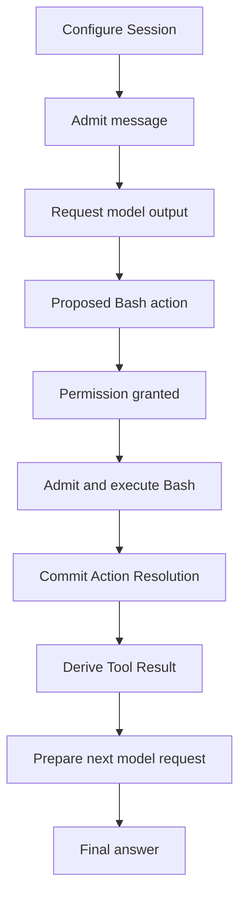
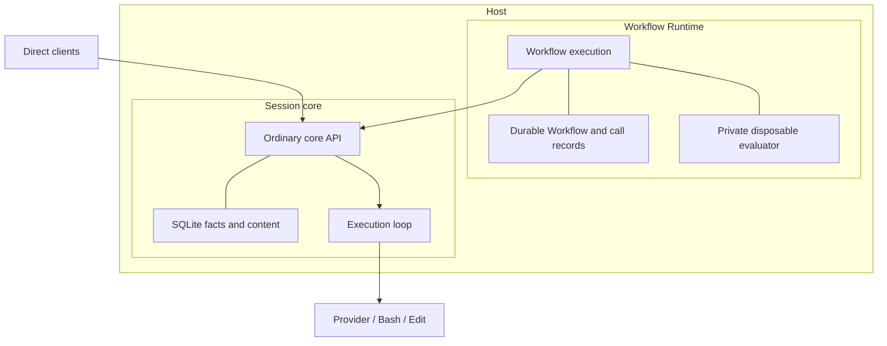
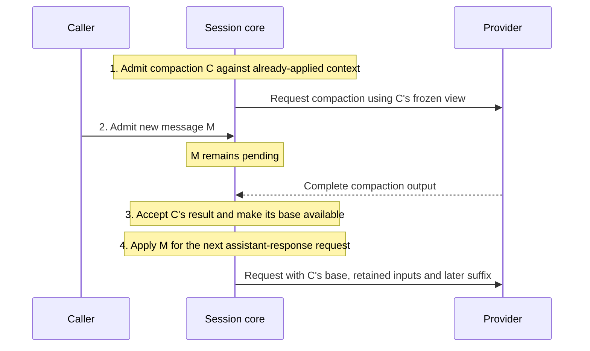
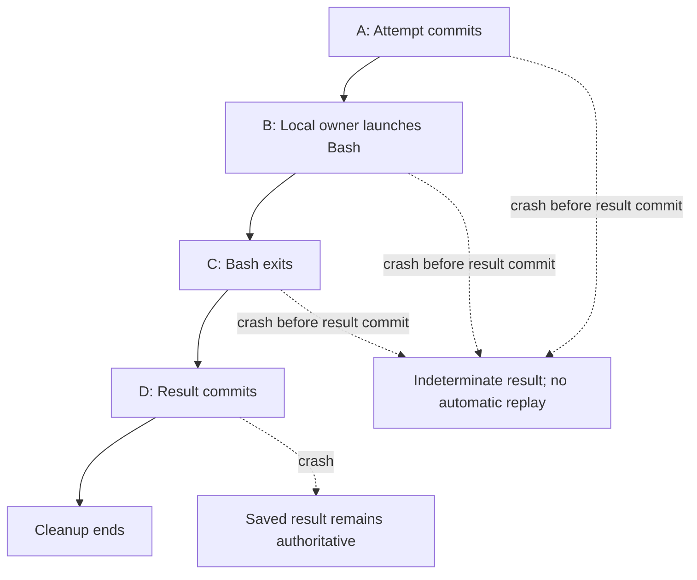

# Rui architecture

This is the accepted V1 contract, not implementation evidence; it includes accepted behavior that is not yet implemented. For runnable behavior and current limitations, see [README Status](README.md#status). [VERIFICATION.md](VERIFICATION.md) owns required evidence.

## Supported guarantees

Rui supports Linux x86-64 and macOS Apple Silicon. Recovery covers a terminated Rui process followed by restart on supported local storage. OS crashes, power loss and storage-device failure are not guaranteed. Existing atomic publication, sync ordering, canonical-state validation and indeterminate-effect rules remain required; narrowing the recovery promise does not excuse a failing functional assertion.

Authorized commands execute with the user's privileges. Permission checks authorize exact Actions, not a filesystem, network or credential sandbox. Rui enforces its own allocation, population and accounting limits exactly. External-process CPU, elapsed-time and termination safeguards are best effort under OS scheduling and I/O; they do not promise hard interruption, descendant containment or exact physical-memory limits. Cleanup retains ownership until release is observed.

## A piece of work from start to finish

Suppose a caller wants an agent to investigate a failing test. The caller explicitly starts the Host, names a Session, configures its Workspace and sends a message. The model asks to run Bash. With the default permission mode, Rui authorizes the proposed action without asking a client. Once admitted for execution, Bash runs; Rui saves its result and asks the model for the final answer.

The caller can disconnect while this work continues. If the Host instead crashes during Bash, recovery reports an indeterminate tool result: the command may have run, so Rui does not automatically run it again. The model can investigate through fresh calls. The sections below define the exact admission, permission and recovery boundaries behind this example.

Read sequentially or jump to the owning contract:

- [Owners and identities](#owners-and-identities): who owns conversations and workflows.
- [Admission](#admission-and-public-requests) and [conversation/settings](#conversation-and-current-settings): configure, submit and recover replies.
- [Model requests](#model-requests-continuation-and-compaction): freeze inputs, retain output and compact context.
- [Tools and permission](#model-output-tools-and-permission), including [Exact Edit](#exact-edit).
- [Execution and recovery](#transactions-execution-and-recovery), then [stops and outcomes](#stops-and-terminal-outcomes).
- [Workflows](#workflow-evaluation-and-cancellation) and their [evaluator containment](#evaluator-containment).
- [Inspection and local protocol](#inspection-and-local-protocol): observe, wait and control work.
- [Host lifetime/platforms](#platforms-and-server-lifetime) and [resources/storage](#resources-storage-and-diagnostics).
- [Remaining decisions](#remaining-decisions): implementation choices and qualification still outstanding.

## Owners and identities

The explicitly started **Host** contains two owners:

| Owner | Responsibility |
| --- | --- |
| Session core | Conversations, model requests, tool authorization, execution and recovery. |
| Workflow Runtime | Workflow evaluation and cancellation through the ordinary core API. Its private disposable JavaScript evaluator computes calls from supplied facts. |

Core and Runtime transact independently and never read each other's tables. They may share a Store and process; the contract does not specify database-file count. Runtime saves an intent before calling core and records core's answer afterward. Lost replies require idempotent resubmission. Cancellation can therefore submit work before stopping it; it cannot roll back core admission. A canonical storage fault fences the whole Host, despite the independent transactions.

The **Host Store** contains canonical facts and content: the committed records that determine saved outcomes and recovery. The **Storage Owner** exclusively accesses core tables. **Content References** identify complete immutable bytes with length/digest and bounded reads. Credentials and diagnostics cannot determine semantic recovery.

| Term | Meaning |
| --- | --- |
| Local Owner | The server/Store owner. All admitted clients act for it; no per-client ACL, delegated Principal or exclusive Session ownership exists. |
| Caller / User / Agent | A Caller invokes APIs; User is the message role, whether person or agent; Agent is the model-driven decision-maker. These roles confer no additional authority. |
| Session / Session reference | One reusable linear conversation, Workspace and access scope. Its opaque caller-provided key addresses it within a Store. Sessions have no terminal outcome or persisted lifecycle phase. |
| Workspace | Working-directory context for relative tool paths, not a sandbox or allowed-path boundary. |
| Turn | Work from taking one or more queued User Messages for processing through a Final Answer or typed terminal outcome. At most one Turn is nonterminal per Session; callers need no Turn key. |
| Operation | One logical model request or Action. It owns its frozen inputs and execution/retry state; once resolved, it owns one immutable Resolution. |
| Attempt | One physical try of an Operation. An Attempt can become uncertain after custody loss; it is not another Operation. |
| Resolution | An Operation’s optional immutable final result. Semantic completion is independent of physical cleanup. |

Each fact has one authority. Each resident allocation has an owner, bounded population and release boundary. Core drives Sessions; Runtime drives Workflows through ordinary core calls. Clients do not sequence internal transactions, dispatch or recovery. Private driving interfaces use direct transactions and effect modules that own their resource lifetimes. Native embedding and Cloudflare Durable Objects are design probes, not SDK, ABI or deployment commitments. Abstractions require concrete consumers or invariants.

### Finding the implementation

This source map locates the existing owners; file boundaries are not part of the behavioral contract. [README Status](README.md#status) owns implementation and qualification status, including the distinction between the private evaluator and public Workflow behavior.

| Responsibility | Start here |
| --- | --- |
| Durable admission, settings, results and recovery | `src/store.zig`: `Store` owns SQLite transactions and canonical facts. |
| Caller request capture and recovery | `src/client.zig`: typed capture, generated/explicit identity, durable records and original-byte transmission. `src/cli.zig` selects HOME/preferences and presentation. |
| Interactive submission lifetime | `src/SessionSubmission.zig`: original Message or Decision, capture facts, same-original retries, joined Admission and release. `SessionInput` owns editing storage and loan tickets; `SessionFrontend` owns consent, presentation, reads and coordinated shutdown. `src/session_departure.zig` selects handoff, re-entry and exit policy from completed cleanup facts and freshly observed interruption. |
| Host lifetime and effect handoffs | `src/server.zig`: Host, execution slots and native orchestration. `src/execution_turn.zig` owns the shared service-turn policy. |
| Attempt bindings, launch permits and cleanup custody | `src/attempt.zig` and `src/execution.zig`: one-shot permits and generation-checked `CustodyPool` records. |
| Model request preparation, transport and interpretation | `src/model_adapter.zig` prepares requests; `src/provider.zig` owns curl and capture lifetimes; `src/provider_output.zig` validates sealed output. |
| Codex authentication and credential storage | `src/codex_auth.zig` owns authentication/refresh logic; `src/codex_credentials.zig` owns private records and cross-process credential leases. |
| Bash process and output lifetime | `src/bash.zig`: preparation, launch, process-group retirement, capture and cleanup. |
| Temporary storage | `src/ScratchBudget.zig` accounts for bytes; `src/named_scratch.zig` retains failed reclamation; `src/output_retention.zig` owns disposable-output retention and eviction. |
| Private evaluator lifecycle | `src/evaluator.zig`: child execution, cancellation, output handoff and cleanup. This is not the public Workflow Runtime. |

## Admission and public requests

### Names, references, IDs and idempotency keys

| Term | Meaning |
| --- | --- |
| Name | Caller-chosen stable text within a documented scope. Session names are local to a Workflow; submission names are local to a Session within a Workflow. These are not freely editable display labels: changing a name can select different work. |
| Reference | Complete value used to address an object. A Session reference is an opaque string such as `workflow/42/reviewer`, not a live handle or lookup operation. |
| ID | Runtime-assigned identity of a durable object, such as Store-wide Workflow ID `42`. Representation and allocation belong to the object's owner. |
| Idempotency key | Identifies a submission across retries so its original committed answer can be recovered. The caller supplies a Workflow creation idempotency key; direct core callers supply a core idempotency key, while Workflow Runtime saves one generated UUIDv4 with each durable submission intent. This does not promise exactly-once external effects. |
| Label | Non-identifying descriptive text. No new label field is introduced. |

Use these qualified terms consistently; do not use a tracing request ID as an idempotency key or confuse a local name with its full reference. The saved core token and the author's submission name serve different boundaries; authors do not generate or encode core tokens.

### Naming and configuring a Session

Clients construct Session references locally, without existence checks, core calls or generated-ID discovery. They unambiguously encode their namespace and local name; core treats the complete reference as opaque, without direct/workflow categories. Equal full references select the same Session across clients. Reuse passes the existing reference unchanged, without another namespace prefix. Workflow `session(name)` scopes names by Workflow identity: replay retains the reference; a fresh Workflow differs. Namespaces separate names, not authority; possessing a reference grants no access.

A complete Session reference may contain at most 128 UTF-8 bytes, including any caller namespace and component encoding. Core validates the complete value before mutation; it does not parse the components or impose separate namespace or local-name limits. Count the value before transport escaping. Reject overflow without truncation or normalization. This bounds reference length, not Session population.

The first complete valid configuration for an unknown Session reference requires a closed provider identity (`codex` in V1), an exact nonempty requested model string and Workspace together. It atomically establishes Session, baseline, Workspace, access scope and request answer.

Later configurations preserve omitted provider/model values and accept explicit equal values. A different provider or model rejects the whole update, without a revision or partial changes. This applies before, during and after work, regardless of saved continuation. Unknown providers reject without fallback.

To use another binding, create a new Session. V1 has no fork, history transfer or cross-provider handoff. The restriction belongs to configuration admission, not permanent storage immutability: Operations resolve their frozen settings revisions, and output retains its producing Operation's provenance.

Other supplied mutable fields apply in admission order; omitted fields remain unchanged. Enforce immutable Workspace/access constraints and supported Core values. An accepted fresh configuration records a revision even for equal values; matching command replay records none. Adapter-owned continuation compatibility is evaluated for the frozen model Operation, independently of the binding admission rule.

Incomplete initialization and messages to unknown Session references reject without partial Sessions. Message admission validates the command and immutable content without provider I/O; acceptance guarantees valid canonical Conversation input if the message is later selected. Configuration enqueues no message; any previously queued input remains governed by the queue invariant when changed settings make it resumable.

No separate creation, reservation, attachment or must-be-new operation is selected.

### Recovering a submission after a lost reply

A **core idempotency key** is a caller-provided value binding one state-changing caller command to core, complete inputs and original committed admission answer: acceptance or definite rejection. Message acceptance identifies one immutable admission to the Session queue; it need not identify a Turn yet. The [processing boundary](#conversation-entries-and-pending-messages) establishes the message's result binding once. Distinct messages processed in one Turn share its result.

Every state-changing caller command to core requires a stable core idempotency key: configuration, message submission, Session stop, Permission Decision and exact Model Interruption. Once committed, its inputs, admission-time selection and original admission answer never change; retries recover that decision rather than select new work. This gives callers one lost-reply recovery rule across intervening work and crashes. Reads and waits observe current facts without retained command identities. Internal driving and effect evidence retain their existing Operation/Attempt authority; this rule does not authorize replay of uncertain effects.

All callers share one Store-wide core idempotency-key domain. Atomically bind the key, target, operation kind, complete canonical inputs and original acceptance/definite rejection with the mutation. Target and kind are bound inputs, not lookup scope; changing either or the inputs conflicts. Recovery requires authorization; a key grants no access.

Core requires an exact UTF-8 string of at most 128 bytes and does not interpret or validate UUID syntax. An empty supplied string remains an identity, not a request to generate one. Runtime and client helpers default to lowercase, hyphenated UUIDv4 text (36 ASCII bytes), generated with platform cryptographically secure randomness. Core enforces bindings rather than assuming tokens are unique; separate clients choosing the same string share one identity.

Recover matching admission answers before checking current conditions; changed inputs conflict without replacement. Every new command needs a fresh key, even with equal inputs. V1 accepts securely generated UUIDv4’s probabilistic uniqueness: core detects mismatched reuse but cannot distinguish a retry from a new command with the same key and inputs.

Retrying old configuration cannot revert later settings; retrying a message recovers the same admission, without enqueueing it again, changing an established result binding or reviving excluded input. An unbound admission remains the same queued work until core takes it for processing. A rejection before Session initialization remains rejected afterward.

Typed results distinguish committed acceptance/rejection, proven key conflict, and failure to establish a trustworthy answer. Conflict preserves the original binding. Invocation/storage failure, malformed envelopes without usable identity and failed commits cannot claim a saved rejection or answer.

Acknowledgment follows durable commit, without provider dispatch or final-answer delay. Configuration completes at admission. Message acceptance completes queue admission; processing and the final result may remain pending.

Observation by core idempotency key returns one of these results:

| Result | Meaning |
| --- | --- |
| Absent | No authoritative answer is recorded. |
| Original rejection | The committed rejection, even if current conditions now permit the command. |
| Original acceptance | The committed acceptance plus current progress for that command. Messages expose queue status, their processing binding/result or exclusion; stops follow their saved selection. |

Progress never rewrites the admission answer. Scalar observations suffice; batching is optional, and reads or waits cannot require every notification.

Before transmission, direct clients durably retain the destination Store, operation, exact key and captured inputs. Immutable retained content references may replace inline payloads; mutable paths or digests alone cannot. Retry helpers reuse that record, not a new token. In-memory retention supports recovery only while the client survives. Recover an uncertain reply by identity, not by guessing from content.

Direct caller capture enforces the decoded per-value content boundary while streaming, before publication or transmission. A stable OS-held lock per record owns capture, recovery and no-overwrite publication. Revisiting that record removes its prior incomplete temporary under the lock; killing a writer releases the lock. The empty lock file remains to preserve one lock inode across openers. This does not reclaim captures at abandoned distinct record paths or legacy PID-named temporaries. A complete published record survives a subsequent directory-sync failure and remains available for recovery, but that uncertain publication returns no transmissible captured owner and cannot automatically send.

The client owns command-specific configuration, Message and Permission Decision capture with a closed choice between a caller-selected generated-record directory and an explicit record/key (including an empty key). Capture pins a read-only reader of its temporary inode before publication, retains that reader across the final flush/rename/directory sync, and transfers its owned record handle only after durable publication; it never reselects the public pathname during that handoff. The CLI announces the saved identity before transmitting the original streamed record bytes; announcement failure leaves the record recoverable without sending. Send failure retains the handle's bounded identity for the caller. Fresh generated recovery opens one record, validates its complete syntax and consumed binding fields, then transmits that same reader's original bytes, never current preferences or mutable source files. This binding reader is not the Host's ordered ingress grammar or domain validator: configuration content stays opaque to Client, and Store still decides admission. An explicit repeat send starts at byte zero even after a lost reply. Closing the handle releases its descriptor, not its saved name; callers close before later observation/waiting. This is one reader per active capture/recovery, fixed content windows and bounded metadata, not a payload tree or request registry. Generated recovery decodes only configuration, Message and Permission Decision records; Session stop and Model Interruption keep their explicit record/retry routes.

Client also owns typed decoding of these five mutation replies before callers interpret admission. One fixed-storage parse validates the complete bounded envelope, consumed-field duplicates, operation/status/replay semantics, echoed Session and control target, and Message decoded length/domain-separated digest and queue admission against the pinned capture. Invalid or mismatched replies are unconfirmed invocations, not durable rejection or proof of noncommit; retain the original recovery key. A canonical invocation failure retains its independent Host-fence authority. Typed facts, original request identity/target and bounded invocation status/type/code are owned values that survive capture closure and response-buffer reuse. CLI renders human and semantic JSON output from this one result, never the raw Host mutation envelope; malformed or mismatched responses expose the typed diagnostic and original request context, not an unvalidated claimed outcome. Outer member order, whitespace, equivalent escapes and unknown fields are not output authority. The receive buffer remains necessary for validation; this is no payload copy/cache or memory-savings claim. Exact domain content and Action argument strings remain unchanged. CLI owns display and workflow, including its existing recoverable-error behavior and fatal canonical-error terminal cleanup. A later worker must delegate to this same operation decoder when integrated, retaining its own custody/lifecycle. Listing/following local handles uses a metadata-only identity projection that cannot authorize transmission and does not scan historical payloads.

Client owns keyed observation and result decoding for checking **one submitted request**, independently of local capture availability. Its owned facts validate the queried key and expose the original operation kind and Session; selected Message callers additionally check these against their saved address. The original admission remains `accepted` even when later work fails or is cancelled. A terminal Message result takes precedence over coarser queue/progress hints; failed/completed processing must carry its Turn/Operation/Attempt binding, while stop-excluded input has a cancelled result without an invented Turn. Supported metadata for CLI and planned workflow consumers is:

| Observation | Supported facts |
| --- | --- |
| Common | Key; absent, accepted or rejected admission; kind, original Session and rejection code when present |
| Configure | Accepted revision and created flag |
| Message | Input text length/digest reference; queue status/admission; scalar Turn/Operation/Attempt; terminal status/code or answer text reference; progress status and nullable actionable Action |
| Session stop | Original selected nullable Turn, admission cutoff and pending/completed semantic completion |
| Model Interruption / Permission Decision | Original Session/Turn/Operation or Action/decision, including retained rejected targets |

One bounded parse validates the entire keyed envelope, consumed duplicates, string-only named statuses/kinds, canonical decimal IDs, content-reference syntax and operation applicability. An omitted field is distinct from invalid present null; only required nullable selection/progress fields accept null. Unknown extensions are syntax-validated and discarded, not retained as a DOM or emitted through ordinary output. Strings belong to fixed-storage facts; returned string slices borrow that value until it leaves scope, independently of receive-buffer reuse. Human and semantic JSON render these same facts. Read failures retain bounded HTTP status/type/code and the queried key; unavailable/failed observation never undoes an earlier admission or proves noncommit. Successful answer and Action-content reads still stream exact domain bytes through fixed windows; partial read failure cannot claim a complete answer. Full's closed inventory remains a separate streamed report. Current and attention snapshot consolidation remain subsequent Client work; [Session-list facts](#public-operations) preserve real Store snapshot cursors, and explicit unconfigured behavior remains unchanged. New supported metadata requires an intentional typed contract, not automatic unknown-field passthrough.

Within the mutation envelope, omittable consequential fields accept a typed value when present, never explicit JSON null: null is not absence and cannot bypass invocation/answer exclusivity or operation applicability. Session-stop `selection.turn` is the exception: it is required but nullable to represent no selected Turn; omission is malformed. Unknown extension values remain syntax-validated without becoming outcome authority.

Global `requests` enumerates filename-valid generated handles even when their record is unreadable or unsupported. Session-local `/requests` filters readable supported identities by recorded Store and Session. Neither listing transmits requests or establishes Host work status.

Runtime saves exact submission identity, captured inputs and one UUIDv4 in its existing intent transaction before core invocation, then records the answer independently; resubmit with that immutable token after lost replies. Core knows no Workflow membership/cancellation. This provides recoverable admission, not exactly-once effects. Controls use the same saved-key protocol; their owners retain command-specific validation, target selection and completion semantics. An original acceptance is immutable even while its completion progresses. A fresh key requests a fresh decision against current state; it does not override an already-settled target.

Retain authoritative intents, retry bindings and content required for original-answer recovery without independent expiration in V1, including after terminal completion. Storage exhaustion cannot silently discard recovery history. This recovery contract assumes committed authoritative history survives; independent database rollback, Store replacement or loss of one owner's history is not ordinary crash recovery. Detectable missing/corrupt authoritative state must not be treated as fresh work.

### Example: acceptance and answer arrive separately

A caller submits “Investigate the failing test” with core idempotency key `message-1`. Core commits acceptance, but the connection closes before the reply arrives. Resending the same identity and inputs recovers that acceptance and its original work; it does not submit another message. The final answer may still be pending. Even after the Session has done newer work, `message-1` remains bound to its original result. A deliberate second submission uses a new identity.

The [workflow identity example](#example-conversation-workflow-and-call-identities) shows how Runtime supplies these identities for workflow calls.

## Conversation and current settings

### Conversation entries and pending messages

**Conversation** is the immutable ordered history of User text, assistant text, Tool Calls, Tool Results and System Instructions. Each entry records its exact causal source and applicable Turn. No edit, deletion or compaction rewrites history. An admitted User Message and its Conversation entry are distinct: **projection** means appending the admitted message to this history. Admission can precede projection, as the pending-message rules below specify.

Messages are immutable admissions ordered within their Session. An admission waiting for processing has no result-producing Turn binding. When no Turn is active, core takes the queued admission-order prefix to begin a Turn; admission of new input may perform that transition in the same transaction. The oldest selected message initiates the Turn. During active work, later admissions wait for its next input boundary without changing Conversation or a frozen model request.

At an input boundary, core selects all eligible pending messages through the observed admission cutoff. One transaction:

1. Rechecks eligibility, stop authority and the parent Turn.
2. Binds the selected prefix to that Turn and appends its Conversation entries.
3. Admits the next assistant-response model Operation and its manifest.

Late selection cannot overwrite a saved stop. Rollback commits none of these changes; input beyond the cutoff stays queued. Each selected message receives that Turn's final text, schema-validated value or typed failure. Its binding is final, with no automatic requeue. Stop or cancellation may instead exclude unselected input and supply cancellation through the controlling fact, without inventing a Turn.

**Queue invariant:** eligible queued input or a completely settled Tool Call group awaiting continuation makes a resumable Session runnable. No additional message is needed. Eligible input is admitted, unselected and not excluded by stop or cancellation. Ordinary continuation and effect-settlement preconditions still apply.

Core discovers work from committed facts after admission, input boundaries, terminal settlement, prerequisite changes and restart. Lost notifications cannot lose work. Eligible candidates receive eventual admission under sustained competition according to [capacity and selection progress](#capacity-and-selection-progress). A finite workload drains when prerequisites become satisfied and admitted lifecycles finish and release capacity. There is no public cross-Session winner order or individual wall-clock wait bound.

Unavailable capacity retains work without execution resources or spinning. A blocked prerequisite leaves input queued. An admitted Operation failure settles selected input through its Turn; a required canonical failure follows the shutdown boundary. Runnable state is derived, not stored as a Session phase, wake receipt or per-Session worker.

Compaction uses already-applied context and leaves pending messages alone. No model-created conversational Input Request exists; permission decisions are separate control facts, not messages. Successful settlement requires no pending applicable message, actionable permission, unresolved Operation or admitted effect, and atomically releases occupancy.

### Selecting current settings

A **Session Context Revision** records persistent configuration from sparse caller updates. Its storage representation is private. It includes provider/model binding, instructions, Tool Catalog, context policy, reasoning defaults, optional output schema, Permission Mode and default output limits.

The revision does not give every setting the same application boundary:

| Setting | Selection boundary |
| --- | --- |
| Model inputs | Model Operation admission. |
| Permission Mode | Child Action admission, when core authorizes the action. |
| Resource limits | The owning execution or resource scope. |
| Host settings | Host startup, outside Session configuration. |

No separate settings store or applied-state machinery is required. Session identity, Workspace/access scope and the V1 provider/model binding are fixed under [configuration admission](#naming-and-configuring-a-session); other supported settings are mutable. Core validates updates atomically. The adapter must establish continuation compatibility for the exact frozen Operation without changing Conversation membership. Revisions do not add provider capabilities.

Defaults apply only when establishing a Session:

| Field | Initially omitted | Explicit value | Later omitted |
| --- | --- | --- | --- |
| Instructions | Empty text | `instructions: ""` selects empty text | Preserve existing value |
| Tools | Bash only | `tools: []` offers no tools | Preserve existing value |
| Permission Mode | `bypass` | `ask` or `bypass` | Preserve existing value |
| Output Schema | Text answers | `outputSchema: null` clears the schema | Preserve existing value |

Omission never clears a field. Settings are ordinary JavaScript data captured at each configure invocation, before later caller mutation. Each Session evolves independently; sharing a settings object creates no shared configuration entity.

Codex **Reasoning Effort** is an optional persistent Session setting. V1 accepts explicit `none`, `low`, `medium`, `high`, `xhigh` and `max`; `none` requests that wire value, not a default. A new Session with no selection uses **provider default**, meaning Rui omits the entire `reasoning` request field, without claiming to know the provider's effective effort. On an existing Session, omitting effort preserves its selection; an explicit `null` clears it back to provider default. The CLI spells the clear as `--reasoning-effort default`, while `--reasoning-effort VALUE` selects an explicit value, both for one-shot `session configure` and interactive `/configure`. An unsupported value rejects the whole configuration update; pi-ai catalog entries do not expand this grammar or validate account/model support. Current inspection and `/status` distinguish an explicit choice from provider default. This setting follows model Operation admission, including compaction and continuation requests; it has no per-Message override or effect on already admitted Operations.

New requests select one committed revision and resolve settings at or before it. No Turn-wide configuration copy, temporary override layer, cross-call lock or historical revision precondition exists. Configuration and subsequent messages can interleave with other clients; later message failure does not roll back configuration.

Queued messages do not capture model settings at message admission. At the next assistant-response input boundary, selected messages use the effective model context selected for that request. For example, while a request is active, admit “review this code,” then configure “focus on security”: if that configuration commits before the next request's selection boundary, the queued review uses it. A configuration committed after that boundary affects later requests; it cannot alter the admitted Operation or its replacement Attempts. Instruction updates remain ordered canonical Conversation facts under the rule below. This model-input boundary does not define when action permission policy changes take effect; authorization follows its own contract.

### Recording and rendering instruction updates

Every successfully admitted explicit instruction update appends an immutable System Instruction to the canonical Conversation, including intermediate reversals and fresh equal values: A→B→A records B and the second A; A→A is an update. Matching request replay adds nothing; omitting instructions creates no update. Identical bytes may share content storage without collapsing distinct entries.

At model Operation admission, core freezes the canonical historical boundary and effective instructions selected for that Operation. The provider adapter owns provider- and model-specific projection of those immutable facts. It may append one wire block per entry, coalesce or lower entries, or use another supported representation, provided the resulting request preserves effective instruction authority and canonical history remains unchanged. No universal wire-block count or placement is a core guarantee.

Commit each configuration revision and its explicit instruction entry atomically. Rollback appends neither. Operation admission and replay derive from canonical originating-update references and the initial baseline, including compaction-covered entries, not text equality or a separate queue/applied flag/receipt. Already-admitted Operations and replacement Attempts retain their frozen historical view; later configuration cannot rewrite it.

With unchanged adapter rules, reconstruction produces equivalent provider input. A deliberate adapter-rule change may alter provider rendering from the same canonical facts without changing their authority, the Operation boundary or Conversation. Adapters should preserve stable provider prefixes where supported, but provider cache layout does not redefine canonical history.

Model-visible time/date/timezone/Workspace binds the adapter's immutable instruction rendering for the admitted Operation; tool observations belong to results. No automatic polling/clock refresh or Turn-environment reconstruction on retry.

### Text and structured answers

An optional persistent **Output Schema** selects a model-generated structured Final Answer; absence selects text. The producing request freezes it. The adapter translates to a supported provider mechanism and validates response/schema in the bounded validation path; workflows receive that value without a second interpretation. Unsupported schemas, refusal, incomplete generation and invalid output fail explicitly. No prose conversion, repair call, per-caller schema or reinterpretation under later settings is permitted.

## Model requests, continuation and compaction

### Operations and frozen requests

An **Operation** is one model request or Action, owning its exact descriptor, causal source and current execution/retry facts. Its optional **Resolution** is its immutable final result; the Operation ID also identifies that result. A retry is another [Attempt](#admitting-an-attempt) of the same Operation; a model request admitted against new context or settings is a new Operation.

Each model Operation owns one immutable **Model Request Manifest** binding its protocol operation, provider and exact requested model through its frozen Session settings revision, historical input view, reasoning/output limits and output contract. References/digests identify canonical content; runtime facts retain their original rendering references. Session facts and Operation admission share one committed per-Session order on their owning records, without a duplicate payload log. The Operation's admission position fixes its historical boundary. Accepted model output, call rejection and Action Resolution become available at their acceptance positions, not a producing Operation's earlier admission position. Historical visibility does not bypass pending-input applicability, expose an incomplete Tool Result group or change Conversation/tool-call order.

Replacement Attempts retain that historical view. With unchanged adapter rules, they reconstruct equivalent request semantics; meaningless JSON spelling need not match. The caller may deliberately change adapter selection/rendering rules between Attempts, so identical requests across such a change are not promised. This does not mutate historical Session settings, provider binding, output contract, saved effect authorization or retry accounting, or permit unsupported continuation. No frozen adapter implementation/version is required. Credentials, endpoints, sockets, transport and nonsemantic headers remain late-bound.

### Agent identity and peer composition

Every assistant-response and compaction request includes compact Rui-owned JSON context containing the canonical `store` selector and exact opaque `session` reference. The adapter derives the address from the originating Operation, including on replacement Attempts. It reconstructs this context after compaction and normal Host restart, separately from user instructions. JSON escaping preserves complete values, including NUL-bearing references. The address is not a PID, execution slot, Workspace or provider continuation identifier, and grants no additional authority.

The context also includes a short discovery hint for installed `rui --help` and scoped command help. Ordinary Bash can invoke `rui` through a controlled PATH and HOME. This does not inherit the Host's complete environment or credentials. No identity tool, peer tool, alternate CLI-path variable or bundled skill is required.

Agents compose ordinary Session configuration and Message admission through the CLI. A supplies its reply address and any correlation in ordinary message text. B later sends a new User Message to A. The receiving Session uses the existing input boundaries, pending-prefix selection, stop exclusions and original-result guarantees. There is no separate inbox, sender field, callback, parent-child ownership or resident waiter for a future reply. Dormant peers retain only saved facts.

The first demonstration uses one Host. A caller can explicitly target another accessible local Store through the same CLI capability. Remote-machine routing and distributed storage are outside this contract.

### Retaining accepted output

Retain accepted model output losslessly in provider order as immutable **Model Output Items** owned by the resolved Operation. Store semantic, private continuation and required response-evidence fields once with producing request/Attempt provenance. Commit Resolution, items and applicable Conversation projections atomically. Derive replay input by stripping response-only/non-replayable fields; persist neither a second replay copy nor a serialized request body. Preserve unknown open fields within known items. Private reasoning, encrypted material, signatures and compaction items remain opaque and inaccessible through generic content reads.

Unknown consequential discriminators—item, content block, Action subtype, compaction variant or terminal status—produce `unsupported_provider_output` with bounded typed rejection and necessary request/causal provenance, without Conversation, continuation or effects. Complete rejected payloads are optional diagnostic detail, not mandatory permanent history. Raw HTTP/SSE framing, token deltas and partial/interrupted/late output remain scratch, never continuation authority.

### Choosing and validating compacted context

**Model Context** is an optional selected Compaction Base followed by one complete ordered suffix of canonical host input and accepted model Operation results, with the binding-specific retained inputs below. A **Compaction Base** is the derived role of an accepted compaction result selected within a later Operation's view. Its producing Operation's admission position is the covered frontier: compaction uses that Operation's historical view, and later applicable inputs form the suffix. The result's ownership identifies this boundary without a separate input list or coverage record. Derive prior bases within that view; retain no copied request body, checkpoint row or permanent history of failed Attempts. Provider caches/previous-response IDs are optional only when their loss permits local reconstruction.

User Messages have no token-admission quota and are never silently split or truncated. The configured **Compaction Trigger** estimates pressure, anchoring on provider usage where available and estimating newly appended content; it is not a content ceiling. Before pending input is applied, compaction may cover only existing context; afterward, the next assistant-response request includes all pending messages and instructions, including arrivals during compaction.

The provider capability owns model-specific policy defaults. Session configuration stores only nullable overrides for `compaction_trigger` and `output_reservation`. An omitted update preserves the override. Explicit `null` resets it to provider/model policy, spelled `default` in the CLI. Triggers are positive token counts; output reservation is nonnegative extra heuristic headroom, not a provider output limit. Current inspection and `/status` show effective values and whether each value is a Session override. Resolve policy once before purpose selection and freeze the effective values on the admitted Operation. Later settings or capability changes cannot change its purpose or retry policy.

Only a valid total-token count or a complete pair of valid, uniquely named input/output counts can anchor pressure. A valid total takes precedence over unusable split counts. Incomplete, invalid or duplicate split counts otherwise fall back to retained-context estimates; a missing counter is not zero. Nested fields do not participate in this top-level pair.

Codex's exact `gpt-6-luna` binding defaults to a 244,800-token trigger and zero extra output reservation, following the [pinned client metadata](research/compaction-prior-art.md#codex). Unknown models have no inferred automatic trigger. An explicit override enables one without claiming a model capacity or entitlement. Pressure uses valid usage from the latest accepted same-binding output plus estimates for appended input and extra reservation; without valid usage it estimates retained context. The threshold fires at equality. The assistant successor of a compaction applies pending input even if the estimate remains above the threshold. Provider-reported overflow still permits recovery without a configured trigger; unchanged context after an accepted base, or overflow during compaction itself, fails with `ResourceExceeded` instead of repeating compaction.

Overflow recovery applies only within an active Turn. A terminal Turn's overflow does not force compaction in a new Turn; evaluate proactive pressure independently. The compaction-successor exemption follows the same pending input even if compaction fails before projection. A Session stop excludes that pending prefix, so the exemption does not suppress proactive checks for later work.

Context overflow reported before accepted output or effects resolves the rejected Operation without removing its applied input. Local preparation and remote overflow use the same compaction policy unless their evidence changes trustworthy retry behavior. Compaction covers that context; continuation gets a new Operation and manifest, not an equal-manifest retry. There is no separate compaction-attempt limit, aggregate Turn request allowance or whole-Turn deadline.

Select the newest accepted base in the current lineage, then validate that exact base and complete suffix:

| Owner | Validation |
| --- | --- |
| Core | Lineage, completeness, content/digests and stored format. |
| Adapter | Demonstrated wire compatibility. |

Both checks must pass; no validity flag is stored. Failed or unresolved compaction cannot replace a base. Unsupported or incompatible selected material fails `continuation_unavailable`, without falling back to an older base or reconstructing from visible Conversation. Missing or corrupt required canonical state fences the Host instead of failing only the Operation.

Configuration changes do not prevalidate or discard saved continuation. Request preparation validates the frozen Operation's selected recipe. Codex initially restricts continuation to the same requested model binding and records requested/served-model evidence; actual provider qualification requires adapter evidence even though V1 configuration admission fixes the Session binding. Incompatible continuation fails that Operation with `continuation_unavailable`, without replaying it or dropping private meaning. If complete retained input still cannot fit, fail with `ResourceExceeded` under terminal-settlement rules. Never discard pending instructions to fit or impose a durable-history limit.

### Example: compaction coverage and availability

C covers the historical view fixed at step 1. Acceptance at step 3 makes the base usable; it does not expand coverage to include M. The [Codex recipe](#response-owned-compaction) specifies which covered host inputs and output items the provider request retains.

### Adapter historical reads

Core supplies an Operation-bound read-only view for request preparation. Only the Storage Owner accesses SQLite; adapters receive no connection or caller-chosen cutoff predicates. The view provides:

- historical settings, applicable host inputs and accepted model results;
- complete model output in provider order, including private objects with no Conversation projection;
- each Tool Call's sole rejection or Action Resolution, complete terminal coverage at the manifest boundary, and derived Tool Results streamed in call order;
- a compaction anchor identifying its producing Operation and item ordinal, with traversal from that item through the end of the same output.

Core owns visibility, source relationships and structural coverage. The adapter owns provider interpretation, context selection and wire encoding.

For managed Codex, derive one opaque cache-affinity value from the Store selector and exact Session reference, not from an Operation, Attempt or current configuration revision. The adapter sends its lowercase hex form as `session-id` on every transfer, including tool continuations, retries and fresh-Host reconstruction, and sends `originator: rui` to identify the client. Different Session references or Store selectors yield separate affinity values without another durable identity or a raw Session name/path in the headers; recreating a Store at the same selector deliberately derives the same value for the same reference. Neither header is canonical authority, a provider-retention promise or a prerequisite for cache-independent reconstruction. A cold-prefix native comparison found immediate reuse with `session-id` but not with `prompt_cache_key` alone; this selects the tested header without claiming a 100-Session cache-hit target.

Use closed semantic variants and opaque view-scoped handles, not storage rows or a generic query language. Generic content access cannot open private continuation; the provider view grants the appropriate private reads without implying wire compatibility. One shared, pointer-stable preparation owner retains the admitted Operation/Attempt binding, historical view and active reader, charged scratch, encoder/replay cursor and cleanup state. There is at most one such owner across all execution slots; it is resumable orchestration state, not durable authority, a worker or a prepared-request queue. Borrowed record metadata expires on reader advance; opaque handles remain stable until view release, and payload reads use bounded caller buffers. No SQLite transaction spans adapter processing or network activity. Historical retention must preserve referenced versions through required recovery; an expired or foreign handle is programmer misuse, while missing/corrupt content and resource/storage failures are explicit failures.

Preparation advances under both byte and item allowances, then returns to the **lifecycle-service boundary**. This boundary reconciles accepted controls, advances Bash preparation/processes and services due ordinary and retained cleanup.

Each execution turn services that boundary before and after admission, consumes at most one provider completion, services the boundary again, then advances preparation once before deciding whether to wait. Both scanned source bytes and emitted or copied bytes consume the byte allowance, even when replay discards a field. Retained items and discarded replay fields consume the item allowance. Large scans and many small items must therefore yield. Every turn gives preparation a bounded progress opportunity, so finite work drains without a completion burst or large history monopolizing orchestration.

Control publication is a hint. The lifecycle owner also reconciles canonical control facts on its bounded fallback cadence, so a lost or coalesced hint can delay but cannot suppress cancellation. Before transport handoff it rechecks superseding controls; stop or shutdown cancels preparation, closes readers and prevents launch. Canonical read faults fence dispatch. Ordinary read, encode, write or seal failure settles the admitted Attempt under existing policy. Scratch unlink or other unconfirmed reclamation retains actionable custody and accounting and blocks unsafe reuse; established cleanup releases it exactly once. Restart derives work only from canonical Store facts and removes owned scratch before admission or refuses startup. No preparation cursor, queue position or completion hint is durable.

Preparation writes the complete provider request into charged scratch before transport can consume it. Stream large strings, opaque objects and unknown open fields; do not decode complete payloads or retain an item-count-sized collection. Preserve exact historical order and bytes while removing only demonstrated non-replayable fields. Source integrity, output completion and scratch sealing must succeed before the existing atomic transport handoff. Partial read, write or capacity failure cannot expose an incomplete request.

Concurrent Codex Attempts to one origin share a lazily established HTTP/2 connection population: at most \(\lceil C/100\rceil\) connections for configured Active Capacity \(C\), with a local 100-stream-per-connection limit. Peer limits may queue work inside curl instead of enlarging that population. One easy handle, sealed request and capture remain owned by each Attempt; a connection, TLS session or stream has no semantic authority.

Negotiated HTTP/2 is required on HTTPS; the deterministic loopback HTTP/1.1 route stays supported under the same connection bound. The pinned curl patch rejects a completed H2-only TLS handshake without `h2` ALPN before sending a POST; only its explicit handshake diagnostic means H2 is unavailable. An H2 stream may fail before curl records a response version, and retains ordinary transport-failure ownership. A reused connection with no response cannot authorize an automatic POST resend; only an HTTP/2 refusal proving no application processing may replay the rewindable sealed request within its original Attempt. Otherwise the ordinary Attempt transport-failure owner decides replacement and allowance. Cancelling or failing one stream leaves siblings independently owned; the reactor alone releases shared connection state.

The per-easy upload buffer is 16 KiB. Pinned curl starts and maintains 16 KiB of receive credit per H2 stream rather than granting 10 MiB to each active stream; its 100-stream connection credit follows at 1,600 KiB. This constrains in-flight bytes when capture pauses, without truncating output or reducing concurrent streams.

The execution owner accepts callback bytes into one fixed 16-entry, 16-KiB-per-entry capture queue; a single worker writes and seals the Attempt-owned scratch outside reactor callbacks. A full queue pauses the current curl stream without accepting its bytes; later resumption redelivers them. Resumption may synchronously invoke capture callbacks: their failure settles only that Attempt, with queued writes drained before custody release; only a reactor or ownership failure fences the Host. Cancellation detaches the transport immediately but retains its capture/custody until queued writes drain; settlement and source handoff wait for drainage and successful seal.

After finalization and native completion service, receive advancement starts after the last progressed slot. One execution-owned cursor prevents a repeatedly re-paused early slot from monopolizing resumption. Each scan samples shared queue room once, so a concurrent writer drain cannot let a later slot bypass an earlier paused candidate. A full-queue scan still handles capture failures and expired queued transfers. This preserves one advance per turn and existing completion priority, without equal-byte shares or an individual completion deadline.

The queue bounds Rui-owned pending capture bytes to 256 KiB even when disk writes stall, but curl retains rejected callback bytes and in-flight H2 data per paused easy handle outside that queue. Its pause cache, TLS and socket buffering need separate resource qualification; worker blockage may delay capture settlement and infrastructure shutdown cleanup, but not execution-owner control service.

Loopback H1 exists for deterministic local semantic tests, not as a managed HTTPS fallback or proof of multiplexing. With one allowed connection below capacity 100, its requests progress serially; a fixture that withholds the first response until all \(C\) requests arrive must use TLS/H2. Retaining this bounded local route avoids making ordinary Store/recovery fixtures implement H2 streams and TLS, while transport and concurrent-resource qualification exercise the actual H2 interface.

Native transport completion is not response readiness. The Transfer retains its capture while accepted writes or a seal are pending, gives late capture failure precedence over transport success, and exposes a final local outcome only after drainage. A control detaches the easy handle immediately but keeps the Transfer until the same drainage condition makes destruction safe. The Host consumes that final outcome for Attempt settlement and custody; it does not infer capture readiness or repair preliminary transport metadata. The local pause timestamp is the single pause fact for both curl resumption and inactivity accounting, including synchronous re-pause during resumption.

Transport retains the completed scratch through its cleanup boundary. The [adapter-view experiments](research/README.md#provider-wire-contract) support this shape, not production qualification.

### Codex wire binding

The [pinned evidence](research/README.md#provider-wire-contract) selects the ChatGPT Codex `POST /backend-api/codex/responses` route with `store:false`, `stream:true` and explicit `include:["reasoning.encrypted_content"]`. Freeze the requested model string and behavior-affecting request settings in the manifest. Rebuild the full local input recipe; neither `previous_response_id` nor a provider conversation is required. Explicit inclusion avoids depending on changing defaults. Render an explicit frozen effort as top-level `"reasoning":{"effort":"VALUE"}` and provider default by omitting the entire `reasoning` field, not by sending `none`, `null` or `{}`. A replacement Attempt reconstructs the originating Operation's effort even if the Session has since changed it. Provider rejection is that Operation's visible failure, without automatic effort downgrade or model substitution. Render the frozen baseline once as top-level `instructions`; render later applicable instruction updates in canonical order as `developer` input messages, not a second baseline or a flattened final update. This follows the first-party managed Responses builder; it does not by itself prove the live backend accepts Rui's complete recipe. A reasoning summary is optional visible explanation, not the private reasoning needed for continuation.

The adapter prefixes top-level `instructions` with Rui's local coding-agent role and the immutable Session Workspace from the Operation-bound historical settings, followed by the saved baseline under `Session instructions:`. Render Workspace as a JSON string literal labeled as path data, with its quotes and escapes preserved after decoding the outer request. Directory-name newlines must remain escaped path content rather than instruction-section boundaries; Bash still receives the exact saved path. This runtime context does not modify saved Session instructions or append Conversation entries. Replay reads neither the Host's cwd nor the caller's current directory. Tool definitions own filesystem/cwd behavior and timeout selection; timeout results own the effective budget and recovery guidance. Static prompt text is an adapter rule, not a copied per-Operation setting.

Accept completed items in provider output order, not token-delta arrival order. `response.output_item.done` supplies complete items, including final encrypted content; an added item can still be incomplete and establishes only index/kind/ID agreement with its done item, not content agreement. Require successful `response.completed` before settlement. The managed route can send an empty `response.completed.output` after completed stream items; this does not discard those items, while any nonempty terminal output must match all of them in order, kind, ID and exact raw item bytes, including unknown open fields and JSON spelling. Failed, incomplete, disconnected or contradictory streams cannot publish a successful candidate. Keep response ID, provider request correlation when supplied, terminal status, usage and reported model evidence with the producing Operation/execution; none is a replay input item.

For the V1 text/function subset, the replay transformation is the original ordered item with only item-level `created_by` removed. Preserve the following fields when supplied, including absence versus null and all unknown fields inside supported open records:

| Record | Values retained for replay |
| --- | --- |
| `reasoning` | `type`, `id`, `summary` (ordered `summary_text` records with their `text`), `content` (ordered `reasoning_text` records with their `text`), exact `encrypted_content`, `status` and provider metadata. Empty summaries do not justify dropping the item; absent or empty encrypted continuation fails `continuation_unavailable` for this binding. |
| Assistant `message` | `type`, `id`, `role`, `status`, `phase`, ordered `content`; `output_text` retains `text`, annotations and log probabilities; `refusal` retains its text and remains a refusal under the output contract. Preserve `commentary`/`final_answer` phase when present; absence is not a fabricated phase. |
| `function_call` | `type`, `id`, `call_id`, `name`, exact JSON-string `arguments`, `status` and supported metadata. Host-produced `function_call_output` uses that exact `call_id` and the canonical Tool Result. Item ID and call ID are distinct. |
| `compaction` | `type`, `id`, exact nonempty `encrypted_content` and supported metadata. The item remains private. |

IDs and item statuses are input-supported fields, not response-only merely because the provider supplied them. Do not turn assistant `output_text` into user `input_text`, decode/re-encode opaque strings, reorder calls, or discard annotations. The first-party SDK also removes its own `parsed`/`parsed_arguments` conveniences; Rui receives raw wire JSON and creates none, so an unknown raw field with that name is not automatically disposable. Preserve `created_by` in canonical output even though replay omits it. Transport framing, response envelopes, usage and correlation remain producing-response evidence rather than being appended to `input`.

The Codex source also recognizes legacy reasoning `text` and `compaction_summary` variants; V1 rejects them pending replay evidence rather than normalizing or dropping them. Close consequential variants before accepting any output: item/content type, role, phase, status, annotation variant and Action control. V1 accepts only its text/function tool catalog, not provider-hosted tools, tool programs, namespaced tools or encrypted function arguments. Known controls requesting those meanings (`caller:program`, asynchronous execution, a nonempty namespace or encrypted arguments) reject as `unsupported_provider_output`; preserving an unknown open field does not authorize an effect. Provider metadata cannot fabricate host-owned tool records, permissions, instruction updates or completed work. Reject provider-supplied `cell_id`, `executed_tool_calls` or `tool_calls_complete` in `internal_chat_message_metadata_passthrough` rather than promoting them to local authority. Preserve other open metadata privately with its provider provenance.

Requested identity and served identity are separate facts. Retain the exact requested string plus available `openai-model` HTTP header, `openai-model`/`x-openai-model` response-header metadata and response-body model; missing served evidence stays absent. Conflicting evidence is not silently rewritten into the requested identity. The initial compatibility rule permits the same requested binding and replay format with retained local material; aliases are not resolved by stripping dates or matching families. Source examples and synthetic fixtures establish serialization/reconstruction, not backend decryption or lossless cross-model reasoning. No cross-model continuation is qualified. A provider rejection of saved continuation fails explicitly, without retrying after deleting reasoning. Native same-model qualification exists for exact `gpt-6-luna` on Linux x86-64 and macOS arm64; other models remain unqualified.

### Authentication and transport lifetime

The V1 model adapter owns Codex request grammar, output interpretation, managed-route headers and authentication policy; the shared transport owns curl, sealed bytes and caller-selected response-header observations. Core stores no credentials; Host schedules acquisition and holds an opaque credential lease through the final launch check without interpreting its contents. Resume uses persisted provider binding, without fixture/provider substitution. Refresh preserves account binding; decoded trusted-TLS-peer token claims are routing metadata, not independently verified identity. Encode provider strings with one bounded JSON encoder including all required control escapes and worst-case expansion. Before header reuse reject NUL/CR/LF/other ASCII controls and non-ASCII token/account bytes. Accept header-safe opaque access tokens as well as compact tokens; when a token has compact syntax, require three nonempty segments and validate any consumed `exp` claim. The pinned first-party login tests accept opaque tokens without `exp`, so treating it as mandatory would reject supported exchanges. Account IDs are nonempty opaque exact strings, not UUIDs. No independent token/account length quota, JWT verification/JWKS/discovery or generic OAuth framework; bounded credential/encoding owners fail explicitly on exhaustion.

`rui auth login codex` uses the pinned device-code flow and installs one global account in an owner-only `~/.config/rui/codex.json`, or an absolute path selected by `RUI_CODEX_CREDENTIAL_FILE`. `rui host serve --codex` activates the fixed HTTPS subscription endpoint; it cannot be combined with a development endpoint or private CA. Configuration and saved-result inspection need no credential. The credential file and stable lock live in the same private directory, reject symlinks, wrong ownership and permissive modes, and carry a closed versioned format. There is no Session account binding or Codex CLI credential fallback.

The credential owner serializes mutations across Hosts and login processes. Login advances a generation. A compact access token with `exp` refreshes near expiry; otherwise Rui refreshes eight days after the last successful exchange. The ID token does not determine expiry.

Refresh follows these steps under one stable exclusive lock:

1. Durably replace `ready` with `refresh_pending`.
2. Perform the remote exchange.
3. Verify the same account ID and FedRAMP routing claim, then durably install the replacement. A changed claim leaves the record pending and requires explicit login.

A competing Host waits outside Store/Host launch locks, then reads the committed generation. A claimant crash releases the lock but leaves `refresh_pending`. Explicit login is required rather than retrying a possibly consumed token. Remote rotation and local replacement are not one transaction.

File replacement writes a same-directory temporary, syncs it, atomically renames it and syncs the directory. Abandoned temporaries are never authority. A stable shared lock and immutable record protect the final model launch check: waiting work selects the latest generation, while launched work retains copied headers through curl teardown.

One Host-wide authentication worker constructs each Lease in final storage and lends its pointer through header copying and launch. It wipes and releases the Lease before another acquisition or shutdown. File and network waits occur outside Store/Host launch locks. Failed load, refresh or save returns an explicit authentication/backend failure, with no model request or alternate backend. Rui-owned private buffers and native header copies are released after their last consumer; this guarantee excludes native TLS copies.

The worker's credential and network descriptors can coexist with Bash spawn and admitted clients; startup budgets them independently of the serial execution transition. Per-transfer HTTP version, connection reuse and hashed correlation are opt-in test-phase traces, not routine Host stderr output: diagnostic backpressure must not be required for ordinary settlement. All Host warnings and traces use the [shared optional stderr contract](#shared-optional-stderr); diagnostic loss has no canonical authority.

Credential preparation does not grant another model dispatch: HTTP authentication rejection returns evidence to core under the ordinary failure policy. DNS/TLS/library/capture failures likewise retain their distinct cause and launch uncertainty; cancellation requests local teardown without asserting remote termination. Transport owns callback/header/request lifetimes through teardown and exposes neither credentials nor native mutable handles to core settlement.

### Response-owned compaction

V1 selects the current Codex client's evidenced response route: a compaction Operation appends a request-only `{"type":"compaction_trigger"}` to its frozen complete context and uses ordinary Responses streaming. The trigger is derived from the manifest's protocol operation, never a Conversation entry or accepted output item. The source demonstrates this path; absence of a standalone call in that client does not prove that the subscription server rejects `/responses/compact`. Generic API documentation does not establish subscription endpoint availability. V1 depends on neither that endpoint nor automatic `context_management` support.

Require a completed response with exactly one nonempty supported compaction item for explicit compaction. Store the complete ordered output once on that Operation. The base anchor is its Operation ID and the compaction item's ordinal within that canonical output.

Derive the replacement recipe from the covered original host User/System Instruction inputs in their original order, then the slice from that item through the end of the same output, then the complete later suffix. Retained host inputs are existing canonical references recovered through the source recipe, including earlier bases; never copies or a newly stored request body. This derives from the subscription client's retained user/developer input shape; retaining every host input without truncation is Rui policy awaiting live qualification. It avoids assuming that the encrypted item alone replaces those inputs. If retained inputs cannot fit, fail explicitly.

No separate replay object, checkpoint relation or copied compacted window is needed. A compaction Operation produces no tool execution or Conversation projection; an unexpected Action rejects the candidate. Its producing Operation's admission position fixes the covered frontier, including the prior base and all already-applied inputs/results within that historical view. Result acceptance determines when the new base becomes available, not what it covered. Pending messages and later instruction updates remain outside that frontier and appear once in subsequent context.

Keep call/result pairs intact when selecting the frontier. Missing/duplicate compaction, unknown compaction variants, truncated output and unresolved/failed compaction cannot advance it. If a supported assistant-response protocol later enables automatic compaction, its base must likewise be a slice of that producing Operation, retaining every item after the anchor; it cannot invent a separate compaction result or drop later calls. That route needs its own capability evidence before enablement. Do not copy another client's message truncation, local-summary or model-fallback policy. The encrypted item is provider-produced compressed context, not a promise of verbatim model recall; canonical Conversation remains unchanged.

## Model output, tools and permission

### Accepting an answer or tool calls

A valid model response contains assistant-only output or an optional assistant-text prefix with ordered Tool Calls. Before atomic admission, validate the complete provider candidate: terminal agreement, supported consequential variants, item order, required field types, nonempty required provider identities and unique item/call identities must establish exact trustworthy call envelopes. A malformed or contradictory envelope rejects the complete candidate; no prefix, call, rejection result or Action is admitted. Preserve each trustworthy call's exact item ID, call ID, name, raw argument string, originating ordinal and supported provider metadata.

A **Tool Call** is one trustworthy model-proposed invocation. Classify every Tool Call against the proposing model Operation's frozen Tool Catalog in the same admission transaction. An unknown tool, malformed argument JSON, wrong argument shape or deterministic descriptor failure receives an immutable bounded rejection result owned by that model call. Its derived Tool Result identifies the unknown tool or invalid arguments without exposing parser, storage, permission-policy or approval-audit internals. It creates no Action, Permission Request, Authorization, Attempt, custody or dispatch authority. Do not repair, coerce or reinterpret the arguments. Valid siblings remain admissible; candidate import still commits every prefix, call, classification, rejection and Action consequence together or none.

Each applicable Tool Call creates one child **Action Operation**, the unit of executable work whose permission and result core owns, linked to its model parent and stable call ordinal. Keeping rejected calls outside Action preserves the invariant that every Action has a canonical executable descriptor. No Step/group entity is required. Actions run and settle independently, including within one Workspace.

Bash arguments require `description` alongside `cmd` and `timeout_ms`. The description is nonblank, single-line, valid UTF-8, and at most 100 decoded UTF-8 bytes. Validation counts decoded bytes, not JSON spelling, characters, or display columns. Missing or invalid descriptions receive the ordinary invalid-arguments rejection; Rui does not repair, fabricate, or accept a compatibility form. The original argument string remains canonical and unchanged.

The tool schema guides descriptions toward a base verb, concrete target, and useful scope, in sentence case without trailing punctuation. It recommends 40–60 characters and excludes status, safety, and success claims. These are wording guidance, not prose-quality validation. Observed state and outcomes come from core facts, never the model's description.

Each call rejection or Action Resolution owns its canonical result content and Conversation acceptance position; siblings settle independently and never rewrite one another. Once every Tool Call has exactly one outcome, the next model Operation may start without another user message. Its frozen core-owned historical view joins each original call to that outcome and derives one provider `function_call_output` with the exact call ID in original call order. The complete group precedes input selected at the same boundary. No copied Tool Result, result batch or publication marker is durable authority. Physical completion order cannot reorder provider input. Call rejection, Action denial, failure, cancellation and uncertainty all produce results.

### Authorizing exact actions

The model-visible **Tool Catalog** contains definitions/schema/result contracts, not execution authority. The closed executable mapping is `bash` and `edit`; Session configuration selects the offered subset. Classify proposed Tool Calls against the proposing model Operation's frozen Tool Catalog, not the latest Session configuration. Removing Bash while that model request runs changes future model requests, not the applicability of its Bash proposal. A later Operation that was not offered Bash can still contain a trustworthy Bash call envelope, but classification saves its rejection result and creates no Action. Execution still requires the exact Action authorization below.

Core owns and enforces Permission Mode per Session. Workflow Runtime configures the Sessions it uses through the ordinary Session configuration API, as other authorized clients do; clients present exact Permission Requests and submit decisions. Mode persists across client disconnect, Host restart and later Session reuse until explicitly changed. Bypass therefore permits unattended progress without a connected approver; ask retains unanswered requests durably for a later client, without a resident client or per-Session worker.

Sharing a Session shares its permission policy under ordinary configuration ordering. Concurrent use by multiple Workflows is technically possible but is not an intended V1 usage pattern and has no coordination or isolation guarantee; it adds no Workflow-local grant, policy copy or lifetime. One retained policy and one application boundary keep unattended work explainable without coupling authority to connection lifetime.

**Authorization** durably permits one exact validated Action. At applicable-Action admission select current Session Permission Mode, default `bypass`, and save descriptor plus configuration provenance. Rejected Tool Calls never consult permission policy.

`ask` creates one immutable Permission Request; `bypass` directly creates Authorization. Siblings admitted together share that view. Permission Decisions allow once or deny one exact request/Operation/descriptor under Local Owner authority; server access never implies bypass.

Later mode changes neither answer pending requests, revoke existing authorizations nor stop running actions. Model-request settings do not authorize later Actions. Recovery reuses saved permission facts, not current mode; rollback creates none. Authorization may wait for capacity without an Attempt. No Workspace isolation, global Action serialization or concurrent-writer coordination is promised.

An authorized Bash command runs as the user and can access the user's files, network and credentials. The authorization protocol is not a sandbox. Evaluator capability restrictions below apply to that evaluator interface, not arbitrary authorized commands.

### Exact Edit

#### Proposal and line coordinates

`edit` accepts one existing-file path and a nonempty replacement list. Each entry supplies one-based start-inclusive/end-exclusive whole-line coordinates, expected text and replacement text, all against the same execution-input state. Reject overlap; adjacent nonempty ranges are allowed. Combine insertions sharing a position or lying inside/at another replacement boundary. No search, relocation, fuzzy matching, replace-all, multi-file batch, file creation/deletion/rename/mode change or whole-file freshness guard exists. Empty replacement deletes text, not the file.

LF separates lines; CR in CRLF remains exact. An empty file has zero lines; a final nonempty unterminated segment is a line; trailing LF adds none. For N lines require `1 <= start <= end <= N+1`. `[4,7)` selects lines 4–6; `[4,4)` inserts before 4 with empty expected text; `[N+1,N+1)` appends, including `[1,1)` in an empty file. Expected text includes selected terminators. Replacement bytes are literal: no normalization or implicit newline; appending to an unterminated line joins it unless replacement begins with LF. Insertion checks position only; replace adjacent context to demand text freshness.

#### Preview and authorization

Save/display the submitted proposal after shape validation without reading target. Preview is proposed snippets/coordinates, not verified current content. Authorization binds exact path/ranges/text. Bash supplies reads and file/directory creation: number before slicing to preserve coordinates (`cat -n -- file | sed -n '40,80p'`); display numbers are not expected bytes and truncated output is no snapshot. Missing Edit targets fail. Ordinary absolute/relative filesystem access applies without Git tracking, repository membership or Workspace containment rules.

#### Checked copyback and cleanup

After authorization and Attempt admission, Edit:

1. Opens the existing target without creating or truncating it.
2. Checks eligibility and every expected slice while streaming the complete edited output into charged, immediately unlinked scratch.
3. Copies the completed output through the same target handle, then sets final length and flushes.

A mismatch, read failure or scratch failure before step 3 leaves the target untouched. Edit never pretruncates or rename-replaces the inode; empty output makes truncation the first mutation. A partial write, truncate or flush failure may change bytes. Report actual evidence or uncertainty, not rollback or false success.

The canonical descriptor is read-only. Keep its readers, the same target handle and the one output scratch through their final consumers and pending I/O, closing before custody release. Completed scratch is copyback input only. Cancellation/partial copyback cannot release a buffer still used by I/O; read failures after mutation cannot claim not-applied.

Edit owns target/scratch/buffers/offsets/cleanup within one trusted in-process module, with bounded service turns and no worker pool or separate timeout. No complete line/file/edit-list residence, source snapshot or durable replay backup is required. Preserve opened-target semantics and safe handle eligibility, not guessed universal inode identity; concurrent writers/path replacement remain caller-coordinated. Unselected content is preserved from execution input, not isolated against later writers. Core owns permission/outcome; Edit has no SQLite/credentials or retry policy. After custody loss, discard scratch and return indeterminate without automatic inspection, replay or repair.

## Transactions, execution and recovery

### Canonical state and transactions

Canonical relations are the source of truth, not a second lifecycle image. Relational constraints enforce identities, parentage, ordering, at-most-once message selection and projection, one active Turn per Session, one terminal Turn outcome, one optional final Resolution per Operation, exact request bindings and content publication with its first durable reference. No ledger/reducer image, permanent Completion, separate Resolution ID, cached lifecycle phase or shadow frontier duplicates authority.

One meaningful mutation owns one cohesive function. It validates bounded syntax/content, reserves custody if admitting execution, then enters `BEGIN IMMEDIATE`. Inside the transaction it performs bounded current-state checks and guarded writes, then verifies affected rows. State-dependent checks stay inside. Only after commit may it release the consequence. Rollback releases unused reservation and grants no dispatch. Private helpers may simplify calculation/query mechanics without a mandatory classifier framework.

Unreleased databases/fixtures are recreated: no migration, compatibility reader, dual-write or alias layer. Schema version 24 adds nullable Session compaction overrides and frozen Operation policy; earlier development Stores and associated configure captures must be recreated. The unreleased wire label remains `1`, with one canonical configure shape including the omission-aware provider field; pre-provider captures are not accepted or defaulted to Codex.

### Admitting an attempt

An **Attempt** is one admitted physical try of an Operation, identified by that Operation and a fresh ordinal. Its admission records that execution may happen; it does not prove preparation or launch occurred.

**Execution Evidence** is what the local execution owner reports at terminal delivery. It is transient, not a saved Resolution. Attempt identity and evidence require no durable per-try history.

Unresolved Operations distinguish no Attempt, admitted uncertainty, and retryable model failure with future eligibility.

Admission atomically checks applicability, absent Resolution and due policy, records fresh ordinal, consumes allowance and replaces eligibility with uncertainty. Retryable settlement saves current failure/accounting/eligibility.

Final Resolution/content is immutable; further admission/acceptance rejects. Action denial, stop or interruption need no invented Attempt. A rejected model Tool Call is not an Action and has no Resolution or Attempt. Diagnostics require no permanent failed-try history.

For example, invalid Bash arguments create a call-bound rejection result without an Action. Denying a valid proposed Bash Action resolves its Action Operation without an Attempt. A temporary model failure can settle one Attempt while leaving the Operation unresolved and eligible for another Attempt. Neither that failed try nor the later retry creates a new Operation. A Resolution ends the Operation; the Turn may still need other Operations or complete terminal coverage before it can continue or finish.

### Launching once and retaining cleanup ownership

Only the invocation committing fresh Attempt admission receives a **Dispatch Permit**: volatile permission to launch that Attempt once. Recovery cannot recreate that permit because the previous process may already have launched the effect.

Every live resource has exactly one cleanup owner until its last possible use ends. **Physical Custody** is the content-free record of that responsibility: keep execution resources alive through safe cleanup. A saved outcome, cancellation or rejection does not shorten their lifetime. Custody confers no permission to launch or decide an Operation's result.

The local owner orders completion/interruption, prevents further terminal-result acceptance, and suppresses an unconsumed permit or detaches active transport. Terminal evidence delivery is at most once; suppress duplicate/stale delivery before custody reuse, without historical-payload comparison or a generic late-result arbiter.

Host infrastructure suppression may discard unlaunched local work and retain cleanup custody, but it creates no user stop, interruption or Resolution. At the final synchronized handoff, Store authority first revalidates the canonical permit/control facts, **Host launch authority** then applies only local launch preconditions without creating semantic authority, and only then may the effect launch. Every later control or settlement rechecks its own canonical authority.

### Effect interfaces and evidence

One reactor multiplexes provider streams and subprocess pipes. Effect modules own handles, bounded windows and charged scratch, never SQLite or permission/retry policy. After commit, adapters materialize outbound requests from manifests/content into unlinked scratch; execution streams output to scratch. No transaction spans request construction, provider/process execution, target mutation or delivery. Only private report-scratch and workflow visibility-metadata writes may occur under their owning read transactions; finish them before delivery/evaluation.

Core invokes private provider/Bash/Edit interfaces through closed effect-specific inputs and evidence. No public provider module, generic dispatch registry or stable ABI is required. An execution receives its admitted Operation/Attempt binding, one-shot permit, immutable input readers and local cancellation control; it cannot choose another descriptor or read current Session settings to replace saved inputs. Keep the permit distinct from the read access needed for validation or permission preview. The reserved execution owner retains this binding before fallible post-commit preparation begins; preparation, authentication and launch failures remain attributable to that Attempt under its failure or canonical-shutdown rule. Starting execution does not wait for its terminal outcome.

| Consumer | Input and returned evidence |
| --- | --- |
| Provider preparation/transport | The Operation-bound historical view supplies lowering inputs; transport consumes only the completed request scratch and late-bound credentials/transport settings. Return sealed capture with observed HTTP/protocol termination and available response correlation, or a typed preparation/transport failure. HTTP success alone is not a model candidate. |
| Provider interpretation | Read the sealed capture and producing request's wire/output contract in the serial workspace. Return complete provider-validated output ranges and exact trustworthy call envelopes, or typed rejection when the wire contract cannot form a trustworthy candidate. It cannot look up the Tool Catalog, validate executable descriptors, admit Actions, grant permission, choose retries or finish a Turn. |
| Bash execution | Read the saved command, Workspace and admitted execution settings. Return process termination, capture completeness and sealed output readers for core's Action settlement. Process exit alone does not establish complete capture or descendant cleanup. |
| Edit execution | Read the exact authorized proposal through bounded readers. Return successful checked copyback, established failure before mutation, or failure/uncertainty after mutation may have begun. Target/scratch ownership and mutation rules remain with [Exact Edit](#exact-edit). |

Local execution ownership supplies Operation/Attempt provenance; provider IDs and payload fields cannot retarget evidence. Use distinct evidence variants for sealed output, known failure and effect-specific outcomes, carrying only fields meaningful to that case. Preserve available observations needed for classification, including valid Retry-After, without converting them into retry authority. Preserve HTTP dates as absolute Unix deadlines through body transfer; delta-seconds retain their delay from failure settlement. At settlement core chooses the later of normal backoff, the greatest valid delta delay and the greatest valid absolute date, using checked arithmetic. A provider delta that cannot produce a representable settlement deadline is ignored without suppressing normal backoff or a valid date. Duplicate headers retain these two fixed-size constraints separately; elapsed body-transfer time must not extend an absolute date. Core checks the still-current unresolved Attempt and applicable stop/interruption facts at settlement. Rejected or stale delivery has no semantic consequence; its local owner still completes cleanup. Transport and tools cannot resend or relaunch an Operation behind core's retry accounting.

### Validating and importing output

Owned sealed sources retain their contents and extent from handoff through the last reader. Sealing stops producer writes and fixes extent/integrity; it establishes stability, not protocol validity or publication authority.

After terminal seal, one shared serial validation/import workspace parses complete output sequentially. No validation worker or manually yielding parser is selected without measured need. Variable items use ranges into sealed source and one sequential unlinked metadata file, traversed through fixed windows, not resident item collections or per-item files. Validation-only reasoning strings undergo complete JSON string/type validation without retaining decoded copies; encrypted content must remain nonempty. Their complete original item bytes remain the canonical retention and replay source.

Charge metadata growth; retain source/metadata through cleanup. Post-commit request-materialization failure remains evidence for the admitted Attempt. Complete provider-envelope validation and Core call classification precede incremental atomic import of content, Resolution/current retry facts and consequences. Late validation/classification/import failure cannot publish partial success.

Caller content enters as a sealed source at its first semantic reference: import verifies length/digest/type/stable bytes; there is no independent public content-publication operation or staged Content Reference. Bounded memory does not bound SQLite/import or validation elapsed time.

Sealed-source handoff grants bounded reads through the last range read and import commit/rollback. Validation metadata contains source-bound ranges, never independent content handles, and expires with the serial workspace. Finishing settlement ends core's evidence reads; it does not report physical cleanup or return execution custody. Partial capture, failed seal or terminal disagreement permits only typed failure handling, never promotion of fragments as complete output.

Captures waiting for the serial workspace remain with occupied execution custody, without another growing payload queue. Import creates canonical Content References only at commit. Scratch closes after its final consumer, while callbacks may retain custody longer. Interruption/rejection fences publication before cleanup.

Delayed physical cleanup is an elapsed-time policy measured against the awake monotonic clock, not a count of orchestration passes; transport availability, Bash activity and scheduler oversleep cannot multiply the requested delay. Cleanup expiry permits release only after the owning cleanup fact is established.

### Commit boundaries and crash recovery

Recovery uses committed facts only; it cannot establish an outcome or permission to execute from temporary artifacts, diagnostics or caller-supplied evidence. The committing owner alone publishes semantic consequences. Attempt admission transfers one-shot launch authority, not canonical-state ownership, to the reserved execution owner. Terminal delivery hands sealed evidence to core validation/import under the ownership and sealing rules above. A live owner can report a known failure before launch; after custody loss, recovery uses committed uncertainty even if launch never happened.

These restart rules cover process crashes, not OS crashes or power loss. Retain transactional and file-publication ordering for consistent observed success and failure; no storage-hardware guarantee follows from a completed sync call.

| Boundary | Commit meaning and retained owner | Next consumer / recovery |
| --- | --- | --- |
| Validation rejects or transaction rolls back | No attempted mutation or dispatch authority survives. Input/scratch and unused reservation remain with their local owner for release. Previously committed facts remain authoritative. | Core may handle later requests after known rollback; canonical storage faults follow shutdown below. |
| Configuration/message admission commits, reply is lost | Core owns the original request answer and its admitted configuration/work. Client connection resources confer no execution ownership. | Direct caller or Runtime repeats exact core idempotency key/inputs to recover that answer. |
| Workflow intent commits, core reply is absent | Runtime owns exact submission intent; core independently owns any committed answer. Neither transaction rolls back the other's work. | Runtime resubmits through the ordinary core API, then saves the answer in its own transaction, including during cancellation recovery. |
| Authorization commits, no Attempt exists | Core owns permission and eligibility; there is no permit, live effect or reserved waiting execution. | Core's ordinary capacity selection rechecks applicability before Attempt admission. |
| Attempt commits, launch has not occurred | Core owns consumed allowance and uncertainty; only the committing invocation holds the one-shot permit and reserved custody. | That local owner may prepare/launch once or suppress launch and deliver a known failure. Fresh-process recovery cannot distinguish this boundary from lost running custody. |
| Post-commit preparation fails | Attempt admission remains committed. Local owner retains incomplete scratch and custody for disposal and reports typed failure; it cannot refund admission or redispatch. | Core settles under existing failure/retry policy. A canonical read/save fault instead fences dispatch. If failure was not saved before custody loss, recover the admitted uncertainty. |
| Output is sealed but not imported | Execution/validation owners retain evidence and scratch; core still has no accepted result. Validation and import publish all required content and consequences together or none. | Live core validates and settles once. A fresh process ignores lost/uncommitted capture and follows committed Operation facts. |
| Model Attempt remains uncertain | No accepted result exists for that Attempt. Scratch, credentials and transport status cannot change the saved meaning. | Core may admit a policy-authorized replacement with the historical manifest and conserved allowance; duplicate cost remains possible. |
| Bash/Edit Attempt remains uncertain | No durable fact proves the external outcome, including whether launch/mutation began. | Core saves an indeterminate Tool Result without automatic replay or required target inspection. Agent may investigate with fresh ordinary calls. |
| Outcome commits, resources remain live | Core's result is authoritative; local custody still owns callbacks, handles and scratch needed for safe release. | Observers consume the saved result; local cleanup releases custody independently. Stop completion follows its selected semantic obligations, not provider/billing termination. |
| Required canonical read/save fails | The affected owner cannot establish new semantic facts; independent core/Runtime transactions do not provide a degraded-service mode. Host fences dispatch and retains local cleanup ownership. | Effect-aware shutdown; explicit restart after repair reacquires Store ownership and recovers each owner's committed facts. Never fabricate durable failure, stop completion or occupancy release. |

External bytes cannot prove authorship. Uncertainty alone requires neither User intervention nor Turn termination; SQLite cannot transact external effects.

### Retries and timeouts

Retry temporary connection failures, body inactivity, rate limits and temporary server failures within frozen-request allowance. Permanent requests/output errors, unfixable authentication, canonical storage and deterministic continuation failures are not blind-retry candidates. Overflow uses compaction, never repeated compaction that cannot make input fit. Local admission/preparation time is not provider-response inactivity. A provider connection queued inside curl consumes the Attempt's inactivity interval; a response locally paused by Rui's full capture queue does not. Resume preserves pre-pause elapsed inactivity rather than starting a new full interval. Persist used allowance and eligibility; restart/configuration/compaction cannot reset accounting or rewrite admitted timeout/saved results. Provider timeout ends local waiting, not remote processing. Retry exhaustion obeys Turn-settlement obligations. Host policies load at startup, with no live reload.

### Bash lifecycle and capture

The lifecycle is monotone across preparation, natural exit, timeout, stop, shutdown and capture failure. Its physical facts remain independent from each other and from semantic settlement: process exit never abbreviates reaping, group absence, pipe capture, custody release or result commit.

#### Preparing a command

After Attempt admission, one shared preparation workspace incrementally decodes canonical arguments and writes the command through bounded windows. Its lightweight custody slot retains the Action/Attempt binding but no payload-sized state. Each orchestration pass consumes bounded input so existing process owners, controls and cleanup progress while a large descriptor is prepared. Stop or shutdown cancels this workspace before launch. No second Bash preparation starts until it releases or transfers ownership; permission and capacity waits consume no Bash execution time.

The Bash definition tells the model that each call starts in the Session Workspace, relative paths resolve there, and absolute paths can access outside it. It recommends scoped filesystem inspection before broader searches. `timeout_ms:null` selects the Host default; a positive representable override replaces it. The description recommends the default unless the work needs a different total elapsed budget, explains that output does not reset the deadline, and distinguishes expiry from a background handle. A saved `timed_out` result reports the execution's effective millisecond budget, preserves its output excerpt, and directs the model to inspect partial effects before retrying, then narrow or lengthen safe repeatable work. An interrupted search cannot establish absence. This guidance changes neither deadline policy nor automatic-replay rules.

#### Facts tracked independently

Terminal child status, signaling authority, original-group absence, each pipe's terminal reason and semantic Resolution are independent facts. A successful signal, reaped leader or pipe EOF proves none of the others. A signaling attempt may fail independently; once read-only observation establishes original-group absence and the remaining release conditions hold, that failure does not retain custody or fence admission. The anchored original process group is the cancellation scope; descendants that establish another process group or session are outside it. Expiry begins retirement, but `timed_out` is saved only after trustworthy retirement and capture. Custody loss before settlement recovers as indeterminate rather than timeout.

On macOS, a group containing only exited, unreaped processes can return `EPERM` from group signaling. This is indistinguishable from permission denial at that syscall boundary. Preserve the observation separately from other signal errors. A saved Tool Result reports both the ambiguous `EPERM` and independently confirmed child reap and original-group absence, without claiming successful signal delivery or complete scratch reclamation. Other signal failures remain visible. Neither category permits early reap or substitutes for the release predicates.

Non-consuming child observation and final reap must agree on the same eight-bit process exit status. macOS `waitid` can expose a wider exit value than `waitpid` retains; interpret its low byte at the native boundary before recording terminal status or comparing the two observations.

Lifecycle policy uses the owner's explicit service-time observation. Pipe reads and writes report progress or capture-failure intent; they do not choose termination time or grace. The owner applies that intent at its supplied observation, and the native path samples again after a potentially blocking pipe operation. The first termination transition fixes the 100 ms grace and cleanup watchdog; repeated stop, failure or shutdown requests do not extend either deadline. Deterministic owner tests supply time directly and never consult a global clock.

#### Retiring the original process group

Observe a launched direct child without reaping; TERM the anchored original process group, wait 100 ms, KILL that group and any still-live direct child, retire nonzero signaling authority, reap the direct child exactly once, then establish original-group absence with read-only probes.

#### Finishing output capture

After group absence, snapshot each open pipe's queued bytes once, drain exactly that finite tail through the shared scratch budget, then verify EOF or record incomplete capture. If the cleanup watchdog expires before group absence can be confirmed, make the same finite-tail transition independently of child-reap or group-probe progress. This prevents an escaped productive writer from consuming scratch forever, but capture cutoff is not proof of retirement. Detached writers cannot extend cleanup indefinitely, and the original process group remains the portable containment boundary.

#### Releasing custody

Release execution custody only after the child is reaped, signaling is retired, group absence is established, and each pipe handle is closed with an honest terminal reason recorded—EOF, finite-tail incomplete capture or capture failure. Delivery references must be gone, and scratch must be released or transferred. Unconfirmed reap, group or removal state remains ineligible for release and slot reuse. A committed Resolution remains independently usable while local cleanup continues.

#### When cleanup cannot finish

If retirement cannot be established before the cleanup watchdog, fence Bash admission and retain unreusable custody rather than fabricate physical completion. Normal execution and shutdown use one shallow owner-progress pass for active Bash and retained Bash cleanup owners. A failed cleanup pass is not progress; retry at low frequency while retaining the Store lease and custody until the same owner establishes release.

Timeout and retry values live in the [resource table](#resources-storage-and-diagnostics).

### Example: a crash between launch and saved result

A crash at A, B or C leaves an admitted Attempt without a saved result. Recovery cannot distinguish those points from the committed facts, so Bash receives an indeterminate result and is not automatically replayed. At D, the saved result is authoritative even if cleanup was unfinished. A live owner that establishes a pre-launch failure can report that evidence; it becomes a recovery fact only when core saves it. Model replacement follows the retry policy above and may incur duplicate cost.

## Stops and terminal outcomes

### Stopping selected work

A **Session stop** selects current work once. Its saved selection prevents that work from advancing; it does not close the reusable Session. The transaction binds the core idempotency key, Session reference, active Turn (if any), queued admission cutoff and admission answer with stop authority. The saved fact excludes unselected input through that cutoff, including between failure and successor admission. Input after the cutoff is not selected by this stop. Earlier committed results remain unchanged.

Acknowledgment confirms that Rui saved the stop intent and selection, not that the selected work has finished. With no active Turn, the queued-input exclusion commit completes the stop. Otherwise completion requires the selected Turn's terminal outcome and atomic occupancy release, including every selected Action's terminal outcome and complete derived Tool Result coverage.

Stop completion follows no future work and proves neither remote provider termination nor the end of billing. Model transport may still retain custody for local cleanup. Stop completion and safe resource release are different facts.

Matching retries recover the original selection/answer, including idle stops; observation follows that selection. A fresh stop needs a fresh key. Callers retain key and exact inputs before sending, without managing Turn identity or coordinating Session reuse for retries. Concurrent Session use remains outside the expected workflow.

### Interrupting one model operation

An exact **Model Interruption** targets one unresolved model Operation, validates owner, parentage and applicability, and commits an `Interrupted` Resolution with exact target/provenance. It does not stop the Session or decide its next Operation. Continue only for independently admitted applicable messages; otherwise derive cancelled Turn outcome. Actions have no independent interruption command. Session stop instead interrupts unresolved model work with causal stop provenance. Neither path accepts partial/late continuation or retries interrupted work.

Persist an accepted Session stop as its command key, Session, optional selected Turn and admission cutoff; derive excluded messages from those facts. Persist every exact-interruption target, including rejected targets, as Session, Turn and Operation under its core command. An interrupted model Operation carries the causing command key if and only if its Resolution is `Interrupted`. Do not add a selected Operation or completion flag to a stop, a stop identifier, a second Turn-outcome identity, per-message stop flags or a uniqueness constraint that would prevent independent stops from selecting the same Turn.

Stop resolves unattempted Actions without execution. Active Bash receives best-effort process-group interruption. Edit can stop without changes before mutation; afterward retain custody for safe execution, observation and cleanup, without rollback promises. Lost custody yields indeterminate result. Every accepted Tool Call still has one terminal outcome from which core derives its call-ordered result. Pending messages/permissions selected by stop/cancellation become inapplicable through those facts, not per-item lifecycle flags.

### Failing and continuing a Turn

A definitive inability to continue fails a Turn only after no unresolved Operation/effect, actionable permission or missing terminal outcome can change its meaning. Unselected queued messages do not prevent failure and do not inherit its outcome. Atomically save the unique typed outcome for the Turn's selected messages and release Session occupancy. No earlier failure-intent stage is needed. Every selected message has already been projected with a model Operation; an Operation-caused failure references that resolved Operation rather than copying evidence. Tool errors, retryable failures, recoverable overflow and direct interruption do not automatically fail the Turn.

After occupancy release, the [queue invariant](#conversation-entries-and-pending-messages) drives a successor from any eligible pending input in admission order. No additional submission or public resume call is required. The failed Turn and its selected messages keep their recorded outcomes; untouched queued messages receive the outcome of the Turn that later takes them for processing. With no eligible pending input, failure starts no more work. New input after failure enters the same queue. Continuation retains saved conversation without reprojecting earlier messages or automatically replaying failed or uncertain effects.

Required missing/corrupt/incompatible continuation must still be repaired before work can proceed; new input cannot bypass validation.

### Reading message applicability

Inspection derives message `applied` from projection; `not applied` from absent projection plus applicable stop/cancellation authority; otherwise `pending` while unselected. Application means entry into model context, not provider consumption. Keep unapplied content and reason inspectable. Established processing bindings and exclusions are final; untouched admissions remain pending under their original identities across another Turn's failure. A command fixed to the old Turn rejects. Crash alone is neither failure nor cancellation.

### Example: pending input after failure or stop

Suppose message A is being processed and B is admitted while its model request runs:

| What happens next? | What happens to B and its caller? |
| --- | --- |
| A's Turn fails before B is selected. | B remains queued and drives the next resumable Turn automatically. Its caller waits for that processing Turn's result. No C is needed. |
| B arrives after A's Turn fails. | B becomes runnable under the same queue rule. No extra wake is needed; B receives its processing Turn's result. |
| The next input boundary selects and projects B into a model Operation before the Turn fails. | B receives that Turn's failure and is not automatically queued again. |
| A stop or cancellation excludes B before selection. | B's caller receives cancellation; B remains readable as not applied and does not revive. |

If C arrives while B still waits, preserve admission order; if B already started a successor, C waits for its next input boundary. Retrying B's original idempotency key never adds another B. A crash reopens committed queue/selection facts without inventing a terminal outcome.

## Workflow evaluation and cancellation

### Workflow identity and saved calls

A **Workflow** is one durable submitted computation, from acceptance through its terminal outcome. It owns immutable JavaScript source, Workspace, semantics and limits, together with its evolving progress, saved calls/results and outcome. Reevaluation, operation retries and Host restart continue the same Workflow. There is no separate Workflow Definition or versioned program entity; source is part of the Workflow. The selected Workspace is a live place for agents to work, not a frozen snapshot of its files.

A caller **Workflow creation idempotency key** creates or reattaches that Workflow when exact creation inputs match. Workflow Runtime owns a separate Store-wide creation-key domain; equal text in the core-admission domain does not collide. The caller-provided value permits at most 128 UTF-8 bytes, preserved exactly; reject overflow without truncation or normalization before Workflow acceptance. This is an independent bound, not an allowance for nested Session references or submission names. Changing source, Workspace, semantics or limits requires a new key and a new Workflow; reusing a key with changed creation inputs conflicts. The new Workflow may deliberately reuse existing Sessions.

A **Workflow ID** is a Store-wide integer allocated when Workflow creation commits and never reassigned to another committed Workflow. Workflow Runtime uses it for stable Session-reference and submission namespacing; core receives only opaque keys and has no Workflow lookup dependency. The caller Workflow creation idempotency key recovers creation after a lost reply; it is not the internal Workflow ID. Workflow IDs use the positive signed-64 range; exact integer allocation remains an implementation choice under nonreuse.

The coordinator constructs Session references as `workflow/<id>/<name>`, with the Workflow ID in canonical decimal digits without leading zeros and the local name preserved exactly as the remaining suffix. Slashes within the name need no component escaping; no hashing or normalization is performed. The prefix is coordinator-owned convention, not core syntax or access authority. Other clients choosing the same full reference select the same Session. Enforce the 128 UTF-8-byte limit on the complete reference: the longest ID uses 19 digits, so its 29-byte prefix leaves 99 bytes for a local name. Shorter IDs leave correspondingly more space. Transport escaping remains separate; reuse passes the full reference unchanged.

A **Submission name** is author-provided stable text scoped to one Session within one Workflow, up to 128 UTF-8 bytes without truncation or normalization. This bounds the name, independently of the core key. Complete call identity is Workflow ID, full Session reference and Submission name. Runtime finds that identity’s intent and saved core token or creates an intent with a UUIDv4. The intent already retains author identity and inputs, so the token needs no composite encoding or separate registry. Core receives only Session reference, token, operation and inputs.

Configuration and messages share this scope. Matching identity/inputs recover the original submission; changed kind/inputs conflict. Separate submissions to the same Session in one Workflow need distinct names, even through different local aliases. Different Sessions may share a name; a new Workflow may reuse the same Session and name for new work.

Enforce unique author identities and tokens among Runtime intents. Concurrent equal-identity creation compares complete inputs and converges on the committed intent; losers never dispatch candidates. Resolve token collisions before publication with bounded regeneration. Entropy failure or exhaustion fails creation without weak-random fallback; existing intents need no randomness. Committed tokens remain immutable, even after core conflict. Cross-caller collisions follow the [core key rule](#recovering-a-submission-after-a-lost-reply); no registry, tuple encoder or lookup round trip is needed.

Workflow source is one JavaScript module with a direct `export default async function` declaration (named or anonymous, non-generator). The evaluator invokes that function with a capability object as its sole argument; its fulfillment is the Workflow Output. The complete source is authored for each submission, including values chosen for that computation; V1 has no separate initial runtime arguments. Helpers and ordinary module statements may appear around the declaration, but imports, re-exports and dynamic imports are unavailable. A default expression, arrow, alias, class or synchronous/generator function is not a Workflow entry. The function name and parameter spelling have no semantic role. Module statements run only during evaluation, never validation.

Before accepting a new Workflow, Workflow Runtime compiles the exact captured source under the selected JavaScript semantics without executing author code or admitting Session calls. Reject invalid syntax, unsupported constructs and statically provable violations of the selected entry-point/call contract with precise diagnostics; do not infer invalidity from naming style, computed keys, shadowed functions or uncertain control flow. No verb requirement or custom lint framework is selected. Runtime validation still checks actual call arguments, complete generated keys and repeated-call bindings. Recover an existing matching Workflow before new-source validation; changed creation inputs conflict without replacing it.

The private evaluator supplies syntax, entry and import checks. Workflow creation and Session-call bindings are separate implementation slices; see [current status](README.md#status). A creation-only slice must not execute Session calls. Before first evaluation, validate any Workflow admitted by that slice against the complete binding-aware call policy. Failure admits no Session calls and does not change the committed creation identity. New-Workflow admission must apply the full policy once bindings are available.

Pre-acceptance validation uses the bounded evaluator lifecycle owner and its applicable memory/CPU/elapsed limits, sharing its serialization with ordinary evaluations. Captured source stays ingress-owned and charged through validation and admission or rejection; release compilation state and child resources safely, retaining no VM or bytecode cache. Compilation/resource failure admits no Workflow or Session work. No database transaction is held across compilation; the creation transaction rechecks the caller key and binds the exact validated source and other creation inputs.

Workflow creation commits the Workflow creation idempotency key and complete bound creation inputs before acknowledgment or execution of author code. A client durably retains the destination Store, key, exact captured source bytes and other creation inputs before transmission; repeating creation with equal inputs attaches to the same Workflow, including after terminal completion or Host restart. Capturing source from a file happens once per submission: recovery uses the saved bytes even if the file changes, while submitting its edited contents with a new key creates a new Workflow. Changed creation inputs conflict without replacing the original. A lost reply is not a reason to choose a fresh Workflow creation idempotency key. Attachment observes saved work; it neither restarts a terminal Workflow nor retains an evaluator or connection on its behalf.

Workflow Runtime owns Workflow creation inputs, generations, saved calls/results, cancellation and output. Submission names preserve exact text and use an unambiguous Workflow-and-Session namespace, not workflow name/content, invocation counter, code location or input hash. Authors derive stable keys/call inputs/order from source and original result identities or positions, not branch completion order. Equal-key conflicts are detected; accidental new keys cannot always be distinguished from intentional work. Pre-acceptance diagnostics do not prove arbitrary shared-mutation determinism or stable computed identities; historical Promise-delivery replay is not promised.

### JavaScript Session functions

Expose public declaration types for workflow authors, including `SessionSettings`, `ToolName` (`"bash" | "edit"`) and `PermissionMode` (`"ask" | "bypass"`). Runtime values remain plain objects, arrays and strings; no settings class, constructor or runtime enum object is required. Workspace, instructions and model identifiers are strings; Output Schema is structured data. Declaration files provide editor guidance without adding TypeScript execution or transpilation. Keep declarations aligned with the public contract rather than exposing storage/provider internals. Runtime validates actual values regardless of editor type checking.

The workflow-facing functions use positional submission names:

| Function | Contract |
| --- | --- |
| `session(name)` | Synchronously returns the full Session-reference string in the current Workflow namespace. No existence check, server call or durable mutation. Reject a derived reference exceeding 128 UTF-8 bytes. |
| `configure(sessionReference, submissionName, settings)` | Returns a Promise resolving to `undefined` after configuration commits, or rejecting on failure. First configuration establishes the complete Session; later calls apply sparse changes. Enqueues no message or new work. |
| `sendMessage(sessionReference, submissionName, text)` | Returns a Promise that remains pending while the admitted message is queued, then delivers its processing Turn's final text or schema-validated value, rejecting on that processing failure or stop/cancellation exclusion. Uses current Session settings without a per-message override; unknown Sessions reject. |

Both mutating functions accept an exact full Session-reference string. To reuse a Session from another Workflow, pass its inspected key directly without calling `session()` on it. No creation, lookup or attachment helper is required. Submission names follow the Workflow-and-Session scope above; verb phrases are examples, not a validation rule. Matching replay recovers the original configuration acknowledgement or message outcome rather than reapplying settings or submitting another message. Final text and schema-validated values follow the existing output contract; a shared Turn can provide the same result to multiple submissions.

### Example: conversation, Workflow and call identities

A Workflow with key `review-42` uses `session("reviewer")` and a message call keyed `review-tests`:

| Identity | What it selects in this example |
| --- | --- |
| Session reference | The reusable reviewer conversation. `session("reviewer")` derives its full reference within this Workflow. |
| Workflow creation idempotency key `review-42` | Caller identity for creating or recovering this Workflow with its exact source and other creation inputs. |
| Workflow ID | Store-wide integer identifying the committed Workflow and its coordinator namespace. |
| Submission name `review-tests` | This submission to the reviewer Session within the Workflow. Runtime uses Workflow ID, full Session reference and Submission name to recover the intent and its saved core token. |

Reevaluation recovers the same Session and submission. A fresh Workflow derives a different Session reference from the same short name; to reuse the earlier conversation, pass its inspected full reference unchanged. Reusing a Session does not reuse an earlier submission or restart its Workflow.

### Reevaluating from saved results

An **Evaluation** is one invocation of the Workflow's JavaScript program against a fixed set of saved results/failures. Many Evaluations may advance one Workflow; an Evaluation is not a new Workflow. Each sees that fixed set for its entire lifetime. Its **Evaluation Generation** binds source, semantics, limits and that **Visibility Snapshot**. Later results belong to a later evaluation; they do not invalidate the current one. Generation/cancellation checks still govern publication.

Evaluate from source, return all encountered calls plus root waiting/value/failure, then discard the heap. No retained Promise graph, bytecode, continuations or second dependency interpreter exists.

Functions, loops, helpers, `Promise.all` and `Promise.allSettled` compose work; `Promise.race`/`Promise.any` cannot expose physical completion order. References/calculation/awaits need no separate keys. Configuration Promises acknowledge commit; message Promises follow the same admission through queueing to its established processing result or exclusion. Awaited configuration is a real dependency that may need another evaluation.

The returned root determines completion. Fulfilled roots need not wait for unrelated calls, but encountered calls must undergo validation/admission before success publication. Their admitted Session work may outlive the Workflow without reopening it; unawaited JS continuations disappear. Pending roots publish their complete encountered unresolved-call set, without Promise-reachability analysis. Rejected roots follow failure handling; prior admissions remain real.

For example, a workflow configures two named Sessions, awaits both acknowledgments, then submits keyed review messages and joins their Promises in input order. If only the second answer is visible, reevaluation recovers the same calls and the join remains pending. Once both are visible, a keyed summary message consumes those original answers, even if either Session has since done newer work. A rejected message follows ordinary JavaScript catch/allSettled behavior or rejects the root; rejection alone does not invoke Workflow cancellation or stop other admitted work. Runtime supplies recorded facts; only the evaluator executes the author's join and branch logic.

### Validating and publishing encountered calls

Capture each call's inputs at invocation, before later JS mutation, with strict-data checks. Validate complete evaluator output, known bindings and repeated complete call-identity consistency before new intents. Equal replay is read-only; new calls retain encounter order and independently recheck generation/cancellation before intent commit. Core checks core idempotency key/access/Session state independently. Preserve committed prefixes after failure/crash; never claim batch rollback. Atomically publish complete dependencies or terminal output with final generation/cancellation checks. Dependencies unresolved in the Visibility Snapshot remain recorded even if results arrive during evaluation/publication.

### Selecting the next evaluation

Use one asynchronous pull loop until a concrete cost justifies replacement under the [algorithm obligations](#capacity-and-selection-progress).

Rediscover eligible Workflows from canonical facts and choose any legal candidate: a new Workflow, an interrupted generation, or a suspended Workflow with a newly available unresolved dependency. Relative selection order is unspecified. A whole join need not finish before reevaluation. Revalidate terminality/cancellation/generation. Finish one evaluation's outcome handling and physical cleanup, service ready host work, immediately recheck; only no eligible work arms one shared one-second timer. Do not queue missed ticks. Already-considered unchanged results cannot keep a suspended Workflow eligible, while new dependency visibility and interrupted generations remain discoverable. No completion hook, ready queue, subscription registry or per-waiter callback/payload is required. On crash, abandon interrupted calculations and capture current original results in a fresh generation; retain committed calls, fence stale publication, never reconstruct historical first visibility. Terminal Workflows do not reevaluate.

### Preparing a fixed visibility snapshot

Within Runtime's own read transaction, capture available keys, tags and immutable result references into charged private metadata scratch; this read view defines visibility and begins the Evaluation's preparation ownership. End it before result-body materialization and evaluation.

Materialize every captured result body through its owning bounded interface, finishing DB access before each scratch write and servicing other work between windows. Check cancellation/staleness during those service turns. No core-table join or new lease is required. Native lookup reads only prepared immutable descriptors and decodes a result when an invocation requests it; decoding does not imply that the returned Promise is awaited. Construct decoded values with own data properties without invoking author-defined accessors during decoding. Separate invocations produce separate decoded values; reawaiting one Promise keeps JS identity. No decoded-answer or prepared-input cache spans Evaluations. Successful null and saved call failure remain distinct ordinary values. Missing/corrupt required canonical content follows the Host storage-fault fence; scratch, prepared-input, handoff or decoding failure is an Evaluation failure and cannot publish success. User-held decoded values still consume heap.

V1 completes canonical input preparation before child execution. This eager copy is the selected algorithm, not the semantic contract: fixed visibility, bounded ownership and evaluator isolation are the retained guarantees. Copying unused bodies costs scratch/I/O, but bounds memory and avoids a live coordinator-to-evaluator read protocol within the child deadline. Runtime uses ordinary core APIs; the evaluator receives no core/SQLite access or status/decoded-answer cache. Reconsider immutable lazy reads only if representative integration attributes scratch exhaustion, accepted target misses or unacceptable Workflow latency/backlog to eager preparation; a high prepared/read ratio alone is insufficient. Any replacement preserves visibility, ownership bounds, control service and child-deadline meaning.

### Owning evaluator input and output

Runtime owns prepared saved-result input and captured output through the evaluation lifecycle. The child receives prepared immutable result/failure descriptors for native lookup when a capability is invoked; it passes only the capability object to the entry. Preparation streams into charged scratch with no descriptor/file per visible result or call. Derive a bounded descriptor set for the selected representation; traverse ranges/metadata through windows as result count grows.

Finish input writes/integrity checks and recheck cancellation/staleness before spawning with completed read-only input. Partial preparation releases its artifacts and starts no child. Compile-only validation uses the same serialized supervision without output scratch; any child stdout is an error. Preparation time is measured separately; the child elapsed deadline starts only after successful spawn.

The pinned worker owns strict-data serialization. The parent checks framing, end marker, EOF and normal exit before allowing success, but does not independently parse complete output. A worker defect can therefore deliver a complete invalid result to the consumer.

Before child work, the evaluator's charged scratch owner creates output, acquires a read-only alias, removes the name and closes the scratch directory. Failed removal retains the name and custody for retry and fences reuse. Startup removes canonical named leftovers after a preparation crash. Evaluation and publication use anonymous handles; consumer success requires no later removal.

The parent submits framed body slices through a fallible append callback and checks exit under an independent watchdog. The scratch owner, not the parent, owns the descriptor and budget. Output survives the last intent and dependency/outcome transaction; its charge releases after the final handle closes. Cancellation, stale generation, failure and shutdown terminate/reap as needed, then close pipes, input, output and metadata after pending I/O ends. Restart discards abandoned artifacts and evaluates fresh saved facts.

### Cancelling a Workflow

Workflow cancellation proceeds in this order:

1. Durably fence new evaluations and calls.
2. Recover every unanswered saved submission with its original inputs and record all answers. This may configure Sessions or start work before stopping it. That effect/cost window is accepted; cancellation is not rollback.
3. Traverse distinct Sessions from accepted message calls in bounded batches. Promptly request ordinary stops before awaiting their completions. References, configuration and reads alone create no stop targets.
4. Finish only after submissions and required stops resolve. Committed completion ends propagation.

Core has no Workflow fence. Before sending a stop, Runtime commits a cancellation-owned intent containing exact inputs and one core UUIDv4, unique per cancellation and Session. This transaction is independent of core admission. Intent population is bounded by distinct accepted-message Sessions; intents and recovered answers survive completion under the retry-history retention rule. Allocation or commit failure leaves cancellation unfinished and sends no unsaved stop.

After crash, traversal recovers the same intents and keys, including successful or idle stops, and observes their original completion. Concurrent traversal must converge on one intent, not allocate another token. A definitive core-key conflict is a nonretryable command error: retain the intent and fence, do not report success, and neither endlessly resend nor replace the key. No automatic collision repair, propagation receipt, durable cursor or idle-check registry is required.

A stop selects work only when core first admits it. Saving its identity cannot retroactively fence a Session. Other Workflows observe the stop without becoming cancelled.

Sessions remain reusable, and any authorized local client with a reference can technically submit work. Coordinated concurrent writing through multiple clients or Workflows is not an intended usage pattern and receives no isolation or cancellation-protection guarantee: a delayed ordinary stop may select work another client placed in the Session. Rui adds no Session ownership, writer lock or transfer protocol.

### Evaluator containment

One evaluator lifecycle includes child execution, output handoff/publication or failure handling, and child/pipe cleanup before another begins. Model/tool work and controls remain concurrent; waiting Workflows retain no evaluator.

The native evaluator requires default SIGCHLD handling without `SA_NOCLDWAIT` and rejects an incompatible disposition before spawn. Its caller preserves that disposition and exclusive wait ownership through cleanup; the evaluator never changes process-wide signal handling. Parent acceptance, parent failure and watchdog deadline/cancellation share one serialized terminal decision. Accepting complete output and normal child exit checks the original deadline and retires monitoring atomically; a delayed watchdog observation cannot replace that decision or an earlier committed failure. Watchdog signaling failure or inability to reap can still make the call report failure. Cancellation callbacks run outside the decision mutex. Child acceptance does not replace the Runtime's cancellation/generation check at publication. The parent terminates failed work before joining the watchdog and reaping.

Give the child an empty environment, three explicit stdio pipes and only selected read-only prepared-input descriptors; close writable input handles first and enforce inheritance through construction/close-on-exec. Native bridge may positional-read those descriptors; JS gets no paths, raw descriptors, imports, FFI, filesystem, network, processes, storage, credentials, clock or randomness. No pathname opens or SQLite access are allowed. This is not protection after arbitrary native-code execution.

CPU protection covers native decoding, compilation, JS/job draining and encoding. Elapsed lifetime spans successful spawn through protocol completion and exit; queue wait, external work and parent preparation/publication have their own ownership. Derive cooperative checks and kernel backstop from policy/OS granularity. Deadline expiry begins termination; retain resources until pipes close and child is reaped. Unexplained signals are not specific resource diagnoses. Exhaustion cannot publish partial success.

Engine allocation/accounting limits remain exact. OS CPU and lifetime backstops are best-effort runaway protection: scheduler delay or blocked I/O may exceed elapsed limits. A returning overrun is failure, not renewed allowance or successful enforcement; unresolved processes and readers retain cleanup ownership.

Maintain small evaluator-only extensions at the pinned QuickJS revision for bounded UTF-8 string construction and the Workflow entry/import compiler policy. Apply the policy to a generated translation unit without modifying the dependency archive; compile-only validation inspects parser-owned facts, not unlinked module namespace bindings or a second source scanner. Disable dynamic compilation before author code runs. Keep engine-layout access behind its native interfaces and require compatibility checks on dependency or build-configuration upgrades. The research prototype is not production integration or platform qualification.

Bound native allocations/stack separately from engine heap; reuse temporary storage only after references expire. The native stack bound is 1 MiB: Linux sets the child soft/hard `RLIMIT_STACK`; macOS creates the bounded Mach-O stack and guard at exec, and the worker verifies the main-thread stack size before reading source. Failure prevents evaluation. Darwin rejects limit changes for custom stacks, and successful limit readback alone does not establish protection after shrinking an ordinary stack. Source may need contiguous storage within budget. Workflow Output is a streamed strict-data value without a separate serialized-size cap. No independent source/result-byte, entry/request-count or microtask quotas merely to preserve fixed tables; use bounded allocation/transfer and CPU/lifetime checks. The worker rejects invalid types/prototypes/accessors/cycles and nonfinite numbers; its object-key enumeration emits unique keys. Retain exact-binding, arithmetic, recursion and diagnostic checks at their owning boundaries. No process pool, numeric descriptor-ceiling scan, exit-time whole-buffer wiping, fixed address-space quota or RSS polling killer is selected. Internal capacities must qualify promised workloads, not silently redefine them.

The pinned compiler currently needs one contiguous native source allocation. Its 64 MiB allocation budget includes the terminating byte and is independent of the 16 MiB engine heap; source that cannot fit fails validation without truncation or execution. This is a resource bound on that concrete allocation, not a separate Workflow source-field rule. Source and engine allocations can overlap (up to approximately 80 MiB of these two logical budgets, not a measured process footprint); qualify actual workloads before changing the native budget or compilation representation.

## Inspection and local protocol

### Public operations

The adapter exposes Session configuration/messages, keyed result reads, observations/history/wait, permission, exact Model Interruption and stops, plus Workflow create/attach/inspect/cancel. Driving is internal, not public `advance`.

#### CLI modes and commands

The live human conversation mode handles input, approvals and resume while attached. The non-interactive mode serves agents and scripts: mutations return admission receipts, reads observe once and content reads explicitly stream saved bytes. Remove `exec`, `follow` and `wait-session`, without compatibility waiting modes. Caller scripts can compose optional polling; no non-interactive command waits for future agent completion.

The CLI uses shallow resource-first commands with one canonical spelling per operation:

| Resource | Operations |
| --- | --- |
| `session` | `configure`, `send`, `inspect`, `list`, `stop`, `interrupt-model`, `read-conversation`, human `resume` |
| `request` | `inspect`, `recover`, `read-result`, `list` |
| `action` | `inspect`, `allow`, `deny`, explicit saved-content reads |
| `host` | `start`, `stop`, `status`, `serve` |
| `defaults` | `inspect`, `configure` |
| `auth` | explicit operator `login` |
| `model` | optional read-only `list` |

`request` means a submitted caller command, not a provider model request. Inspection observes once. Recovery retransmits original captured intent with its original identity and may admit it if it never committed. A keyed result read streams only the originally bound terminal public answer, without private provider items. Request listing enumerates local captures, not Store-wide work history. Existing explicit Store/key/record routes and exact hex selectors remain available. Renaming introduces no new runtime entity or authority, deeper command hierarchy or compatibility aliases.

#### Configuration and input

Fresh `session configure` without a Session selector generates and captures its reference and concrete resolved Workspace/provider/model/defaults before transmission. Fully explicit settings bypass unused preferences. Addressed configuration preserves the exact reference and sparse create-or-update inputs; an unknown reference needs the ordinary complete first configuration. It does not probe existence, inherit the configuring agent's settings or apply creation defaults to an existing peer. Configuration and sending remain separate. `session send` requires an already configured Session. A later send failure does not undo accepted configuration.

Message input is one literal value or one file/stdin source, preserving complete bytes and trailing newlines. Standard `--` ends option parsing and permits flag-like text and a literal dash. Reject unknown options, duplicate singleton options even when equal, conflicting selectors and conflicting input sources before capture or transmission. An option value spelling `--help` remains data. Domain validation and saved rejection stay with the existing owners.

#### Help and prerequisites

Root help (`rui --help` or `rui -h`), resource help and operation help succeed with useful stdout and zero exit without a Host, credentials, preferences, TTY or state changes. Invalid invocation is nonzero with a stderr diagnostic and relevant help path. Command/option definitions own syntax and scoped help; public types and goldens own semantic fields. There is no second catalog, generic JSON-command input mode, schema generator or registry. Ordinary non-interactive calls never implicitly start a Host, sign in or enter setup. The receiving Host owns provider authentication and refresh; client-local credential readiness is not a peer-admission prerequisite.

#### Session listing

The protected `POST /v1/list-sessions` read enumerates the Store's accepted, configured Sessions, including those with no Messages and none in local request captures. The public client `listSessions` streams one complete JSON page to caller-owned output, not through client SQLite. Request fields are `version`, `kind`, canonical `store`, `workspace` (exact canonical stored path or `null` for all), and string-valued `after`/`ceiling` (both `"0"` initially). Response `session_list` has up to eight `sessions` in creation order, each with exact `reference`, `workspace`, `provider`, `model`, `tools` and `permission_mode`, and `next` as either `null` or the two string-valued cursor positions. Reuse the same workspace filter with `next`; a new traversal begins with zero/zero. The first read fixes a rowid high-water mark while under the Store lock; accepted later configurations may update existing summaries but newly created Sessions do not enter the traversal. Sessions are not deleted, so rowids retain creation order. The Workspace index and rowid keyset visit only the next nine matching rows, not the dormant population; no mutable last-activity order or second Session registry exists. Full or current inspection of a chosen reference remains a separate observation. Each list page is fully captured into charged, unlinked scratch under the Store lock, then delivered with no SQLite cursor or transaction held over a slow client; disconnect and release close that owner. The eight-row bound limits worst-case escaped workspace/reference/model output without truncating any identity. Concurrent captures follow the live-exchange resource contract. `rui session list [--store PATH] [--all]` selects the explicit/saved/HOME Store and filters by canonical cwd unless `--all`. It streams one final complete JSON value across bounded pages in creation order, without retaining the Session population. This read never starts a Host, imports local records or selects a Session for resume.

Client interprets each list exchange as owned `SessionListReply` facts: a complete eight-row-bounded page or a validated HTTP status/type/code read failure. Rows retain the exact reference, Workspace and model strings, named provider, closed tools and Permission Mode; slices borrow the fact value independently of scratch/reply-buffer reuse. Validation requires the version/type, all row fields and explicit nullable `next`, rejects consumed duplicates and duplicate references/tools, checks every row against the requested Workspace, and requires a full page plus increasing canonical signed-SQLite cursor positions with the same continuation ceiling. Non-null `next` requires `after < ceiling`: a ninth matching row must exist beyond the eighth row's position. A full final page with `next:null` remains valid, as does a request cursor at its ceiling for an empty terminal probe. Unknown extensions are syntax-validated and discarded. CLI human and semantic JSON output use these facts only after the whole page validates, never raw Host spelling or unknown metadata; failure is nonzero and cannot establish absence, rejection or noncommit. The typed decoder requires the body at file offset zero and consumes exactly `[0, report.bytes)`, rejecting zero, malformed/truncated promised input and physical EOF before the promise ends; backing-file bytes beyond that range are ignored without changing the borrowed file. Transport writes start at the destination's current offset, without rewind or truncation; callers place each body appropriately, and the CLI uses fresh scratch. Caller-owned unlinked report scratch, one 4-KiB input window and 12-KiB parser scratch support maximum escaped configured fields; exhaustion fails explicitly, without truncation. There is no Session registry, resident population/history cache, new transport exchange or successful partial page. Current/attention and Full remain separate report families.

#### Store selection and defaults

Human `rui session resume` enters an already configured Session and retains its address within the interactive process; `/status` displays its effective Workspace and permission mode. Every destination-bearing command selects its Store by explicit `--store`, then the private saved default, then `$HOME/.local/share/rui/store`. Explicit selection does not read preferences. Scripts can pin destinations with `--store`. Existing Stores use the private canonical validator, including supported aliases. `host serve` may create a missing selected explicit or HOME Store. A missing or invalid saved Store fails rather than selecting another. Captured requests retain their recorded Store across preference edits.

`rui defaults inspect` reads defaults without writing; `rui defaults configure` saves explicit Store/provider/model edits. Interactive `/setup` keeps the same future-default capability. These edits never change an existing Session's saved binding or permission mode. An explicitly edited Store is validated and canonicalized before publication, allowing replacement of a deleted saved Store. An unchanged saved Store retains syntax validation but its availability is checked only when selected for work. Independent provider/model inspection or publication does not require an unused Store to exist or fit. Inspection reports unavailable prospective destinations without selecting an alternate. HOME and the private preference path must still be valid. Interactive defaults output escapes dynamic fields without changing stored bytes. `/setup` and `/configure` accept double-quoted values and escaped quotes, backslashes or spaces without shell expansion; invalid quoting rejects before mutation.

The versioned private file under `$HOME/.config/rui/preferences` contains only these three optional values, not credentials, Session lists or work status. Only `codex` is selectable as a provider in this slice. The CLI owns the bounded file of at most 1,024 bytes, validates private ownership/access and format on read, and serializes updates under a private lock. Publication writes/syncs a same-directory temporary file before atomic rename and directory sync, including HOME and `.config` parent entries on first creation. A failed pre-rename save retains the previous complete value; post-rename sync failure reports uncertainty. Inspection creates neither directory nor file.

#### Human entry and authentication

On a terminal, bare `rui` (optionally `--store`, `--provider`, `--model`) is fresh intent, not resume. It captures canonical cwd before starting/attaching the selected capacity-8 Host, and resolves only a locally usable supported provider; an unavailable choice offers Codex login or deferral without creating a Session. When all three selectors are explicit, unreadable future defaults cannot block creation, even after login fails to save them; otherwise the post-login choice rereads future defaults. A ready existing Host retains its actual capacity/capabilities; no model capability prevents fresh configuration without restarting it. The caller derives a distinct `rui/<UUIDv4>` reference from its generated configuration key and durably captures the full Workspace, exact provider/model, Bash and `bypass` configuration before transmission. The same enumerable handle recovers the same reference after a lost reply; a second invocation is a new intent. Entry begins only after accepted configuration and keeps successful Host startup and configuration receipts out of normal output; `/status` and `/requests` expose binding and recovery records. A capture failure creates no transmissible intent. Non-TTY entry rejects before Store, Host or request mutation. Existing explicit Session entry and scripted commands retain their saved permission modes.

The bare caller captures a `require_model` condition in that configuration command, not an observed Host instance. The receiving Host supplies its actual model capability to the Store's atomic configuration admission; for a new key, missing capability is a saved rejection with no Session. An identical key replays its saved acceptance or rejection regardless of later Host capability, and changing the condition with the same key conflicts. Low-level configuration without the condition remains available for offline setup. This closes Host replacement between preflight and submission without binding Store-wide recovery to a particular process.

`rui "PROMPT"` uses the same fresh-Session route and seals the initial text through the frontend's existing submission owner. The argument is literal Message text, including slash prefixes and embedded newlines, not an interactive command. It must fit the editor's complete UTF-8 text contract before any mutation. `--` disambiguates flag-like text or a prompt equal to a command name.

`rui session resume [--store PATH] REF` re-enters that exact opaque Session reference without changing its settings. Session-addressed routes also accept `--session-hex HEX` for references that cannot travel through argv, including NUL. The decoded reference retains the same nonempty UTF-8 and 128-byte bound; malformed or conflicting selectors reject without submission. Generated commands use hex only for NUL-bearing references and preserve ordinary shell quoting otherwise. `rui session resume --last` selects the newest created configured Session in canonical cwd, not the most recently active Session. It traverses the Host's bounded pages at one frozen creation ceiling and retains only the last reference. It uses no local Session registry or saved-request guess. An empty scope reports how to start a Session or inspect other Workspaces. Resume validates the existing Store before attaching to or starting its Host; it does not create an alternate Store.

Human prospective new-Session provider resolution chooses an explicit supported provider before a saved preference, then a sole locally usable supported provider; otherwise it requests a choice. Non-interactive fresh configuration resolves defaults without interactive choice or a client-local credential requirement. An unavailable saved provider stays selected for repair, never falls back. Within the selected provider an explicit valid model wins over its saved pin, then its recommended exact model. Codex owns the local identifier rule: 1–256 printable non-space ASCII bytes, including `=`. Valid syntax does not claim catalog membership, entitlement or live qualification. Initially the only managed capability and recommended model are Codex and `gpt-6-luna`. `rui defaults inspect` shows the prospective choice, local Rui-owned credential state and separately the selected Store's actual readable Host capabilities. It never refreshes, contacts a provider, creates a Host/Session or imports another CLI's credentials. The bare-entry provider chooser can begin Codex device login or defer; explicit `rui auth login codex` uses the same publication rule. Conversation `/login` does not invoke this chooser. Denial/expiry leaves preferences unchanged. After secure credential installation, login atomically fills only Codex when no provider default exists, leaving the model unpinned and preserving an existing choice even if unsupported. Failure of that independent preference save is reported without claiming credential rollback. Local usability is not proof of remote acceptance. Existing Sessions retain their exact saved binding despite changed preferences, recommendations or credentials.

Setup observes local credential readiness once before a save and supplies that capability to provider/model resolution under the preference lock; a model-only update with no saved provider can choose the sole locally usable provider. It resolves edits against the original saved provider/model pair, so replacing a provider clears its old model without persisting a recommendation; Store-only edits preserve stale provider/model values without checking current capability support. Local inspection opens a credential snapshot without blocking on a private non-file path. Configured and renewal-due credentials are locally usable; renewal due does not require fresh login. An opaque token becomes renewal due eight days after its last successful exchange, and a token with known expiry becomes renewal due at that timestamp. A pending refresh remains refresh-required and unavailable for prospective selection. Inspection performs no refresh or remote call; dispatch retains the authentication owner's refresh rules.

Preference updates express Store/provider keep-or-set and model keep/set/clear intent through the locked application owner. Only explicit choices are saved; an absent model inherits the recommendation when a new Session is configured. Keep retains a pin for the unchanged provider. `rui defaults configure --clear-model` and `/setup --clear-model` remove only the saved model; they are mutually exclusive with `--model`, including when flags are repeated or reversed. Clear preserves the saved provider, even an unsupported one, unless `--provider codex` explicitly replaces it; it never discovers a provider or persists a recommended replacement model. Login fills only an unset provider, not a model pin. Clear must pass the same HOME, syntax, private-file and atomic-publication checks as other edits, without checking an unused Store's availability. Store/provider clearing is outside this unit.

During a bare-entry device exchange, the CLI owns SIGINT through credential installation and the prospective preference outcome, then restores the previous handler before continuing fresh-Session selection. One-shot login owns the same scoped handler without resetting a chooser's pending cancellation. Login preflight inspects the existing atomic credential snapshot without taking the refresh lock; only publication, after winning the cancellation gate, acquires the exclusive credential lock and rereads the current generation. Rejected provider-choice input starts neither login nor a Session; incomplete escape/input timeout or terminal cleanup failure remains fatal. The device code and post-install future-default failure are written to the verified terminal stdout, independently of redirected stderr. Cancellation and the start of credential publication compete at one atomic gate: an interrupt that wins leaves credentials and provider preferences unchanged; once publication wins, a later interrupt cannot claim cancellation or rollback. After installation, missing HOME or a failed preference save is reported as a separate future-default failure, not credential rollback. No nested conversation login owner is retained.

Interactive input uses the single conversation-first frontend described under [staged persistent input](#staged-persistent-input). It captures each exact Message before transmission and observes Host activity without a separate per-prompt follow loop or follow reminders. Inline permission presents one exact Action's Workspace and complete decoded Bash command, then accepts fresh `a` or `d` plus Enter; queued chat, typeahead and marked paste authorize nothing. The durable decision retains that exact target for Host revalidation. One-shot inspection retains Action IDs, opaque call IDs, complete arguments and executable allow/deny commands. `/configure` changes settings for this Session (including its immutable Workspace check), but file-valued settings must use a path rather than terminal stdin; one-shot configuration still accepts `-`. `/status` and `/requests` retain diagnostics and recovery handles; `/setup` edits only future defaults. `/wait` and `/login` are unsupported within the conversation; explicit operator authentication remains separate. Re-entry uses Host facts, not local saved-request guesses. An unknown Session requires explicit configuration before entry. Terminal input and output are required; redirection rejects rather than silently changing semantics. Exit, interruption or a disconnected caller never cancels Host work.

**Bounded CLI editor (native terminal-display qualification pending):** The editor owns draft bytes, grapheme cursor, keyboard/paste decoding and rendering within the frontend's terminal lifetime. Its caller supplies storage: up to 65,536 UTF-8 bytes for a Message and a smaller choice buffer. Validated submission borrows complete bytes; [staged persistent input](#staged-persistent-input) owns sealing, next-draft custody and Admission. The editor retains no message history or approval. Strict UTF-8 and stateful extended-grapheme segmentation govern edits, including deletion joining previously separate clusters; byte count governs the limit, and uncertain cell widths cannot justify cursor movement. Ctrl-D exits only an empty draft; otherwise it deletes the following grapheme or does nothing at the end. Marked multiline paste is one Message; ordinary Enter submits when permitted by the submission owner. An over-limit, malformed or unsafe draft rejects in full even if later shortened. Incomplete UTF-8 or marked paste times out and ends the caller after restoration, preventing delayed tails from becoming another Message or choice. If cursor placement cannot be established safely, decline the edit explicitly without a request and direct the caller to one-shot `session send --text FILE`. Restore terminal settings and disable bracketed paste on all exits, reporting unconfirmed cleanup rather than success after I/O failure. Only fresh `a`/`d` plus Enter may decide an Action; the Host alone validates that exact target. Input custody prevents pre-choice typeahead or marked paste from authorizing it while preserving the separate next draft. The provider chooser remains a separate terminal reader. Option/Command-Backspace may be consumed by the terminal; only supported received sequences are promised. No Host/Workflow input policy, message history, completion, alternate-screen UI or configurable keymap is added.

An incomplete CSI or SS3 sequence also times out and ends the caller, rather than treating its delayed tail as Message text; bare ESC alone may expire without rejecting the draft.

The separate provider-choice reader finalizes its prompt by attempting bracketed-paste disable with stdout drainage and exact saved-attribute restoration independently, then reports restoration failure before disable/drain failure before the original input result. Input and output may be different terminals: drain stdout after writing its disable sequence, retrying interrupted drainage, then attempt input restoration even if that cleanup effect failed. Restoration uses `TCSAFLUSH`: discard unread input from the completed prompt before restoring canonical mode. Immediate restoration on Darwin can instead set `PENDIN`, leaving the saved attributes unequal. Neither accepted provider input nor a new provider prompt is released while cleanup is unconfirmed. Output drainage confirms kernel transmission, not emulator interpretation, and can block; input decoding deadlines do not bound that reader's cleanup. It retains its separate post-render fresh-choice drain/flush. Conversation consent and restoration instead use the persistent owner below.

Consecutive Backspaces at the draft's end may be applied with two forward grapheme scans and one repaint on a bounded cadence. Check the original draft's display geometry before applying the batch, and flush it before a different key or prompt exit; this changes presentation cadence, not the Message bytes or terminal/Host handoff. When the prompt and draft have only printable ASCII and have never wrapped or resized, each tail Backspace may erase one known-width cell directly, even when keys arrive separately. Separately paced Unicode edits can still require a full repaint each; the editor does not promise linear total work for arbitrary Unicode editing.

#### Caller capture and recovery

Non-interactive mutations are prompt-free and independent of TTY. Their destinations are captured exactly, with explicit Action targets where required. A direct-core mutation generates a fresh core key and durably captures its complete inputs in one private, enumerable caller record before transmission. Pre-send recovery notices use stderr; failed announcement prevents original transmission but leaves the capture recoverable. A fresh client can inspect or recover that original request, or create a fresh record for new intent. Recovery does not reread changed files or preferences, reapply settings or retarget an established result. The explicit-key/record commands remain available. Records are recovery custody, not a Session directory, job database, dispatch queue or work-status authority.

If the caller exits before delivering its generated handle, enumeration still finds the capture. Enumeration alone cannot reliably correlate one concurrent invocation when every notice and receipt was lost. Callers requiring pre-known identity use the existing explicit key/record capability. Missing or unreadable capture never proves noncommit. No automatic retry or fresh-key replacement follows from a failed process exit.

#### Client transport and observations

Client's typed `Requests` borrows `std.Io` and an optional caller-pinned `Cancellation`; existing top-level `std.Io`/File APIs forward with cancellation absent. Each invocation owns one socket through return and borrows its inputs, captured reader, sink and reply storage until then; a caller using a worker retains them through return/join before reuse or destruction. Stop ends only the local exchange with `Cancelled`, never revokes Host import/committed work, deletes captured intent, or turns known acceptance into rejection. At socket service points, observed stop precedes timeout/error; an already completely framed and delivered response remains complete without a retrospective stop check.

Cancellation-aware connect/write/read waits use nonblocking sockets and at most 100-ms polling quanta, not an end-to-end return bound. After mutation upload completes, five seconds without response progress expires the local exchange, including the silent first-byte phase. Timeout leaves an unconfirmed outcome with the original recovery identity; it does not cancel admitted work. Large uploads and streaming reads retain separate 60-second transfer inactivity. Only positive byte progress renews inactivity, not polling, `AGAIN` or interruption. Progressing transfers have no minimum rate or total deadline. Source-file and synchronous sink work are not preemptible. Result, inspection and Session-list streaming use existing 4-KiB windows; a synchronous sink consumes or copies each borrowed window before returning. Partial delivery is not a complete response. Host discovery keeps its separate absolute deadline.

The direct client owns selected-Message interpretation: a Store/Session/key address needs no local capture, and observation validates the wire envelope, exact key, command kind and Session binding before returning typed admission/outcome, failure code and optional progress/Action facts. The selected terminal outcome takes precedence over queue and progress hints; missing progress stays absent, never fabricated runnable work. Non-200, absent, malformed or mismatched observations remain read errors, not saved work failures. Observation uses [Client's supported fixed-storage facts](#recovering-a-submission-after-a-lost-reply); returned code slices borrow the observation value until it leaves scope, independently of reply-buffer reuse. Output renders those facts, not unknown extensions; completed answer bytes keep their streamed read path. The human frontend owns live observation and transient status based on queue, progress status and Action presence. The exact Action ID remains the attention target without periodic reminders. Current inspection and keyed observations are separate coherent snapshots, not a combined transaction or re-selection rule. No reader substitutes a successor's result for the originally selected Message.

Client also owns Current interpretation: validate exactly the promised offset-zero body before returning explicit unconfigured or fixed owned settings, work, selection, ten recent bindings and execution metadata. Omitted reasoning effort stays unreported, distinct from explicit null/provider default. Every unresolved/resolved Action, rejected call and actionable permission retains its identities, authorization/outcome and complete content-reference metadata through synchronous traversal of the same caller-owned immutable capture; row slices expire at callback return. No collection cap or resident population results. Supported semantic JSON discards unknown extensions, scans the capture once for validation and four more times for its grouped attention arrays, trading approximately five input traversals for fixed storage and independence from JSON object field order. Scratch remains pinned through rendering/return; failure cannot publish a successful partial observation. Full's existing streaming consumer and inventory remain unchanged.

`rui model list` is an optional, read-only CLI lookup of public pi-ai model suggestions for Rui's Codex route. Its catalog reader owns the sole correspondence `codex` → pi-ai `openai-codex`, fetches only on explicit lookup and presents model IDs and advertised effort choices as suggestions, with source and lack of account-availability guarantee visible. It does not offer direct OpenAI or Anthropic entries as Codex selections. CLI configuration still accepts an exact manually supplied model string without fetching or consulting the catalog; it does not reinterpret prefixes or infer a provider from that string. The fixed Session provider/model binding and normal provider rejection apply. A failed, stale or changed lookup affects suggestions only: it cannot alter configuration admission, committed settings, request construction or recovery. The reader does not select endpoints, credentials, defaults or wire settings. The Codex adapter knows its actual transport and effort encoding, not pi-ai's taxonomy; Session core and Host retain no catalog or second route map. A Host catalog API is not part of V1; a later client may reuse discovery without making its availability execution authority.

### Staged persistent input

Bare `rui` and explicitly addressed `rui session resume` use one conversation-first `SessionFrontend`, without a compatibility alias. The former preview replaces the parallel per-prompt conversation and interactive allow/deny/later loop; one-shot commands, the provider/login chooser and diagnostics retain their own contracts. This consolidation changes no Store selection, capture format, backend or Host authorization rule. Fresh Sessions use Bash and `bypass`; existing Sessions retain their saved bindings and permission modes. Explicitly ask-configured Sessions use the same inline Allow once/Deny path, without special fresh-Session behavior.

One invocation owns two 65,536-byte draft banks with independent grapheme cursors and one same-size command snapshot. Submission seals the original bank while the other remains editable through capture and Admission. A second Enter cannot create replacement intent while the original is unresolved. Only a joined, validated Host acceptance releases the submitted bank. A definite rejection remains retained until explicit `/discard`; slash commands are entered as composition text, so replacing that text is the caller's own edit. Malformed or oversized completed input clears only the active composition. Incomplete input remains fatal after terminal cleanup.

`SessionSubmission` owns this invocation's original intent and the existing Admission `ClientTask`, borrowing the editor's immutable loan without another payload buffer. Capture publication, Admission and worker lifetime remain independent facts. `SessionInput` validates loan tickets but stores no Admission state. `SessionFrontend` selects consent and presents owner facts without sequencing capture, reopen validation, retry identity or release. Handoff restores the terminal, cancels both borrowers, joins both and acknowledges output. It retains the pinned saved-record reader for recovery. Acceptance or explicit rejected-intent discard releases the original; final invocation cleanup closes any remaining reader. Joining alone is not final disposal.

The caller owns the sealed Message or selected Decision before fallible reservation and reserves one key before asynchronous canonical capture. If reservation or the first worker launch fails, or initial cancellation wins before capture entry, that intent remains definitely unsent; after restoration the caller says it may be submitted again, without stale accepted guidance or an unpublished recovery handle. The original and next draft stay separate until invocation exit. Failed or cancelled recovery cannot make an existing uncertain original definitely unsent. The submission owner's capture truth survives worker and captured-reader retirement: capture entry makes publication uncertain until confirmed, and confirmed publication is not inferred from a still-open handle. Ctrl-R and matching `/recover KEY` retry that original Store, Session, key and complete Message bytes, never the next draft. Capture failure precedes send. Recovery first opens and validates a published record; only absent publication permits canonical capture of the same reserved intent. A pinned captured reader survives send and join. Uncertain transmission cannot release the draft or permit discard. Each Client borrower has one join and, for streaming activity, one acknowledged 4-KiB delivery window. Workers never write the terminal. No per-Session draft cache or local work-status database exists.

Deferred recovery names the current submission's reserved key. Idle or rejected recovery gestures create no request. A request made during Admission may recover that same original if it becomes unconfirmed, but acceptance or discard cannot transfer the request to a later submission.

After restoration and joined Admission settlement, detachment reports any unresolved original with its exact recovery key, even when local cancellation itself succeeds. A later fatal observation or failed detach notice reports the last accepted intent through `rui request inspect KEY` for a Message, or `rui request recover KEY` for the same saved Permission Decision admission. Explicit `request read-result` reads the Message's saved answer after completion. Guidance preserves its exact handle and selectors. A current unresolved original takes precedence over that accepted fallback. Joined read borrowers transfer structured HTTP status, type and code into one bounded frontend owner, independent of worker reuse. Recoverable history/details preparation presents terminal-safe diagnostics through ordinary transcript output without losing the draft or older cursor. The frontend retains the diagnostic until successful presentation; fatal fallback runs only after quiescence. Read errors grant no admission or absence certainty. Optional stderr diagnostics are bounded and nonblocking; reporting failure never replaces restoration or the original error.

Opening captures Current and the newest backward page of at most 16 Activity rows before content presentation. It freezes older Conversation navigation at that page's end, then renders the Activity rows chronologically in one content pass. Only a successfully joined opening starts forward catch-up at the captured end. Later appends cannot enter the opening or older traversal. Current supplies status and attention; it is not a pending-input inventory. An exact opening pending count requires a fixed-end forward metadata walk, retaining only the oldest four queued identities. Their previews display at most 256 source bytes each, escaped in line mode, while draining and validating their complete streams. This has fixed resident storage but history-sized query work, not bounded opening latency.

The conversation frontend is a scrollback conversation with a composer, not a full-screen or alternate-screen interface. Submitted User text begins at the margin with `›`; assistant prose is indented two columns without speaker labels. Tool activity occupies an owned redrawable region above the composer. It shows at most the three oldest calls awaiting permanent presentation, fewer on short terminals, with an exact overflow count and `/status` guidance. A displayed call retains its complete wrapped description and outcome explanation; calls that do not fit the physical-row budget count in overflow rather than showing a misleading clipped prefix. This display bound does not cap execution. Working and permission hints remain transient. Normal desktop widths are the design target; narrower terminals wrap the same interface, never omit an approval command or decision label. Opening adds no configuration banner or command tutorial. Bash bypass mode retains its safety warning. Routine capture, reserved keys, proposal fields, resize notices and repeated attention prose stay out of the transcript. Unconfirmed or rejected submissions retain actionable notices. Explicit `/status` and `/requests` retain detailed diagnostics, including the current reserved recovery key even before publication; reservation does not prove capture or acceptance.

On short layouts, the renderer can remove the spacer and shorten overflow to `+N · /status`. It budgets the actual undisplayed population after selecting complete call previews. Optional spacing and overflow wording yield before ordinary status. Only after trying those alternatives may genuine row pressure shorten the bounded status view. Approval requires complete Allow, Deny and Enter instructions; shorter wording is used only when it takes fewer physical rows. If required instructions, overflow and input cannot fit, the renderer fails before emitting a clipped prompt and restores terminal configuration.

Tool markers distinguish observed facts: `•` means unresolved, not proof that execution started; `?` means approval is required; `✓` means succeeded; `!` means failure or uncertainty with an explanation. Denied and rejected calls use neutral presentation with explicit outcome wording, distinct from execution failure. Glyphs and spacing remain readable without color. Each call receives one permanent contextual outcome, with its unchanged label when available, and no permanent start line. Settled calls retain their observed outcome in the live region until permanent presentation succeeds. Full-group Tool Result publication and original call order remain unchanged, so a settled sibling can remain visible while another is unresolved. Reopening reconstructs presentation from saved facts; call identity, not matching description text, correlates updates. Redraw preserves the draft and cursor, exact Workspace and command consent, warnings, uncertainty, and `/details` access.

Consecutive successful tool outcomes occupy adjacent rows in normal conversation, including across Activity reads. A warning stays attached to its heading and ends the compact group. Other visible messages, failures and detailed inspection retain block separation. Failure headings keep their explicit outcome beside the marker; their summaries omit the matching repeated Bash outcome prefix while retaining exit codes, signals and other diagnostic text. Full `/details` and history presentation retain their existing spacing and saved text.

Routine internal success diagnostics stay out of normal tool presentation, including the first occurrence and reopening. This includes Bash's exact confirmed-retirement observation with ambiguous macOS `EPERM`: independently confirmed reap and original-group absence make that line informational. The saved result, model continuation, `/details`, history and raw export retain it unchanged. Concise presentation suppresses only recognized complete routine lines and matching outcome prefixes, not warning prefixes or all metadata on success. Unknown metadata, actual signaling failures, incomplete capture and uncertain outcomes remain visible.

Cleanup after terminal resize is best-effort. Reflow or shrinking can move old activity, status or draft rows into native scrollback before Rui observes the change. Rui redraws on a fresh line with the same draft bytes and logical cursor, but old visual snapshots may remain. It preserves native scrollback rather than clearing and replaying history or switching to an alternate screen. Resize residue is not another saved call or outcome and changes neither execution nor approval. Rui still intentionally writes only one permanent outcome per call.

Live and historical content share streaming hanging indentation at the width captured before each read. It retains grapheme state and one 4-KiB output window, not history; wrapping preserves joined Unicode clusters. Intentional permission denial is a neutral settled outcome, not a failed Bash execution or a reason to inspect nonexistent output. Explicit details label saved Tool Results independently of whether a command executed.

After opening, a silent observation or history-preparation borrower does not suppress draft and status redraw. The UI owns transcript custody from the first nonempty output window through joined completion; redraw and notices cannot split that stream, including between windows. Opening remains indivisible, and this presentation fact grants no permission authority.

The composer uses the same `› ` marker as submitted User messages and normally owns one blank spacer row within its redrawable region. Short layouts may omit the spacer to retain required content. Repeated redraws erase the owned row instead of appending empty scrollback. Presentation-owned ANSI foreground colours reinforce meaning: blue User/input markers, neutral assistant prose and settled outcomes, subdued transient status, yellow permission decisions, and red blocking failures or uncertainty. Settled outcomes stay quiet through concise wording and indentation, not a terminal palette's potentially unreadable dark grey. Nonempty `NO_COLOR` or `TERM=dumb` disables these foreground colours. Content cannot select a style, and all escaping, exact permission text and terminal cleanup guarantees remain unchanged.

Historical applied Admissions are suppressed in favor of their User rows; live Admissions display once and their later User projections are suppressed. Successful outcome aggregates do not repeat assistant rows. Assistant opening, live, history and human keyed-result text use `AnswerRenderer`; User, Tool Result and inspection fields use terminal escaping without Markdown interpretation. Normal tool presentation shows the canonical outcome header, omitting routine zero exit codes and stdout/stderr tails. It retains failure, indeterminate outcomes and capture or cleanup warnings even after a successful exit. The public result's tail delimiters control display only, never execution, permission or outcome classification. The output summary uses one fixed 256-byte line buffer. A longer line receives shortening and `/details` guidance; subsequent metadata lines remain visible until the first output-tail delimiter. The remaining stream drains without retention. Tool Result streams validate even when their bytes are not displayed; label-only observation uses admission-certified metadata under the public Session activity contract. Fresh exact proposal and Action inspection authenticates all four complete proposal fields. Complete Action arguments remain available through fresh inspection; one-shot inspection also exposes the call ID. `/details` shows the latest Conversation page with full saved Tool Results through the same bounded history owner, without moving the older-navigation or live Activity cursor. Older results remain available through `/history`; oversized items retain exact raw export. Opening and live user and assistant content are never subject to the historical omission limit. Stream framing, expected length, domain digest and physical EOF must validate before the final content window is delivered. A late content, integrity or rendering failure after visible opening/live output is fatal after terminal restoration, without retry or rollback. Failure abandons retained renderer text and pending writer bytes; synchronous keyed-result output attempts only an ANSI reset before diagnostics, preserving the original error rather than finishing incomplete content.

`/history` uses existing public Conversation reads, independently of Admission. It prepares one page atomically in unlinked scratch: at most 16 included items of at most 8,192 raw bytes each, with a 128-KiB raw-content ceiling. Metadata continuation, complete received bytes and reread staged bytes validate before output. Ordinary preparation failure exposes no page content and retains the older cursor and draft for an explicit retry. Rendering I/O or integrity failure is fatal. Local command cancellation after the first nonempty output window is also fatal, preventing replay of an incomplete prefix within this invocation. Only a successful joined render advances the older cursor. Oversized bodies are omitted with their exact position, ordinal, raw-byte count and executable `rui session read-conversation` command. Tool Results retain their saved description and outcome heading before that notice in both `/history` and `/details`. Generated commands use printable hex Store/Session selectors to preserve opaque identities without terminal or shell interpretation; ordinary selectors remain supported and decoded values retain the existing bounds and validation. Raw export streams the exact content without presentation. There is no history cache or new Host route.

When Current exposes an actionable permission, the frontend automatically reads one exact Action's complete arguments and displays its Workspace, decoded `Run Bash:` command and explicit timeout or `Host default` through terminal escaping, followed by `a: Allow once / d: Deny (Enter)`. A separate 64-byte fresh-choice editor accepts typed `a` or `d` plus Enter. Queued chat, invalid choices and marked paste grant no authority; invalid choices do not repeat the command. The original next-draft editor retains its bytes, grapheme cursor and pending paste decoder custody. A fragmented pre-prompt paste must finish under the existing incomplete-input deadline before fresh choice scope opens. Complete framing and argument validation precede choice readiness; no successful partial proposal is possible.

Persistent consent opens only after stdout has accepted every Action and choice-prompt byte and nonblocking input service has observed no queued bytes or pending decoder state. Pre-boundary input is discarded through the choice decoder, preserving raw Ctrl-C and fragmented paste meaning, not by a blind flush. A bounded service batch that exhausts its budget does not establish empty input. No blocking output drain occurs on this UI owner. This is a complete-write/input-custody boundary, not physical transmission or emulator acknowledgment; neither it nor `tcdrain` proves that the user read the command. The Host still requires the exact explicit decision and revalidates its applicability.

`session_consent` owns the exact choice target and freshness decisions from completed observations. `SessionFrontend` owns decoding and I/O, distinguishing actual empty input from decoder expiry, pending input, handoff and exhausted service budget. Prompt completion uses post-write state because terminal writes may service input. Ordinary redraw preserves fresh typing; invalid input, a completed non-decision and terminal reentry require fresh eligibility again. A valid choice consumes the target before starting Admission.

The existing Admission owner captures and sends the Permission Decision through `/v1/control/permission-decision`, pinning Store, Session, Action, decision and reserved key. Ctrl-R recovers those exact bytes after uncertain delivery; it cannot create a second effect or retarget another Action. The Host revalidates that exact Action at admission, even if an external decision resolved it while displayed. A definite stale-target rejection remains the original until explicit `/discard`; a subsequent distinct Action receives its own fresh presentation. The next draft and cursor survive choice and recovery. `/details` and `/history` return to the same choice without moving its target; saved tool output remains available there. Failed outcomes retain `/details for output.` guidance; successful outcomes omit routine zero exit codes and output but retain cleanup warnings.

`/inspect-action` restores terminal custody and freshly inspects the first actionable exact Action through the existing CLI diagnostics path. It sends no decision. Inspection displays Workspace, complete arguments and executable exact-target one-shot allow/deny commands. Shared shell-selector emission preserves exact bytes while keeping controls and bidi bytes out of displayed commands. Slash text deliberately replaces normal composition; the original submission remains pinned. Inspection does not reserve an Action. `/exit` loses the unsent in-memory draft. `/wait` and `/login` are rejected so no nested legacy raw-terminal owner can run; login uses the explicit one-shot command. Other command handoffs restore the terminal and join borrowers before synchronous CLI work; editing pauses during that work. Pending commands unwind output delivery and cancel the observation after restoration rather than waiting for its first byte or output credit. Only a successful joined observation advances Current and the activity cursor. Cancellation before the first nonempty output window permits command dispatch and a fresh read. Once the UI owns a nonempty window, cancellation retires the invocation without command dispatch or resumed composition, retaining restoration and canonical-failure precedence. This shared boundary covers opening, live Activity, permission presentation, history and details; it changes no saved work or intent.

An older-navigation request queued during opening is eligible only after successful joined opening establishes its cursor; pre-output cancellation for a command or inspection retains the request while opening restarts. A null cursor before that join is not evidence of exhaustion.

Selecting a synchronous command handoff or inspection ends input consumption before terminal restoration discards queued suffix bytes. Cleanup collects independent reader and Admission outcomes after restoration, cancellation, both joins and output-loan retirement, then selects error precedence. Restoration failure wins; an already-consumed substantive failure is not replaced by an external interruption. An interruption received during cleanup prevents pending command dispatch. Ordinary history/details preparation failure remains recoverable while active or handing off, but reportable on final exit; rendering failure remains fatal. Deliberate exit retires cancelled output without resuming or replaying it, unlike a handoff that would continue the invocation. This boundary does not make an already-started synchronous command preemptible.

Exit, Ctrl-C and external INT or TERM restore terminal user configuration and descriptor flags before cancelling or joining borrowers. Input is discarded independently with `TCIFLUSH`; immediate `TCSANOW` restoration avoids waiting for output credit while raw mode is active. Darwin kernel-maintained `PENDIN` and `FLUSHO` are not saved user configuration. The terminal owner independently attempts ANSI reset and paste-disable nonblockingly, without a drain promise; unconfirmed delivery reports cleanup failure. This also ends styling on command or inspection handoff, without asking a cancelled worker to deliver another window. Restoration failure takes precedence. The optional detached notice includes an executable resume command with exact Store and Session selectors; changed defaults cannot retarget it. Its best-effort nonblocking write cannot hold cleanup on output credit. Capture filesystem work and synchronous command work are not preemptible, so cleanup may still await their return after restoration. Cancellation affects local exchanges only and never stops Host work. The separate provider reader retains its own drain/flush contract.

### Inspecting Sessions associated with a Workflow

Combine Runtime records with ordinary core observations. Each owner’s observation is consistent; the report may lag and has no global cross-Session revision, evaluator-visibility role or cancellation authority. List full references and identifying context for Sessions with accepted configuration/messages, recovering lost answers first. Declarations/rejections establish no association; configuration-only Sessions are visible but outside cancellation’s stop set. The CLI queries this Host inspection to discover a known Workflow's Sessions, not its local saved-request records or SQLite. To reuse current state, inspect W1 and pass a selected key unchanged to W2; no output metadata, previous-Workflow argument, lookup, attachment or snapshot restore is needed.

### Capturing and delivering reports

Reports have exactly two closed profiles. **Current**, the default, contains effective settings, current execution state, the latest relevant outcome, pending-message count, every unresolved Action and actionable permission, accepted call outcomes still participating in the active Turn, the selected work's original Message key (active Turn's first admission or oldest unexcluded queued admission), and up to ten most recent applied Messages from terminal Turns with their keys and outcomes. Selection and recent identities are committed Host facts, not local caller records; growing terminal history is excluded. Explicit **Full** contains Current plus the following closed inventory:

- for a Session, every Session Context Revision; admitted Message with its binding, application or exclusion and public outcome; canonical Conversation entry; Turn; model or Action Operation with its public Resolution; Tool Call and ordered Tool Result, including bounded call rejection; Permission Request, Decision and Authorization; and committed Session stop or Model Interruption command with its public outcome;
- for a Workflow, every accepted configuration or message submission with its saved public result or failure, associated Session reference, terminal Workflow outcome, cancellation, and cancellation-owned Session-stop intent with its public outcome.

Every inventory member is represented. Repeated content may reference an identified owning member that contains the complete bytes in the same Full report; revision content is owned by its first `(revision, field)` occurrence across instructions then output schema, and later occurrences name that owner directly. Content omitted from the report requires a separate public read. Evaluator generations/visibility snapshots, physical Attempts, private provider continuation, credentials and internal storage rows are not report collections. Adding another public historical collection requires changing this inventory. Exact command and field spelling remains implementation work.

Capture the selected profile completely, in deterministic report order, with bounded traversal/encoding and charged scratch, releasing each owner's DB resources before delivery. A slow client holds no transaction. Service controls and settlement between queued reports without starving inspection; individual calls/captures/imports remain non-preemptible. No report collection cap, report pagination/cursor, hard capture deadline, arbitrary section selector or successful partial report is permitted. Current includes all unresolved and actionable work even beyond resident buffers; Full includes every member of the closed inventory above. Larger strings stream through fixed windows/block writes; scratch/window size is not a field limit. Completeness applies to the selected public profile, not every internal fact or one globally consistent Core/Runtime instant.

The report owner retains completed scratch through delivery; the connection borrows bounded reads. Capture failure releases incomplete scratch and returns an observation error. Partial writes continue at the unsent offset; disconnect/timeout/delivery failure closes the exchange and releases scratch after pending I/O ends. Slow delivery retains ordinary client capacity and scratch, with no detached report queue or execution credit. Restart discards captures; new inspection observes current committed facts.

Reply writes establish nonblocking socket mode only at delivery, preserving request-ingress behavior. Readiness promises some capacity, not a whole-window write. Each available header/body window starts the existing 60-second socket-inactivity budget; only positive writes advance the unsent offset and renew that budget. Interrupted waits/writes and `AGAIN` retry against the remaining budget, without renewal. Store/report production between windows is excluded, so progressing replies have no total deadline. Delivery failure ends the exchange without appending a second HTTP response or revoking committed work; existing reader, report-scratch, socket and connection-population owners retain their cleanup responsibilities. No reply queue, worker, payload copy or new persistent state is introduced.

### Public Conversation pages

The separate `conversation_page` Host read is a filtered projection of canonical applied User entries, assistant text and completed Tool Results; it does not change Current/Full reports or persist a transcript. Pending input, instruction updates, model-output items (including private reasoning and encrypted continuation), proposals and partial tool groups are outside this projection. Full retains its complete inventory; Action inspection remains the exact approval-target read. A missing Session or malformed/stale cursor fails without changing work.

`POST /v1/conversation-page` takes the ordinary wire envelope with `kind:"conversation_page"`, `session`, and decimal-string `end`, `before_position`, `before_ordinal`. A first page has both `before` fields at `"0"`; `end:"0"` captures the current end, while a previously observed committed end fixes replay before any later work appends. Cursor positions and ordinals must fit SQLite's signed integer domain; invalid public values are rejected before binding, not treated as canonical corruption. The returned `end` fixes the last committed Session position at that read; subsequent pages echo it and pass the previous page's `before_position`/`before_ordinal` when `more` is true. Results run newest-first, at most 16 items per page; Tool Results share their completed group's final acceptance position and use one-based call ordinals to break ties, descending within that reverse traversal. Other entries use ordinal zero. Once a group settles its final acceptance position is newer than any prior fixed end, so incomplete results cannot materialize behind an existing cursor. Later appends are outside the fixed end. Each item carries kind, position, ordinal, exact byte length and SHA-256, with `display:"omitted"`; no payload is silently shortened into a preview. Reverse the retrieved sequence for chronological presentation. An empty first page has no continuation, even if work later appends.

Continuation cursors must identify an actual public item in that Session at or before the fixed end. The Store validates the same public identity used by exact content reads before applying the reverse keyset predicate; invented ordinals and private-only positions are invalid cursors, not alternate positions in the history.

Before exposing a returned page row, cursor or content reader, the Store validates the exposed content's public classification and metadata; ordinary entries also validate their producing admission or Operation and Turn in that Session. A missing public identity remains an ordinary request error; contradictory ordinary provenance or private/missing exposed content under an existing public identity fences the Store rather than disappearing through a filtering join. Privacy applies to the exposed content, not its projection backing: accepted provider source rows may legitimately be private. These checks retain only constant-size identity/metadata values and no payload or cache; the existing page query's traversal time can still grow with canonical history.

`POST /v1/conversation-content` takes `session`, `position`, `ordinal` and `start` as decimal strings; it resolves the public item in that Session rather than trusting a caller-supplied digest. Position and ordinal share the signed SQLite domain; invalid values fail as ordinary identities. By default the raw octet-stream response contains at most 4 KiB, with total `X-Rui-Content-Bytes` and exclusive `X-Rui-Next-Offset`; repeat until the offset equals total. A range can split UTF-8: join bytes before decoding/display. Out-of-range or nonpublic identities fail without leaking content. The server requests public byte ranges; the Store owns representation selection, positioning, decoding and validation. Raw content seeks directly; derived assistant text discards preceding decoded bytes through the same bounded caller window, restarting for backward ranges. Canonical readers hold no SQLite transaction over socket delivery. The Host does not retain a traversal or per-Session content cache; each ordinary connection owns one fixed page buffer or read window and releases it at reply/close. Repeated late-offset projection ranges can repeat decoding; bounded output/window storage does not imply linear traversal or bounded query time. Optional spillover removal does not affect canonical Tool Results.

The optional trailing `stream:true` field requires `start:"0"` and delivers the complete public value in one fixed-length HTTP response through one sequential canonical reader and one 4-KiB delivery window. `Content-Length`, `X-Rui-Content-Bytes` and `X-Rui-Next-Offset` all name the complete decoded byte length, not escaped backing bytes. No content prepass, payload staging/cache or new Session-view route is implied. The reader closes on completion, disconnect or failed delivery; Store resources close before each socket write, using the same reply-only nonblocking/progress-inactivity policy. Projected EOF digest/tail validation occurs before the final window is sent, including empty and exact-window-multiple values. An empty or one-window canonical failure returns an error before successful headers. A later fault fences the Host and closes an incomplete advertised body without another HTTP response; a caller must not treat that prefix as a complete value. This is complete-stream consistency, not prefix authentication. Sequential decoded work avoids repeated prefix positioning, but does not guarantee traversal time or a measured speedup.

### Historical proposal reads

Historical proposal discovery is a separate bounded projection of the existing Tool Call inventory, not an expanded Conversation or a complete Session activity chronology. `POST /v1/proposal-page` takes `kind:"proposal_page"`, `session`, `end` (null to capture the current committed Session end, otherwise a decimal string including zero) and decimal-string `after`. It returns at most 16 accepted proposals in increasing immutable model-output-item position, with `end`, `items` and `more`. Continue with the same end and the last returned position; restart at after zero to replay that fixed prefix. Zero freezes empty history rather than recapturing. Nonzero cursors identify a proposal in this Session at or before end. Cursor values fit SQLite's signed domain; absent Sessions and invalid cursors fail without changing saved work. Query work can grow with non-proposal history; bounded metadata is not a traversal-time guarantee.

Each row owns position, producing model Operation and Turn, zero-based call ordinal, the actual optional Action ID, the closed optional rejection (`unknown_tool`, `invalid_arguments`, `tool_unavailable`), and exact length/content digest for `item_id`, `name`, `call_id` and `arguments`. Accepted rejected calls remain discoverable after settlement and restart, with no invented Action. Fields and classification are immutable; current permission or later outcomes do not rewrite the page. `POST /v1/proposal-field` takes `kind:"proposal_field"`, `session`, decimal-string `position` and one of those four field names. The Store resolves the Session/proposal/field again, not a global content digest, and checks producing Operation/Turn/call/Action linkage, agreement between the public item-ID digest and the accepted item's canonical identity, and public exposed metadata. It authenticates all four decoded field references against the original accepted private provider item. Another valid descriptor or public string is not authority for this call, including when content deduplication reused a different item's backing. Canonical provider-item identity uses the same domain-separated decoded-byte digest as public content; this persisted-format change requires recreating prior development Stores under the unreleased schema policy. Missing proposal identity is an ordinary unavailable read; contradictory provenance, missing owners or private/missing exposed fields fence rather than disappear. Private provider backing remains private and may supply a verified public string projection.

Each field delivers its complete decoded bytes once through the same sequential public-content reader, 4-KiB window, fixed-length octet framing, projected EOF validation and cleanup/failure policy as whole-stream Conversation content. Authentication scans the private item and hashes its decoded fields through bounded windows before metadata exposure. It adds read work, not a complete payload copy, staging, cache, registry, worker or persistent state. Typed Client returns owned fixed-size page facts and streams fields into caller-owned synchronous sinks; malformed metadata, inconsistent framing or truncated delivery cannot become successful partial values. A sink may have received prefix bytes before a late failure. These historical reads grant no authorization: a later approval still binds the freshly inspected exact pending Action through the existing decision route. Proposal reads alone do not satisfy the complete Session-opening contract.

### Public Session activity

Session activity is a separate seven-kind projection, not Conversation repurposed as an inventory: Message admission, applied User entry, assistant text, immutable Tool Call, complete-group Tool Result, terminal Turn outcome and accepted Session stop. Admission, stop and every terminal outcome claim the existing Session sequence in their owning transaction. No copied log or second frontier exists; this schema change follows the development-Store recreation policy. Calls retain historical rejected proposals and all four complete field references under the proposal contract above. Tool Results validate the complete group's accepted call/output-item, Session/Turn/attempt and item-ID provenance before exposure; malformed sibling links fence even when the caller skips proposal rows. Outcome provenance is the terminal Turn's causing model Operation, not a later Session Operation. Full, Current and exact Action inspection retain their independent authorities.

Tool Call admission validates the original descriptor and atomically saves its nullable decoded description, bounded to 100 UTF-8 bytes, and the four accepted field lengths and digests on the immutable call. A valid Bash descriptor retains its label even when Bash is disabled and the call is rejected; malformed descriptors and unknown tools have null labels. The Store combines that admission-owned label with canonical outcomes for shared `ToolPresentation` metadata on Current, Activity, and Conversation. There is no presentation table, copied log, frontend cache, or identity-to-description map.

Lightweight Current, Activity, Conversation and idle-classification reads validate call/Operation/Turn/Action linkage, complete sibling groups and public field metadata against the admission certificate without reopening command or private provider payloads. Presentation read work is independent of command byte length, not call count or history size. These reads trust immutable admitted metadata: later corruption confined to undisplayed payload bytes need not be detected by polling. Exact proposal reads, full Session inspection, Action arguments/call-ID inspection, execution input and model replay retain complete private-item/field authentication; streamed public content retains its own integrity checks. Canonical result content and proposal arguments remain unchanged; descriptions grant neither execution nor permission authority. The additional per-call canonical data is at most 100 label bytes plus 160 field-certificate bytes, excluding SQLite row/page overhead; readers retain fixed-size metadata, not commands.

Each Activity page also captures `call_activity` under the same Store lock, with an exact total and at most the three oldest `(operation, ordinal)` identities awaiting presentation. Its boundary is the last returned row for a forward page with `more`, otherwise `(end, null)`, including backward opening. Unpublished groups retain all calls, including settled siblings. Published calls retire only before that boundary or at its position through the presented one-based result ordinal. Turn completion does not retire a call. The fixed page end limits history rows, not current call activity, so newer calls remain visible during frozen catch-up. The frontend commits this snapshot and its cursor together only after successful joined presentation. Permission preparation consumes the same normal Activity scan before showing the freshly selected exact command. Current's active attention and history-independent query contract remain unchanged. This projection has fixed resident storage, not history-independent query cost.

`POST /v1/activity-page` takes `kind:"activity_page"`, `session`, nullable `end`, decimal-string `position`, nullable decimal-string `ordinal` and `direction:"forward"|"backward"`. Null end captures the current committed end; zero freezes empty history. Pages echo end/direction and return at most 16 owned metadata rows with `more`, ordered by (position, ordinal). Only complete Tool Result groups share positions, using one-based call ordinals; other rows use zero. A nonnull ordinal identifies an actual row in this Session and end. Continue from the last returned row with that ordinal and the same end/direction. Null ordinal denotes a sequence boundary, excluding all rows at position; position zero starts either traversal. Forward catch-up captures a fresh end from the preceding end with null ordinal, so group ties are not replayed. Later appends and group completion cannot backfill an earlier prefix. Query work may grow with history; item bounds do not promise traversal latency.

Each row has position/ordinal and one closed tagged `value`. Message facts include original key/admission, exact content reference and queued/applied/excluded state, with Turn binding visible only after its application position. Stop selection/cutoff and pending/completed status are likewise evaluated at end. This is a logical inventory prefix, not a historical transaction snapshot: immutable call classification remains attached to its item even at an interior end before the rejection-result position. Call fields are in `item_id`, `name`, `call_id`, `arguments` order. Content references carry exact decimal-string bytes and SHA-256; no preview truncation or private provider content enters activity.

`POST /v1/activity-content` takes `kind:"activity_content"`, `session`, decimal-string `position` and `ordinal`, resolving the public row and provenance again. Admissions, applied input, assistant text, complete Tool Results and successful outcome content stream completely once under the whole-stream reader/framing/failure contract above; calls use proposal-field reads, while stops and contentless outcomes have no byte value. Client returns owned fixed-size typed facts/cursors and synchronous borrowed content windows. Invalid identities/cursors do not mutate work; contradictory canonical facts fence. Ordinary connection capacity bounds readers, fixed metadata/scanner storage and 4-KiB windows; no worker, payload stage/cache or per-Session traversal survives return. Persistent draft/input custody, terminal composition and the final one-pass opening/replay consumer remain separate work, including precommit preservation and postcommit fatality. These reads alone do not complete opening.

### Work state and wait conditions

Message work follows its own processing binding or exclusion. Unbound queued input may depend on a predecessor's active Turn; bound input depends on its own Turn. Neither inherits an unrelated Turn's failure. Summaries use this precedence:

| Condition, checked in order | Work status |
| --- | --- |
| The message has a terminal outcome | `completed`, `failed` or `cancelled`. |
| Execution is admitted or a retry is eligible in the future | `in_flight`. |
| Permission is actionable and no work can progress | `waiting_for_permission`. |
| Otherwise | `runnable`. |

Workflow `permission_required` likewise means permission is actionable and no member work can progress. History supports recent entries, kind filters and after-position reads; unapplied input and reasons remain separately readable.

The Host reads a Message's admission, binding/exclusion, outcome and, while pending, Session progress and earliest actionable Permission Request in one Store-owned observation. Progress is a client-neutral fact, not a prompt or authorization instruction. This is not a global cross-owner snapshot. Current supplies the Session overview and one-time work selection. Repeated observation by the human frontend or caller-owned polling retains no connection between reads.

Underlying adapter and Workflow waits observe work; they do not start or resume it. These selection semantics are not non-interactive CLI commands:

| Caller | Fixed selection | Returns when |
| --- | --- | --- |
| Adapter default Session wait | Active Turn, otherwise oldest queued admission | Selected work is terminal or `waiting_for_permission`. |
| Adapter terminal-only Session wait | Same selection | Selected work is terminal. |

A Session wait returns idle if no work exists and returns immediately when its condition already holds. Later activity cannot retarget it. The queue invariant drives successors, not the wait. Closing an observing client changes neither work nor its saved request. Attention does not create a Session phase or imply that progressing siblings are blocked.

On permission return, an adapter caller can read every actionable ID through a separate bounded-memory Current snapshot. Later hints/results may reflect newer commits; only a decision revalidated against the Host's exact target authorizes an Action. `/status` likewise shows every actionable ID and flags indeterminate resolved Actions in the active Turn. Such commands may have run and were not replayed. Older Turns require historical inspection.

Observation notifications are disposable hints; committed observations determine completion. Required live-control publication remains mandatory for rescanning handed-off effects. Inspection shows the unselected pending-message count beside current state or the latest outcome, including after failure. Pending input is normal state, not an abandoned-input warning. Excluded input remains distinguishable as not applied, with full content and reasons available through message reads.

### Outcomes and observation errors

Inspection and terminal-state waits return observed outcomes, including failure/cancellation, as data. Failure to obtain an observation is a separate error, not evidence that the work failed or a submission was rejected. State-changing core-command admission returns its committed acceptance or rejection under the core idempotency key protocol; communication loss leaves that answer uncertain until recovered. Workflow message Promises instead deliver the bound answer or reject with the recorded failure/cancellation under the workflow contract. These are distinct interfaces to the same authoritative facts.

All five core mutation handlers report Store infrastructure failure, after unchanged fencing, as HTTP 500 `{"version":"1","type":"invocation_error","code":"canonical_store_failure"}`, the same format as canonical observation/read failure. This diagnoses the invocation, not a saved operation answer: it establishes neither rejection nor absence nor whether commit succeeded. Ordinary accepted/rejected/replayed/conflict answers remain unchanged. The captured Store, target, inputs and original key remain recovery authority; any caller receipt is context, not an outcome. No server-side answer/replay/execution fields are fabricated for the fatal response.

The direct client's canonical-failure boundary validates the complete bounded JSON, string-only `version`/`type`/root `code`, and uniqueness of those consequential fields, including escaped-equivalent names. Canonical authority requires HTTP 500, version 1 and type `invocation_error`; nested codes and unknown fields receive syntax validation without becoming authority. The mutation decoder and existing read classifier share this authority rule; mutation replies need no second parse. A mutation envelope mixing root invocation diagnosis with operation-answer fields is invalid, not admission or fatal authority. Caller-owned fixed storage retains no payload strings or general-heap dependency. Mutation output retains typed HTTP status, validated bounded type/code when available, diagnostic reason and unconfirmed certainty, with original Store/Session/key/target as non-outcome context. Captured JSON pairs its unchanged request handle with an `invocation_error`/`error` event rather than an admission. Existing read/inspection raw output remains outside this mutation unit. Interactive catches propagate canonical failure rather than resume with an apparent successful detachment. Ordinary observation/transport failures keep their existing handling; this adds no retry or terminal owner. Fatal diagnosis never replaces the original captured identity or demotes an earlier confirmed admission to unconfirmed.

`request inspect` presents the saved command's original rejection, queued/processing state, exclusion, failure, cancellation or completion as data. `request read-result` explicitly streams its original public answer when available. Neither infers work failure from an observation error or substitutes the Session's latest result. Before a Permission Decision in an ask-configured Session, normal interactive presentation shows the exact Workspace and complete decoded Bash command with the inline Allow once/Deny choice, not numeric IDs. Explicit inspection retains Action IDs, opaque provider call IDs and complete arguments. A decision binds the exact Action target; presentation and inspection grant no authorization.

While observing a saved Message, the interactive caller describes only observed queue dependency and progress through transient composer status, without inventing tool text or a retry time. Unchanged observations produce no periodic reminders. Permission attention beside in-flight work does not label the entire Session blocked. A failed or cancelled saved Message remains distinct from a later answer in the same Session. When the original submission loses its reply, its admission is uncertain until its saved request is recovered; when a confirmed admission later loses observation, the work remains accepted and is observed through the original key rather than resubmitted. An indeterminate reported outcome never implies that an effect did not run or may safely be repeated.

### Wire format and command output

HTTP owns closed versioned JSON. Non-interactive mutation receipts and metadata reads default to one final complete JSON value on stdout, without interleaved events or prose. Bounded streaming does not promise atomic pipe delivery or a resident result population. Explicit content reads stream saved bytes. Stderr carries pre-send recovery notices and diagnostics. Compiled public types and exhaustive goldens own fields, unions, omissions and integer encodings; `u64`-class values are JSON strings. No handwritten duplicate schema or generic native command/result union is required.

The CLI's shared mutation renderer owns semantic JSON and contextual interactive replies, including concise Configure success. Configure records validated admission before rendering. Invocation errors retain the original Store, Session and key context and remain unconfirmed, even when successful interactive replies omit routine receipts.

Accepted mutation admission with complete successful delivery and disposal exits zero. Rejected, conflicting or unconfirmed mutation admission is nonzero with distinct structured facts when deliverable. A successful observation of pending, rejected, failed or cancelled saved work exits zero because the read succeeded. Invocation, access, rendering, incomplete delivery and cleanup failure are nonzero. An accepted answer stays authoritative if later cleanup fails. Nonzero never proves noncommit. Delivered Workflow failure likewise remains a successful observation, not an invocation failure. Exact nonzero numbers are not another state protocol.

Conversation entry is quiet, without configuration banners or routine IDs. Any entry to a Session with Bash and `bypass`, including fresh bare entry, shows one short notice, `Bash runs without approval.` Existing Sessions preserve their saved mode. `/status` and human Session listing retain exact binding and permission details. User submissions use a `›` margin and assistant prose is indented without repeated role labels; concise tool outcomes and transient working status stay near the composer. Successful conversation omits protocol receipts and follow reminders; original captured request handles remain available through `/requests`. If fresh entry fails after confirmed configuration, best-effort stderr guidance retains that configuration handle and an executable exact Store/Session resume command while preserving the original failure. This reports configuration acceptance only, not Message submission or completion, and does not promise delivery under stderr contention or failed output credit. `/help` describes the implemented Session commands and one-shot login route. These are presentation choices over existing Host facts, not new conversation or recovery authority; one-shot and JSON output remain unchanged.

### Connection capacity and control headroom

Connections serve one exchange then close, without pipelining or idle keepalive. Intake uses lightweight transient exchange ownership that scales with simultaneous live exchanges, not dormant Sessions, retained history or already-admitted pending work. Stream large values through bounded windows and charged scratch. SQLite retains pending work; intake adds no application or durable queue. Kernel backlog and serialized Store access may involve waiting.

Intake and durable admission make progress independently of execution credits, including when every credit holds a Bash caller sending a message. Discovery, Session stop, Workflow cancellation, Model Interruption and Permission Decision remain usable during supported ordinary load. The former 12/10/2 connection quotas and thread-per-connection model are not constraints on the replacement. Any caps, buffering or isolation machinery need demonstrated resource and progress justification. Demand scaling does not promise unlimited memory or throughput; genuine descriptor, allocation, scratch and infrastructure failures preserve exact uncertainty recovery.

Exchange custody lasts through import or rejection, delivery and required cleanup, including socket close and native handler retirement. Incomplete uploads publish nothing. Every valid short control and its complete semantic response fit a field-derived bound, including framing and worst-case escaping, without content scratch. Reject oversized discovery before body parsing and route/kind disagreement before content capture. Discovery keeps one acceptance-derived ten-second absolute deadline across headers, body and all reply/error writes. Progress cannot renew it. Mutation-response waiting and transfer inactivity follow [the client transport contract](#client-transport-and-observations). Timeout releases temporary exchange state, not committed work.

Control service permits admission and durable acknowledgment, not a connection held until stop or cancellation completion. Observe completion through subsequent one-shot reads. If admission is unavailable or the reply is lost, the caller cannot infer whether a control committed. Recover core controls with the original core idempotency key and inputs, preserving their committed selection. Workflow cancellation is addressed to one immutable Workflow ID and repeated cancellation recovers its existing fence and propagation intents; it never starts a new propagation after completion. Reconnection obtains a fresh complete observation, not a continuation of a partially delivered report.

### Live-control notification

Classify a connection after its complete request line, retaining the 16 KiB header bound and ten-second total header deadline. Every accepted control result, including replayed acceptance and a reply deliberately dropped after commit, publishes one process-local changed hint before reply handling. This publication is the required in-process progress signal for an already handed-off live effect; only the execution owner consumes it, scans the fixed execution slots and rechecks each candidate against canonical Store facts before cancelling transport. The owner atomically clears the flag before scanning, so a publication racing the scan remains set for the next pass and earlier publications may safely coalesce into the current scan. The hint carries no command or Operation identity and is never admission, settlement or recovery authority. Before handoff and after sealed output, the already-required canonical handoff or settlement check can decide the control without that hint. Restart destroys the old process's transports; the new owner reconstructs from canonical interruption facts rather than an old notification.

### Ingress ownership through admission

Ingress remains connection-owned through the receiving core/Runtime owner's import or rejection. Disconnect before complete capture releases it without mutation; once admission is in progress, disconnect cannot revoke it or close its source before commit/rollback and the last read. Complete upload alone is not admission. A lost state-changing core-command reply recovers through its core idempotency key; Workflow creation uses its Workflow creation idempotency key, and cancellation recovers the existing cancellation for its Workflow ID. Restart never imports leftover ingress.

## Platforms and server lifetime

### Platform capabilities

Support Linux x86-64 and macOS Apple Silicon through capabilities, not distribution allowlists. Minimum OS/kernel/libc follows build/API requirements; incompatibility rejects. Platform-sensitive changes require affected native checks on both supported systems before merge. Optional cross-compilation of Linux ARM64 and Intel macOS is experimental and does not extend support. Keep platform memory metrics and unavailable counters distinct.

| Owner | Selected mechanism |
| --- | --- |
| Transport | Bundle pinned libcurl, nghttp2 and OpenSSL for HTTP/2 with a supported asynchronous resolver; HTTP/3/QUIC is absent. Use Apple SecTrust on macOS, host CA certificates on Linux, and explicit CA-file configuration where needed. Missing trust/capabilities fail; never disable verification. Transport owns initialization, resolver lifetime and cleanup. |
| Storage | Bundle pinned thread-safe SQLite with single-owner access and native VFS. Use local filesystems; network/shared-mounted Stores are unsupported. Enable macOS fullfsync. |
| Evaluator | Bundle pinned QuickJS; child-scoped CPU/stack protection and parent termination/reaping on both systems. Disable core dumps with `RLIMIT_CORE=0`; Linux also sets `PR_SET_DUMPABLE=0` after exec, before sensitive input. Failure prevents evaluation. |
| Credentials | One Rui-owned file on Linux and macOS. Check ownership/access, preserve account binding and atomically persist refresh; do not fall back to Codex CLI state or another backend. The file is readable by same-user programs, including authorized Bash; credentials never enter semantic data, logs or child environments. |
| Files/processes | Configurable disk-backed scratch and installed Bash with optional executable path. Report known memory-backed scratch as incompatible with disk-first guarantees; unknown backing is a deployment assumption. A target-header C shim supplies non-consuming child observation and queued-pipe-byte counts; lifecycle policy remains in Zig. Process-group cleanup promises neither detached-descendant containment nor rollback. |

### Exclusive Store ownership

`rui host serve` acquires an exclusive OS-held Store lock before recovery, stale-endpoint reclamation or dispatch, retaining ownership until no dispatch or semantic writes remain possible. Locking and pathname Unix-socket discovery share one bounded canonical Store selector: equivalent supported paths cannot create two owners. The canonical selector is at most **492 bytes**, so its 504-byte `/rui.sqlite3` database path plus SQLite's eight-byte journal suffix fits the pinned Unix VFS 512-byte pathname bound. A longer raw CLI alias remains supported when the OS resolves it to a selector within that canonical bound; canonical overflow rejects before the Store lock, SQLite database or socket has an owner. Do not use Linux abstract sockets. Close-on-exec prevents descendants inheriting ownership. PID metadata, socket existence, timeout and absent results prove neither ownership nor effect termination.

Protect socket/parent directory; validate Store identity/wire version before mutation. Reclaim only the expected stale socket after ownership. Unavailable/inaccessible/competing owners reject. Clients never auto-start or access SQLite; disconnects/timeouts do not cancel work.

Host information is a read-only, bounded `/v1/host-info` exchange for the canonical selected Store. A client first probes the existing `host.lock` with a nonblocking shared lock, without creating a Store or lock: no owner means unavailable even if a stale socket exists; an exclusive owner permits a protected socket request. One absolute probe deadline covers connect, write, first byte, header and full body; ordinary commands retain their separate processing and transfer waits. The shared response parser accepts only valid bounded HTTP/1.1 headers with one decimal Content-Length, supported Content-Type and wire version; it rejects malformed field names/values, duplicates of consequential fields and unsupported transfer or content encodings rather than interpreting ambiguous framing. A complete compatible reply from that owner means ready and reports the canonical Store selector, wire version, actual allocated Active Capacity and enabled Bash, model and managed-authentication capabilities. Missing credentials do not change readiness. An owned Store without a usable listener/reply, or with a valid bounded 503 capacity/fencing error, is **owned but unavailable** (possibly starting, busy or draining; not a finer diagnosis); a complete malformed or unknown 503 reply is incompatible, distinct from an access failure. Lease and socket observations may race replacement, so they are not a durable ownership certificate and must not authorize effects. After listener closure, only the lease can still establish ownership; without it, completion remains unconfirmed. No status registry, separate listener, client SQLite, credential access or stale-owner reclamation is involved.

`rui host status [--store PATH]` displays these categories as observations. Explicit Store selection bypasses private preferences; otherwise it uses the same saved Store or HOME fallback as other destination-bearing commands. Ready output includes the canonical Store, compatible wire, actual capacity, capabilities and opaque instance. Unavailable and owned-but-unavailable never claim that outstanding effects have finished.

`rui host start [--store PATH]` attaches to a ready Host without changing it. Otherwise it creates only a candidate private Store directory, resolves the canonical selector and launches this executable's `host serve --active-capacity 8 --codex` in a separate session. Explicit `host serve` keeps its 1,000-capacity default and caller-owned lifetime.

| Platform | Detached launch |
| --- | --- |
| Linux | Double fork with `closefrom`. |
| Darwin | Same-executable helper spawned with `POSIX_SPAWN_CLOEXEC_DEFAULT`, only `/dev/null` stdio and an exec-error channel; the helper creates the detached grandchild. Isolation includes handles above a lowered soft FD limit and does not scan a potentially unlimited hard limit. |

Before final exec, the grandchild changes to `/` to release the launcher's cwd. Bash still uses its configured Session Workspace. A close-on-exec pipe reports exec or cwd failure; abnormal helper exit is failure. A launcher error can occur after the Host executes, so the CLI leaves execution and readiness unconfirmed and prints an exact Store-specific status command. The launcher normally reaps its helper and restores inherited SIGCHLD disposition, including when SIGCHLD was ignored. A disconnected readiness pipe records startup failure instead of terminating on SIGPIPE; only the writing thread masks that signal.

Host startup establishes default SIGCHLD handling with `SA_NOCLDWAIT` cleared before Store ownership or child launch, including for direct `host serve`. This preserves waitable child identities until their signaling owners retire. Host startup then owns lease acquisition, recovery and readiness. Competing launchers may create candidates, but one holds the lease. All probe the winning Host for up to ten seconds from readiness-check start, without killing an unconfirmed owner. Each Host-info probe uses the lesser of remaining readiness time and its one-second response deadline, including connection. These readiness deadlines are separate from [ordinary transport inactivity](#client-transport-and-observations). Credentials are not required for managed readiness. Timeout reports uncertainty, not effect failure or cleanup.

The CLI owns the complete terminated managed-launch argv; the native adapter borrows it through final exec/error handoff, including the Darwin early helper. Both platforms inherit the caller's environment without filtering or replacing it; ordinary macOS Host allocator defaults still apply at `host serve` startup. The adapter prepares only helper framing before spawn/fork, not Store/provider/preference policy. It closes unrelated descriptors only in the detached child and preserves the caller's descriptor flags. Exec-channel closure establishes only successful exec, never Host readiness or Store ownership.

After the lease, the serving Host writes allowlisted startup phase records under its private `diagnostics/` directory, closing the writer before normal service. This startup-only append writer uses 4 KiB maximum records and up to 16 private files of at most 8 MiB each (128 MiB total), deleting the oldest before growth and repairing an incomplete tail on restart. Diagnostics never authorize recovery or contain request/credential bytes. A failed diagnostic write disables further diagnostic writes without affecting service; failure before the lease or writer initialization may leave no record. Successful automatic Host start/attachment is silent; explicit `host start` retains readiness/diagnostic receipts. Startup uncertainty points to the diagnostic location, if present. Direct `host serve` requires the caller to supply open stdout at launch; Rui does not establish whether fd 1 was open before process initialization. If the readiness write fails, the Host records failed startup rather than claiming ready. Managed launch supplies `/dev/null` stdout and observes readiness through the protected Host-info exchange. This is not the later general diagnostic export/history owner.

Each serving Host generates a random 128-bit opaque instance identity before advertising readiness. It changes on replacement and has no PID or recovery authority. The Host accepts an optional canonical lowercase-hex `X-Rui-Host-Instance` header on protected exchanges; after reading and validating the bounded request, the receiving Host compares it with its own identity **before** dispatch and returns `host_instance_changed` without mutation on mismatch. Omission preserves existing clients, except for Host stop. A caller retaining this identity must still use the ordinary Store selector, wire checks and command idempotency/recovery rules.

On shutdown, listener closure first prevents new handlers, then the execution owner drains every process, transport and retained-cleanup owner, and existing connection handlers drain. Only afterward may the Store connection close and the OS-held lease release. These populations and their existing synchronization are the release proof; there is no parallel shutdown registry. Optional retained output has no independent lease authority after producer aliases and execution custody retire: ordinary retention cleanup runs while the Host lives, and any named leftovers are handled by the startup policy below.

### Infrastructure shutdown

Infrastructure shutdown promptly prevents new effect launches, interrupts supported effects and safely collects evidence while retaining resources until cleanup is safe. This is a dispatch fence followed by cleanup, not a promise to let admitted model work finish. It neither awaits model completion nor invents user stops or Workflow cancellation.

The existing execution owner first initiates shutdown across its occupied slots: suppress unlaunched work, detach provider transports and request launched Bash termination without waiting for provider capture drainage. It then incrementally services all discarded providers, Bash retirement and due retained cleanup in shared passes. A pending capture or failed reclamation retains its resources and custody; it cannot prevent the execution owner from requesting another effect's termination or servicing independent cleanup, regardless of admission order. Transfer storage remains pointer-stable until the capture writer releases its references. Provider drainage releases local custody without ordinary model settlement; launched Bash keeps its existing infrastructure-shutdown evidence and settlement policy. No second scheduler, shutdown registry or generic effect interface owns these transitions.

If the operating system cannot establish physical effect retirement or resource reclamation, shutdown has no completion deadline. The Host remains in a low-frequency blocked drain with its Store lease, execution storage and custody intact. Forced process termination instead loses custody without confirming cleanup. Restart then uses committed uncertainty and owned-leftover cleanup; it preserves recovery allowance. Remote effects and duplicate model cost remain possible.

`rui host stop [--store PATH]` observes the ready Host once, then sends a bounded protected `POST /v1/control/host-stop`. It requires the observed `X-Rui-Host-Instance`, validated before fencing. A lost reply prints an exact retry command retaining that instance. Matching in-flight retries may receive the same acknowledgement; a replacement returns `host_instance_changed` without action.

Stop affects all work in the selected Store. Acknowledgement means a fence was requested, not that effects retired, connections drained or the lease released. A missing/disconnected listener or timeout leaves completion unconfirmed. After listener closure, lease observation reports only unavailable or owned-but-unavailable, not cleanup progress or completed shutdown. Host stop adds no PID signal, force escalation, Session stop or separate shutdown authority.

Peer collaboration has no Rui-owned group lifecycle. Operators compose ordinary Session stops over known addresses or stop the entire selected Host, including unrelated work there. Session stop leaves the address reusable; a later peer Message can start new work. Iterating Session stops is not an atomic group fence. Host shutdown preserves saved Sessions, history and pending input without inventing Session stops. Explicit Host restart performs ordinary recovery and may resume saved eligible work. No swarm registry, paused-Session phase, mandatory Host per collaboration or cross-Host containment is added.

## Resources, storage and diagnostics

### Capacity and selection progress

#### Capacity ownership

**Active Capacity** is one startup-fixed array of content-free custody records. Neutral entries are no-ops. Initially scan the full array without free/active lists; this is an algorithm selection, not a prohibition on bounded indexes. Custody is process-local, never durable slots. One occupied record is one Active Credit from reservation through execution and safe cleanup, not a second pool. No per-waiter execution resources or permanent Edit lane. Permission waits retain only durable facts; Edit validation/build/copyback acquires shared capacity after authorization.

Without capacity, eligible work stays in SQLite with no Attempt, consumed allowance, materialized request or wait flag. Each resource owner rediscovers eligible facts and chooses a legal candidate. Exact cross-Session and Workflow winner order is not public. Approval, retry and restart preserve identity, authorization, deadlines and allowance, not scheduling rank.

The execution loop filters blocked permissions and future retries, then revalidates at Attempt admission. It handles events, saves results, releases resources safely, advances Session input under the queue invariant and fills available capacity before waiting for OS activity. Ready controls and due cleanup receive service between settlements, socket events and transfer completions, outside callbacks. Settlement and inspection must also progress.

Discovery uses bounded storage queries, not per-Session resident tasks. The writer rechecks after writes; accepted live-effect controls publish their required process-local signal. No SQLite watcher is required. Retry polling runs once per second with a due-time index that excludes future deadlines. Missed ticks do not queue. Full capacity or an empty array must not cause spinning.

For Session work, keep one fixed preference order of four kinds: authorized Bash, due model retry, message-driven model admission and tool-only model continuation. Try kinds in order at legal admission opportunities, using existing eligibility and resource gates and oldest-eligible identity order within each kind. After successful committed Attempt admission, move only the winning kind to the back. Skipped, unavailable, no-work and rolled-back kinds retain their relative position. A circular pointer that forgets skipped kinds does not satisfy this policy.

An eligible Session-work candidate receives eventual admission despite sustained competition under a healthy, continuing Host, satisfied prerequisites, recurring matching admission capacity and safely retiring finite effects. A candidate may wait behind its finite older-identity prefix. Blocked permission, future retries, retained custody and unavailable preparation are not eligibility. The guarantee is not equal time or token shares, preemption, a completion deadline or model success. Preferences may reset on restart; indefinitely repeated failures or restarts do not meet the stable-service assumptions. Workflow polling retains its finite-drain guarantee when competition is not replenished.

The four-kind order adds fixed-size discovery policy, not per-Session workers, timers, a resident ready queue, durable scheduling phases or another credit pool. Control, completion, preparation and cleanup service continues between bounded admission steps. Replace discovery algorithms only for a demonstrated need while preserving canonical authority, one-shot dispatch, safe custody reuse, eligibility and these progress guarantees. Lost or stale hints and restart cannot lose work or grant launch authority. Any index or hint needs an owner, population bound, failure behavior and release point.

### Memory ownership and configured bounds

#### Resident-memory invariant

At fixed configured capacity and live-exchange population, retained orchestration memory and open-handle populations do not grow with durable history or payload item count. Large values travel through bounded windows and owned scratch/content stages, not payload-sized resident copies. Dormant Sessions, terminal Turns and waiting Workflows retain no resident graph, worker, socket or credit.

This is not a whole-process ban on allocation after startup. Library, transport and evaluator allocations remain separately bounded. User-held decoded values consume evaluator heap within its own limit.

A failed named-scratch unlink transfers its open aliases, retryable name and exact charge into one owner under custody. Reclamation treats an absent name as success, retains every resource on any other removal failure and releases handles/accounting exactly once before custody becomes reusable. The Host lease supplies the scratch directory throughout service and shutdown and outlives execution cleanup and join, so each execution slot needs no duplicate Store path.

Measure allocator-live, retained allocations and physical footprint separately; release need not lower RSS immediately. [Verification owns the Host qualification targets](VERIFICATION.md#resources-and-accepted-host-qualification-targets) and the additional [aggregate peer qualification](VERIFICATION.md#per-call-accounting-and-100-agent-acceptance). The Host boundary includes in-process transport, TLS and network libraries; the peer boundary also charges live CLI/helpers and routing shells. Workload subprocesses and kernel resources remain separately reported. Counters that overlap or measure different quantities are not additive.

On macOS, `rui host serve` supplies `MallocMaxMagazines=1` and `MallocSpaceEfficient=1` only when each variable is absent. If either is added, it replaces its process image with the same executable and arguments before opening the Store; libmalloc reads the resulting environment before `main`. This reduces allocator-retained pages after repeated work without changing live-data ownership. Explicit values, including empty values, take precedence. `RUI_HOST_MALLOC_DEFAULTS=0` disables both defaults without removing caller-supplied settings. Linux and non-Host CLI commands add nothing. Path resolution or replacement failure aborts startup before Store effects. These Apple implementation settings are not a public compatibility guarantee: correctness must not depend on their effect, and resource qualification must record the OS and overrides. The measured macOS 15.7.7 tradeoff does not qualify other releases or Linux; retain the opt-out rather than adding an allocator replacement or periodic trimming.

| Boundary | Selected value and scope |
| --- | --- |
| Active Capacity | Startup default 1,000 shared model/Bash/Edit executions and cleanup; adjustable, no independent hard maximum. |
| Shared scratch | Startup default 8 GiB logical owned bytes, including pending growth and overlapping copies; no allowance-sized allocation/reservation. |
| Clients | [Demand-scaled intake and control progress](#connection-capacity-and-control-headroom), independent of execution capacity. |
| Exchange bounds | Request line+headers 16 KiB; derive short-control request, acknowledgment and error bounds separately from supported fields and their maximum encoded sizes. Reject oversized requests before mutation. |
| Client deadlines | [Transport inactivity](#client-transport-and-observations) and [absolute discovery/header deadlines](#connection-capacity-and-control-headroom). |
| Evaluator | One full lifecycle; initial 16 MiB JS allocation ceiling; 1 s process CPU and 5 s parent elapsed lifetime. Native/parent memory additional. |
| Model retries | Startup default 3 after initial try, waits 2/4/8 s or later valid Retry-After; conserved per Operation. |
| Provider inactivity | Startup default 5 min awaiting first body and between chunks; body/heartbeats reset it, no progressing-stream total deadline. |
| Bash | Startup default 5 min from process start, output does not reset it; per-call positive finite representable override, no policy maximum. |
| Tool excerpt | Startup default 10,000 UTF-8 bytes of tail output across the entire Tool Result, no line quota; omission/path metadata additional. |
| Edit copy window | Reusable 16 KiB; not an expected-text/line/replacement/file limit. |
| Diagnostics | Startup default 128 MiB, at most 16 files, each floor(cap/16), 4 KiB encoded record. Detail shares cap; exports consume scratch. |
| Qualification acceptance targets | [Verification’s Host qualification targets](VERIFICATION.md#resources-and-accepted-host-qualification-targets) define workload-specific acceptance targets. They are not runtime admission limits or per-module quotas. |

Qualification procedure, fixture pacing, CPU brackets and control sampling live in [Verification’s qualification workload](VERIFICATION.md#qualification-workload-and-measurement-boundary). Recorded results remain in [current qualification](tests/qualification/README.md), with their original targets and conditions.

### Scratch, tool output and accounting

#### Shared scratch ownership

One shared temporary owner covers request/response/metadata, ingress, reports, exports, Edit output and retained spillover. Canonical SQLite and persistent diagnostics are separate; temporary copies count. Model request/response files may overlap; Bash has separate stdout/stderr and optional input files; client ingress/outgoing roles may overlap. These derive accounting, not file quotas. Ownership transfer preserves charges. Protect current work/publication/delivery/I/O. Release files with no later consumer; optional **Spillover Output** becomes disposable after its excerpt/result is saved and execution releases it. Evict oldest eligible retained files to satisfy byte reservations or retained-file capacity, not LRU, a background expiry service or per-tool pool.

Before admission, startup classifies scratch entries by canonical typed name. Owned names are exactly the implemented request, response, response-metadata, Bash input/output and report prefixes followed by their canonical numeric components and `.tmp`; request/report number zero is allowed only where those producers use it, while other components are positive canonical decimals. Evaluator output and key-index scratch instead use `evaluator-<canonical lowercase u64 hex>.tmp` and `.index`. Regular files with those names are removed, and another filesystem type refuses startup. Malformed components, prefix/suffix lookalikes, unrelated files, canonical Store files and diagnostics are preserved. The expected endpoint path is removed only when it is a Unix socket; another type refuses startup. Temporary content never reconstructs semantic state, a dispatch permit or a saved result.

Reserve growth before I/O with checked arithmetic and serialized owner accounting. Charge sparse gaps and simultaneous copies; overwrites need no new charge. Return a provably unused reservation after short/error writes; an unknown partial write retains its submitted increment until safe cleanup. Ingress charges decoded file growth, not HTTP framing or escaping, and transfers each charge with its sealed file. Failed removal retains only that file’s charge until restart cleanup. After the owner closes its final descriptor, an already-absent private name establishes reclamation; otherwise private scratch charge survives unlink and pending I/O, releasing only after successful shrink or safe final closure. No writable alias may bypass accounting; no per-write heap allocation, directory scan, SQLite transaction or global lock across disk I/O. Logical bytes do not model block rounding/cache/compression or reserve real disk space.

#### Retained output and its queue

Published spillover is an ordinary absolute path, never reused by Rui for different output. Charge Rui-produced bytes while its name is retained. External additions/links and bytes held by external readers after retained-name removal are outside that allowance. Removal or an already-absent name plus closure of Rui handles establishes reclamation and releases retention charge; other removal failures retain the queue entry and charge. Unknown external readers neither pin FIFO eligibility nor require a registry. Optional retained files retain neither execution credits nor open per-file handles.

Retain optional full output in a bounded in-memory FIFO owned by the temporary owner. Each entry holds a generated file identifier and charged length; derive the fixed retained-file capacity at startup from the queue's allocated orchestration memory and actual complete entry cost. Include container overhead in the memory derivation. The concrete allocation and resulting capacity are implementation choices requiring whole-Host qualification, not a second user-facing setting or an allocation proportional to the scratch allowance. Count each retained physical file, including empty files and separate stdout/stderr files. Active/protected files remain bounded by their existing owners and are additional to this capacity.

Evict oldest eligible output when either the shared scratch-byte allowance or retained-file capacity requires it. Earlier eviction despite spare scratch bytes is accepted because full output is optional; saved Tool Results, excerpts, permission/Edit evidence and provider continuation remain unchanged. This policy removes disk-index growth and reclamation requirements; no disk retention index is required.

Reserve a queue entry before execution releases a file to retention; only saved-and-released output becomes eligible. Failed handoff leaves the file with its execution cleanup owner. Failed deletion retains both its queue entry and byte charge; never overwrite an occupied entry or move failures into unbounded tracking. If reclamation cannot make room, leave ownership with the current owner and handle exhaustion explicitly without oversubscription or spinning. Update tracking at handoff/removal, not on each streamed output write. Restart may discard the queue and its owned spillover, but startup cleanup failures must prevent unsafe admission under the shared cleanup rule. Measure filesystem metadata and cleanup latency separately from logical bytes and queue memory.

#### Tool excerpts and full output

Tool output has no per-call total capture cap. Short output is complete; larger output saves status, tail excerpt, omission notice and path, preserving combined-stream allowance and valid UTF-8 boundaries before provider JSON framing. Failed full capture cannot masquerade as successful preservation. Full output is read through ordinary Bash permissions/timeouts/excerpts, not a new Read tool or whole-file context injection. FIFO or Host exit/crash may remove it; unavailability leaves saved results unchanged. Canonical permission, Edit intent and outcome evidence are not disposable spillover.

#### Exhaustion and cleanup

If safe reclamation cannot provide space before admission, wait without Attempt. Exhaustion after admission stops the affected execution safely and returns explicit storage failure: no RAM fallback, silent truncation, indefinite quota-holding wait or redispatch. Retain custody/evidence through settlement. Real volume exhaustion is independent of the configured cap. Small controls need no execution credit or content scratch, but still need canonical writes.

A read handoff does not duplicate charges; a physical copy does, including temporary import copies, request overlapping response and evaluator input overlapping output. Reserve each actual growth increment, not the possible maximum output. A short successful I/O may advance by its actual count and continue; premature EOF, zero progress where bytes are required or a terminal error cannot certify completion. On write failure retain every submitted byte not proven unwritten, including the complete increment when the API reports no reliable partial count, and stop the affected producer before releasing its resources.

File and descriptor populations follow their concrete owners: occupied execution records, ordinary client exchanges, the single validation workspace, the single evaluator lifecycle and bounded diagnostic/export work. Their temporary-file counts likewise stay independent of payload item count and durable history; metadata grows in charged sequential storage. Include overlapping preparation/capture, partially constructed resources, spawn duplicates and delayed cleanup in startup derivation. Reserve required tracking before creating/opening resources; failure unwinds the resources already obtained. Retained spillover is the only temporary population that outlives these active owners and follows its retention rule above. This requires a cost derivation for each selected implementation, not a new generic handle registry or descriptor-credit pool.

Failed shrink/removal/closure cannot be recorded as reclaimed capacity. Keep unresolved resources charged and owned; service other work without spinning or repeatedly allocating replacements. If cleanup cannot establish safe callback/handle release, keep custody unavailable and use effect-aware shutdown when continued ownership cannot be maintained. Do not rewrite an already-saved outcome to claim cleanup success. Startup under exclusive Store ownership may remove identifiable leftover temporary artifacts before admitting new work; failures must remain accounted for or prevent startup. Canonical files, diagnostics and unrelated files are not temporary cleanup targets.

### SQLite and representation

Enforce a finite internal SQLite heap, deriving cache/window/statement capacities against whole-Host targets; no separate caller SQLite tuning or artificial database/page-count quota/emergency reserve. Large incremental imports must not retain payload-sized dirty-page memory. Verify effective spill/cache/heap enforcement, not merely setter success. Use DELETE/EXTRA, mmap off, file-backed temporary work, immediate `busy_timeout=0`, foreign keys, defensive/untrusted-schema configuration and disabled unused attachment/extension/trigger/worker features. Required features need concrete consumers.

#### Canonical content reads and retention

A canonical Content Reference is a durable identity, not an open file or transferable SQLite handle. Its owning interface opens read-only access into bounded caller-owned buffers; closing the reader invalidates its handle, not the copied bytes or reference. Close readers before their parent view. Scratch ranges/view-scoped handles cannot be stored as canonical references. Runtime materializes core-owned results through the ordinary core interface; adapters/evaluators receive no SQLite connection. Private continuation access remains exclusive to the Operation-bound provider view.

Committed content remains available for saved requests, historical Operation views, workflow materialization and recovery. Temporary cleanup cannot invalidate it; V1 selects no canonical-content garbage collection or new lease. Read failures cannot masquerade as EOF/successful prefixes; missing/corrupt required content follows the Host-wide storage-fault boundary. A projected reader hashes every decoded byte, including positioning discards, in the existing public content domain and checks its advertised digest before returning the final window or successful EOF. It also rejects unvisited projection parts with nonzero encoded or decoded length, including beyond empty rows or ordinal gaps; legitimate zero-length trailing text records remain valid. This is complete-stream consistency, not authentication of previously delivered prefixes or earlier ranges, nor a raw-BLOB cryptographic audit. It adds constant-size hash state to the existing reader, not a decoded payload copy, cache or preflight pass. Trusted local facts need no repeated external-syntax validation.

#### Connection recovery and representation bounds

After transaction error, resolve rollback and confirm autocommit before reuse; uncertain connections cannot continue. Bound query work through indexes and service between transactions, not window-size assumptions. `SQLITE_LIMIT_VDBE_OP` limits compiled size, not runtime; its `SQLITE_NOMEM` is not necessarily physical exhaustion.

Derive SQL/row/parameter bounds from actual statements and pinned representation, not workload percentiles or durable-history quotas. Keep guards until replacement storage/traversal is safe. Distinguish invariants, fixed consumer boundaries, adjustable resource budgets and verification targets; only the first three reject work.

Before Store ownership or readiness, the Host observes inherited descriptors and `RLIMIT_NOFILE`, then computes its simultaneous requirement with checked arithmetic. Linux enumerates `/proc/self/fd`, or checks the bounded range with `F_GETFD` when procfs is unavailable and the limit is finite. An unlimited Linux limit requires procfs; macOS enumerates `/dev/fd`.

For configured Active Capacity \(C\), the requirement is \(I + F + T + 42 + 1 + E(C) + A(C)\):

| Term | Descriptor requirement |
| --- | --- |
| \(I\) | Inherited open descriptors. |
| \(F\) | 7 for Store lease, database, journal, temporary storage, directory sync and listener ownership. |
| \(T\) | 0 without transport; 2 Linux eventfds or 4 descriptors for two macOS curl pipes. |
| 42 | Ten ordinary exchanges at four descriptors each, plus two control sockets. |
| 1 | Listener self-wake. |
| \(E(C)\) | 0 when \(C=0\); otherwise \(5C+5\). |
| \(A(C)\) | 0 without managed authentication or execution places; otherwise 8 on Linux or 10 on macOS for the independent authentication worker. |

An ordinary exchange peaks at a socket, one sealed content file, and overlapping writer/read-only handles for the second value. Absolute POSIX opens use `AT_FDCWD` without a directory descriptor.

A model slot conservatively budgets one request file, two response aliases and two Happy Eyeballs sockets, despite shared H2's tighter connection bound. A Bash slot may own three files and two parent pipe ends. These are exclusive five-descriptor cases, not additive pools; the Bash/full mixed maximum still determines \(E(C)\). The five serial excess descriptors cover the largest of preparation, trust loading, cleanup or Bash spawn. Spawn may hold two child pipe ends, two exec-error pipe ends and lazy `/dev/null`. Authentication headroom is separate because its worker can overlap those transitions.

A finite limit below the computed requirement rejects startup; equality and unlimited limits are accepted. Rui does not reduce capacity, mutate the limit or create a descriptor-credit pool or future-owner reservation. Later acquisition failures follow the acquiring owner's cleanup rules.

Names, references and idempotency keys preserve exact text as specified in [admission terminology](#names-references-ids-and-idempotency-keys) and [Workflow identity](#workflow-identity-and-saved-calls): no trimming, case folding, Unicode normalization or arbitrary whitelist. The representation layer must preserve those distinct scopes rather than treating all keys as one 128-byte class. Derive wire/request/acknowledgment/error bounds from each complete public value and worst-case escaping; other keys gain no length quota without an actual consumer requirement. Validate positivity/nonreuse and arithmetic for actual identity/ordinal consumers; SQLite INTEGER requires signed-64 representability where used. Binding/content SHA-256 digests are domain-separated 32-byte values, not authentication. Validate OS/API paths including NUL, complete derived suffixes and socket terminators. Finite selectors preserve supported model/tool names; media/schema/diagnostic types follow their actual consumer. No generic identifier validator or silent truncation.

### Diagnostics

#### Shared optional stderr

All Host warnings and opt-in traces share process-local, try-only custody of stderr. One process-wide atomic byte owns custody and records whether optional borrowing remains enabled. Contention drops the diagnostic without waiting for a logging mutex or a queue. Warning formatting uses one bounded 1,024-byte buffer; the mechanism adds no heap allocation, worker or queue. Traces retain their existing fixed `ResponseBuffer`, per-Host sequence and sticky atomic loss fact, with no blocking trace mutex. A dropped, partial or failed trace marks loss; later success never clears it.

The narrow OS boundary reads stderr flags and, when needed, temporarily enables `NONBLOCK` for one bounded write. It does not wait for output credit or retry a partial write. Already-nonblocking stderr needs no flag toggles. Every attempted enable is followed by an attempt to restore the saved flags, even when enabling reports OS failure. Failed restoration disables further optional borrowing process-wide. It neither claims that the flags were restored nor fences canonical work. This mechanism adds no SIGPIPE owner.

Required stdout readiness is outside optional diagnostics. Startup acquires exclusion immediately after the Store lease, before continuing startup diagnostics or execution writers, and retains it through readiness delivery or failed unwind, including when fd 1 and fd 2 alias the same open file description. Execution writers can run during readiness but drop optional output rather than borrow flags. A startup diagnostic-file failure retains its error for a best-effort notice after successful readiness. Optional stderr loss cannot change canonical settlement, fence authority, wake service or retained cleanup ownership.

Custody coordinates Rui's process-local writers, not external aliases of the borrowed open file description. External aliases can observe temporary flags; borrowing assumes no uncoordinated external flag mutation. Restoration is not guaranteed after an OS restore failure or abrupt process death. `NONBLOCK` avoids waiting for pipe or socket credit, but does not universally bound filesystem or device syscall latency or descheduling latency.

The persistent diagnostic-file writer remains a separate owner under [diagnostic records and export](#diagnostic-records-and-export). The single conversation frontend retains its [formatting and restoration contract](#staged-persistent-input); optional notices use this same narrow stderr boundary rather than a second frontend mechanism. This correction is neither acceptance nor attribution of historical Activity failures.

Native integration checks can opt into a private inherited observation pipe, separate from optional stderr. The fixture owns its reader before readiness and through Host reap. The Host owns its nonblocking write descriptor through connection, execution and capture-writer joins, and excludes it from effect exec. Each selected owner boundary attempts one atomic record of at most 512 bytes. There is no retry, writer lock, queue or reader acknowledgment. Backpressure, closed output or encoding failure invalidates evidence rather than delaying classification, settlement or cleanup. This adds no public Host operation or signal owner. With observation disabled, normal descriptor, synchronization and clock behavior is unchanged.

Observations retain native awake-clock timestamps, exact subject identities and handler-local control times. Native phase and subject select evidence before optional trace construction or decoding. Unselected diagnostics do not enter observation custody or mutate sequence/loss state. A scope-local handle retains selected publication custody through construction, decoding, encoding, reservation and the single write attempt. Failed construction marks sticky loss; native custody retires before optional stderr is attempted. Atomic sequence reservation is independent of arrival order. The fixture exposes only complete selected prefixes and rejects loss, duplicate sequences, malformed records and population overflow. One fixed, fixture-owned unlinked shared mapping retains final sequence, sticky loss and active-publication count through reap, including SIGKILL. Host closes its backing descriptor during initialization and unmaps after writer joins. No final pipe write or graceful-shutdown substitution is required.

Ordinary fixture disposal atomically seals publication admission in that mapping, then drains existing publication custody within its original disposal budget before SIGKILL. A selected attempt increments custody before checking the seal. A late attempt marks sticky loss before retiring its count and cannot publish. Interruption before that loss leaves active custody visible. Successful sealed disposal establishes no outstanding publication handle and no capability to admit a successful new publication. It does not prove runtime-owner quiescence or replace the fixture's independently complete required endpoint populations. Intentional crash tests remain unsealed. After reap, both paths validate exact count, zero loss, process/run identity and zero active publication custody; sealed disposal also requires the seal to remain set. Required owner populations still need every specified endpoint within their original budgets, including before publication custody begins. A missing final endpoint cannot be inferred from sequence continuity or sealed admission. Disabled observation adds no normal behavior. The finite plans and storage bounds belong to [Verification](VERIFICATION.md#native-owner-observations), not to a persistent runtime registry.

#### Diagnostic records and export

Use one bounded append writer for newline-delimited diagnostic records with identity, timing, classification and available versions. Rotate oldest closed files before growth; framing/active file count. Preserve mandatory fields, mark optional-text omission, or omit a record that cannot fit. Reject a cap unable to fit one record per file. No age-based expiry, compression or separate diagnostic DB. Restart preserves records, drops incomplete tail, and prunes reduced caps before growth. Per-record fsync is unnecessary. Failed write/deletion stops or drops diagnostic writes with bounded notice, never semantic failure, false reclaimed space or a RAM backlog.

Explicit payload detail uses bounded chunks with capture identity/order/completeness in the same files; missing chunks never imply complete capture. Export recent complete records in bounded turns into charged scratch, recording cutoff/rotation gaps. Close source handles between turns so slow export cannot pin deleted logs. Scratch failure is explicit. Diagnostics cannot authorize effects or replace accepted/private continuation; absent detail may require reproduction. No automatic upload exists.

The append writer alone mutates diagnostic files. Partial writes leave incomplete records for tail repair/chunk-completeness handling. Export capture/delivery uses ordinary client capacity and report-scratch ownership, including failure release after pending I/O. Derive source-handle population from the writer and current bounded export reads, including rotation overlap.

## Remaining decisions

Open implementation choices are limited to command/wire spelling, history defaults and content-range edges. Current and Full report profiles are selected; their presentation details must preserve the closed report inventory. Open issues hold unresolved decisions and research; this contract records accepted behavior.

Production implementation and live-provider qualification remain required by [Verification](VERIFICATION.md). V1 excludes conversation branching, model/provider fallback, incompatible handoff, dynamic tools/MCP, generalized scheduling, multi-host coordination, retained workflow VMs and application-state retention/migration. Future fork creates a new Session with ancestry.
