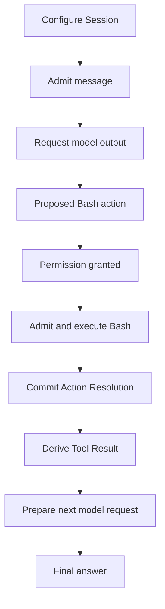
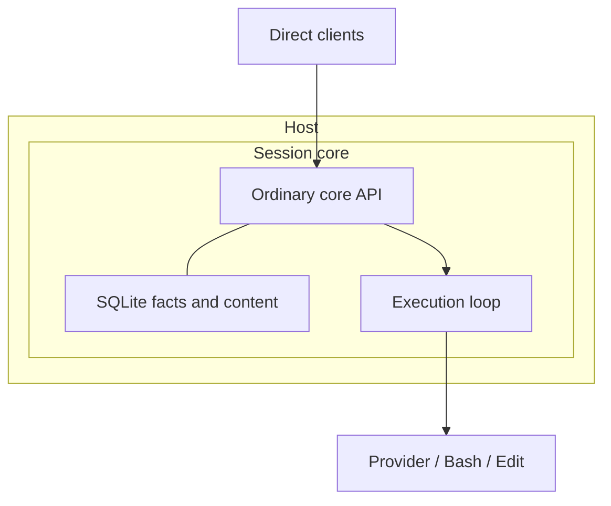

# Rui architecture

This is the accepted V1 contract, not implementation evidence; it includes accepted behavior that is not yet implemented.
For runnable behavior and current limitations, see [README Status](README.md#status).
[VERIFICATION.md](VERIFICATION.md) owns required evidence.

## Supported guarantees

Rui supports Linux x86-64 and macOS Apple Silicon.
Recovery covers a terminated Rui process followed by restart on supported local storage.
After an OS crash or power loss the canonical Store has SQLite's ACID behavior for WAL with `synchronous=FULL` (see [Store durability](docs/contracts/store.md#store-durability)); Rui adds no further OS-crash, power-loss or storage-device guarantee.
Existing atomic publication, sync ordering, canonical-state validation and indeterminate-effect rules remain required; narrowing the recovery promise does not excuse a failing functional assertion.

Authorized commands execute with the user's privileges.
Permission checks authorize exact Actions, not a filesystem, network or credential sandbox.
Rui enforces its own allocation, population and accounting limits exactly.
External-process CPU, elapsed-time and termination safeguards are best effort under OS scheduling and I/O; they do not promise hard interruption, descendant containment or exact physical-memory limits.
Cleanup retains ownership until release is observed.

## A piece of work from start to finish

Suppose a caller wants an agent to investigate a failing test.
The caller explicitly starts the Host, names a Session, configures its Workspace and sends a message.
The model asks to run Bash.
With the default permission mode, Rui authorizes the proposed action without asking a client.
Once admitted for execution, Bash runs; Rui saves its result and asks the model for the final answer.

The caller can disconnect while this work continues.
If the Host instead crashes during Bash, recovery reports an indeterminate tool result: the command may have run, so Rui does not automatically run it again.
The model can investigate through fresh calls.
The linked subsystem contracts define the exact admission, permission and recovery boundaries behind this example.

Read the owning contract and its required evidence for the subsystem you change:

- For shared terms or implementation owners, read [Owners and identities](#owners-and-identities).
- For Session naming, configuration, admission, or lost replies, read [Admission](docs/contracts/admission.md).
- For Conversation entries, settings, instructions, or skills, read [Conversation and settings](docs/contracts/conversation.md).
- For frozen model requests, provider history, authentication, or compaction, read [Model requests and provider context](docs/contracts/model-io.md).
- For tool permission, Exact Edit, Bash, retries, or crash recovery, read [Tools, execution, and recovery](docs/contracts/execution.md).
- For canonical transactions, Store formats, durability, or content representation, read [Store](docs/contracts/store.md).
- For stop, archive, interruption, or Turn outcomes, read [Session stops and outcomes](docs/contracts/sessions.md).
- For CLI grammar, defaults, capture, or command output, read [CLI operations](docs/contracts/cli.md).
- For sign-in screens, Session overview, composition, choices, or terminal cleanup, read [Session UI](docs/contracts/session-ui.md). Its [chat input and User message bands](docs/contracts/session-ui.md#chat-input-and-user-message-bands) section owns bottom-anchored plain input, themed submitted-message bands and shared timestamp presentation.
- For reports, pages, Activity, waits, or local transport, read [Inspection and local protocol](docs/contracts/inspection.md).
- For platforms, exclusive Host ownership, or shutdown, read [Host lifetime](docs/contracts/host.md).
- For capacity, memory, scratch, or selection progress, read [Resources](docs/contracts/resources.md).
- For optional stderr, diagnostic records, or export, read [Diagnostics](docs/contracts/diagnostics.md).
- For outstanding implementation choices, read [Remaining decisions](#remaining-decisions).

## Owners and identities

The explicitly started **Host** contains one owner:

| Owner | Responsibility |
| --- | --- |
| Session core | Conversations, model requests, tool authorization, execution and recovery. |

A canonical storage fault fences the whole Host.

The **Host Store** contains canonical facts and content: the committed records that determine saved outcomes and recovery.
The **Storage Owner** exclusively accesses core tables. **Content References** identify complete immutable bytes with length/digest and bounded reads.
Credentials and diagnostics cannot determine semantic recovery.

| Term | Meaning |
| --- | --- |
| Local Owner | The server/Store owner. All admitted clients act for it; no per-client ACL, delegated Principal or exclusive Session ownership exists. |
| Caller / User / Agent | A Caller invokes APIs; User is the message role, whether person or agent; Agent is the model-driven decision-maker. These roles confer no additional authority. |
| Session / Session reference | One reusable linear conversation, Workspace and access scope. Its Store-allocated six-character ID addresses it within that Store. Sessions have no terminal outcome or persisted lifecycle phase. |
| Workspace | Working-directory context for relative tool paths, not a sandbox or allowed-path boundary. |
| Turn | Work from taking one or more queued User Messages for processing through a Final Answer or typed terminal outcome. At most one Turn is nonterminal per Session; callers need no Turn key. |
| Operation | One logical model request or Action. It owns its frozen inputs and execution/retry state; once resolved, it owns one immutable Resolution. |
| Attempt | One physical try of an Operation. An Attempt can become uncertain after custody loss; it is not another Operation. |
| Resolution | An Operation’s optional immutable final result. Semantic completion is independent of physical cleanup. |
| Seam | A plug-in point of the core, such as the Store, the provider, the tools or the client interface. Seams are not called sockets or ports. |
| Adapter | One implementation that fits a Seam, such as the SQLite Store or the OpenAI-key provider. The provider adapter fits the provider Seam. |

Each fact has one authority.
Each resident allocation has an owner, bounded population and release boundary.
Core drives Sessions.
Clients do not sequence internal transactions, dispatch or recovery.
Private driving interfaces use direct transactions and effect modules that own their resource lifetimes.
Native embedding and Cloudflare Durable Objects are design probes, not SDK, ABI or deployment commitments.
Abstractions require concrete consumers or invariants.

### Finding the implementation

This source map locates the existing owners; file boundaries are not part of the behavioral contract.
[README Status](README.md#status) owns implementation and qualification status.

| Responsibility | Start here |
| --- | --- |
| Durable admission, settings, results and recovery | `src/store/Store.zig`: `Store` owns SQLite transactions and canonical facts; its entry points call into one file per domain under `src/store/domain/`, and `src/store.zig` is the surface code outside `src/store/` imports. |
| Wire vocabulary, routes and size bounds | `src/protocol.zig`: request parsing, the command table and its routes, the reply and request vocabulary, and one JSON shape per reply and request. Each writer writes its shape and each size bound is derived from that same shape. |
| Caller request capture and recovery | `src/client.zig`: typed capture, generated/explicit identity, durable records and original-byte transmission. `src/cli.zig` selects HOME/preferences and presentation. |
| Reply decoding | `src/protocol_reply.zig`: decodes each reply against its `src/protocol.zig` shape, accepting or rejecting its bytes, into facts the caller owns after the reply buffer is reused. |
| Interactive submission lifetime | `src/SessionSubmission.zig`: original Message or Decision, capture facts, same-original retries, joined Admission and release. `SessionInput` owns editing storage and loan tickets; `SessionFrontend` owns consent, presentation, reads and coordinated shutdown on a terminal its caller lends. `src/session_departure.zig` selects inspection supersession and exit policy from completed cleanup facts and freshly observed interruption. |
| Host lifetime and effect handoffs | `src/server.zig`: Host, execution slots and native orchestration. `src/execution_turn.zig` owns the shared service-turn policy. `src/host_start.zig` owns settings intake and retains detached admission through launch; `src/credential_location.zig` owns client and Host credential-location defaults; `host_settings_handoff.zig` owns the private source-only frame and `host_launch_transfer.zig` its shared descriptor pump. The [Host contract](docs/contracts/host.md) defines provenance and later new admission. |
| Attempt bindings, launch permits and cleanup custody | `src/attempt.zig` and `src/execution.zig`: one-shot permits and generation-checked `CustodyPool` records. |
| Model request preparation, transport and interpretation | `src/model_adapter.zig` prepares requests, walking a request's neutral items and writing the pieces the Session's codec answers each with; `src/provider.zig` owns the HTTP/2 Client and response capture lifetimes and `src/transport_policy.zig` classifies finished transfers and parses `Retry-After`; `src/output_decode.zig` classifies an HTTP error body by giving it, mapped read-only, to the pinned codec's classifier, and decides the error response and report from what the classifier names, and interprets a sealed response stream by giving each event, mapped read-only, to the pinned codec's interpreter, keeping the Host's rules across items and writing the output metadata the Store imports. `src/codec_abi.zig` is the provider codec contract and `src/codecs.zig` lists the codecs this Host serves by the codec name a Session pins, dispatches at comptime to a codec's request encoder, request headers, error classifier and response interpreter, plain functions over values their caller stores; a codec's manifest names the response headers the transport observes for it (`src/codecs/responses.zig` for `openai-responses/1`, `/2` and `/3`, which encodes its request body, its history-memo carry and its tool envelope, names its request headers, reads its error envelope and interprets its response events; `src/codecs/json.zig` is the RFC 8259 JSON reader a codec runs over a whole input, and its string decoder also serves the shell). The contract, the JSON reader and each codec are functional cores, listed in `test-logic`, so a codec imports only `std`, the contract and the reader. `src/tools.zig` defines each tool's name, description and parameter schema once. |
| Codex authentication and credential storage | `src/codex_auth.zig` sequences Host credential acquisition and local status and owns the device-login and refresh transport; `src/codex_credentials.zig` owns private records and cross-process credential leases. `src/codex_credential_policy.zig` owns the value decisions those owners follow: record format, selection, refresh claim and replacement admission. `src/codex_token_wire.zig` builds and interprets device-login and token-exchange messages and the records they produce. `src/providers.zig` holds the sign-in sources the Host serves (none, a ChatGPT sign-in, an API key) behind one closed `Credential`: the Host asks it whether a request waits for a lease, which endpoints it may reach, which fields it writes, what a model 401 means and who owns a Turn's routing value, and never which kind it is. |
| Bash process and output lifetime | `src/bash.zig`: preparation, launch, process-group retirement, capture and cleanup. `src/BashLifecycle.zig` owns the value transitions those handles follow: process phases, pipe terminal reasons, stop reason, signaling facts and resolution. |
| Temporary storage | `src/ScratchBudget.zig` accounts for bytes; `src/named_scratch.zig` retains failed reclamation; `src/output_retention.zig` owns disposable-output retention and eviction. |
| Product defaults | `src/product_defaults.zig`: values supplied for omitted settings, namely default Active and intake capacity, fresh-Session tools and permission mode, the recommended model and compaction policy. |
| Provider facts | `src/provider_name.zig`: one table of what each provider fixes (its codec, the name prose knows it by ("ChatGPT (device code)", "ChatGPT", "OpenAI"), the short label of its sign-in where one is chosen or read beside a model ("ChatGPT", "ChatGPT", "API key": both ways into one account read the same), whether its credential is a sign-in or a key, the `rui auth login` command that signs it in (`rui auth login chatgpt --device-code`, `rui auth login chatgpt`, `rui auth login openai`), the other provider that signs in to the same account (`codex` and `chatgpt` name each other; `openai` names none), and whether its model list is Rui's catalog or fetched live). Whether a Session may ask for structured output depends on the sign-in source, so `src/providers.zig` answers it. Core asks a provider for a fact and never switches on which provider it is; [provider_locality.py](tests/ci/provider_locality.py) fails CI when core production code imports a sign-in file, names a ChatGPT header, endpoint or OpenAI error code, or names a provider by its tag. |
| Model capability | `src/model_catalog.zig`: identifier syntax, the reasoning-effort grammar and the shipped models.dev facts; the Store selects saved facts when a source exists, otherwise shipped facts. `src/model_capability.zig` derives capability from the operation's supplied facts (listed efforts and optional context window). The generated image modalities are exact-ID tri-state facts; request preparation reevaluates them per attempt, and the catalog owns sourced exact-model image cost rules. |
| Session work | `src/session_work.zig` derives each Session's work state, a functional core; `src/store/domain/report.zig` reads its inputs under one Store lock. |
| Session change hint | `src/change_ring.zig`: the fixed in-memory ring of recent (Session, commit, Workspace key) entries behind Session listing's `since`. `src/store/Store.zig` records into it where its commit counter advances. |
| Session overview | `src/Overview.zig` owns the terminal surface and its reader; `src/overview_view.zig` is the shared presentation core for full-list and sidebar row marks, state ages, aligned controls and the single earliest redraw deadline for visible row ages, spinners and quota countdowns. Settings retains its divider and has its own bottom line above quiet memory and the update button. The upgrade status owner supplies the fitted failure reason and keeps transient paused/publication labels scoped to a running attempt. `src/memory_text.zig` owns memory wording and fitting; `src/UpgradeJob.zig` and `src/upgrade_status.zig` own update availability and progress. Sidebar and Settings use one upgrade path, with drawn-target decisions in the core. UpgradeJob carries the same validated release candidate and Download owner from startup discovery through an accepted check/install, preserving recovered transport without a second discovery. Chat footer feedback is chat-only. |
| Desktop notifications | `src/attention.zig` decides what program status record (OSC 7501) each Session has; `src/TerminalApp.zig`'s `Attention` writes the records through vaxis. |
| Functional cores | The `cores` list in `src/logic_tests.zig`; `src/core_boundary.zig` defines what a core may name. |

## Remaining decisions

Open implementation choices are limited to command/wire spelling, history defaults and content-range edges.
Current and Full report profiles are selected; their presentation details must preserve the closed report inventory.
Open issues hold unresolved decisions and research; this contract records accepted behavior.

Production implementation and live-provider qualification remain required by [Verification](VERIFICATION.md).
V1 excludes conversation branching, model/provider fallback, incompatible handoff, dynamic tools/MCP, generalized scheduling, multi-host coordination and application-state retention/migration.
Future fork creates a new Session with ancestry.
