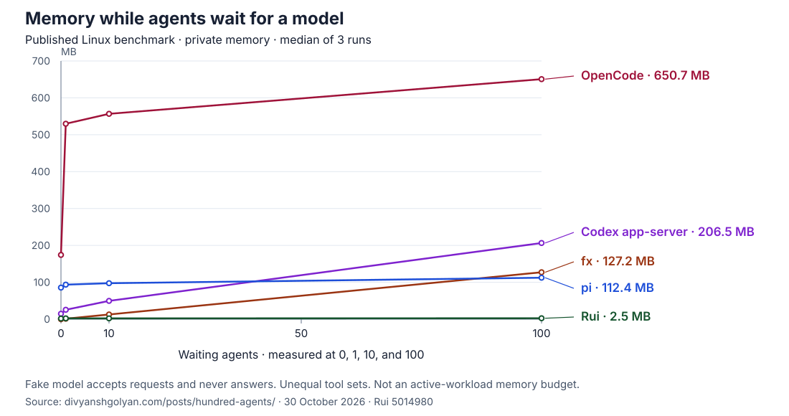

# Rui

Rui is a memory-efficient agent runtime.
Build applications that run multiple agents without starting a separate runtime process for each one.
Give agents work, connect your tools, and collect their results through a TypeScript client.

**100 waiting agents.
2.5 MB of private memory.**



Source: the [published Linux model-wait benchmark](https://divyanshgolyan.com/posts/hundred-agents/) at [Rui revision 5014980](https://github.com/DivyanshGolyan/rui/commit/50149807908283e044e3573f1b251d6a2f21e854).
See the [data and method](docs/waiting-agent-memory.md) for measurement scope and versions.

## Get started with TypeScript

[Follow the TypeScript quickstart](docs/integrating-rui.md) to run a Session and read its answer.

The client launches a child Host:

```ts
import { Rui } from "ruicode";
const rui = await Rui.connect({
	store: { sqlite: { dir: "./app-rui-store" } },
	providers: {
		openai: {
			endpoint: "https://api.openai.com/v1/responses",
			key: { value: process.env.OPENAI_API_KEY! },
		},
	},
});
```

Install with `npm install ruicode` on Node.js 22.6+; the package brings the matching `rui` executable for your platform.
This example uses an OpenAI-compatible Responses API key; Host settings can also select the Codex or ChatGPT sign-in providers.
Provider usage may incur charges.

## How it works

Your application talks over a local socket to one shared Host that runs the Sessions.
The Host shares networking and execution capacity and saves conversation state in SQLite or MySQL.
Connect built-in tools or MCP servers, coordinate agents, and follow their activity through the client.
For MySQL TCP URLs, the only query option is `ssl-ca=/absolute/path/to/ca.pem` (the path may be percent-encoded), which replaces system trust with that PEM bundle alone; socket URLs and verification-disabling options are refused.
See the [Host guide](docs/host.md) for capacity and lifecycle.

## Try it in your terminal

<a id="install"></a>

The standalone binary supports Apple Silicon macOS 15+ and x86-64 Linux with glibc 2.34+.
ARM64 Linux and Intel macOS builds are experimental.

```sh
curl -fsSL https://ruicode.com/install | sh
```

The installer checks SHA-256 and installs in `~/.local/bin`.
If `~/.local/bin` is not on your `PATH`, it adds it to your shell profile; open a new terminal afterwards.
Set `RUI_NO_MODIFY_PATH=1` to leave your profile alone and follow its `PATH` instructions instead.
See [upgrade and activation](docs/host.md#upgrade-and-activation) before updating saved work.

<a id="start-a-conversation"></a>

Run `rui` in your project directory.
The first run signs you in with your ChatGPT account in your browser, or with an OpenAI API key.
The first run and `rui auth login chatgpt` both open ChatGPT in your browser; on a machine whose browser cannot reach back, paste the address the browser ends on, or sign in with a code instead: press Tab on the first-run screen, or add `--device-code`.
A code sign-in needs Codex device code authorization turned on in ChatGPT security settings first, or your workspace admin to allow it; keep the code private.
The [Host guide](docs/host.md#run-in-the-foreground) covers signing in from scripts.

Bash runs with your full privileges, without a sandbox, and defaults to running without approval (`bypass`).
[Approval settings](docs/using-rui.md#approve-bash-commands) apply per Session and do not automatically propagate to agents it starts.
See the [terminal guide](docs/using-rui.md) or [scripting guide](docs/scripting.md) for your next step.

## Documentation

<a id="status"></a>
Rui is in development.

- [TypeScript integration](docs/integrating-rui.md), [terminal guide](docs/using-rui.md), and [scripting guide](docs/scripting.md).
- <a id="run-your-first-swarm"></a>[Agent coordination](docs/scripting.md#agents-calling-rui) to start investigators and collect their reports.
- <a id="skills"></a>[Skills](docs/using-rui.md#skills) and <a id="archive-a-conversation"></a>[archive controls](docs/using-rui.md#archive-sessions).
- <a id="build-from-source"></a>[Development and source builds](docs/development.md), including contribution setup and provider-free examples.
- <a id="learn-more"></a>[Architecture](ARCHITECTURE.md), [Verification](VERIFICATION.md), and [Research](research/README.md).
- [Store format reset](docs/store-reset.md), [contributing rules](AGENTS.md), and [third-party notices](THIRD_PARTY_NOTICES.md).
