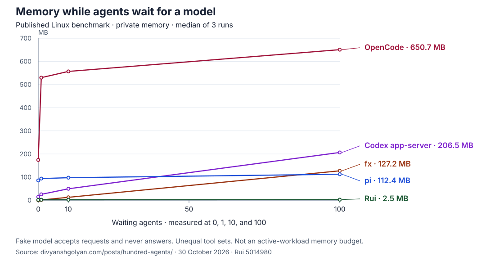

# Rui

Rui runs hundreds of agents from your application in one small process.
Work picks up where it left off when Rui restarts after a crash.

**100 agents.
2.5 MB of private memory.**



From the [published benchmark](https://divyanshgolyan.com/posts/hundred-agents/); see the [data and method](docs/waiting-agent-memory.md).

## Start an agent from TypeScript

Install with `npm install ruicode` on Node.js 22.6+.
It brings the matching `rui` executable and starts it for you.

```ts
import { randomUUID } from "node:crypto";
import { Rui } from "ruicode";

const rui = await Rui.connect({
	store: { sqlite: { dir: "./app-rui-store" } },
	providers: { openai: { endpoint: "https://api.openai.com/v1/responses", key: { value: process.env.OPENAI_API_KEY! } } },
});
const agent = await rui.sessions.create(
	{ workspace: process.cwd(), model: process.env.RUI_MODEL!, tools: ["bash"] },
	{ idempotencyKey: randomUUID() },
);
await agent.send("Summarize what this repository does.", { idempotencyKey: randomUUID() });
for await (const entry of agent.listActivity({ follow: true })) {
	if (entry.kind === "assistant") console.log(await agent.readContent(entry));
	if (entry.kind === "turn_ended" && entry.sessionId === agent.id) break;
}
await rui.close();
```

The [TypeScript guide](docs/integrating-rui.md) covers tools, MCP servers and MySQL.

## How Rui differs

pi, the Codex SDK and the Claude Agent SDK run each agent inside your application or start a process per agent.
Rui runs every agent in one shared process and saves each step, so a hundred agents fit in a few megabytes and a crash loses no work.
If Rui stops in the middle of a command, it reports that the command may have run and never runs it again by itself.

## Use it in your terminal

<a id="install"></a>

```sh
curl -fsSL https://ruicode.com/install | sh
```

Supports Apple Silicon macOS 15+ and x86-64 Linux with glibc 2.34+.
The installer adds `~/.local/bin` to your `PATH` unless you set `RUI_NO_MODIFY_PATH=1`.

<a id="start-a-conversation"></a>

Run `rui` in your project directory and [sign in](docs/using-rui.md#sign-in) with ChatGPT or an API key.
Bash runs with your full privileges and, by default, without asking; see [approval settings](docs/using-rui.md#approve-bash-commands).

## Learn more

<a id="status"></a>
Rui is in development.
Report bugs and ask questions in [Issues](https://github.com/DivyanshGolyan/rui/issues).

- <a id="run-your-first-swarm"></a>[Terminal guide](docs/using-rui.md), [scripting guide](docs/scripting.md) and [Host guide](docs/host.md).
- [Architecture](ARCHITECTURE.md), [development](docs/development.md) and [contributing rules](AGENTS.md).
