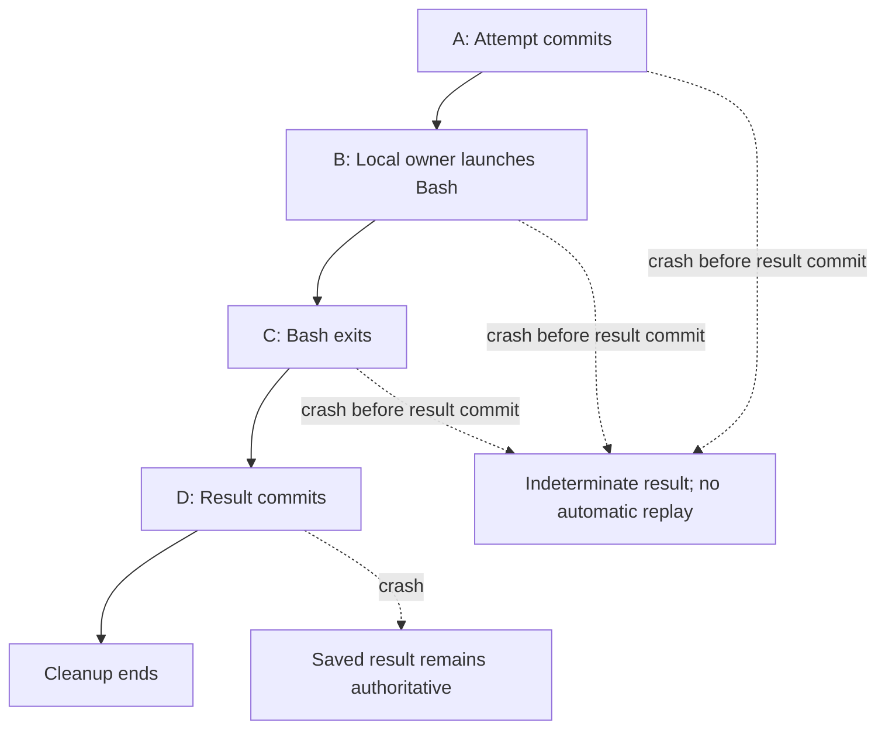

# Tools, execution, and recovery

[Architecture](../../ARCHITECTURE.md) owns shared guarantees, terminology, and the source map.
[Verification](../../VERIFICATION.md) owns global evidence rules and gates.

## Accepted contract

### Model output, tools and permission

#### Accepting an answer or tool calls

A valid model response contains assistant messages, ordered Tool Calls, or both.
Assistant text remains visible in output-item stream order, including before and among calls.
Before atomic admission, validate the complete provider candidate: terminal agreement, supported consequential variants, item order, required field types, nonempty required provider identities and unique item/call identities must establish exact trustworthy call envelopes.
A malformed or contradictory envelope rejects the complete candidate; no message, call, rejection result or Action is admitted.
Preserve each trustworthy call's exact item ID, call ID, name, raw argument string, originating ordinal and supported provider metadata.

An assistant message's `phase` is absent, null, `commentary`, `partial_answer` or `final_answer`.
Both `commentary` and `partial_answer` produce visible non-final text.
One `final_answer` selects the Operation's canonical answer text.
Without any phased messages, the last assistant message selects the answer.
Earlier messages remain separate visible text; Rui neither hides non-final text nor concatenates messages into an answer.
More than one `final_answer` is malformed.
Unknown phases are unsupported.
A phased response without a final answer requires Tool Calls to continue, including when phased and unphased messages are mixed.
Tool Calls retain their existing continuation and settlement requirements; a phase cannot complete a Turn with unresolved calls.

The `partial_answer` item shape follows a [pinned first-party Codex SSE fixture](https://github.com/openai/codex/blob/970111f6cb62cc02fe36a82ea7d71b37a2889c97/codex-rs/codex-api/src/sse/responses.rs#L759-L798).
This synthetic fixture is not a live provider capture or executed upstream-test evidence.
Its `end_turn:false` sampling continuation does not change Rui's requirement for a final answer or Tool Calls.

A completed response without calls can select an empty answer.
Empty or Unicode-whitespace-only selected text produces an empty Request result and completes the Turn when no queued input remains.
Inspection and the TUI expose completion, not failure.
Nonblank selected text becomes the Request result byte-exact, including surrounding whitespace.
Raw provider items and Conversation message projections remain unchanged.
Missing selected messages, malformed envelopes and incomplete streams still reject.

A **Tool Call** is one trustworthy model-proposed invocation.
Classify every Tool Call against the proposing model Operation's frozen Tool Catalog in the same admission transaction.
An unknown tool, malformed argument JSON, wrong argument shape or deterministic descriptor failure receives an immutable bounded rejection result owned by that model call.
Its derived Tool Result identifies the unknown tool or invalid arguments without exposing parser, storage, permission-policy or approval-audit internals.
It creates no Action, Permission Request, Authorization, Attempt, custody or dispatch authority.
Do not repair, coerce or reinterpret the arguments.
Valid siblings remain admissible; candidate import still commits every prefix, call, classification, rejection and Action consequence together or none.

Each applicable Tool Call creates one child **Action Operation**, the unit of executable work whose permission and result core owns, linked to its model parent and stable call ordinal.
Keeping rejected calls outside Action preserves the invariant that every Action has a canonical executable descriptor.
No Step/group entity is required.
Actions run and settle independently, including within one Workspace.

Bash arguments require `cmd` and `description`; `stdin` and `timeout_ms` are optional.
Function tools are offered with `"strict": false`, explicitly, since an omitted field lets the provider make the schema strict: the provider does not check a call against its schema, Rui does.
A call whose arguments fail that check is settled as an `invalid_arguments` rejection whose result tells the model what was wrong (for example "Invalid arguments for tool 'bash': cmd is required."), so the model corrects the call within the Turn; the Turn does not fail.
The description is nonblank, single-line, valid UTF-8, and at most 100 decoded UTF-8 bytes.
Validation counts decoded bytes, not JSON spelling, characters, or display columns.
Missing or invalid descriptions receive the ordinary invalid-arguments rejection, naming the description; Rui does not repair, fabricate, or accept a compatibility form.
The original argument string remains canonical and unchanged.

The tool schema guides descriptions toward a base verb, concrete target, and useful scope, in sentence case without trailing punctuation.
It recommends 40–60 characters and excludes status, safety, and success claims.
These are wording guidance, not prose-quality validation.
Observed state and outcomes come from core facts, never the model's description.

Each call has exactly one original fulfillment: its rejection, accepted background receipt, or Action Resolution.
Each owns canonical result content and a Conversation acceptance position. Siblings fulfill independently and never rewrite one another.
Once every Tool Call has one fulfillment, the next model Operation may start without another user message.
Its frozen core-owned historical view joins each original call to that fulfillment and derives one provider `function_call_output` with the exact call ID in original call order.
The complete group precedes input selected at the same boundary.
No copied Tool Result, result batch or publication marker is durable authority.
Physical completion order cannot reorder provider input.
Call rejection, Action denial, failure, cancellation and uncertainty all produce results.

#### Foreground and background Actions

Host-owned function tools accept the optional root argument `rui_execution`, either `foreground` or `background`.
Omission means foreground. Provider-hosted `web_search` has no execution option.
The offered schema adds this reserved name centrally, including MCP tools, and refuses a server schema that already owns it.
The exact raw arguments remain canonical. Host execution metadata is removed before tool-specific validation and execution.

Foreground calls block the original continuation until their rejection or sole Resolution.
Background acceptance fulfills that same call with an accepted receipt naming its Action, not a running-process claim.
Permission may still wait, and authorized work may still wait for capacity.
Acceptance never grants permission, creates another Action or resets an Attempt, launch, timeout or deadline.
`rui action background --session ID --action N` promotes an existing foreground invocation without replacing its executor.
If terminal acceptance commits first, promotion selects that final instead. Otherwise the receipt remains the original fulfillment even after final settlement.
A refusal changes neither the original fulfillment nor execution authority.

An Action belongs to its Session after its causal model Operation and Turn finish.
A later background Resolution admits a new tool-final input in the same transaction, referencing the sole Resolution content without copying its payload or outcome.
This source cannot receive a command answer or bind a skill. The adapter identifies it as tool output data, not a person or peer instruction.
The original tool call receives no second `function_call_output`.
The final acceptance position and source admission determine the new input's frozen boundary, never the earlier background receipt position.
A stop selecting the source suppresses later delivery permanently, including after fresh Session work. Truthful terminal evidence remains saved and readable.
Bash cancellation and MCP effect certainty retain their existing runner-owned rules.

The existing custody pool counts model, Bash, MCP and cleanup owners together.
Dispatch of background work requires two genuinely free custody records and reserves one atomically while checking that one remains free.
Promotion of an attempted Action requires one genuinely free record but never releases, detaches or reserves its existing token.
Capacity one refuses background acceptance or promotion. A pending background Action may wait.
Detached cleanup still occupies capacity. An ordinary finite consumer may take the remaining credit after the background reservation.
This conservative policy does not promise a permanently idle record or unlimited fairness.

`rui action read --session ID --action N [--offset N]` returns status and one bounded, repeatable final-result window without waiting or consuming it.
Attempted status does not establish that a process runs or that a remote request was sent.
`rui action stop` saves a stop selection, not a claim that the effect has ended.
Native keyed controls retain their existing Owner authority. Model tools `read_action` and `stop_action` can target only their originating Session.
Configured tool-name narrowing still applies. `stop_action` revalidates its originating Action and commits target selection with its own Resolution atomically.
The existing exact call-ID and argument reads remain proposal inspection, separate from result/status reads.
These Actions add no intermediate publication, JavaScript runtime, inbox, durable execution restoration or execution checkpoint.

#### Authorizing exact actions

The model-visible **Tool Catalog** contains definitions/schema/result contracts, not execution authority.
It holds `bash`, which Rui runs as Actions; `find_tools`, `message_agent`, `read_action`, `read_transcript`, `skill`, `start_agent` and `stop_action`, which the core runs itself; and `web_search`, which the provider hosts: the request names it (OpenAI with live page access) and the provider runs it inside the response, so it never becomes an Action and needs no approval.
The CLI and TUI put `bash`, `skill` and `web_search` in a fresh Session's spec; the Host never supplies a tools list (D104).
CLI `--tools` accepts a comma list of those names or `none`; the public configuration and report arrays list each chosen tool once, in catalog order (`bash`, `find_tools`, `message_agent`, `read_action`, `read_transcript`, `skill`, `start_agent`, `stop_action`, `web_search`).
A Session's optional `loaded_tools` uses the same name-list grammar (`--loaded-tools a,b|none` in the CLI), defaults to all its `tools`, and records loaded-name intent; the Operation's projected, frozen offer is sent to the model and used to validate calls.
Every loaded name must be in its resulting tools or configure refuses `loaded_tools_not_in_tools`; a strict subset must contain `find_tools` or configure refuses `loaded_tools_unreachable`.
Changing tools without specifying loaded_tools keeps equality when the saved sets were equal; otherwise it intersects the saved loaded set with the new tools and applies the same checks.
The Session and each revision store intent as a nullable `loaded_tool_set_id`, interned like `tool_set_id`, with NULL denoting equality; Current and Full reports expose both sets, and a newly loaded tool follows the existing `additional_tools` history path without discarding the cache prefix.
Who runs an accepted call is derived from its name, never stored.
A **core tool** call runs as one core command, with no process: `message_agent(id, text)` admits `text` to Session `id` as a Message from the calling Session, with no client environment, and resolves the call `Delivered to ID.` in the same transaction; an unknown `id` resolves it failed and sends nothing.
`find_tools(words)` searches the Session's currently available, not-yet-loaded projected tools by name or description, ignoring ASCII case and matching any of one to eight space-separated words.
SQL selects only unloaded candidates; the Host streams names and description windows through the shared `word_search.Matcher`, whose ASCII folding and carry give every Store engine the same answers (D216).
It loads at most eight matches in name order, in one call-keyed command and one revision naming `loaded_tools`, committed with the call result.
A no-match call writes no revision.
A strict `loaded_tools` subset must include `find_tools`; NULL in the saved loaded set means all configured tools.
Newly loaded definitions join the next request as `additional_tools`; a call to an unloaded tool still settles as `unknown_tool`.
`read_transcript(id?, kinds?, before?, limit?, query?, full?, offset?)` reads any Session's public activity feed, defaulting to the caller, and resolves only its call: newest-first outlines page up to 16 entries, and `full` opens one entry in UTF-8-aligned 16 KiB windows.
It uses the public activity visibility and provenance rules, never private provider material; invalid arguments, unknown Sessions and missing entries resolve failed when the core runs the call, not at settlement.
`start_agent(task, attached, spec)` creates a Session configured by the full agent `spec` (model, effort, token-count compaction threshold, tools, initially loaded tools, Permission Mode, output reservation, instructions, output schema and label) in the caller's Workspace with its provider, admits `task` to it as its first Message from the caller under the key `rui.core/start_agent/<action>`, and resolves the call `Started ID.`, all in one transaction; an attached agent records the caller as its parent.
Every refused `start_agent` spec fails the tool call and starts nothing, including a missing required field, a named provider or Workspace, unsupported effort or an excessive known-window compaction threshold (D140, D165, D166, D221).
A spec that widens the caller's tools or asks for `bypass` under a caller that asks resolves the call failed with a result naming the field; the Host checks the arguments when it runs the call, not at admission.
Both `start_agent` and native creation with a parent narrow against the parent's configured-name intent, not its loaded intent or current projected offer; ordinary configuration validation still refuses requested names absent from the Host tool set.
The child saves only its own configured and loaded intent, with its effective offer frozen at each Operation admission by the same projection as any Session.
The agent's Bash starts from the caller's client environment, installed as the task commits.
A core tool acts only on the Store, so admission authorizes its call at once under either Permission Mode, and a stop cancels it like any other unattempted Action.
Removed `edit`, duplicate names and alternate spellings reject rather than aliasing another selection.
Classify proposed Tool Calls against the proposing model Operation's frozen Tool Catalog, not the latest Session configuration.
Removing Bash while that model request runs changes future model requests, not the applicability of its Bash proposal.
A later Operation that was not offered Bash can still contain a trustworthy Bash call envelope, but classification saves its rejection result and creates no Action.
Execution still requires the exact Action authorization below.

Core owns and enforces Permission Mode per Session.
Authorized clients configure Sessions through the ordinary Session configuration API, present exact Permission Requests and submit decisions.
Mode persists across client disconnect, Host restart and later Session reuse until explicitly changed.
Bypass therefore permits unattended progress without a connected approver; ask retains unanswered requests durably for a later client, without a resident client or per-Session worker.

Sharing a Session shares its permission policy under ordinary configuration ordering.
Concurrent use by multiple clients is technically possible but is not an intended V1 usage pattern and has no coordination or isolation guarantee; it adds no per-client grant, policy copy or lifetime.
One retained policy and one application boundary keep unattended work explainable without coupling authority to connection lifetime.

**Authorization** durably permits one exact validated Action.
At applicable-Action admission select the saved Session Permission Mode and save descriptor plus configuration provenance.
Rejected Tool Calls never consult permission policy.

`ask` creates one immutable Permission Request; `bypass` directly creates Authorization.
Siblings admitted together share that view.
Permission Decisions allow once or deny one exact request/Operation/descriptor under Local Owner authority; server access never implies bypass.

Later mode changes neither answer pending requests, revoke existing authorizations nor stop running actions.
Model-request settings do not authorize later Actions.
Recovery reuses saved permission facts, not current mode; rollback creates none.
Authorization may wait for capacity without an Attempt.
No Workspace isolation, global Action serialization or concurrent-writer coordination is promised.

An authorized Bash command runs as the user and can access the user's files, network and credentials.
The authorization protocol is not a sandbox.

#### Exact Edit

Edit execution is unimplemented and `edit` is absent from the current Tool Catalog and configuration.
The following contract describes future execution, not an available tool.

##### Proposal and line coordinates

`edit` accepts one existing-file path and a nonempty replacement list.
Each entry supplies one-based start-inclusive/end-exclusive whole-line coordinates, expected text and replacement text, all against the same execution-input state.
Reject overlap; adjacent nonempty ranges are allowed.
Combine insertions sharing a position or lying inside/at another replacement boundary.
No search, relocation, fuzzy matching, replace-all, multi-file batch, file creation/deletion/rename/mode change or whole-file freshness guard exists.
Empty replacement deletes text, not the file.

LF separates lines; CR in CRLF remains exact.
An empty file has zero lines; a final nonempty unterminated segment is a line; trailing LF adds none.
For N lines require `1 <= start <= end <= N+1`.
`[4,7)` selects lines 4–6; `[4,4)` inserts before 4 with empty expected text; `[N+1,N+1)` appends, including `[1,1)` in an empty file.
Expected text includes selected terminators.
Replacement bytes are literal: no normalization or implicit newline; appending to an unterminated line joins it unless replacement begins with LF.
Insertion checks position only; replace adjacent context to demand text freshness.

##### Preview and authorization

Save/display the submitted proposal after shape validation without reading target.
Preview is proposed snippets/coordinates, not verified current content.
Authorization binds exact path/ranges/text.
Bash supplies reads and file/directory creation: number before slicing to preserve coordinates (`cat -n -- file | sed -n '40,80p'`); display numbers are not expected bytes and truncated output is no snapshot.
Missing Edit targets fail.
Ordinary absolute/relative filesystem access applies without Git tracking, repository membership or Workspace containment rules.

##### Checked copyback and cleanup

After authorization and Attempt admission, Edit:

1. Opens the existing target without creating or truncating it.
2. Checks eligibility and every expected slice while streaming the complete edited output into charged, immediately unlinked scratch.
3. Copies the completed output through the same target handle, then sets final length and flushes.

A mismatch, read failure or scratch failure before step 3 leaves the target untouched.
Edit never pretruncates or rename-replaces the inode; empty output makes truncation the first mutation.
A partial write, truncate or flush failure may change bytes.
Report actual evidence or uncertainty, not rollback or false success.

The canonical descriptor is read-only.
Keep its readers, the same target handle and the one output scratch through their final consumers and pending I/O, closing before custody release.
Completed scratch is copyback input only.
Cancellation/partial copyback cannot release a buffer still used by I/O; read failures after mutation cannot claim not-applied.

Edit owns target/scratch/buffers/offsets/cleanup within one trusted in-process module, with bounded service turns and no worker pool or separate timeout.
No complete line/file/edit-list residence, source snapshot or durable replay backup is required.
Preserve opened-target semantics and safe handle eligibility, not guessed universal inode identity; concurrent writers/path replacement remain caller-coordinated.
Unselected content is preserved from execution input, not isolated against later writers.
Core owns permission/outcome; Edit has no SQLite/credentials or retry policy.
After custody loss, discard scratch and return indeterminate without automatic inspection, replay or repair.

### Transactions, execution and recovery

### Admitting an attempt

An **Attempt** is one admitted physical try of an Operation, identified by that Operation and a fresh ordinal.
Its admission records that execution may happen; it does not prove preparation or launch occurred.

**Execution Evidence** is what the local execution owner reports at terminal delivery.
It is transient, not a saved Resolution.
Attempt identity and evidence require no durable per-try history.

Unresolved Operations distinguish no Attempt, admitted uncertainty, and retryable model failure with future eligibility.

Admission atomically checks applicability, absent Resolution and due policy, records fresh ordinal, consumes allowance and replaces eligibility with uncertainty.
Retryable settlement saves current failure/accounting/eligibility.

Final Resolution/content is immutable; further admission/acceptance rejects.
Action denial, stop or interruption need no invented Attempt.
A rejected model Tool Call is not an Action and has no Resolution or Attempt.
Diagnostics require no permanent failed-try history.

For example, invalid Bash arguments create a call-bound rejection result without an Action.
Denying a valid proposed Bash Action resolves its Action Operation without an Attempt.
A temporary model failure can settle one Attempt while leaving the Operation unresolved and eligible for another Attempt.
Neither that failed try nor the later retry creates a new Operation.
A Resolution ends the Operation; the Turn may still need other Operations or complete terminal coverage before it can continue or finish.

### Launching once and retaining cleanup ownership

Only the invocation committing fresh Attempt admission receives a **Dispatch Permit**: volatile permission to launch that Attempt once.
Recovery cannot recreate that permit because the previous process may already have launched the effect.

Every live resource has exactly one cleanup owner until its last possible use ends. **Physical Custody** is the content-free record of that responsibility: keep execution resources alive through safe cleanup.
A saved outcome, cancellation or rejection does not shorten their lifetime.
Custody confers no permission to launch or decide an Operation's result.

The local owner orders completion/interruption, prevents further terminal-result acceptance, and suppresses an unconsumed permit or detaches active transport.
Terminal evidence delivery is at most once; suppress duplicate/stale delivery before custody reuse, without historical-payload comparison or a generic late-result arbiter.

Host infrastructure suppression may discard unlaunched local work and retain cleanup custody, but it creates no user stop, interruption or Resolution.
At the final synchronized handoff, Store authority first revalidates the canonical permit/control facts, **Host launch authority** then applies only local launch preconditions without creating semantic authority, and only then may the effect launch.
Every later control or settlement rechecks its own canonical authority.

### Effect interfaces and evidence

One reactor multiplexes provider streams on its own thread; the execution owner services subprocess pipes.
Effect modules own handles, bounded windows and charged scratch, never SQLite or permission/retry policy.
After commit, adapters materialize outbound requests from manifests/content into unlinked scratch; execution streams output to scratch.
No transaction spans request construction, provider/process execution, target mutation or delivery.
Only private report-scratch writes may occur under their owning read transactions; finish them before delivery.

Core invokes private provider/Bash/Edit interfaces through closed effect-specific inputs and evidence.
No public provider module or generic dispatch registry is required.
A provider's wire format is a codec, pinned per Session by name and version, behind one value contract (`src/codec_abi.zig`): plain values, with no calls back into the Host, no file access and no state the Host does not store, so the same contract can later run a codec outside the Host's address space; the built-in codecs are linked in natively.
To encode a request the shell gives the codec one neutral item at a time, with canonical content named by handle, and writes the literal, content and raw-image base64 pieces the codec answers with through its own request cursors under the preparation allowance before it asks for the next item.
The Responses `/1`, `/2` and `/3` input domains extend additively with image-bearing Message or tool-result open, ordered Text or Image parts, and close.
PNG and JPEG Image parts name raw Content; the codec supplies data-URL MIME framing and `detail:auto`, and the shell reads verified bounded windows through a pinned standard-base64 cursor.
Source reads and emitted bytes consume the existing preparation allowance; request scratch, cancellation and sealing keep their existing owners.
An image-bearing tool result uses an actual `function_call_output.output` array under its original `call_id`, never a synthetic user Message.
Text-only results remain strings, saved MCP JSON stays opaque text, and every old handler, escape, Carry and route dialect keeps its original bytes.
Only the open resumes and the close ends the new history element; partial image state never enters Carry.
These codec and raw-byte transforms do not themselves admit or persist typed images, validate media containers, or qualify provider image support.
The codec's encoder state is a small value of the codec's own type that the shell stores, and it holds the codec's carry.
Before each history element and `history_end` the shell resumes the codec from its carry, also a value of the codec's type, which the shell kept after the previous element or took from a history memo, so a memo copy and a rebuild continue identically.
A built-in codec is trusted Host code: a piece naming a handle the item lacks, or more pieces than an item holds, is a Host defect caught by assertion and tested over the codec's whole item domain, not a runtime failure.
A codec that cannot encode a request declines it, which fails the Attempt `provider_codec_failed`: nothing is sent before the request seals, so the Attempt settles unanswered and its request scratch is released.
Request headers come from two owners.
The codec writes its own once per request from the frozen settings, which carry the Session's affinity, into the prepared request's own bounded storage: at most 8, whose values total at most 192 bytes.
Each name is a tag of the codec's constant `RequestHeader` enum, so the request stores only its index and the 192 bytes count values alone.
Each name is a lowercase token that names no field the Host or h2 writes itself (`content-type`, the credential's `authorization` and `chatgpt-account-id`, `user-agent`, `x-openai-fedramp`, every codec's routing header, and h2's `content-length`, `accept-encoding`, `host` and connection fields) and no earlier header, and each value is printable ASCII without a leading or trailing space; a built-in codec's headers are tested against these rules over its settings domain rather than checked at runtime.
The Host writes the rest: a transfer sends `content-type`, then the codec's headers in the codec's order, then the sign-in source's fields (a ChatGPT device sign-in's `authorization` and `chatgpt-account-id`, or a ChatGPT plan sign-in's or a key's `authorization`), `user-agent`, `x-openai-fedramp` when a ChatGPT binding is FedRAMP and, for any credential, the Turn's routing value under the codec's routing header when it has one.
A route without a credential sends the codec's headers and no credential-path fields.
To classify an HTTP error body, the shell maps the sealed body read-only and gives it whole, as one slice, to the classifier of the codec the request was encoded with, with scratch the shell lends for that call and the classifier writes before it reads.
The classifier writes its answer into one value the shell lends: context overflow, or else the `codec_abi.Refusal` its code names with the reset time when given, and the report's `code` and `message` parts as ranges of the body with a pinned escape.
The map shares the capture's page cache, so it makes no second copy of the body.
The shell alone decides the failure.
It reads only 4xx and 5xx bodies; it takes a quota only at HTTP 429, then context overflow, then a refusal at any status; the codec alone knows its provider's codes and names each one it knows as a neutral `codec_abi.Refusal` (quota, plan, policy or model unavailable), so a code it does not know narrows nothing; and it decodes, bounds and control-strips the report itself.
Every narrowing settles as a failure that no retry can fix, so a codec can narrow a failure but never make one retryable.
A body the classifier cannot read names nothing, so the status rule decides alone; a report range outside the body is a Host defect caught by slice bounds, not a runtime failure.
A sealed body shorter than its recorded length, or one that fails to map, stays `response_read_failed`.
To interpret a response, the shell maps the sealed capture read-only, frames its SSE lines and writes each event's data to charged event-data scratch, which it maps read-only once at the capture's length, which decoded data never exceeds, so each event reaches the codec whole as one slice of that map, however large; a failure to map it fails the response `response_data_failed`, as a failed write does.
The codec answers each event with one value, in scratch the shell lends and the codec writes before it reads: an event it ignores, a stream's end, an added item's identity, an accepted output item, the completed response or the provider's failure, or the reason it rejects the event; an output item and the completed response name cursors from which the shell asks for their bag members and parts one at a time, each a range of the event.
The codec's stream state is a small value the shell stores between events.
The shell keeps every rule across items and events: it decodes and hashes what the codec names, keeps the answer selection, the call count and the compaction base (dropping a superseded prefix), records metadata and evidence, compares the completed output list with the item records it wrote, mapped read-only, and maps each reason to its rejection.
An execution receives its admitted Operation/Attempt binding, one-shot permit, immutable input readers and local cancellation control; it cannot choose another descriptor or read current Session settings to replace saved inputs.
Keep the permit distinct from the read access needed for validation or permission preview.
The reserved execution owner retains this binding before fallible post-commit preparation begins; preparation, authentication and launch failures remain attributable to that Attempt under its failure or canonical-shutdown rule.
Starting execution does not wait for its terminal outcome.

| Consumer | Input and returned evidence |
| --- | --- |
| Provider preparation/transport | The Operation-bound historical view supplies lowering inputs; transport consumes only the completed request scratch and late-bound credentials/transport settings. Return sealed capture with observed HTTP/protocol termination and available response correlation, or a typed preparation/transport failure. HTTP success alone is not a model candidate. |
| Provider interpretation | Read the sealed capture and producing request's wire/output contract in the serial workspace. Return complete provider-validated output ranges and exact trustworthy call envelopes, or typed rejection when the wire contract cannot form a trustworthy candidate. It cannot look up the Tool Catalog, validate executable descriptors, admit Actions, grant permission, choose retries or finish a Turn. |
| Bash execution | Read the saved command, Workspace and admitted execution settings. Return process termination, capture completeness and sealed output readers for core's Action settlement. Process exit alone does not establish complete capture or descendant cleanup. |
| Edit execution | Read the exact authorized proposal through bounded readers. Return successful checked copyback, established failure before mutation, or failure/uncertainty after mutation may have begun. Target/scratch ownership and mutation rules remain with [Exact Edit](#exact-edit). |

Local execution ownership supplies Operation/Attempt provenance; provider IDs and payload fields cannot retarget evidence.
Use distinct evidence variants for sealed output, known failure and effect-specific outcomes, carrying only fields meaningful to that case.
Preserve available observations needed for classification, including valid Retry-After, without converting them into retry authority.
Preserve HTTP dates as absolute Unix deadlines through body transfer; delta-seconds retain their delay from failure settlement.
At settlement core chooses the later of normal backoff, the greatest valid delta delay and the greatest valid absolute date, using checked arithmetic.
It then adds positive random jitter of 1 through one quarter of that Attempt's configured backoff in milliseconds, with a minimum upper bound of 1 ms.
Addition saturates at the maximum representable deadline instead of wrapping or shortening the provider floor.
A provider delta that cannot produce a representable settlement deadline is ignored without suppressing normal backoff or a valid date.
Duplicate headers retain these two fixed-size constraints separately; elapsed body-transfer time must not extend an absolute date.
Core checks the still-current unresolved Attempt and applicable stop/interruption facts at settlement.
Rejected or stale delivery has no semantic consequence; its local owner still completes cleanup.
Transport and tools cannot resend or relaunch an Operation behind core's retry accounting.

### Validating and importing output

Owned sealed sources retain their contents and extent from handoff through the last reader.
Sealing stops producer writes and fixes extent/integrity; it establishes stability, not protocol validity or publication authority.

After terminal seal, one shared serial validation/import workspace parses complete output sequentially.
No validation worker or manually yielding parser is selected without measured need.
Variable items use ranges into sealed source and one sequential unlinked metadata file, traversed through fixed windows, not resident item collections or per-item files.
Validation-only reasoning strings undergo complete JSON string/type validation without retaining decoded copies; encrypted content must remain nonempty.
Their decoded text is saved once as private parts; the neutral form and bags are the canonical retention and replay source.

Charge metadata growth; retain source/metadata through cleanup.
Post-commit request-materialization failure remains evidence for the admitted Attempt.
Complete provider-envelope validation and Core call classification precede incremental atomic import of content, Resolution/current retry facts and consequences.
Late validation/classification/import failure cannot publish partial success.

Caller content enters as a sealed source at its first semantic reference: import verifies length/digest/type/stable bytes; there is no independent public content-publication operation or staged Content Reference.
Bounded memory does not bound SQLite/import or validation elapsed time.

Sealed-source handoff grants bounded reads through the last range read and import commit/rollback.
Validation metadata contains source-bound ranges, never independent content handles, and expires with the serial workspace.
Finishing settlement ends core's evidence reads; it does not report physical cleanup or return execution custody.
Partial capture, failed seal or terminal disagreement permits only typed failure handling, never promotion of fragments as complete output.

Captures waiting for the serial workspace remain with occupied execution custody, without another growing payload queue.
Import creates canonical Content References only at commit.
Scratch closes after its final consumer, while callbacks may retain custody longer.
Interruption/rejection fences publication before cleanup.

### Commit boundaries and crash recovery

Recovery uses committed facts only; it cannot establish an outcome or permission to execute from temporary artifacts, diagnostics or caller-supplied evidence.
The committing owner alone publishes semantic consequences.
Attempt admission transfers one-shot launch authority, not canonical-state ownership, to the reserved execution owner.
Terminal delivery hands sealed evidence to core validation/import under the ownership and sealing rules above.
A live owner can report a known failure before launch; after custody loss, recovery uses committed uncertainty even if launch never happened.

These restart rules cover process crashes; [Store durability](store.md#store-durability) states the Store's OS-crash and power-loss behavior.
Retain transactional and file-publication ordering for consistent observed success and failure; no storage-hardware guarantee follows from a completed sync call.

| Boundary | Commit meaning and retained owner | Next consumer / recovery |
| --- | --- | --- |
| Validation rejects or transaction rolls back | No attempted mutation or dispatch authority survives. Input/scratch and unused reservation remain with their local owner for release. Previously committed facts remain authoritative. | Core may handle later requests after known rollback; canonical storage faults follow shutdown below. |
| Configuration/message admission commits, reply is lost | Core owns the original request answer and its admitted configuration/work. Client connection resources confer no execution ownership. | The caller repeats exact core idempotency key/inputs to recover that answer. |
| Authorization commits, no Attempt exists | Core owns permission and eligibility; there is no permit, live effect or reserved waiting execution. | Core's ordinary capacity selection rechecks applicability before Attempt admission. |
| Attempt commits, launch has not occurred | Core owns consumed allowance and uncertainty; only the committing invocation holds the one-shot permit and reserved custody. | That local owner may prepare/launch once or suppress launch and deliver a known failure. Fresh-process recovery cannot distinguish this boundary from lost running custody. |
| Post-commit preparation fails | Attempt admission remains committed. Local owner retains incomplete scratch and custody for disposal and reports typed failure; it cannot refund admission or redispatch. | Core settles under existing failure/retry policy. A canonical read/save fault instead fences dispatch. If failure was not saved before custody loss, recover the admitted uncertainty. |
| Output is sealed but not imported | Execution/validation owners retain evidence and scratch; core still has no accepted result. Validation and import publish all required content and consequences together or none. | Live core validates and settles once. A fresh process ignores lost/uncommitted capture and follows committed Operation facts. |
| Model Attempt remains uncertain | No accepted result exists for that Attempt. Scratch, credentials and transport status cannot change the saved meaning. | Core may admit a policy-authorized replacement with the historical manifest and conserved allowance; duplicate cost remains possible. |
| Bash/Edit Attempt remains uncertain | No durable fact proves the external outcome, including whether launch/mutation began. | Core saves an indeterminate Tool Result without automatic replay or required target inspection. Agent may investigate with fresh ordinary calls. |
| Outcome commits, resources remain live | Core's result is authoritative; local custody still owns callbacks, handles and scratch needed for safe release. | Observers consume the saved result; local cleanup releases custody independently. Stop completion follows its selected semantic obligations, not provider/billing termination. |
| Required canonical read/save fails | The affected owner cannot establish new semantic facts; there is no degraded-service mode. Host fences dispatch and retains local cleanup ownership. | Effect-aware shutdown; explicit restart after repair reacquires Store ownership and recovers its committed facts. Never fabricate durable failure, stop completion or occupancy release. |

External bytes cannot prove authorship.
Uncertainty alone requires neither User intervention nor Turn termination; SQLite cannot transact external effects.

### Retries and timeouts

Sealed SSE `error` and `response.failed` events classify exact provider codes.
Overload, rate limits and unknown codes are temporary failures.
Known quota, plan, policy and model failures are permanent refusals, in an event or an HTTP error body at any status.
The codec names each as a neutral `codec_abi.Refusal`, which saves `provider_quota`, `provider_plan`, `provider_policy` or `provider_model_unavailable` whatever the provider called it; the provider's own code stays in the report; exact context overflow retains its compaction path.
A clean framed close without `response.completed` is a temporary connection failure.
Malformed JSON or framing, explicit incomplete generation and contradictory completion remain permanent output failures.
No failed prefix becomes accepted output.
Scheduled retries save no rejection content; exhaustion retains only the settling Attempt's diagnostic and request correlation in the existing Resolution.

HTTP 429 whose code the codec names a quota or plan refusal is a permanent quota refusal, not a temporary rate limit; the Responses codec names `usage_limit_reached`, `insufficient_quota`, `credit_balance_exhausted`, the two spend limits and the two `subscription_sharing_usage_*` codes a quota and `usage_not_included` a plan.
Each retains its neutral failure code, its refusal and optional nonnegative integer `resets_at` timestamp in the existing Resolution diagnostic and failed-response record.
A Turn saved before refusal and sign-in codes became neutral keeps its old code (such as `provider_usage_limit_reached` or `provider_authentication_failed`), which now reads as an unknown failure: it shows its code, no trouble band and no reset time, and the Store does not fence it.
Missing, null, invalid or duplicate reset metadata stays absent without making the quota refusal retryable.
Provider prose is not copied into the diagnostic.
Other HTTP 429 responses retain their temporary status classification unless their code is a known refusal.

A terminal model failure, context overflow that compaction cannot help, and retry exhaustion also keep the settling Attempt's **report**: the provider's own words, `code: message`, from its error event or HTTP error body (`code`, else an error object's `type`; `message`, else a bare `detail`).
Each part keeps at most its first 256 bytes, cut at a whole UTF-8 scalar and marked `…`; control bytes read as spaces.
The report is the failed Turn outcome's public content, shown by the conversation view beside a reason and one next step for the failure's class.
It is display text only: classification, retries and continuation never read it, and an absent or malformed field leaves it out.
Two settlements have no response body in hand and keep none: a 401 whose credential generation advanced during its forced refresh, and exhaustion recovered after a restart.
The view's next step comes from `failure_class`, one functional core that the overview's provider band also reads.

Retry temporary connection failures, body inactivity, rate limits and temporary server failures within frozen-request allowance.
Permanent requests/output errors, unfixable authentication (including a model 401 after the Operation's one forced refresh), canonical storage and deterministic continuation failures are not blind-retry candidates.
Overflow uses compaction, never repeated compaction that cannot make input fit.
Local admission/preparation time is not provider-response inactivity.
A stream waiting for a connection or for the peer's stream limit consumes the Attempt's inactivity interval.
Rui never pauses a response locally, so there is no local pause to exclude.
Persist used allowance, as the Attempt ordinal, and eligibility, with the Unix second the current state began: Attempt admission, retry scheduling or resolution.
Restart, configuration and compaction cannot reset accounting or rewrite admitted timeout/saved results.
Session work reads expose a waiting retry's due time, last failure code and ordinal, and a quota failure's saved reset time.
These are saved facts, not predictions of discovery latency.
Provider timeout ends local waiting, not remote processing.
Retry exhaustion obeys Turn-settlement obligations.
Host policies load at startup, with no live reload.

### Bash lifecycle and capture

The lifecycle is monotone across preparation, natural exit, timeout, stop, shutdown and capture failure.
Its physical facts remain independent from each other and from semantic settlement: process exit never abbreviates reaping, group absence, pipe capture, custody release or result commit.

#### Preparing a command

After Attempt admission, one shared preparation workspace creates the two output captures, then incrementally decodes canonical arguments into an in-memory command of at most 122,880 bytes (120 KiB) of decoded UTF-8.
Bash receives it as `bash -c <command> bash`, so `$0` is `bash`, diagnostics read `bash: line N:` and Bash can replace itself with an eligible final command.
A longer command settles before launch as `spawn_failed` with an explicit size message; it is never truncated or written to a file.
The bound stays below Linux's 128 KiB per-argument limit, which counts the terminating NUL, and leaves 8 KiB for the shell path, environment and pointers under the kernel's 128 KiB small-stack floor; if the OS still refuses the arguments with `E2BIG`, for example because the environment is large, the Action settles as `spawn_failed` with a message naming the command's and the environment's sizes in bytes and the number of variables.
Launch uses `posix_spawn`: the child leads a new session, so also a new process group with no controlling terminal, and starts with an empty signal mask and every signal at its default action, so signals the Host inherited as ignored or its thread blocked never reach the tool.
A prompt that opens `/dev/tty`, such as sudo's, fails at once even under a foreground Host instead of stopping in the background of its terminal.
Other Host descriptors reach Bash only if they lack close-on-exec.
Whether Bash execs in place depends on the installed Bash (5.1+ also optimizes the last command of `;`, `&&` and `||` lists; macOS's 3.2 only a lone simple command) and is never required: the direct child, its process group and every lifecycle fact stay the same either way.
When it does, the reaped leader is the final command, so a final command ended by a signal reports `Signal: N` instead of Bash's exit 128+N.
Its lightweight custody slot retains the Action/Attempt binding but no inline payload-sized state.
Each orchestration pass consumes bounded input so existing process owners, controls and cleanup progress while a large descriptor is prepared.
Stop or shutdown cancels this workspace before launch.
No second Bash preparation starts until it releases or transfers ownership; permission and capacity waits consume no Bash execution time.

The existing Bash tool accepts optional `stdin`, a string or null.
Stdin is empty unless set.
Missing or null preserves the child-opened `/dev/null` path without an input file.
A string supplies its exact decoded UTF-8 bytes, including NUL and trailing newlines, through a private unlinked scratch file opened read-only as fd 0 at offset zero, followed by EOF.
Invalid UTF-8 and non-string/non-null values reject without coercion.
The Host never inserts input into `cmd`, argv or an environment value.
The tool description says: "Put text payloads in stdin, never inside cmd."
This composes with `rui session send --to ID`, `rui session start`, `git commit -F -` and `cat >file`.
The schema leaves `stdin` out of `required`; Rui also accepts an explicit null.

Decoded stdin is bounded to 122,880 bytes, reusing the existing command preparation ceiling rather than adding an unbounded per-execution payload.
Oversize input settles as `spawn_failed` with the byte limit before launch.
The existing canonical Action arguments retain the original JSON and exact input for inspection, continuation and recovery; there is no new persisted representation or Store-format change.
Permission preview shows the complete command and supplied literal input through terminal escaping.
Input is ordinary private Action content, not a credential transport, and is never copied into diagnostics or automatically exported.

Preparation streams decoded input through a fixed 16 KiB window into the existing shared scratch budget, reserving each increment before writing and retaining its charge on partial failure.
Both private aliases are close-on-exec; only the read-only alias is duplicated onto child fd 0.
The execution retains the writer and full charge until original-group retirement, including timeout, stop and infrastructure shutdown.
Reclamation truncates before closing and releasing the charge, so a descendant outside that group cannot retain uncharged input storage; failure retains the owner and charge for cleanup.
Failed or cancelled preparation reclaims the same owner before launch.
There is no stdin pipe, feeder, polling or EPIPE handling, and stdout/stderr drainage is unchanged.
Input is never published as a scratch output or copied into a payload-sized execution buffer.
Null-input executions retain the previous resource path.

The Bash definition tells the model that each call starts in the Session Workspace, relative paths resolve there, and absolute paths can access outside it.
It recommends scoped filesystem inspection before broader searches.
It also says Bash has no terminal, so a prompt that flags or stdin cannot answer goes to the user to run in their own terminal, never retried in Bash.
An omitted or null `timeout_ms` selects the Host default; a positive representable override replaces it.
The description recommends the default unless the work needs a different total elapsed budget, explains that output does not reset the deadline, and distinguishes expiry from a background handle.
A saved `timed_out` result reports the execution's effective millisecond budget, preserves its output excerpt, and directs the model to inspect partial effects before retrying, then narrow or lengthen safe repeatable work.
An interrupted search cannot establish absence.
This guidance changes neither deadline policy nor automatic-replay rules.

##### Bash environment

Bash runs in the environment of the `rui` client that last brought the Session work, never the Host's.
Every `/v1/message` exchange carries the sending process's environment ahead of its record: the header `X-Rui-Environment-Bytes: N`, then a body of `N` bytes of `NAME=VALUE\0` entries followed by the unchanged record bytes, so `Content-Length` is `N` plus the record's length.
The client forwards every variable whose name is not empty, has no `=` and does not start with `RUI_`, and whose value has no NUL; it forwards nothing else and never truncates.
An environment over 64 KiB is refused before connecting, naming its size, the limit and its three largest variables, and the capture stays recoverable.
The Host refuses before admission a Message with no header (400 `environment_required`), one over 64 KiB (413 `environment_too_large`, from the header alone) and malformed entries, a repeated name, a repeated or unreadable header, a header that claims the whole body (a record is never empty) or the header on another route (400 `invalid_environment`).
It strips any `RUI_` name the entries still hold.
Configure, stop, interruption and permission-decision exchanges carry no environment.
A creation with `parent`, like `start_agent`, snapshots the parent's Host-memory environment through `child_environment.zig` and installs it only after the real creation COMMIT, before the Store releases its lock (D169, D176, D178). Replays and refusals install nothing; a missing saved environment keeps the normal fallback.
The environment never enters the Store, caller request records, digests, logs or diagnostics, and `rui request recover` sends the recovering process's environment.

The Host keeps one environment per Session in a [capped register](resources.md#resident-memory-invariant) (`src/SessionEnvironments.zig`).
Intake reads a Message's environment straight into the one allocation the register keeps, so a Message costs one allocation and no copy; whatever the register does not keep is freed right after admission.
The Store calls the intake back after a fresh Message commits and before it releases its lock, and the intake offers the environment with its rank: a person's Message outranks a peer's, and between equal origins the later Store admission wins.
The register keeps the highest rank, so its value depends only on what the Store admitted, not on which intake worker ran first.
A peer's Message never displaces a person's environment and fills a Session that holds none.
A replayed admission installs nothing.
Execution sees a new Turn only after the Store lock is released, so the Turn's first Bash already sees its environment.
Lock order is the Store lock, then the register's leaf mutex; execution takes the register's mutex alone, and the register neither allocates nor frees under it.
Launch copies the Session's environment before launch authority; if that copy cannot be allocated, the Action settles as `spawn_failed` before launch.
The pure `environment.childBlock` builds the child's block from that copy, with this `rui`'s directory leading `PATH` once and `RUI_ADDRESS`, `RUI_STORE` and `RUI_SENDER_HANDLE` set by the Host.
A directory containing `:` cannot be one PATH entry, so Bash then finds only the environment's own commands.

When the register holds no environment for the Session, after a Host restart or after the register replaced it, Bash gets the OS system `PATH` and the Host's `HOME` when it is absolute, both read once at Host start.
On macOS the system `PATH` is `/etc/paths`, then each file in `/etc/paths.d` in name order without repeats, as `path_helper` builds it; on Linux, or when those files are unreadable or too long, it is `/usr/local/bin:/usr/bin:/bin:/usr/sbin:/sbin`.
The next Message from a person or peer fills the Session again.
No login shell runs and no rc file is read.

#### Facts tracked independently

Terminal child status, signaling authority, original-group absence, each pipe's terminal reason and semantic Resolution are independent facts.
A successful signal, reaped leader or pipe EOF proves none of the others.
A signaling attempt may fail independently; once read-only observation establishes original-group absence and the remaining release conditions hold, that failure does not retain custody or fence admission.
The anchored original process group is the cancellation scope; descendants that establish another process group or session are outside it.
Expiry begins retirement, but `timed_out` is saved only after trustworthy retirement and capture.
Custody loss before settlement recovers as indeterminate rather than timeout.

On macOS, a group containing only exited, unreaped processes can return `EPERM` from group signaling.
This is indistinguishable from permission denial at that syscall boundary.
Preserve the observation separately from other signal errors in the lifecycle.
A Tool Result exists only after the child is reaped and a read-only probe observes the original group absent (`ESRCH`); a probe `EPERM` keeps the group present until the cleanup watchdog fences.
So a group-signal `EPERM` behind a saved result had no live targets, and the result carries no retirement note: confirmed retirement is not news.
Other signal failures remain visible as a warning, and unconfirmed retirement never produces a result.
Neither category permits early reap or substitutes for the release predicates.

Non-consuming child observation and final reap must agree on the same eight-bit process exit status. macOS `waitid` can expose a wider exit value than `waitpid` retains; interpret its low byte at the native boundary before recording terminal status or comparing the two observations.

Lifecycle policy uses the owner's explicit service-time observation.
Pipe reads and writes report progress or capture-failure intent; they do not choose termination time or grace.
The owner applies that intent at its supplied observation, and the native path samples again after a potentially blocking pipe operation.
The first termination transition fixes the 100 ms grace and cleanup watchdog; repeated stop, failure or shutdown requests do not extend either deadline.
Deterministic owner tests supply time directly and never consult a global clock.

#### Retiring the original process group

Observe a launched direct child without reaping; TERM the anchored original process group, wait 100 ms, KILL that group and any still-live direct child, retire nonzero signaling authority, reap the direct child exactly once, then establish original-group absence with read-only probes.

#### Finishing output capture

After group absence, snapshot each open pipe's queued bytes once, drain exactly that finite tail through the shared scratch budget, then verify EOF or record incomplete capture.
If the cleanup watchdog expires before group absence can be confirmed, make the same finite-tail transition independently of child-reap or group-probe progress.
This prevents an escaped productive writer from consuming scratch forever, but capture cutoff is not proof of retirement.
Detached writers cannot extend cleanup indefinitely, and the original process group remains the portable containment boundary.

#### Releasing custody

Release execution custody only after the child is reaped, signaling is retired, group absence is established, and each pipe handle is closed with an honest terminal reason recorded—EOF, finite-tail incomplete capture or capture failure.
Delivery references must be gone, and scratch must be released or transferred.
Unconfirmed reap, group or removal state remains ineligible for release and slot reuse.
A committed Resolution remains independently usable while local cleanup continues.

#### When cleanup cannot finish

If retirement cannot be established before the cleanup watchdog, fence Bash admission and retain unreusable custody rather than fabricate physical completion.
Normal execution and shutdown use one shallow owner-progress pass for active Bash and retained Bash cleanup owners.
A failed cleanup pass is not progress; retry at low frequency while retaining the Store lease and custody until the same owner establishes release.

Timeout and retry values live in the [resource table](resources.md#resources-storage-and-diagnostics).

### Example: a crash between launch and saved result

A crash at A, B or C leaves an admitted Attempt without a saved result.
Recovery cannot distinguish those points from the committed facts, so Bash receives an indeterminate result and is not automatically replayed.
At D, the saved result is authoritative even if cleanup was unfinished.
A live owner that establishes a pre-launch failure can report that evidence; it becomes a recovery fact only when core saves it.
Model replacement follows the retry policy above and may incur duplicate cost.

## Required evidence

### Background Action lifecycle

`async-actions-integration` drives the public CLI against a local model endpoint and a gated native Bash producer.
The fsynced launch record and PID establish one physical launch through foreground blocking, promotion, the original answer and final delivery.
The fixture also separates background acceptance from permission to launch, proves capacity-one refusal leaves the caller unchanged, and drives configured model `read_action` and `stop_action` against an approval-waiting invocation.
The endpoint captures a single original-call receipt and one later tool-data input, not a second output for the original call ID.

Store conformance cases in `store/tests/async_actions.zig` cover immutable fulfillment, promotion refusal, source-stop suppression, exact replay, atomic core stop authority, complete siblings, frozen busy-model boundaries, attached-tree versus standalone stop, and recovery without effect replay.
`rsql.zig`'s conditional sourced-input projection cases hold Session markers, nullable sender absence and every source-table tie to the same write authority as ordinary input insertion.
The native migration tests compare fresh and migrated catalogs and rows on SQLite and MySQL.
The final-source negative control removes only the new exact reference and must fail the same Session/Action/content acceptance gate with every other foreign key enabled.
Custody tests cover reserve-and-headroom interleavings, detached cleanup and rollback without reusable stale tokens.
Source inspection, the transition prototype and Python SQLite probes are design evidence, not substitutes for these native and public gates.

### Execution, retries and permission

#### Settlement and recovery scenarios

| Contract | Canonical checks | Limits and exceptions |
| --- | --- | --- |
| Settlement scenarios in the composed gates | `check`, `check-full` | A fixture marker detects duplicate execution; Store facts remain recovery authority |
| Owner invariants at stable checkpoints | `'custody sequences'`, `'slots agree with custody'` | Stable checkpoints only |
| Shared settlement commit order | `'Action settlement'`, `'exact model interruption'` | None |
| [Bash launched, result not committed](#commit-boundaries-and-crash-recovery) | `bash-recovery-integration` | Uncertain Bash is never replayed |
| Canonical settlement cannot publish a result | `canonical-failure-integration`, `'Host fences'` | None |
| One sibling settles while another is unresolved | `dispatch_integration.py` | Edit sibling: none located |
| [Retries and timeouts](#retries-and-timeouts): 1 + 3 Attempts, 2, 4 and 8 s backoff plus positive post-floor jitter, 5 min timeouts | `'model retry decision'`, `'retry jitter'`, `'retry settlement adds actual entropy'`, `'Retry-After'`, `'inactivity defaults'`, `bash_owner_integration.py` | Deterministic clock and entropy prove floor, positive offset, bounded spread and saturated extreme dates without sleeps. Retries may duplicate billing. Bash 5 min default: none located |
| HTTP 429 quota, refusals at any status and rate limits | `'HTTP 429 quota'`, `'HTTP quota refusal'`, `'an HTTP error body keeps'`, `'transfer decisions exhaust'`, `dispatch_integration.py http-quota` in `dispatch-integration` | Three distinct permanent quota codes, valid reset and request correlation through reopen, one Attempt, unchanged temporary rate-limit recovery. A known refusal code is permanent at 404 and 503 with its own `provider_` code; another code keeps its status code. Each failed Turn keeps the provider's report (`code` else `type`, `message` else `detail`). Unknown, duplicate or malformed codes grant no quota or refusal authority. Synthetic provider only |
| SSE failure classification, clean close and nullable evidence | `'provider interpretation'`, `'provider completion treats null'`, `'retryable stream rejections'`, `dispatch_integration.py stream-failures` in `dispatch-integration` | Synthetic `error` and `response.failed` retries, permanent quota and policy controls each saved under its own `provider_` code, malformed framing and code controls, four-Attempt exhaustion, exact final diagnostic and correlation through reopen, and no accepted failed prefix. `'a provider error event keeps'` and the integration Turn outcomes pin the report: one line, each part shortened at a whole scalar, kept for overflow and exhaustion. No live provider evidence |
| SSE framing and notification authority | `'SSE line framing'`, `'SSE multiline data'`, `'SSE decoded data'`, `'metadata notification'`, `dispatch_integration.py sse-framing` in `dispatch-integration` | BOM and all line endings, exact LF insertion and nested replay spelling through restart, large payload windows, ignored unknown fields/events versus strict output-item namespace, malformed JSON and pending EOF. Shared raw/decoded/metadata charge ceiling and disposal, retained unlink custody, unchanged failed-response bytes and raw rejection offsets. Synthetic provider only |

##### Runnable Bash caller acceptance audit

| Contract | Canonical checks | Limits and exceptions |
| --- | --- | --- |
| Saved Bash result and cleanup recover after a Host crash | `bash-walkthrough` | Not live provider, power loss or a crash during an active Attempt |

#### Bash lifecycle scenarios

| Contract | Canonical checks | Limits and exceptions |
| --- | --- | --- |
| Optional literal stdin: exact 122,880-byte decoded boundary, strict UTF-8 without coercion, Unicode/NUL/trailing bytes, large stdout and stderr before reading, EOF, early close and unread-input timeout; missing/null retain `/dev/null` | `bash_integration.py`, `'Bash stdin'`, `'resumable Bash parser'` | Private unlinked read-only offset-zero file, charged to shared scratch; no stdin pipe |
| Exact Action input through pending restart, continuation and uncertain-attempt recovery without replay | `bash_integration.py`, `bash_recovery_integration.py` | Existing Action JSON format; no Store-format change |
| Approval renders supplied literal input and denial launches nothing | `human_cli_integration.py persistent-permission` | Terminal-escaped preview; explicit nullable schema and independent provider/request goldens remain exact |
| Empty `session send` from empty/null tool stdin refuses without a published capture or Message admission; stop and infrastructure shutdown retire charged input with the original group | `bash_integration.py`, `bash_lifecycle_integration.py` | No change to peer routing policy |
| Expired Bash budget: exact budget, partial output and retry guidance in the saved result | `bash_owner_integration.py` | Successful commands omit timeout guidance |
| Stop during descriptor decoding launches nothing | none located | None |
| Original group does not retire naturally | `bash_lifecycle_integration.py` | Retirement facts precede reuse |
| [Detached writer survives](#releasing-custody) | `'finite tail closes'`, `bash_lifecycle_integration.py` | Capture ends finitely without claiming retirement |
| Cleanup facts unavailable: fence only while facts stay unconfirmed | `bash_lifecycle_integration.py`, `'service acts'` | macOS `EPERM` |
| Cross-scenario matrix: splits, cutoff and status | `'resumable Bash parser'`, `'wide process exit'` | Native Linux and macOS. Cross-compilation does not qualify `WNOWAIT` |
| Capture cannot be completed | `'stops a running Attempt'` | None |
| [Bash environment](#bash-environment): the Turn's first Bash sees the sending terminal's environment led by this `rui`, without the Host's own variables or the terminal's `RUI_` names; a later terminal's Message switches it | `bash_environment_integration.py`, `'received keeps well-formed entries'` | Linux; the macOS system `PATH` and live terminals are lane evidence |
| A peer's Message never displaces a person's environment and fills a Session that holds none; every order of offers keeps the highest rank | `bash_environment_integration.py`, `'Rank.outranks is a strict total order'`, `"every order of offers keeps each Session's highest rank"` | Fallback after a Host restart: unit evidence only |
| Only a fresh admission installs, after commit and before the Store worker takes another request; a replay or rejection installs nothing | `'message admissions remain queued in order'`, `'a peer sender is resolved from its Action handle'`, `'message conflicts and failed commits cannot create another admission'` | None |
| An environment over 64 KiB is refused before connecting, naming its largest variables, and its capture recovers from a smaller environment; no environment value reaches a caller record | `bash_environment_integration.py`, `'a Message uploads its environment ahead of the unchanged record'` | None |
| Host refuses a missing header, an oversized or malformed environment, a repeated name and the header on another route before admission | `bash_environment_integration.py`, `"a Message's environment header and entries are checked before admission"` | None |
| Evidence layers | `test-logic`, `bash-owner-integration`, `bash-lifecycle-integration` | No reruns to pass |
| [Frozen catalog and permission mode](#authorizing-exact-actions) | `'frozen catalog'`, `'allow once survives'` | None |
| Bash-only catalog and configuration: exact `bash`/`none` CLI, `["bash"]`/`[]` wire; removed Edit and duplicate/alternate spellings reject | `human_cli_integration.py`, `dispatch_integration.py`, `'Current facts'` | Public arrays and private SQLite masks remain distinct representations |

### Exact Edit

| Contract | Canonical checks | Limits and exceptions |
| --- | --- | --- |
| [Exact Edit](#exact-edit) ranges, copyback, failures | none located | Edit execution is unimplemented |
