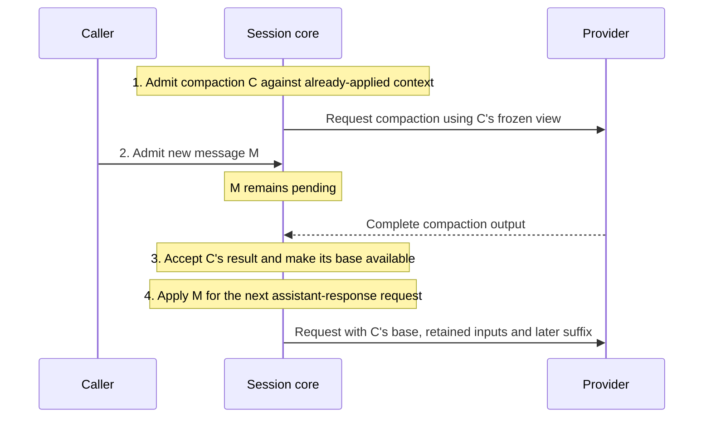

# Model requests and provider context

[Architecture](../../ARCHITECTURE.md) owns shared guarantees, terminology, and the source map.
[Verification](../../VERIFICATION.md) owns global evidence rules and gates.

## Accepted contract

### Model requests, continuation and compaction

#### Operations and frozen requests

An **Operation** is one model request or Action, owning its exact descriptor, causal source and current execution/retry facts.
Its optional **Resolution** is its immutable final result; the Operation ID also identifies that result.
A retry is another [Attempt](execution.md#admitting-an-attempt) of the same Operation; a model request admitted against new context or settings is a new Operation.

Each model Operation owns one immutable **Model Request Manifest** binding its protocol operation, provider and exact requested model through its frozen Session settings revision, historical input view, reasoning/output limits, effective context window and output contract.
References/digests identify canonical content; runtime facts retain their original rendering references.
Session facts and Operation admission share one committed per-Session order on their owning records, without a duplicate payload log.
The Operation's admission position fixes its historical boundary.
Accepted model output, call rejection and Action Resolution become available at their acceptance positions, not a producing Operation's earlier admission position.
Historical visibility does not bypass pending-input applicability, expose an incomplete Tool Result group or change Conversation/tool-call order.

If the transport answer exceeds 4 MiB, retain the received JSON prefix through the optional scratch path with a larger-than-limit note, not a claim that the complete answer was saved.
`mcp/reply.zig` judges complete and cut answers with the same envelope, result-type, content-shape, `isError` and JSON-RPC error rules; `mcp/result_text.zig` renders that judgment and classifies transport endings without an answer.
HTTP status and media type accompany the retained bytes: a proven JSON-RPC outcome takes precedence, otherwise HTTP 4xx is a definite refusal and other statuses (including 5xx) are indeterminate, without retry.
A cut result must establish each defaultable semantic field explicitly, or close its result object before missing fields take their defaults; an unread `resultType`, content shape or `isError` is not invented. A matching envelope and a valid error code with a complete message can establish a JSON-RPC error before its data finishes.
An unsent request is failed-not-run; a lost sent request is indeterminate.
Session stop before send cancels the call; after send, closing the connection leaves the remote outcome indeterminate.
Shared Action settlement preserves MCP adapter evidence, including a definite answer when stop races settlement; Bash's confirmed local stop remains cancelled.

Bash, MCP and `read_image` supply content and outcomes to the same tool-result route for excerpting, image validation, layout, optional retention, sealing and settlement. The profile is derived from the frozen tool record and offer. Core-tool migration to this route is separate work.

For a complete MCP result containing an image-typed content block, the Action Resolution retains text and validated PNG or JPEG images in content order. The `isError` wording precedes the content. Invalid image data, MIME, or media produces a short Text diagnostic in that block's position, without exposing its base64; an image is never partially retained. Other content types, including audio and resources, remain raw JSON text. One text excerpt budget covers all text runs, including image diagnostics; omitted text receives the existing omitted-byte note, and later valid images can still be retained. Scratch capacity failure settles `storage_failed`.

When optional full output is retained for a complete image-bearing result, it is rendered text with an in-place placeholder for each valid image and a diagnostic for each bad image, without image base64. Text-only results and non-result endings retain their existing rendering, including full output. Oversized or truncated answers retain their raw JSON prefix as text with the larger-than-limit note; that prefix is not interpreted as image parts and may contain base64. A saved Resolution is replayed without calling the MCP server again.

Replacement Attempts retain that historical view.
With unchanged adapter rules, they reconstruct equivalent request semantics; meaningless JSON spelling need not match.
The caller may deliberately change adapter selection/rendering rules between Attempts, so identical requests across such a change are not promised.
This does not mutate historical Session settings, provider binding, output contract, saved effect authorization or retry accounting, or permit unsupported continuation.
No frozen adapter implementation/version is required.
Credentials, endpoints, sockets, transport and nonsemantic headers remain late-bound.

#### Agent identity and peer composition

Every assistant-response and compaction request includes Rui-owned context containing the Session's bare six-character ID.
The adapter derives the address from the originating Operation, including on replacement Attempts.
It reconstructs this context after compaction and normal Host restart, separately from user instructions.
The address is not a PID, execution slot, Workspace or provider continuation identifier, and grants no additional authority.

The collaboration context adds only the Session's own address, a pointer to installed `rui --help` and the commands that read and set its own Label. The model names an unnamed Session once and never renames it unless asked, so a long-running chat that moves through many topics, such as a coordinator, keeps the name it was given, whether by the person or by itself. It does not teach how to reach other Sessions: the built-in `start_agent` and `message_agent` tools, which every fresh Session loads, carry that in their own descriptions, so a tool's description is the one place it is explained.
Scoped help and errors describe command syntax, model selection and recovery.
The general agent preamble, Workspace fact and caller-authored Session instructions remain unchanged.
Shared text files own context wording; request builders and fixtures independently encode their supplied facts.
Ordinary Bash runs in the environment of the terminal that last sent the Session work, with the running Host executable's directory first on `PATH`, `RUI_ADDRESS` (the bare Session ID) and `RUI_STORE` (the canonical Store selector); [Bash environment](execution.md#bash-environment) owns the rule.
Bash never inherits the Host's own environment or credentials.
No identity tool, alternate CLI-path variable or bundled skill is required.

Agents reach other Sessions through `start_agent` and `message_agent`; the CLI's `rui session start` and `rui session send` serve people and scripts, and also work from a Session's Bash. Either way the Host records who sent each Message.
`rui session send --session k7m2qx` takes one exact canonical ID, without JSON.
Anonymous human and script sends may select `--store PATH` or use their ordinary Store defaults.
A peer destination is in the trusted sender's Store, before HOME preferences; an explicit Store override that canonicalizes to that same Store keeps the peer identity.
An explicit Store override naming another Store is a plain caller's send there, unsigned, because a peer identity belongs to one Store and never crosses to another (#957); a harness that starts its own Host inside a Session relies on this.
The invalid-peer-context refusal names the three variables and the plain-caller form, `env -u RUI_ADDRESS -u RUI_STORE -u RUI_SENDER_HANDLE rui ...`.
Incomplete or malformed peer environment rejects without anonymous or default-Store fallback, including with an explicit Store selector.
Store selection is canonicalized without changing Session bytes.
A Session may send to itself.

Each Action receives an opaque Host-issued `RUI_SENDER_HANDLE` in its Bash environment.
The CLI captures that handle and the sender's Store and ID in the request.
The Host resolves a fresh sender from its own live Action handle and requires the full address to match.
An unknown, stale or mismatched handle saves an `invalid_sender_handle` rejection and creates no sender Activity.
A present invalid handle never becomes an anonymous send.
Human and script sends without any peer fields remain anonymous.
The Host retires the handle on observed process exit, accepted stop or Action resolution; opening the Store retires all handles from the previous Host.
The handle is private identity evidence, not model context or additional permission authority.

Recovery retransmits the saved sender and handle without reading the environment again.
Exact committed replays return their saved answer before live-handle validation.
The full sender address and handle are part of the Message's semantic digest, so reusing a key with a different sender or handle conflicts.
An accepted Message saves its nullable sender on the admission, and the send takes a position in the sender's sequence.
A rejected send from an authenticated sender saves its position there too.
Each Session's Activity therefore orders the Messages it sent and their refusals among its other facts.

The model adapter renders a peer Message's sender as a separate leading input part.
It contains only the sender's bare ID, marked as not instructions, the fact that the answer is stored as this request's result and is not delivered to the sender, and how to reply (`message_agent`, or `rui session send` for a Session without it).
The Message's own text follows unchanged.
Sending a report requires an explicit Message admission.
The receiving Session uses the existing input boundaries, pending-prefix selection, stop exclusions and original-result guarantees.
There is no separate inbox, callback or resident waiter for a future reply.
A Session created with validated parent input records its creator in immutable `session.creator_ref`, whether attached or detached.
An attached `start_agent` child also records its lifecycle **parent** in `session.parent_ref`, never itself.
A detached child retains creator provenance with no lifecycle parent.
Without parent input, the authenticated sender of a Session's first admitted Message becomes its creator, with no lifecycle parent, so an agent that starts a chat from Bash is its creator ([Session provenance](sessions.md#session-provenance)).
Creation without parent input records no lifecycle parent.
[Session provenance](sessions.md#session-provenance) owns creator identity; the following stop, ending-Message, and forwarding rules follow lifecycle parent links alone.
When a parent stops, or a Turn of it ends out of context, each of its attached children owes a stop (`session_stop_owed`, written in the same transaction, keyed `rui.core/stop/<child>/<parent>/<position>` by the parent position that caused it).
The Host runs each owed stop before any core tool call, as that child's own ordinary Session stop, which settles the owed row and passes the stop on to the child's own children.
A child that owes a stop runs none of its core tool calls; the stop cancels them.
Clients cannot use keys under `rui.core/`, which Rui keeps for its own commands, so an owed stop's key is always free.
An owed stop whose obligation a client's stop already settled, or a newer one replaced, runs nothing.
Every attached child Turn ending owes its parent an ordinary Message from the child, waking the parent through normal Message admission (D39, D122).
A done ending's Message is the child's saved answer itself, so nothing is copied; any other ending is a short line naming it, which is prompt text (D161).
An ending selected by a parent-caused stop (`session_stop.parent_caused`) settles quietly without admitting a Message (D139).
The first-hop `session_forward` ending row also owes this Message: its nullable `message_delivered` is 0 while owed and 1 after settlement; approvals and later hops leave it null.
One Store command admits the Message and marks that retained forward row settled atomically, so a retry cannot deliver it twice.
Archive suppression stays on this same row and survives parent restoration.
An attached child's approval request and Turn ending also appear in every ancestor's Activity feed, naming the Session whose Action or Turn it is (D135, D180).
An approval request queues an unpositioned `session_forward` row for the direct parent in the transaction that saves it, and a Turn ending queues one in the transaction that closes the Turn (so a root Session's Turn end writes nothing extra); after owed stops and ending Messages, the Host delivers one hop per Store command before core tool calls.
Each delivery claims a position only in the receiving ancestor, retains the delivered row and atomically queues the same child fact for that ancestor's parent, if any.
The unique `(target_ref,kind,source_id)` key and retained rows make retries no-ops, and no transaction walks the tree or grows with its depth.
A Permission Decision addressed to an ancestor may name the child's Action only after that ancestor received its forwarded request; it updates the child's Action and Turn, while the saved command retains the Session the client named.
Dormant peers retain only saved facts.

Peer composition supports one Host, which owns one Store.
Peer CLI sends cannot select a foreign Store.
The Host independently rejects unknown or mismatched sender handles before delivery, including forged wire requests.
There is no cross-Host authentication, RPC, issuer startup, foreign Store read or claimed-sender mode.
Remote-machine routing and distributed storage are outside this contract.

#### Retaining accepted output

Retain accepted model output in provider order as immutable **Model Output Items** owned by the resolved Operation, in Rui's neutral form plus a provider bag.
The neutral form is what Rui understands: each item's kind and phase, its ordered text parts with decoded text, and a call's name, call ID and arguments.
The bag keeps every other member exactly as received, including IDs, status, encrypted continuation and unknown fields; each part keeps its own bag for annotations and other part members.
Item-level `created_by` is dropped at import.
A field is neutral only in exactly the expected shape; anything else stays in the bag.
Commit Resolution, items and applicable Conversation entries atomically.
The provider codec rebuilds replay input from the neutral form and bags, writing each item canonically; the prompt cache matches what the model sees after the provider parses the request, so a rebuilt item parses equal to the received one.
Persist neither the raw item, a second replay copy nor a serialized request body.
The Host-local [history memo](#history-memo) is the only other copy of request bytes: when a request seals, its encoded input span is copied into a derived, non-durable scratch file for its Session, rebuilt from the Store on any mismatch or restart.
Preserve unknown open fields within known items.
Private reasoning, encrypted material, signatures and compaction items remain opaque and inaccessible through generic content reads.

Each assistant message has its own Conversation entry at its output item's stream position.
The entry names its producing Operation and item ordinal.
Its public text is the message's text: every `output_text` and `refusal` part's decoded text back to back, saved once as one row at import.
Each text part keeps only its length, so its text is the next that many bytes of that row, and replay reads the parts in order as ranges of it.
The item certifies that text separately from the Operation's selected answer.
Public reads check that exact binding, Session, Turn and Attempt.
Equal text may share content without sharing message identity.
Replay rebuilds each message with its phase and every part, not only its public text.

Unknown consequential discriminators—item, content block, Action subtype, compaction variant or terminal status—produce `unsupported_provider_output` with bounded typed rejection and necessary request/causal provenance, without Conversation, continuation or effects.
Complete rejected payloads are optional diagnostic detail, not mandatory permanent history.
Raw HTTP/SSE framing, token deltas and partial/interrupted/late output remain scratch, never continuation authority.

Sealed-response validation failures retain at most 512 UTF-8 bytes of rejection classification on the producing model Operation's Resolution: a local typed reason, validation stage, capture byte offset and optional output index.
Available HTTP request correlation remains on that Operation.
An HTTP status failure likewise records the request correlation the provider returned, or none.
A scheduled retry records none; the Attempt that settles the Operation, including one that exhausts retries, decides it.
The settlement type separates failures without a provider answer, which record only a code, from answered failures (an HTTP error status, or a sealed success that never reached validation), which must supply the provider's correlation, and from validation or settlement rejections, which must also supply their classification.
Save these facts in the same Attempt-checked terminal transaction; an import or commit failure follows canonical rollback/fencing rather than silently losing required provenance.
Full Session inspection exposes the classification and nullable Operation `request_id` after scratch disposal and restart.
Neither is a Turn answer, Conversation entry or continuation item.
Classification copies no provider text, arguments, private continuation or arbitrary discriminator values; an offset does not make the discarded capture retrievable.
Identifying an unfamiliar wire discriminator can still require an explicitly authorized private capture.
Existing failures are not retroactively populated.

#### Choosing and validating compacted context

**Model Context** is an optional selected Compaction Base followed by one complete ordered suffix of canonical host input and accepted model Operation results, with the binding-specific retained inputs below.
A **Compaction Base** is the derived role of an accepted compaction result selected within a later Operation's view.
Its producing Operation's admission position is the covered frontier: compaction uses that Operation's historical view, and later applicable inputs form the suffix.
The result's ownership identifies this boundary without a separate input list or coverage record.
Derive prior bases within that view; retain no durable copied request body, checkpoint row or permanent history of failed Attempts.
The [history memo](#history-memo) is keyed by the selected anchor and never selects or certifies a base.
Provider caches/previous-response IDs are optional only when their loss permits local reconstruction.

User Messages have no token-admission quota and are never silently split or truncated.
The configured **Compaction Trigger** estimates pressure, anchoring on provider usage where available and estimating newly appended content; it is not a content ceiling.
Before pending input is applied, compaction may cover only existing context; afterward, the next assistant-response request includes all pending messages and instructions, including arrivals during compaction.

The provider capability owns model-specific policy defaults.
Session configuration stores only nullable overrides for `compaction_trigger` and `output_reservation`.
An omitted update preserves the override.
Explicit `null` resets it to provider/model policy, spelled `default` in the CLI.
Triggers are positive token counts; output reservation is nonnegative extra heuristic headroom, not a provider output limit.
Current inspection shows effective values and whether each value is a Session override.
Current inspection also reports `context_estimate`: the estimated tokens the next model call starts from (eligible accepted usage, estimated bytes / 4 and output reservation), read by the same facts purpose selection reads, when that selection would compare it with the trigger.
It is null without a trigger and when the next call's purpose does not depend on it: a Session's first call, the call after a compaction, a recovery compaction and context unchanged since the last compaction.
So whenever it is shown, it reaches the trigger exactly when a model call admitted at that moment compacts, and the chat footer's `0% context left` means that.
When non-null, chat info’s Context field shows it beside the trigger; once at least half is used, the chat footer shows the share of the trigger it leaves.
Resolve policy once before purpose selection and freeze the effective values on the admitted Operation.
The Operation INSERT also freezes its model's effective context window from the selected saved-or-shipped catalog, in the same statement and Store hold, with no additional Store round.
Only absence of a catalog source selects shipped facts; an authoritative saved generation with a missing model or null window uses the 128,000-token unlisted estimate, and a non-null window, including zero, is preserved.
An overflowing compaction's settlement and successor admission both derive escalation from that failed Operation's frozen window and reservation, never the current catalog or the successor's window.
A new Operation freezes the then-selected window; retries and replacement Attempts preserve the original.
Later settings or capability changes cannot change its purpose or retry policy.

The Store keeps usage in Rui's form: four counts, uncached input, cache read, cache write and output, each a whole SQLite integer, all present or all absent.
Pressure is their sum, saturating at its maximum.
Usage anchors pressure only when its frozen request used the same model, selected Compaction Base (or no base), and effective history floor as the next request.
Replay selection owns that identity; a model return does not make older compact-recipe usage cover a restored visible prefix.
When the recipes differ, estimate retained context without that usage anchor.
The Responses provider maps uniquely named top-level `input_tokens` and `output_tokens`, with `input_tokens_details.cached_tokens` as the cache read (zero when its details are absent or null) and zero cache writes, which Responses does not bill.
A provider total is not a count.
A missing, invalid or duplicate count, or a cache read above the input, leaves usage absent, and pressure falls back to retained-context estimates; a missing counter is not zero.

The Host chooses an omitted or explicitly defaulted compaction trigger using the provider and exact model, capped at 90% of its selected catalog window. The model-specific Codex triggers follow the [Codex catalog pinned at commit `8fca6ffb92a602875a0b97e3e535eb48375bdd8c`](https://github.com/openai/codex/blob/8fca6ffb92a602875a0b97e3e535eb48375bdd8c/codex-rs/models-manager/models.json) (D111).
`gpt-6.1-sol`, `gpt-6.1-terra`, and `gpt-6.2-sol` use 450,000 tokens when the selected catalog window permits it. Other Codex models use the 244,800-token provider fallback under the same cap. A missing or null window uses the unlisted context estimate, producing at most 115,200 tokens.
An explicit count remains subject to the exact model's known context window; an excessive count is the request error `compact_at_too_large` on create or update, while an unlisted model has no known-window refusal (D166). An explicit count does not claim a model capacity or entitlement.
A legacy stored null threshold uses a fixed 115,200-token safety threshold independent of the catalog. New creation and default resets save the resolved threshold; `--compaction-trigger default` carries the reset to the Host.
Pressure uses eligible usage from the latest accepted same-binding output plus estimates for appended input and extra reservation; without same-recipe usage it estimates retained context.
Without an eligible usage anchor, add the selected built-in instruction body's UTF-8 byte length to uncovered bytes before the four-bytes-per-token estimate.
Eligible provider usage already covers those instructions, so it does not add them again.
The estimate cannot distinguish old built-in wording after a binary upgrade because no built-in version is stored.
The threshold fires at equality.
Admission reads its Session's facts with its selection, inside the Store hold and before its transaction, and does not read the appended bytes: where only their count decides the purpose it writes an assistant call whose first write is a guard that the count is under the policy's limit, and a failed guard rolls back and admits the compaction instead.
On a network Store the admitted Attempt's request starts in the same message: its settings read follows COMMIT, whole or not at all, and a request whose settings did not ride reads them in a round of its own.
Where the [history memo](#history-memo) remembers the Session's last request, that message also reads the request's first history round, from where the memo ends and by the keys that request's view had.
The memory is a hint: the round is kept only when the new view's own boundary gives the same keys and preparation then reads from the same position and tool-group scan position, and otherwise preparation reads the round itself, so a stale hint costs the round it would have saved and never a wrong entry.
The assistant successor of a compaction applies pending input even if the estimate remains above the threshold.
Provider-reported overflow still permits recovery without a configured trigger; unchanged context after an accepted base, or overflow during compaction itself, fails with `ResourceExceeded` instead of repeating compaction.

Overflow recovery applies only within an active Turn.
A terminal Turn's overflow does not force compaction in a new Turn; evaluate proactive pressure independently.
The compaction-successor exemption follows the same pending input even if compaction fails before projection.
A Session stop excludes that pending prefix, so the exemption does not suppress proactive checks for later work.

Context overflow reported before accepted output or effects resolves the rejected Operation without removing its applied input.
Local preparation and remote overflow use the same compaction policy unless their evidence changes trustworthy retry behavior.
Compaction covers that context; continuation gets a new Operation and manifest, not an equal-manifest retry.
There is no separate compaction-attempt limit, aggregate Turn request allowance or whole-Turn deadline.

Select the newest accepted base in the current lineage, then validate that exact base and complete suffix:

| Owner | Validation |
| --- | --- |
| Core | Lineage, completeness, content/digests and stored format. |
| Adapter | Demonstrated wire compatibility. |

Both checks must pass; no validity flag is stored.
Failed or unresolved compaction cannot replace a base.
Unsupported selected material fails `continuation_unavailable`, without falling back to an older base.
A selected base made for another requested model is not replayable: use the visible canonical history it covered, including exchanges its floor omitted, rather than its opaque state.
Missing or corrupt required canonical state fences the Host instead of failing only the Operation.

Configuration changes do not prevalidate or discard saved continuation.
Request preparation validates the frozen Operation's selected recipe.
The producing Operation's frozen revision supplies each item's requested model; served-model evidence never substitutes for that identity.
One output-item replay rule permits visible assistant messages, tool calls and tool results across models, but omits reasoning and compaction items from a different requested model (D192).
A model switch therefore rebuilds from visible history, costing one unavoidable cache miss; it changes no canonical output and needs no new Store column.
The ordinary compaction trigger weighs this rebuilt history for the new model; old-model compaction floors and successor exemptions do not apply.
Actual provider qualification still requires adapter evidence.
If complete retained input still cannot fit, fail with `ResourceExceeded` under terminal-settlement rules.
Never discard pending instructions to fit or impose a durable-history limit.

#### Example: compaction coverage and availability

C covers the historical view fixed at step 1.
Acceptance at step 3 makes the base usable; it does not expand coverage to include M.
The [Codex recipe](#response-owned-compaction) specifies which covered host inputs and output items the provider request retains.

#### Ordered Message and Tool Result input

Request preparation lowers canonical Message and Action Resolution parts in recorded order: Text becomes input text and PNG/JPEG Image bytes stream unchanged through the request encoder. Recorded peer sender facts precede the parts. The frozen cutoff and history floor select whole Messages and their skills. Floor selection weighs a compound value by its parts. Context pressure counts uncovered Text bytes and, where sourced, exact-model image estimates separately. For OpenAI `gpt-6-astra` and `gpt-4.1`, auto-detail estimates use certified image dimensions and the model-specific sizing rules. Usage already covering an image is not counted again. Other routes, models and sizing cases with ambiguous rounding remain unknown; unknown images alone do not trigger compaction.
Compound pressure and overflow-floor scans yield between bounded Store reads, then revalidate their frozen selection before committing. Later Messages do not enter that selection.

Preparation checks image capability against current sourced model facts for each attempt, including retries and requests after a model switch. A known-negative model with a retained Message or Action image fails with `model_image_input_unsupported` before HTTP; supported models proceed, and unknown capability proceeds unverified. Inputs are neither dropped nor rewritten. This deliberately differs from #1472’s earlier instruction to freeze policy facts: capability is an admission check rather than request content, so a later fact update may change whether a retry proceeds without changing its frozen request bytes.

For OpenAI `gpt-6-astra`, preparation also refuses an image whose dimensions provably exceed the sourced auto-detail patch limit.

Preparation accepts at most 1,500 selected images and 512,000,000 bytes in the complete encoded request, including framing and base64. Exceeding either limit saves `local_ordered_input_limit` before transfer, with no retry hint. Canonical corruption still fences the Store; provider HTTP refusals retain their existing classification. This lowering does not add public attachment ingress.

#### Adapter historical reads

Core supplies an Operation-bound read-only view for request preparation.
Only the Storage Owner accesses SQLite; adapters receive no connection or caller-chosen cutoff predicates.
The view provides:

- historical settings, applicable host inputs and accepted model results;
- complete model output in provider order, including private objects with no Conversation projection;
- each Tool Call's sole rejection or Action Resolution, complete terminal coverage at the manifest boundary, and derived Tool Results streamed in call order;
- a compaction anchor identifying its producing Operation and item ordinal, with traversal from that item through the end of the same output.

Core owns visibility, source relationships and structural coverage.
The adapter owns provider interpretation, context selection and wire encoding.

One output item grammar judges each item once, at import, and also checks the Operation there: a compaction item outside a compaction Operation, or a call inside one, is unsupported output.
The Store saves each accepted item with the replay rule the grammar judged: whether it is a reasoning item whose private `reasoning_text` content is not replayed.
The Store format fixes the grammar, so a change to what it accepts or omits is a new format, and replay applies the saved rule without judging again.
A Tool Call binds its Tool Results through its admission certificate, which the Store checks while it discovers each tool group.
Replay verifies every part's text and every bag against its digest as it copies them; a message's text parts must cover its text exactly, in order, and the text's digest is checked when the last of them reaches its end.
Every item and every part has a bag, an empty one when nothing is left over, and an item saves its part count, so replay also fences on a missing bag, a missing part, a part whose array or kind does not fit its item, or an array whose parts are not contiguous.
Corruption fences the Store.
Once continuation is unavailable, later output items are not read.

For managed Codex, derive one opaque cache-affinity value from the Store selector and exact Session reference, not from an Operation, Attempt or current configuration revision.
The Responses codec receives it in the settings item and asks for its lowercase hex form as `session-id` on every transfer, including tool continuations, retries and fresh-Host reconstruction, and sends `originator: rui` to identify the client.
Different Session references or Store selectors yield separate affinity values without another durable identity or a raw Session name/path in the headers; recreating a Store at the same selector deliberately derives the same value for the same reference.
Neither header is canonical authority, a provider-retention promise or a prerequisite for cache-independent reconstruction.
A cold-prefix native comparison found immediate reuse with `session-id` but not with `prompt_cache_key` alone; this selects the tested header without claiming a 100-Session cache-hit target.

The Host keeps per-Turn sticky routing for every provider, following the pinned Codex client ([client contract](https://github.com/openai/codex/blob/968835997714baaff199cfed5f89a2c65d8ca77d/codex-rs/core/src/client.rs#L256-L283)) without asking which provider it serves.
The codec names the routing header (`x-codex-turn-state` for `openai-responses/1`); the first value of it in a successful (2xx) response to a Turn's request is that Turn's routing state.
Every later request of the same Turn sends it unchanged: retries, replacement Attempts, tool continuations and in-Turn compaction.
A provider that never sends the header has no value to send back.
A later value in the same Turn, any value on an interim or error response, and an empty, non-printable-ASCII or over-4,096-byte value are ignored rather than failing the transfer.
No other Turn sends the value.
It belongs to the owner that received it: a ChatGPT sign-in's account and FedRAMP binding, or the one owner of a key or of no credential, which a Host never changes.
Refresh keeps that binding; observing another owner while preparing a request clears every cached Turn of that provider and advances that provider's Host-local routing epoch, matching the pinned owner-change rule rather than Rui's per-refresh credential generation.
A transfer delivers the value as its headers arrive, under its provider and launch epoch, so it cannot repopulate the table after an owner change, even if the original account later returns.
The value is Host process memory, not canonical state: the Store never holds it, a fresh Host starts every Turn without it, and each provider's table, bounded by execution capacity, replaces the least recently used Turn.
Losing it only loses stickiness, because every request carries complete reconstructed input.

Use closed semantic variants and opaque view-scoped handles, not storage rows or a generic query language.
Generic content access cannot open private continuation; the provider view grants the appropriate private reads without implying wire compatibility.
One shared, pointer-stable preparation owner retains the admitted Operation/Attempt binding, historical view and active reader, charged scratch, encoder/replay cursor and cleanup state.
There is at most one such owner across all execution slots; it is resumable orchestration state, not durable authority, a worker or a prepared-request queue.
Borrowed record metadata expires on reader advance; opaque handles remain stable until view release, and payload reads use bounded caller buffers.
The view's first round reads the frozen settings, checks that the Attempt binding is still current, finds the selected base with its anchor and checks the first page of accepted outputs; opening the view reads nothing.
It reads history in batches of 16 entries, each batch in one round with its page: each output item with its call, the items' parts in order, the first page of the tools the request ends with, and with every row the whole bytes of each content it names of at most 16 KiB.
The page is plain values on the heap for the view's life (under 300 KiB), because history below the admission never changes; a reader of a content the page kept copies from it without entering the Store and still checks its digest, and a larger content, or one the page had no room for, is read through its own reader.
A batch that comes back short is the Session's last, so the end of the walk costs no round.
The tool-group scan reads 16 source Operations and 64 of their calls a round, judging each source's item population and each call's Proposal and result as rows of one read, and a group's results come 16 a round with their small contents; a source with more calls than a round holds resumes from its next call.
No SQLite transaction spans adapter processing or network activity.
Historical retention must preserve referenced versions through required recovery; an expired or foreign handle is programmer misuse, while missing/corrupt content and resource/storage failures are explicit failures.

Preparation advances under both byte and item allowances, then returns to the **lifecycle-service boundary**.
This boundary reconciles accepted controls, advances Bash preparation/processes and services due ordinary and retained cleanup.

Each execution turn services that boundary before and after admission, consumes at most one provider completion, services the boundary again, then advances preparation once before deciding whether to wait.
Both scanned source bytes and emitted or copied bytes consume the byte allowance, even when replay discards a field.
Retained items and discarded replay fields consume the item allowance.
Large scans and many small items must therefore yield.
Every turn gives preparation a bounded progress opportunity, so finite work drains without a completion burst or large history monopolizing orchestration.

Control publication is a hint.
The Store also advances an in-memory control generation after each accepted control commits, before releasing its lock, and the lifecycle owner reconciles canonical control facts whenever that generation moved, so a lost or coalesced hint cannot suppress cancellation or delay it past the next lifecycle service, and the loop's own commits read no controls.
The Store advances an in-memory commit generation whenever a locked entry point changed rows, before releasing its lock; each turn skips its Bash, message and tool-continuation admission scans while the generation, the free-slot count and which shared preparation owners are open are unchanged since the last read found nothing.
An Action Attempt loses custody without a saved outcome only after dispatch is fenced or the Host is shutting down, and neither admits work again, so uncertain Actions come only from an earlier Host; the lifecycle owner stops scanning for them once a scan after startup finds none.
Retry admission depends on time and keeps its one-second poll.
A Store commit from any thread and a finished stream wake the lifecycle owner at once; for everything else it waits at most 100 ms between turns, 25 ms while Bash runs, and the HTTP/2 Client's own timers end a wait sooner.
A control always commits before its hint, so a lost hint still moves the control generation.
Before transport handoff it rechecks superseding controls; stop or shutdown cancels preparation, closes readers and prevents launch.
Canonical read faults fence dispatch.
Ordinary read, encode, write or seal failure settles the admitted Attempt under existing policy.
Scratch unlink or other unconfirmed reclamation retains actionable custody and accounting and blocks unsafe reuse; established cleanup releases it exactly once.
Restart derives work only from canonical Store facts and removes owned scratch before admission or refuses startup.
No preparation cursor, queue position or completion hint is durable.

Preparation writes the complete provider request into charged scratch before transport can consume it.
Stream large strings, opaque objects and unknown open fields; do not decode complete payloads or retain an item-count-sized collection.
Preserve exact historical order, and rebuild each item from its neutral form and bags so that it parses equal to the item the provider sent, minus only demonstrated non-replayable fields.
Source integrity, output completion and scratch sealing must succeed before the existing atomic transport handoff.
Partial read, write or capacity failure cannot expose an incomplete request.
Unlinked scratch files (ingress request content, provider request, response capture, response metadata, decoded event data and Session reports) are flushed from Rui's buffers and length-checked at seal or before use, but not fsynced.
They never outlive the Host process, so a sync adds no crash durability; durability lives in the Store.
A write error still fails at write time, and a later read error fails the call that reads it.

Model transport is Rui's own HTTP/2 client in `src/h2/`, built on pinned nghttp2 and OpenSSL.
It is a separate build module that imports nothing from Rui.
The TLS client settings, host naming and trust loading it shares with the Store's Postgres and MySQL wire live in their own module, `src/tls_client/`, which links OpenSSL; the Store's wire depends on it, not on HTTP/2, and SecTrust stays with h2.
The execution owner drives it on its own thread; nothing in it runs on its own except short-lived name-lookup and SecTrust threads.

Concurrent Codex Attempts to one origin share a lazily established connection pool.
The client opens another connection only when the peer's SETTINGS_MAX_CONCURRENT_STREAMS is full, and never holds more connections than streams.
One stream, sealed request file and response capture remain owned by each Attempt; a connection, TLS session or stream has no semantic authority.

HTTPS requires ALPN `h2`, checked after the peer is trusted, so an untrusted peer reports `untrusted_peer` before any HTTP/2 refusal.
A missing `h2` reports `provider_http2_required` before any request byte is sent.
Loopback `http://` uses h2c by prior knowledge; there is no HTTP/1.1 route, so local fixtures serve h2c.
The one automatic resend is a stream the server proved it did not process (REFUSED_STREAM, or above a GOAWAY's last stream id); it goes back to its origin's queue and is sent again from byte 0 within the same Attempt.
Any other failure goes to the ordinary Attempt transport-failure owner, which decides replacement and allowance.
Cancelling or failing one stream sends RST_STREAM for that stream only and leaves siblings independently owned.
Every request carries `accept-encoding: identity`, since nothing decodes a content coding, and a final head naming any other coding ends the stream `encoded_response`, which the Attempt treats as invalid provider headers.
SNI and the certificate name check use the host without a fully qualified name's trailing dot.
The client's SETTINGS advertise a 64 KiB header list limit, at or below which its own header block check always passes.

Request bodies are read from the sealed scratch file within the peer's window, never copied into a per-request buffer.
Header values that every request shares, the managed credential and the fixed fields, are referenced rather than copied per stream: the Host keeps one copy of each credential in use, wiped and freed when its last Transfer ends.
The request's scratch charge retires once its body is fully sent and the response has started, since until then a refused stream may be sent again; a long response does not hold it.
Each stream grants 16 KiB of receive credit, and the connection window is that times the streams it carries.
Every socket read lands in one shared 16 KiB buffer; the response body bytes for a stream are written from it straight to that Attempt's capture file and charged to shared scratch, and the stream's window reopens only after that write returned.
Rui therefore holds no pending capture queue: in-flight response bytes are bounded by the open windows.

A compaction transfer reserves a bounded continuation workspace in its response capture from the same scratch allowance before launch. If that reservation fails, the capture fails before transfer. The body length excludes the reservation, and the charge stays with the capture through any pending overflow-floor settlement.

The HTTP/2 Client runs on its own transport thread, so streams, PING answers and flow control keep moving while the execution owner waits on a Store round, a remote MySQL included.
The execution owner still makes every decision, each as a short call into the transport under its lock: it launches a stream only after that Attempt's admission commits, cancels it, and takes each finished stream to seal and settle; it never holds that lock across a Store call, and the transport thread never touches the Store.
Writes are synchronous on the transport thread, as is the first read of each root from the host's certificate directory during a handshake.
A disk that stalls on a write pauses every stream, and any execution step waiting on the transport's lock, until it returns; this is the accepted trade for no writer thread and no queued capture bytes.
A failed write, or scratch exhaustion, ends only that stream, and its Attempt settles with `response_write_failed` or `response_scratch_exhausted`.

Inactivity is per stream, in one shared timer list, with one PING per quiet connection.
A stream that has made no progress for the provider inactivity interval ends on its own; a slow sibling that keeps progressing is not affected.

Native completion is response readiness.
When a stream finishes, the execution owner seals the capture in the same turn and settles from the sealed bytes; a compaction overflow may retain the capture and custody while bounded floor preparation continues across service turns.
A control cancels the stream immediately and releases its custody in the same turn; there is no drainage condition to wait for.
The Host consumes the finished outcome for Attempt settlement and custody.

Transport retains the completed scratch through its cleanup boundary.
The [adapter-view experiments](../../research/README.md#provider-wire-contract) support this shape, not production qualification.

##### History memo

The history in a request's `input` array is one contiguous span, a pure function of the Session's history below the Operation's admission position, the selected compaction anchor and the requested model; history below an admission position never changes.
For views containing only single-Text Message and Action Resolution inputs, when a request seals the execution owner copies that span's exact bytes from the sealed request into the Session's memo file and records their 64-bit Wyhash digest, appending only the bytes after a span the memo itself supplied.
That copy is part of preparation: it yields in chunks under the preparation byte allowance, so a large history never blocks controls, Bash, provider completions or cleanup, and preparation hands the request on only after the copy ends.
A preparation stopped or failed during the copy keeps no memo and removes its file like an eviction.
Process memory keeps only a fixed-size index entry: Session, requested model and anchor, with the producing admission position, the last covered history position, the codec's carry (its encoder state where the span ends, a value of the codec's own type; the input state (`unopened`, `first`, `comma` or `owed`); `openai-responses/2` also holds the effort in force), the tool-group scan position, the keys the producing view read its history by (its floor, the Session's first Message, the selected base's Operation and the frozen tool set), the span length and the digest.
When the next request of that Session selects the same model and anchor and its frozen view contains the producing admission position, preparation opens the file, requires exactly the recorded length, and reads it into the request through the request writer in bounded chunks, hashing as it goes, in place of re-reading and re-encoding the covered entries; it then closes the file and encodes only later entries.
The copied bytes count only once the whole span matches the recorded digest.
The copy consumes the byte allowance and scratch charge like any other emitted bytes and the request stays byte-identical to a full rebuild.

Views containing compound Message or Action Resolution input bypass memo reads and writes, rebuild the selected parts, and still verify the durable prefix seal. Single-Text memo behavior is unchanged.

The span is append-only by construction: request N+1 of a Session begins with request N's span.
The `history_start` boundary precedes the span and opens the input array if needed or writes its prefix separator and records that separator as owed for the first history item. The span is everything the codec writes for the history items, up to the `history_end` item; whatever depends on being last, such as closing the `input` array, comes at or after it.
A codec's state at each history-element boundary is exactly its carry: before every history element and before `history_end` the shell resumes the codec's whole state from the last carry, whether the previous element ended in it or a memo supplied it, so a memo copy continues exactly as a rebuild does.

Any other case rebuilds the span from the Store, which remains the only authority: no memo, another anchor or model, an older frozen view such as a retry of an earlier Operation, a Host restart, eviction, a memo file that is missing, unreadable, not exactly its recorded length or whose content does not match its digest, or a read failure while copying.
The rebuild then writes from the span start over the partial copy, which is truncated and uncharged when truncation succeeds and otherwise stays charged until the request closes.
A failure writing the request itself fails the preparation as for any other emitted byte.
A failure while keeping a memo drops it and leaves the sealed request untouched.
Losing a memo never fails an Operation or fences the Host.
The memo is derived, never durable and never read by recovery.
Covered entries and their tool-call groups are read, authenticated and validated once, when a request first encodes them; a later request that uses the memo skips only that work, and checks the memo's content against its digest instead.
Every request still checks its Attempt, settings, the complete accepted-output population and base selection.
The table holds at most one memo per unit of Active Capacity in an index preallocated at Host start, one named scratch file `history-memo-<slot>-1.tmp` per occupied slot, and 1 GiB of memo file bytes in total, replacing the least recently used Session; a larger span is not kept.
A slot's file bytes stay counted until its removal is confirmed or its file is rewritten; later stores retry unconfirmed removals.
Those bytes have their own bound instead of a shared scratch charge, because shared scratch accounting is the Host's observable owned-work total and returns to zero at idle.
The memo holds no descriptor between requests: one is open only while a preparation copies from it or writes its sealed span into it, after closing its request writer, within the serial model preparation's descriptor excess.
Eviction and Host stop delete the file and replacement rewrites it; startup removes any left by a crash with other owned scratch.
Sessions are durable and have no end event, so an idle Session's memo lasts until eviction or Host stop.

##### Prefix seal

The provider caches requests by their prefix, so a Host that encodes the same history differently, after an upgrade or through a bug, would lose a Session's cache without any sign.
Each Session therefore stores one 56-byte prefix seal: the anchor and admission position of the view whose fully rebuilt span it records, that span's length and its SHA-256.
Every full rebuild of a span, under the same model and anchor and with a view containing the sealing view, must begin with exactly the sealed bytes.
Derive the seal's model from the existing Operation at its admission position; a different model's seal does not bind or change the 56-byte encoding.
After the request seals, preparation hashes the span from the sealed request in chunks under the preparation byte allowance, handing each chunk on to the memo being written, so the span is read once; a mismatch, or a span shorter than the seal, fails the Attempt `encoding_drift` before anything is sent, keeps no memo, and leaves the seal in place.
A memo copy is this Host's own earlier encoding and is not hashed again.
The seal is replaced by the whole span once a rebuilt span is at least twice the sealed length, so a Session writes its seal a logarithmic number of times per anchor and the seal always covers at least half of a rebuilt span; between replacements a rebuild hashes only the sealed bytes.
A seal of another anchor does not bind and is replaced; one of a later view, as when an earlier Operation is retried, neither binds nor is replaced.
The write is its own transaction, checked against the current Attempt; it records a deterministic encoding, so a request that is never sent still leaves a valid seal.
The seal covers the history span, not the request's settings and instructions before it: those follow the Session's current revision, and a legitimate settings change must not read as drift.

##### Effort inside the history

A Session pins its codec at creation, and new Sessions pin `openai-responses/2`; a Session on `openai-responses/1` keeps it and its exact bytes, since requests use the codec the Session pinned.
Under `openai-responses/1` each request's top-level `reasoning.effort` is its Operation's frozen effort, so an effort change costs the provider cache.
Under `openai-responses/2` the top-level effort is the effort the Session's first Operation for the requested model froze.
`openai-responses/3` is `/2` for an endpoint that refuses the `configuration_update` input item: as under `/1`, each request's top-level effort is its Operation's frozen effort and no request writes an effort update, so an effort change costs the provider cache and no provider error is an effort-change refusal.
No provider pins it yet.
A rebuilt history preserves effort boundaries only from Operations requesting that model; other models' effort settings are not visible conversation and may not be supported by this model.
Their tool declarations remain in place for the visible calls.
The history view yields an Operation element at each earlier same-model Operation's admission position. The codec restores its effective effort only when it differs from replay carry; a boundary back to null declines. Admission captures the current request's actual emission decision against that same replay recipe (raw newest base, compatibility, effective floor and covered anchor) and frozen first-model top. The current unrefused request emits exactly that saved decision, not a new comparison against later settings. Historical boundaries and refused retries remain representation restorations, preserving pinned request bytes and memo/rebuild parity even on the first successor after compaction.
An unambiguous provider error can refuse only a saved emitted update that changes the previous same-model admitted effective effort. A synthetic restoration of an unchanged choice, a configure cycle ending at the unchanged wire effort, a first/top-level request, and a repeated refusal are ordinary provider failures. Eligible settlement appends a `session_changed` refusal with the bounded provider report and a foreign key to the exact Operation and source, atomically with its existing retry or exhaustion transition. It creates no compensating revision and never edits the Operation's admission snapshot.
Configure owns configured-choice identity: each immutable revision freezes its source, inheriting it for labels/no-ops/effective snapshot copies and establishing a new source for a real model or effort choice. Format 66 freezes legacy raw choices for every migrated revision once, including choices newer than an unresolved Operation; a later refusal cannot reinterpret their identity. The source revision owns the nullable override. A refusal maps that exact source to its Operation's frozen previous override, including null; actual request fallback is that Operation's independently frozen previous effective effort. This distinguishes legacy null overrides carrying concrete effort without searching older, possibly unadmitted choices. `operation_effort` owns those projections for configuration, historical requests and settlement.
Refusal settlement invalidates the history prefix seal, so a memo from before the refusal cannot reintroduce the rejected item.
Initial top-level effort errors, ambiguous errors, and failures without an eligible update remain ordinary provider failures; retries use the existing Attempt allowance.
A compaction base covers the Operation elements before its anchor with the output it covers, so replay carry restarts at the frozen top; an unchanged admitted effort may require a non-refusable restoration after the base.
Every Operation is placed, whatever its outcome, because its own request carried its boundary; effort may start unspecified and then acquire a supported value, but admission refuses a boundary back to unspecified effort.

##### Tools inside the history

Under `openai-responses/2` and `/3` function tools are declared inside the history too, so adding, rewording or removing one keeps the provider cache (D53-D55, D75).
After each Operation element the history view declares, with `{"type":"additional_tools","role":"developer","tools":[…]}`, the function tools that Operation's frozen set holds and the set of the last earlier Operation since the span's start lacks; a tool record is saved once, so a reworded tool is a new record and is declared again.
The first Operation after the span's start, or after a compaction base's anchor, declares its whole set, since the base covers the earlier declarations.
A removed tool stays declared in the history, and a call to it gets the tool result `This tool was removed.`: settlement offers the Operation's own set and withdraws every tool an earlier Operation offered or an earlier configuration revision loaded.
The top-level `tools` holds only the provider-run tools (web search), which OpenAI ignores inside the history ([live check](../../research/responses-tools-probe/README.md)); turning one on or off changes the top and costs that one request the cache.
Under `openai-responses/1` the top-level `tools` holds the Operation's whole set, as before.

The Host lists every configured MCP server at startup and re-lists a server when asked (D110).
One owner on the execution loop keeps at most one list per server in flight, folds asks that arrive mid-list into one more list, and publishes only a complete list in one Store step.
A list that fails or collides keeps the previous tools and retries with backoff (1 second, doubling, capped at 5 minutes).
A server that is unreachable at startup keeps its saved tools until a retry lists it.
Startup drives the same lists and publishes every first list with the other servers' saved tools in one merge; a result that collides or exceeds the Host tool limit during startup refuses the start (`tool_name_collision`, `settings_invalid`), because the configuration is wrong now, while the same refusal later keeps the running Host's previous tools.
Operations keep their frozen offer, and the next Operation is projected from the new set (D110).
The Session's configured and loaded tool sets hold caller **intent**, snapshotted in each configuration revision; neither is a materialized current offer.
Only configure and `find_tools` write that intent. Host tool set changes never write Session intent or create configuration revisions, and change rows are not used to reconstruct it.
`store/domain/tool_offer.zig` owns one projection from intent and the Host's saved tool set: permitted MCP names resolve to today's identity (including server), unavailable names disappear, and built-ins retain their saved identity.
The configured names remain a ceiling, including for a K1-narrowed child: a new Host tool with an unpermitted name is not granted automatically.
An unavailable name returns only if it is still intended; an explicit equal-valued narrowing is authoritative, regardless of command-key spelling.
Operation admission freezes the projected loaded offer in `model_operation.tool_set_id`, atomically with admission; retries, history declarations, settlement and MCP dispatch use that immutable offer, never a new projection.
`find_tools` searches the same current projection and expands loaded intent, preserving previously loaded names that are temporarily unavailable, without loading unavailable names the caller never selected.
Admission's existing facts round also reports whether the loaded intent names an MCP record the Host's saved tool set no longer holds; a tool record is saved once per identity, so otherwise the loaded intent set is the offer and admission takes no extra round.
Only a changed or missing loaded MCP record costs a projection, which uses the Store's existing fixed scratch, not text-sized allocations.
Schema 65 adds the Operation offer reference. Migration backfills each Operation from its own revision's effective loaded set, preserving historical requests exactly.
Existing Session sets become intent as-is: conservatively, a name already missing from the Session's current effective sets does not return unless the caller asks again. No historical change-row inference attempts to recover lost intent.

#### Codex wire binding

Every request sets `text.verbosity` to `low` and `parallel_tool_calls` to `true`, for every model.
The Host decodes, dispatches and replays several calls from one response in call order, so it never asks a model to hold back; a codec writes the model's name and never branches on it ([provider_locality.py](../../tests/ci/provider_locality.py) fails CI when a codec reads or names a model), and a fact that differs by model belongs in `src/model_catalog.zig`.
The field sits in the settings envelope before the history span, so changing it under `openai-responses/1` leaves prefix seals and history memos valid; a Session's next request after an upgrade differs only in that field.
Managed requests identify the client with `User-Agent: rui/<rev>`, where `<rev>` is the build's full Git revision or `unknown` for a source archive.
These are source-parity settings, not live backend qualification.

The [pinned evidence](../../research/README.md#provider-wire-contract) selects the ChatGPT Codex `POST /backend-api/codex/responses` route with `store:false`, `stream:true` and explicit `include:["reasoning.encrypted_content"]`.
Freeze the requested model string and behavior-affecting request settings in the manifest.
Rebuild the full local input recipe; neither `previous_response_id` nor a provider conversation is required.
Explicit inclusion avoids depending on changing defaults.
Render a non-null frozen effort from the explicit Session setting, as top-level `"reasoning":{"effort":"VALUE"}`.
A null frozen effort omits the entire `reasoning` field, never sending `none`, `null` or `{}` as a default.
A replacement Attempt reconstructs the originating Operation's effort even if the Session or catalog has since changed.
Provider rejection is that Operation's visible failure, without automatic effort downgrade or model substitution.
Render the frozen baseline once: `openai-responses/1` uses top-level `instructions`, while `openai-responses/2` and `openai-responses/3` put it in the first `developer` input message. Render later applicable instruction updates in canonical order as `developer` input messages. Existing `/2` and `/3` Sessions lose their provider cache once after this upgrade, as with a built-in wording change.
This follows the first-party managed Responses builder; it does not by itself prove the live backend accepts Rui's complete recipe.
A reasoning summary is optional visible explanation, not the private reasoning needed for continuation.

The adapter prefixes the baseline instruction message with Rui's local coding-agent role and the immutable Session Workspace from the Operation-bound historical settings, followed by the exact requested model's built-in guidance and the saved baseline under `Session instructions:`.
Render Workspace as a JSON string literal labeled as path data, with its quotes and escapes preserved after decoding the outer request.
Directory-name newlines must remain escaped path content rather than instruction-section boundaries; Bash still receives the exact saved path.
This runtime context does not modify saved Session instructions or append Conversation entries.
Replay reads neither the Host's cwd nor the caller's current directory.
Tool definitions own filesystem/cwd behavior and timeout selection; timeout results own the effective budget and recovery guidance.
Static prompt text follows the running binary, not a copied per-Operation setting.
The model catalog selects built-in guidance for the six exact, case-sensitive IDs `gpt-6-luna`, `gpt-6.1-terra`, `gpt-6.1-sol`, `gpt-6-astra`, `gpt-6.2-sol` and `gpt-6.2-astra`, independently of provider.
Other IDs use the shared Rui frame and authored instructions without a specialized body; spelling similarity, namespaces and aliases do not borrow another model's guidance or change the requested ID.
Each call composes from its Operation's frozen model and authored history.
A deliberate binary upgrade may therefore change built-in wording on reconstruction or retry without changing saved instructions or Conversation.
[Source provenance](../../src/model_instructions/README.md) records the pinned Codex literals and explicit Rui compatibility edits.

Accept completed items in provider output order, not token-delta arrival order.
`response.output_item.done` supplies complete items, including final encrypted content; an added item can still be incomplete and establishes only index/kind/ID agreement with its done item, not content agreement.
Require successful `response.completed` before settlement.
The managed route can send an empty `response.completed.output` after completed stream items; this does not discard those items, while any nonempty terminal output must match all of them in order, kind, ID and exact raw item bytes, including unknown open fields and JSON spelling.
The one exception is reasoning and compaction items: the provider encrypts their content afresh for `response.completed`, so they agree by order, kind and ID, and the streamed copy is kept.
A superseded compaction prefix has no kept record, so its entries in a nonempty list are counted but not compared.
Failed, incomplete, disconnected or contradictory streams cannot publish a successful candidate.
Keep response ID, provider request correlation when supplied, terminal status, usage and reported model evidence with the producing Operation/execution; none is a replay input item.

Null response `usage` or `model` means absent evidence, like an omitted field.
Other malformed values and duplicate consumed fields still reject.
Header model evidence remains independent when the body model is absent.

Decode SSE before interpreting provider JSON: ignore one leading UTF-8 BOM, accept CR, LF and CRLF line endings, ignore comments and unknown fields, and strip at most one space after a field's colon.
A colonless `data` field supplies an empty value.
Join each event's `data` values with exactly one LF and dispatch only at a blank line; never concatenate JSON fragments without that LF.
Empty or malformed JSON data, pending data at EOF, contradictory completion and late output still reject.
`[DONE]` is recognized only as a complete decoded payload after successful completion.

SSE events outside `response.output_item.*` that are not recognized completion or failure events are notifications, including `response.metadata` and future event kinds.
Rui validates their JSON envelope and string `type`, then ignores them without granting answer, tool, completion or permission authority.
Unknown `response.output_item.*` events reject as unsupported.
Known output items, terminal status, malformed JSON, incomplete streams and late output retain their strict validation.

For the V1 text/function subset, the replay item is rebuilt from the neutral form and its bags: `type` first, then role and phase for a message or name, call ID and arguments for a call, then the part arrays, then the item bag.
Item-level `created_by` is never saved, and a reasoning item's `reasoning_text` content parts are not written.
Preserve the following fields when supplied, including absence versus null and all unknown fields inside supported open records, through the bags:

| Record | Values retained for replay |
| --- | --- |
| `reasoning` | `type`, `id`, `summary` (ordered `summary_text` records with their `text`), exact `encrypted_content`, `status` and provider metadata. An empty `content` array replays unchanged. A `content` array of `reasoning_text` records stays in canonical output as private evidence but is never replayed, following the [pinned first-party serializer](https://github.com/openai/codex/blob/968835997714baaff199cfed5f89a2c65d8ca77d/codex-rs/protocol/src/models.rs#L1611-L1618); `encrypted_content` carries the continuation. Empty summaries do not justify dropping the item; absent or empty encrypted continuation fails `continuation_unavailable` for this binding. |
| Assistant `message` | `type`, `id`, `role`, `status`, `phase`, ordered `content`; `output_text` retains `text`, annotations and log probabilities; `refusal` retains its text and remains a refusal under the output contract. Preserve `commentary`, `partial_answer` or `final_answer` phase when present; absence is not a fabricated phase. |
| `function_call` | `type`, `id`, `call_id`, `name`, exact JSON-string `arguments`, `status` and supported metadata. Host-produced `function_call_output` uses that exact `call_id` and the canonical Tool Result. Item ID and call ID are distinct. |
| `compaction` | `type`, `id`, exact nonempty `encrypted_content` and supported metadata. The item remains private. |

IDs and item statuses are input-supported fields, not response-only merely because the provider supplied them.
Do not turn assistant `output_text` into user `input_text`, decode/re-encode opaque bag members, reorder calls, or discard annotations.
The first-party SDK also removes its own `parsed`/`parsed_arguments` conveniences; Rui receives raw wire JSON and creates none, so an unknown raw field with that name is not automatically disposable.
Reasoning text stays in the Store as private parts even though replay omits it.
Transport framing, response envelopes, usage and correlation remain producing-response evidence rather than being appended to `input`.

The Codex source also recognizes legacy reasoning `text` and `compaction_summary` variants; V1 rejects them pending replay evidence rather than normalizing or dropping them.
Close consequential variants before accepting any output: item/content type, role, phase, status, annotation variant and Action control.
V1 accepts only its text/function tool catalog and one provider-hosted tool, web search, not other hosted tools, tool programs, namespaced tools or encrypted function arguments.
A `web_search_call` item (status absent, `completed` or `failed`) records a search the provider already ran inside the response; Rui creates no Action for it, keeps it whole in its provider bag and replays it so the next request sees what the model searched.
The codec also reads its action (`search` with its query, or else the first of its `queries`; `open_page` with its url; `find_in_page` with its url and pattern) and whether its status is `failed`, as output metadata; an unknown action reads as no action.
Known controls requesting those meanings (`caller:program`, asynchronous execution, a nonempty namespace or encrypted arguments) reject as `unsupported_provider_output`; preserving an unknown open field does not authorize an effect.
Provider metadata cannot fabricate host-owned tool records, permissions, instruction updates or completed work.
Reject provider-supplied `cell_id`, `executed_tool_calls` or `tool_calls_complete` in `internal_chat_message_metadata_passthrough` rather than promoting them to local authority.
Preserve other open metadata privately with its provider provenance.

Requested identity and served identity are separate facts.
Retain the exact requested string plus available `openai-model` HTTP header, `openai-model`/`x-openai-model` response-header metadata and response-body model; missing served evidence stays absent.
Differences between these sources are evidence, not an output rejection.
Retain each exact value with its source rather than rewriting it into the requested identity or fabricating agreement.
Malformed metadata and conflicting duplicate values for one header still reject.
The initial compatibility rule permits the same requested binding and replay format with retained local material; aliases are not resolved by stripping dates or matching families.
Source examples and synthetic fixtures establish serialization/reconstruction, not backend decryption or lossless cross-model reasoning.
No cross-model continuation is qualified.
A provider rejection of saved continuation fails explicitly, without retrying after deleting reasoning.
Native same-model qualification exists for exact `gpt-6-luna` on Linux x86-64 and macOS arm64; other models remain unqualified.

#### Authentication and transport lifetime

The V1 model adapter owns Codex request grammar, output interpretation, managed-route headers and authentication policy; the shared transport owns the HTTP/2 Client, sealed bytes and caller-selected response-header observations.
Core stores no credentials; Host schedules acquisition and holds an opaque credential lease through the final launch check without interpreting its contents.
Resume uses persisted provider binding, without fixture/provider substitution.
Refresh preserves account binding; decoded trusted-TLS-peer token claims are routing metadata, not independently verified identity.
Encode provider strings with one bounded JSON encoder including all required control escapes and worst-case expansion.
Before header reuse reject NUL/CR/LF/other ASCII controls and non-ASCII token/account bytes.
Accept header-safe opaque access tokens as well as compact tokens; when a token has compact syntax, require three nonempty segments and validate any consumed `exp` claim.
The pinned first-party login tests accept opaque tokens without `exp`, so treating it as mandatory would reject supported exchanges.
Account IDs are nonempty opaque exact strings, not UUIDs.
No independent token/account length quota, JWT verification/JWKS/discovery or generic OAuth framework; bounded credential/encoding owners fail explicitly on exhaustion.

`rui auth login chatgpt --device-code` (also the unlisted `rui auth login codex`) uses the pinned device-code flow and installs one global account in an owner-only `~/.config/rui/codex.json`, or an absolute path selected by `RUI_CODEX_CREDENTIAL_FILE`.
`rui host serve --set 'providers.codex={}'` activates the fixed HTTPS subscription endpoint; a development endpoint and credential-free requests can instead be configured through provider settings.
An explicit `providers` object selects exactly the providers a new Host serves; `providers={}` selects none.
When `providers` is omitted, every new-Host entry uses automatic selection, including plain `rui`, `host start`, foreground `host serve`, saved `host.json`, and file or framed-stdin settings documents.
Automatic selection offers device-code sign-in (`codex`) even while signed out, browser sign-in (`chatgpt`) with a usable local credential, and OpenAI (`openai`) with a usable local key.
Offering the device-code route while signed out does not imply usable credentials or that a model request can succeed before sign-in.
A saved `host set` of `providers.NAME...`, or `unset` of an automatically served `providers.NAME`, on a document with no `providers` object first saves that automatic set (any other `unset` below `providers` changes nothing), so the edit changes only that provider and the saved set is then exact; `--set` on `host start` is unchanged.
Divyansh chose automatic omission on November 14, 2026, answering "yes, automatic" to automatic services from sign-ins and API keys versus none until explicit setup (#1461, under #1459).
This decision supersedes the unresolved omission finding in #1452's body and review; merging #1452 did not itself approve the policy.
Upgrade replay preserves the previously observed provider selection exactly rather than re-evaluating omitted settings against new defaults or changed local credentials.
Model admission skips Sessions of any provider the Host does not serve, and `host_info` reports each provider's route.
Configuration and saved-result inspection need no credential.
The credential file and stable lock live in the same private directory and reject symlinks, wrong ownership and permissive modes; symlinks above that directory are followed, as macOS's `/var` needs, but the directory itself must not be one.
They carry a closed versioned format.
There is no Session account binding or Codex CLI credential fallback.

`rui auth login openai` reads one line from stdin (unechoed on a terminal) and installs it as an owner-only `~/.config/rui/openai.key`, or the absolute path `RUI_OPENAI_KEY_FILE` names; it then saves the provider default as every `rui auth login` does ([Human entry and authentication](session-ui.md#human-entry-and-authentication)).
An explicitly selected OpenAI provider reads that key once at startup and sends it as `authorization: Bearer` only to `https://api.openai.com/v1/responses` and the model list beside it (`/v1/models`), or to the configured `providers.openai.endpoint` Responses URL and its sibling `/models` for an OpenAI-compatible `https://` endpoint with a host and no credentials or fragment, with no ChatGPT account header.
It speaks the same Responses codec and model catalog as Codex, so a Session's request body is the same on either.
A missing or unreadable key fails startup.
A 401 on the key is final, `provider_api_key_rejected`, with no refresh or resend; the Session and overview say to save a new key and restart the Host, which keeps the key it started with.
Automatic provider selection serves OpenAI whenever a usable key is saved.

An explicitly selected `chatgpt` provider serves a ChatGPT plan sign-in from an owner-only `~/.config/rui/chatgpt.json`, or the absolute path `RUI_CHATGPT_CREDENTIAL_FILE` names, in the same credential format and custody as Codex; its record carries the issued client id and its account is the ID token's `sub`.
It speaks `openai-responses/3` and sends the access token as `authorization: Bearer` with user-agent only to `https://api.openai.com/v1/responses` and the model list beside it (`https://api.openai.com/v1/models`), with no account or FedRAMP header; its route is `chatgpt_plan`, and it accepts structured output.
Its token must carry `exp`, so it refreshes within 300 seconds of expiry and never on the eight-day opaque clock; a 401 forces one refresh over the plan's token wire, as Codex's does over its own.
Its provider fact names `rui auth login chatgpt`, and the device-code provider's names `rui auth login chatgpt --device-code`, so the Host line and the overview's notices name the command for the sign-in at hand; an expired sign-in's band names it too when the line holds it whole, and otherwise reads only "ChatGPT sign-in expired." or "ChatGPT (device code) sign-in expired." so the 40-column list pane keeps it whole.
The Host's one sign-in worker serves both sign-ins; each lease or forced refresh names the sign-in it is for.
Automatic provider selection serves `chatgpt` whenever that credential is usable.

`rui auth login chatgpt` (`src/chatgpt_plan_login.zig`) makes the host id `~/.config/rui/host-id` (owner-only, a version 4 UUID URN, never replaced) before its first authorization.
It listens on `127.0.0.1:1455`, else any free loopback port, prints the authorization link, opens a browser when there is one, and reads a callback address pasted on stdin at the same time; the first answer that is this attempt's wins, so a machine whose browser cannot reach the listener signs in by pasting.
A first sign-in names `dynamic_agent_client` and the agent name; a returning one names the saved issued client id and no agent, sends no `id_token_hint` because the link is printed, and refuses an answer for another client.
The checked record is installed through the same custody and SIGINT gate as a device-code login; it fills an unset provider default and replaces a saved `codex` one, as either ChatGPT sign-in replaces a saved default of the other because the provider table says both sign in to the same account, and a Host already serving `chatgpt` uses it from its next lease.
`rui auth logout chatgpt` ends both ChatGPT logins (Divyansh chose this on 2026-11-13), each under its own exclusive credential lock and each whether or not the other could be ended.
For the browser sign-in it revokes the refresh token as the issued client, retrying a server failure, then publishes the record `signed_out` at a new generation even when the revocation was not confirmed.
The device-code login has no revocation Rui sends, so its record is only published `signed_out` locally at a new generation; OpenAI is not told.
A `signed_out` record holds no tokens and keeps its account and, for the browser sign-in, its issued client id, which the next sign-in reuses as the issuer's guide asks; every reader treats it as no sign-in, so a lease fails with `provider_sign_in_required` and local status reports it missing.
`rui auth status` prints each provider's local sign-in, with the ChatGPT account's email and access-token expiry.
`subscription_sharing_usage_limit_exceeded` and `subscription_sharing_usage_unavailable` are quota refusals, never retried.

The credential owner serializes mutations across Hosts and login processes.
Login advances a generation.
A compact access token with `exp` refreshes at or within 300 seconds of expiry; otherwise Rui refreshes eight days after the last successful exchange.
The ID token does not determine expiry.

Refresh follows these steps under one stable exclusive lock:

1. Durably replace `ready` with `refresh_pending`.
2. Perform the remote exchange.
3. Verify the same account ID and FedRAMP routing claim, then durably install the replacement.
   A changed claim leaves the record pending and requires explicit login.

The exchange runs on Rui's HTTP/2 client, which counts a request as sent once its HEADERS frame is packed for a connection, before any of its bytes reach the socket.
If request preparation fails, or the exchange ends before that point (URL, resolution, connection, TLS or verification failure, a peer that does not speak HTTP/2, or the connect or total timeout), restore `ready` at the same generation under that lock.
The failed acquisition still returns an error; a later acquisition can refresh.
Counting at packing rather than at a successful write means a partial or failed send is never taken as unsent.
Every failure after packing, including a timeout, a lost connection, an interrupted or failed wait and a received rejection body, leaves the record pending.
Refresh error bodies distinguish `refresh_token_expired`, `refresh_token_reused` and `refresh_token_invalidated` as `provider_sign_in_refresh_token_expired`, `provider_sign_in_refresh_token_reused` and `provider_sign_in_refresh_token_invalidated`.
Every failure only a new sign-in resolves saves a code under `failure_class.sign_in_prefix` (`provider_sign_in_`), so core reads it as a sign-in without knowing which source saved it.
Unknown bodies retain the generic authentication failure.
No response text enters these codes.

A competing Host waits outside Store/Host launch locks, then reads the committed generation.
A claimant crash releases the lock but leaves `refresh_pending`.
Explicit login is required rather than retrying a possibly consumed token.
Remote rotation and local replacement are not one transaction.

File replacement writes a same-directory temporary, syncs it, atomically renames it and syncs the directory.
Abandoned temporaries are never authority.
A stable shared lock and immutable record protect the final model launch check: waiting work selects the latest generation, while launched work retains copied headers until its stream is collected or cancelled.

One Host-wide authentication worker constructs each Lease in final storage and lends its pointer through header copying and launch.
It wipes and releases the Lease before another acquisition or shutdown.
File and network waits occur outside Store/Host launch locks.
Failed load, refresh or save returns an explicit authentication/backend failure, with no model request or alternate backend.
Rui-owned private buffers and native header copies are released after their last consumer; this guarantee excludes native TLS copies.

The worker's credential and network descriptors can coexist with Bash spawn and admitted clients; startup budgets them independently of the serial execution transition.
Per-transfer HTTP version, connection reuse and hashed correlation are opt-in test-phase traces, not routine Host stderr output: diagnostic backpressure must not be required for ordinary settlement.
All Host warnings and traces use the [shared optional stderr contract](diagnostics.md#shared-optional-stderr); diagnostic loss has no canonical authority.

Credential preparation does not grant another model dispatch.
The one exception is a stale managed token.
When the model endpoint answers a managed Attempt with HTTP 401, the Store first claims the Operation's single forced refresh, which requires an absent claim and an open replacement allowance.
The Attempt stays uncertain while it holds the claim.
The authentication worker then refreshes under the credential lock, but only while the committed generation still equals the rejected lease's generation:

- A committed refresh settles the Attempt as `provider_http_401` with the provider's correlation and makes one replacement Attempt due immediately within the existing allowance.
  No backoff or jitter applies.
- If another Host or a login has already advanced the generation, the Attempt fails as answered, with no refresh and no replacement.
- A refresh failure saves its own authentication code, such as `provider_sign_in_required` for a record that requires login, and also sends no replacement.

A second 401, a stop, a crash after the claim, or restart recovery never refreshes the same Operation again.
Transport authentication failures, other HTTP statuses and unmanaged endpoints keep the ordinary failure policy.
DNS/TLS/library/capture failures likewise retain their distinct cause and launch uncertainty; cancellation requests local teardown without asserting remote termination.
Transport owns callback/header/request lifetimes through teardown and exposes neither credentials nor native mutable handles to core settlement.

#### Response-owned compaction

V1 selects the current Codex client's evidenced response route: a compaction Operation appends a request-only `{"type":"compaction_trigger"}` to its frozen complete context and uses ordinary Responses streaming.
The trigger is derived from the manifest's protocol operation, never a Conversation entry or accepted output item.
The source demonstrates this path; absence of a standalone call in that client does not prove that the subscription server rejects `/responses/compact`.
Generic API documentation does not establish subscription endpoint availability.
V1 depends on neither that endpoint nor automatic `context_management` support.
Under `openai-responses/3`, for an endpoint that refuses the trigger item, a compaction request appends no item and instead ends with the top-level `"tool_choice":"none","context_management":[{"type":"compaction","compact_threshold":1000}]`, after the history span, so the span and its carry are unchanged.
The provider refuses a threshold under 1000 tokens, and a compaction Operation runs only on a large context, so 1000 always compacts; `tool_choice` keeps the reply the provider writes while compacting from calling a function or searching the web.
With `context_management` the provider's response is `compaction`, `message`, `compaction`, and the last compaction item alone carries the whole memory: replaying only it keeps the context.
Only `chatgpt` pins `openai-responses/3`, so a ChatGPT plan Session's `compaction`, `message`, `compaction` response settles on its last compaction item: a later compaction item supersedes everything before it, as the rule below states.

Require a completed response with at least one nonempty supported compaction item for explicit compaction.
The last compaction item is the new base.
A later compaction item supersedes all output before it, the earlier compaction item included: the response interpreter keeps no record of it, so it is never stored, replayed, selected as the answer or forwarded.
The first compaction item supersedes nothing, so a response with one compaction item is unchanged, whatever comes before or after it.
Superseded items are not stored because one owner then decides what replays: the Store receives exactly one compaction item, and every later reader (the base anchor, history replay, the feed's compaction row, drop-unit accounting and the history memo) keeps reading that one item, as before.
Store the kept output once on that Operation: the whole response when it holds one compaction item, else the last compaction item through the end of the response.
The base anchor is its Operation ID and the compaction item's ordinal within that output.

Derive the replacement recipe from the covered original host User/System Instruction inputs in their original order, then the slice from that item through the end of the same output, then the complete later suffix.
Retained host inputs are existing canonical references recovered through the source recipe, including earlier bases; never copies or a newly stored request body.
This derives from the subscription client's retained user/developer input shape; retaining every host input without truncation is Rui policy awaiting live qualification.
It avoids assuming that the encrypted item alone replaces those inputs.
If retained inputs cannot fit, fail explicitly.

No separate replay object, checkpoint relation or copied compacted window is needed.
A compaction Operation produces no tool execution or Conversation projection; an unexpected Action rejects the candidate.
Its producing Operation's admission position fixes the covered frontier, including the prior base and all already-applied inputs/results within that historical view.
Result acceptance determines when the new base becomes available, not what it covered.
Pending messages and later instruction updates remain outside that frontier and appear once in subsequent context.

Keep call/result pairs intact when selecting the frontier.
Missing compaction, unknown compaction variants, truncated output and unresolved/failed compaction cannot advance it.
If a supported assistant-response protocol later enables automatic compaction, its base must likewise be a slice of that producing Operation, retaining every item after the anchor; it cannot invent a separate compaction result or drop later calls.
That route needs its own capability evidence before enablement.
Do not copy another client's message truncation, local-summary or model-fallback policy.
The encrypted item is provider-produced compressed context, not a promise of verbatim model recall; canonical Conversation remains unchanged.

## Required evidence

### Asynchronous peer collaboration

These rows target the accepted [peer composition](#agent-identity-and-peer-composition) and [non-interactive CLI](cli.md#cli-modes-and-commands), not today's runtime.
Extend existing owners and their gates; replace obsolete wait wrappers and fixed-quota assertions while keeping capture, original-result, control, delivery and cleanup coverage.

#### Native behavior and failure cases

| Contract | Canonical checks | Limits and exceptions |
| --- | --- | --- |
| Model self-address, `rui --help` pointer and self-label command, unchanged preamble, Workspace and caller instructions; peer start and reply taught only by the `start_agent` and `message_agent` descriptions; separate peer sender, local-result and how-to-reply facts; explicit report delivery through Bash still carries its Host-recorded sender (`RUI_ADDRESS`, Action handle, capture recovery) | `peer_integration.py`, `human_cli_integration.py`, `'request preparation'`, `'recorded sender facts'` | Scripted provider proves workflow and rendered facts, not future model compliance. Fixture-observer snapshots synchronize holds and audit saved outcomes. Native Linux x86-64 and macOS arm64. Compaction and replacement Attempt identity: none located |
| Peer self-send admitted with explicit and generated capture; canonical Store alias and bare Session ID; plain answers saved as request results without implicit delivery; parent receives literal backticks, `$()` and quotes byte-exact through Bash tool stdin and file sends without shell evaluation or login | `peer_integration.py`, `'a peer capture preserves'` | No sender is inferred for human or script sends; original-capture recovery is unchanged. Shared text owns prose; independent request encoding, structural validation, history and digest negatives remain |
| Peer page identities and TUI labels carry the same full six-character ID; Activity decoding rejects obsolete abbreviation metadata without changing Message selection | `activity_integration.py`, `store/tests/` `'a peer sender'`, `session_view.zig` `'a peer reference'` | Conversation decoding retains its ordinary unknown-field policy. No independent label allocation or abbreviation collision machinery |
| Bare `--session ID`; sender Store beats conflicting HOME defaults; anonymous explicit Store selection; conflicting peer Store override and malformed peer context reject before capture; JSON, prefix, UUID, NUL, uppercase and excluded alphabet variants reject without aliases | `'grammar rejects ambiguous'`, `peer_integration.py`, `sender_identity_integration.py` | Genuine no-sender external sends remain anonymous. Noncanonical references are never coerced or prefix-matched |
| Store allocates exactly six CSPRNG Crockford characters under unique insertion; actual collision retries, original creation replay, unknown update no-create; ten concurrently created peers each start and send back by ID; guessed unknown IDs admit no work | `store/tests/` `'Store allocates six'`, `peer_integration.py` | Forced secure-entropy draws exercise the collision branch independently of random chance. Scripted provider proves runtime routing, not model compliance |
| `session start` atomically allocates and admits its first Message; committed lost output and concurrent first admissions/replays retain one ID and input; rollback/rejection leave no orphan; cancellation/reopen never readmit | `store/tests/` `'initial Message'`, `server.zig` `'initial Message reply'`, `peer_integration.py` | An ID is admission, not execution/completion. Existing Message observation and original-result contracts apply |
| Refused peer creation and malformed addressed sends retain their sender position, key, code and replay identity; public activity uses a null peer without fabricating creation intent | `store/tests/` `'refused peer creation activity'`, `'a peer sender'`; `client.zig` `'client failed-send target'`; `session_view.zig` `'failed peer Messages distinguish absent targets'`; schema 58 and populated migration tests; generated OpenAPI and TS feed checks | The regression crosses Store activity serialization and strict client decoding. Canonical unknown peers stay present; invalid non-null peers and omitted target still fail. Supported Store migration preserves saved attempts; no format-49 upgrade or per-row decoder recovery is implied |
| Message and instruction stdin preserve NUL, UTF-8 and trailing newlines; file-valued/literal alternatives reject; malformed peer context cannot downgrade; errors distinguish Store, stdin read, parse, content-file read, connect and uncertain admission | `peer_integration.py`, `admission_integration.sh`, `'grammar rejects ambiguous'` | Linux/synthetic evidence is separate from physical Mac qualification. No automatic report delivery or provider parser change |
| Action-issued sender identity; forged, missing, empty, unknown and misbound handles fail closed; exit, stop and restart retire authority; exact committed capture replay preserves admission after retirement | `'a peer sender is resolved'`, `'peer wire rejects old'`, `sender_identity_integration.py` (in `check`) | Single Host only. Handles never appear in public snapshots or model context. Native fixture uses a controlled scripted provider |
| Conflicting explicit peer Store fails before capture; forged foreign-Store context reaches the receiving Host, saves `invalid_sender_handle`, replays its rejection and creates no recipient admission | `peer_integration.py` | Successful cross-Store peer delivery is unsupported; no RPC, issuer startup, foreign Store reads or claimed-sender mode |
| 60 s mutation reply inactivity, shared with transfers | `ResponseTiming.zig` `'renews mutation inactivity'`, `'a mutation answer after five seconds'`; TS `unit.test.ts` `'a Host that answers after five seconds'` | Intake independence, held credit, peer burst and native stall: none located |
| Peer selection progress and Host stop | `'skipped continuation'`, `host-stop-integration` | Peer input: none located. Iterated stops are not group cancellation |

#### Per-call accounting and 100-agent acceptance

| Contract | Canonical checks | Limits and exceptions |
| --- | --- | --- |
| Per-call cost decomposition of a real send | planned | None |
| 100 collaborating Sessions | planned | A live task needs spending authorization |
| ≤25,000,000 bytes Rui memory and 95% of sends in ≤1 s | planned | Includes CLI helpers. No throttling to pass |

### Context, provider output and compaction

#### Historical inputs and settings

| Contract | Canonical checks | Limits and exceptions |
| --- | --- | --- |
| [Frozen request inputs](#operations-and-frozen-requests) | `'selection freezes its'`, `'request preparation'` | Sizes are qualification workloads |
| [Built-in model instructions](#codex-wire-binding) | `model_catalog.zig` 'built-in instructions select only four'; `model_adapter.zig` 'request preparation streams exact built-in'; `turn_policy.zig` 'built-in instruction pressure'; `store/tests/compaction.zig` 'built-in instructions contribute'; `dispatch_integration.py RUI builtin-instructions`; `measurement-check` | Exact-ID and generic fallback, literal composition and escaping, provider-independent guidance, frozen model and authored updates on retry, saved-key replay and compaction. Pressure checks cover missing and eligible usage, model changes, byte remainders, saturation and threshold -1/equal/+1. Omitting built-in bytes must fail the intended pressure assertion. Binary upgrades can change built-in text. No live provider acceptance or quality claim. |
| [Reasoning effort](conversation.md#selecting-current-settings), listed-model admission and unlisted-model passthrough | `'reasoning effort checks listed models'`, `'configuration validates effective effort'`, `'unlisted effort passes configure preset Message creation'`, `'a start_agent child works'`, `'request preparation keeps the starting effort'`, `'a refused top-level effort'` | Every grammar effort passes unlisted-model Configure/preset/creating-Message/child admission and ordinary/compaction request bytes; listed unsupported efforts and null remain refused. Initial provider refusals retain their code/report, while update refusals follow the row below. Sealed length and scratch release are checked. No live backend qualification |
| Effort update refusal (D77, D137, D218) | `codecs/responses.zig` 'effort update refusal requires'; `model_adapter.zig` 'a refused effort change'; `store/tests/` 'effort refusal requires an emitted', 'effort provenance excludes refused Operations', 'admitted effort carry agrees'; `model_adapter.zig` 'Operation effort emission'; `activity_golden_tests.zig` 'activity golden'; `store/sqlite_tests/` 'the previous Store format preserves'; TS feed 'a refused effort change' | A targeted invalid/unsupported-request body and rejecting status classify in the codec; another 400 and ambiguous/malformed bodies do not. Low→high refusal retains provider text, retries without the update, and the next Operation reports low, with memo/rebuild equivalence. Owner-domain coverage spans null and every concrete effort, legacy frozen settings/nullable overrides, unchanged wire effort, unadmitted configure cycles and skipped choices, /1 and /2, unrelated revisions before/after admission and refusal, no-op revisions, and deliberate re-selection. Compaction successors distinguish actual emissions, unchanged-choice restorations and retry fallback restoration, then compare current-to-history prefixes and memo/cold rebuilds. The relational carry matrix covers absent/incompatible newest bases, floors below/equal/above base floors, anchor boundaries, other-model boundaries and null tops/boundaries. Format-65 migration tests freeze every legacy choice before a later refusal and preserve original emission decisions across reopen on SQLite and configured live MySQL. Ordinary golden change rows carry explicit null provider text. An exhausted Attempt still saves the refusal and later Operations use the preceding effort. Previous-format SQLite rows survive migration and the new text bound holds; the baseline MySQL migration comparison runs only with a configured live server. No live-provider refusal qualification is claimed. |

#### Provider validation and output ownership

| Contract | Canonical checks | Limits and exceptions |
| --- | --- | --- |
| [Independent requested and reported model identity](#codex-wire-binding) | `'provider interpretation preserves independently reported model evidence'`, `dispatch-integration` evidence cases | Exact source-separated certificate, absent sources, differing headers and body, unchanged saved items, original public answer and correlation through restart. Malformed body metadata and conflicting duplicate values for one header still reject. Synthetic, not live provider or cross-model continuation evidence |
| [Answer and tool-call acceptance](execution.md#accepting-an-answer-or-tool-calls) | `'Bash descriptions'`, `'complete call outcomes'`, `'message phases'`, `'partial answer fixture'`, `'synthetic gpt-6-luna shaped'`, `dispatch_integration.py phased-messages` | Synthetic streams, not recovered live captures. Commentary, partial-answer and unphased messages interleave calls, select one result, replay exact items and survive Host crash/restart. The partial-answer item shape comes from the pinned first-party fixture linked in Architecture, not executed upstream-test proof. Missing finals without calls, duplicate finals and unsupported phases reject |
| [Saved call lines](execution.md#accepting-an-answer-or-tool-calls) | `store/tests/` 'MCP settlement saves one decoded presentation line or the tool name', 'saved MCP call lines survive all work reads pending, running and completed at every boundary'; `session_work.zig` 'saved MCP call lines survive pending, running and completed Actions at every boundary'; `overview_view.zig` 'a saved MCP running line fits overview rows without narrowing its saved bound'; `tool_presentation.zig` 'saved call descriptions allow 200 bytes without widening Labels'; `tools.zig` 'rejected Bash arguments name what is wrong'; `session_view.zig` and `protocol_reply.zig` focused tests | 100-, 101- and 200-byte lines survive pending, running and completed MCP Actions through Current, Activity, Session list and Message progress; overview rows fit long lines at UTF-8 boundaries. Exact 200-byte ASCII, multibyte UTF-8 and escaped lines survive settlement; missing, mistyped, blank, multiline and overlong values fall back. Bash and Labels remain 100 bytes; MCP consent uses the saved line without parsing arguments. |
| [Refusal preservation](#codex-wire-binding) | `'provider refusal'`, `'the item grammar'`, `dispatch_integration.py refusals` in `dispatch-integration` | Synthetic refusal-only and mixed text/refusal messages preserve public result and Conversation text through Host crash/restart. Saved neutral parts and replay retain the refusal type. Missing, null and duplicate refusal text, unsupported blocks, delta-only responses and incomplete streams still reject |
| [Usage counts](#model-requests-continuation-and-compaction) | `"responses usage maps onto Rui's four counts"`, `'compaction exact threshold zero reservation'`, `'compaction pressure uses the latest accepted output even without usage'`, `dispatch_integration.py` neutral usage columns | Cached tokens split from input, null or empty details, cached above input, duplicate, fractional, negative and over-range counts, a total alone, saturating sum at the threshold. No live cached-token report |
| [Session codec binding](store.md#store-format-and-upgrades) | `'a Session pinned to a codec this Host cannot build fences its settings'`, `'persisted settings survive reopen'` | Another codec version or any codec options fence; label CHECK rejects uppercase, leading digit, dot, empty and 17-byte labels and empty options. No second served provider yet |
| [MCP image results](#operations-and-frozen-requests) | `tool_result.zig` 'result budgets image diagnostics and keeps a later image', 'result accepts exactly the full image part limit', 'result reserves final part for refusal text'; `result_layout.zig` 'layout reserves a trailing run at the part limit', 'layout merges text and notes and commits only successful images'; `image_intake.zig` 'replayable intake validates before capture and preserves preceding parts', 'intake rejects invalid replayable and oversized images before capture', 'image diagnostic is written in place'; `server_read_image.zig` 'read_image preflight precedes result allocation and OOM fences'; `server_mcp_tests.zig` 'Host MCP settles image parts on the original call', 'Host MCP malformed image settles canonical text without base64', 'Host MCP image scratch exhaustion settles storage failure without fencing', 'Host MCP definite image settlement survives an earlier Session stop'; `server_mcp.zig` 'MCP image part limit accounts for empty text tails', 'Running oversized JSON and SSE answers preserve borrowed evidence until release'; `read_image_integration.py mcp-mixed` | Cover mixed ordering, six bad images followed by 20,000 text bytes and a valid image, one budget including diagnostics, the 1,500-part boundary, text-only golden parity, scratch exhaustion, stop and stale settlement, restart replay without an MCP re-call, oversized raw prefixes, and a synthetic provider request with the original call ID and exact image bytes. Reverting mutations must fail the relevant checks. No live provider vision is qualified. |
| Image model admission and context cost | `model_catalog.zig` `image capability`, `model_catalog_main.zig` `image`, `model_adapter.zig` `image model policy` and `Astra image patch limit`, `compaction.zig` `known image costs`, `read-image-integration` | Exact generated modalities retain supported, unsupported and unknown. Message and Action inputs are checked on preparation, retry and model switch; the provider fixture checks refusal before HTTP without another Action attempt. Sourced auto-detail estimates cover uncovered images, while ambiguous and unlisted cases remain unknown. |
| Additive Responses image encoding under `/1`, `/2` and `/3` | `test_image_input_fixtures.py`, `codecs.zig` `'additive'`, `responses.zig` `'every item at its longest'`, `request_encoding.zig` `'base64 cursor'`, `model_adapter.zig` `'raw image preparation'` | Six full-request goldens pin each codec's regular and compaction wire bytes. Independent typed-wire fixtures, actual raw PNG, RFC 4648 vectors, every small split, large-window schedules and mixed whole-element resume cover new encoding. Native neutral-item fixtures exercise the production verified Content reader, charged request writer, cancellation at every byte boundary, capacity, write and digest failures. Canonical compound Message replay, cutoff, peer prefix, request limits, cancellation and memo/seal behavior are checked by the `canonical ordered Message` tests, the `historical compound` tests, and the server encode-failure test. The `canonical ordered Action Resolution` test checks typed tool output and the single-Text string; `compound Action Resolution pressure` and `floor weighs compound Action Resolutions` cover accounting and whole-unit selection. These checks alone do not qualify MCP image ingress or live model vision. |
| [Message text stored once](#retaining-accepted-output) | `"a message's text is stored once and its parts replay as lengths of it"`, `"a large message's parts read only their own ranges"`, `'replay fences part damage that keeps every digest'`, `'public assistant message provenance'`, `dispatch_integration.py` saved parts | One public row per message with empty and escaped parts; a part length that overruns or leaves text uncovered, and changed text bytes under the same digest, fence replay. A memo hit reads no part text, so it checks nothing |
| [Prefix seal](#prefix-seal) | `'prefix seal'` in `model_adapter.zig` and `prefix_seal.zig` | Restarted-Host rebuilds over six rounds of reasoning, message, call and denied-result history keep and replace the seal; a flipped digest, a longer or shorter seal fail `encoding_drift`, keep it and keep no memo; another anchor is replaced and a later view's seal kept; a memo hit is not rehashed. No upgrade between real Host versions |
| [Codec encode contract](execution.md#effect-interfaces-and-evidence) and the append-only history span | `'request preparation'` goldens, `'every replayed output item parses equal'`, `"request N+1 begins with request N's history span"`, `'a history memo hit writes exactly the bytes'`; `test-logic` `'CM-45 input boundary transitions cover each version and carry state'`, `'a resumed encoder writes what an uninterrupted one writes'`, `'every item at its longest fits max_pieces and names only handles it has'`, `'an encoder resumed from a carry separates its next input item only after an earlier one'`, `'a tool entry escapes'` | Byte-identical requests through the codec over six rounds of reasoning, message, call and denied-result history; a fresh encoder resumed from any element's carry writes the bytes of one encoder never resumed; every item the Host can give, with each handle set it can give it, from every encoder state, takes at most `max_pieces` pieces, the longest exactly that many, and names only handles it has. Only the built-in native codec |
| `provider_codec_failed` | `'an encode failure settles unanswered and releases request scratch'` in `server_execution.zig`; `'a codec that declines fails provider_codec_failed before any request exists and leaves no scratch'` in `model_adapter.zig` | The Responses codec declines an opaque block that carries text, which the Store never holds, so a test fault gives it one in place of an item. A codec declining at `settings`, a message or `request_end` leaves no request, no scratch charge and no retained file. The execution owner settles a codec that declines at `request_end`, after every earlier item already wrote request scratch, unanswered as `provider_codec_failed`, with custody and scratch released and dispatch unfenced, the path `request_write_failed` and `request_seal_failed` exercise in `dispatch-integration`. `provider_codec_unavailable` is not reachable: the Store fences a Session pinned to a codec this Host cannot build |
| [Codec request headers](execution.md#effect-interfaces-and-evidence) and their order | `"a prepared request carries the Responses codec's headers"` in `model_adapter.zig`; `'ChatGPT headers carry the routing value only when the Turn has one'`, `'an API key goes only over https'` in `providers.zig`; `'a Transfer that fails to start'` in `provider.zig`; `test-logic` `'the request headers ask for the stream'`, `'a header value is printable ASCII'`; `codex-h2-integration` | The Responses codec gives `accept`, `session-id` (hex of the Session's affinity) and `originator` and the prepared request keeps them in that order; the credential path writes only the credential, `user-agent`, FedRAMP and turn state after them, and the synthetic H2 peer sees content-type, codec headers, credential fields, `user-agent`, FedRAMP in that order; codec headers count toward h2's 16 fields |
| Codec headers never name a Host field | `'the Responses headers are lowercase tokens, header-safe, within bounds and name no Host or h2 field'` in `model_adapter.zig`; `'ChatGPT headers carry the routing value only when the Turn has one'` in `providers.zig` | Over every effort and sampled affinities, the Responses headers are distinct lowercase tokens with header-safe values within 8 headers whose values total at most 192 bytes (names are the codec's `RequestHeader` constants and are not counted), none naming a field the Host writes (`authorization`, `chatgpt-account-id`, `content-type`, `user-agent`, `x-openai-fedramp`, `x-codex-turn-state`) or h2's own; every field `providers.Headers` writes is one of those Host fields |
| [Codec classify contract](execution.md#effect-interfaces-and-evidence) | `'an HTTP error body keeps'`, `'context overflow requires exact valid provider code over HTTP'`, `'a large error body classifies as its small twin does'`, `'a malformed number makes a body not JSON'` in `output_decode.zig`; `'HTTP 429 quota'`, `'quota and policy stream failures permanent'` in `model_adapter.zig`; `'every refusal saves one provider code'`, `'a saved quota record reads back'` in `transport_policy.zig`; `'saved failure codes name what the person can do'` in `failure_class.zig`; `'a file maps read-only'` in `os/pages.zig`; `test-logic` `'classify answers the same with 0xAA or leftover scratch'`, `'the reader accepts exactly the objects std.json accepts'`, `'the reader accepts exactly the numbers std.json accepts'`, `'a value nests at most max_depth deep'` | The Responses classifier, given the sealed body whole through a read-only map, names each provider code it knows as a neutral refusal (quota, plan, policy, model unavailable), which saves `provider_<refusal>` with the provider's code kept in the report, and gives the overflow and report as before, for a body of over 850 KB whose report parts lie at its start and end, and answers the same with its scratch filled with 0xAA or left over from another body; the reader accepts exactly the objects and numbers `std.json` accepts, so a body with a malformed number such as `1.2.3` narrows nothing and keeps no report; a sealed body shorter than its length stays `response_read_failed`. Only the built-in native codec |
| [Codec interpret contract](execution.md#effect-interfaces-and-evidence) | the grammar, stream, usage and fuzz tests in `output_decode.zig`, ported from `provider_output.zig` with their expected values, among them `'the item grammar rejects unsupported meaning and preserves open fields'`, `'import names the first rule broken in lookup order'`, `'a 4 MiB reasoning item interprets whole as one event'`, `'escaped envelope keys name their fields and repeated unknown keys stay unread'`; `'provider interpretation preserves independently reported model evidence'` in `model_adapter.zig`; `'a write after the map is visible through it'` in `os/pages.zig`; `test-logic` `"the codec's JSON reader names each syntax error as validation did"` in `codecs.zig`, `'every entry point answers the same with 0xAA or leftover scratch'`, `'an accepted item walks as its bag members and parts in document order'`, `'a function call, a reasoning item and the output list walk as acceptance splits them'`, `'an event that is not JSON fails for the reason validation names'`, `"the judge's verdict on an item reaches the shell as its reason or replay rule"`, `"a provider's error names its report, its refusal and context overflow"` | The codec's interpreter and the shell's grammar accept and reject what `provider_output.zig`'s validation did, which an oracle running both over every one of these streams (153 accepted, 369 rejected) proved before validation was deleted: the same event data and metadata bytes, validated counts, digests, answer, evidence, provider failure and rejection code, kind and detail; the item tables now name each rejection's reason, and the JSON reader's error names match validation's by a recorded digest. An escaped envelope key names its field, so an escaped repeat of `type` is a duplicate, and repeated unknown keys are not read. A 4 MiB reasoning part reaches the codec as one slice; event data written after the map is read through it; the codec answers the same with its scratch filled with 0xAA or left over. Only the built-in native codec |
| [Reasoning text is private evidence, not replay input](#codex-wire-binding) | `'every replayed output item parses equal to the item the provider sent'`, `'without its private reasoning text'`, `'large private reasoning item within each advance'`, `'fences a saved provider bag whose bytes changed'`, `'replay fences part damage that keeps every digest'` | Synthetic saved items, saved with the replay rule the import grammar judges: ordered, reordered, whitespace and escaped `content` keys drop under three emission schedules while summary, `encrypted_content`, status and open fields replay exactly; empty `content` and a prefix-named open field stay. Saved bag bytes whose digest no longer matches fence on replay, as do a missing part, an inflated part count and a part that does not fit its item. Not live backend acceptance evidence |
| Empty selected answers complete with no result text; nonblank answers retain surrounding whitespace | `'completed empty assistant answers'`, `dispatch_integration.py empty-answers`, `human_cli_integration.py empty-answers` | Synthetic phased and unphased empty/Unicode-whitespace answers, exact nonblank bytes, inspect/read-result, crash/restart replay and a usable TUI composer. Existing missing-final, duplicate-final, malformed and incomplete controls remain required |
| [Codex per-Turn sticky routing](#adapter-historical-reads) | `'turn state observation'`, `"a routing value replays one Turn's first value"`, `'owner changes invalidate paused Turns'`, `"two providers' Turns keep their values"`, `'ChatGPT headers carry the routing value'`, `codex-integration` turn-state journey | Synthetic h2c fixture: no value at Turn start or after an error answer, first successful value replayed unchanged on a 503 retry and a tool continuation, none for a later Turn in the same Session or a continuation after Host restart, and no Store row holds it. Account/FedRAMP changes invalidate paused Turns and reject old-epoch completions before and after the original account returns; refresh preserves the epoch. These owner transitions, first-value and least-recently-used replacement are value tests; the fixture credential cannot switch accounts. Not live routing evidence |
| Codex credentials, H2 and cache affinity | `codex-integration`, `codex-credential-integration`, `codex-h2-integration`, `'Codex affinity'`, `'refresh transport'`, `'only a refresh proven'`, `'sent or uncertain refresh'`, `'refresh rejection bodies'`, `'selection refreshes'` | Synthetic. Raw h2c peers cover not-sent evidence (refused connect, peer gone before its SETTINGS, an HTTP/1.1 peer) and a sent request with a lost reply; `test-h2`'s exchange cases cover the total deadline's sent flag. Every failure after HEADERS are packed retains pending. Value tests cover body codes and the inclusive 300-second margin. H2 needs `h2==4.3.0` ([requirements.txt](../../tests/integration/requirements.txt)) and is not in `check-full`. Live refresh HTTP is unverified |
| [One forced refresh after a managed model 401](#authentication-and-transport-lifetime) | `'a refresh claim'`, `'a forced refresh runs only'`, `'only an answered model 401'`, `'a 401 forced refresh is claimed'`, `codex-integration` forced-refresh journey | Synthetic h2c covers an identical replacement, a second 401, login-required failure and newer ready or pending credentials preserving the answered 401 and correlation without resend. Value tests cross ready/pending state with equal/different generation. Store tests cover the durable claim across transient failures and reopen, stale binding and the final Attempt boundary. The fixture republishes synthetic tokens, not remote refresh HTTP. Cross-Host generation exclusion is a unit test; crash recovery is Store reopen, not a Host-process cut. Stop during refresh is untested |
| [Codex request envelope](#codex-wire-binding) and supported-model compaction defaults | `codex-integration`, `codex-h2-integration`, `'supported model compaction'`, `'request preparation'`, `'only the pinned table'` | Synthetic outgoing HTTP bodies and revision header, all nine exact IDs and both parallel policies. Unknown IDs retain no inferred trigger and no parallel calls. No live backend qualification |
| Live Codex journey | `python3 tests/integration/codex_live.py /absolute/path/to/rui --live --model EXACT_MODEL` | Opt-in with authorized credentials. Never a gate |
| Compaction on context overflow | `'compaction overflow'`, `dispatch-integration`, `human_cli_integration.py` | Synthetic. Live compaction: none located |
| [Superseded compaction prefix](#response-owned-compaction) | `output_decode.zig` `'a later compaction item supersedes everything before it, and a first one nothing'` | One table: one compaction item alone, after reasoning (empty and full terminal list), before a message, and between both, all kept whole as before; compaction, message, compaction (empty and full terminal list), after reasoning, and with a message after the last; two compaction items; no compaction item; a call before, between and after. Kept items, first kept item, answer and released metadata charge. Synthetic stream; the live shape is from the plan-route probe, not a gate |

| [Release-supported model IDs](cli.md#supported-model-ids) | `human_cli_integration.py compiled-models` in `check` | Exact shipped help/error/notice membership; malformed explicit and saved IDs rejected before capture or input reads; accepted IDs, retained stale pins, one detached startup notice and quiet attach, valid and cleared defaults. Client defaults remain shipped; fixture endpoints do not prove account entitlement or live qualification |
| [Runtime model catalog](cli.md#supported-model-ids) | `store/tests/` `runtime catalog` cases on SQLite and MySQL, SQLite read-failure fencing, capability/list renderer tests and the native client oversized-reply test; `codex_h2_cases.py saved_catalog_run` through `codex-h2-integration` | No source, changed window/efforts, saved-only and removed IDs, null windows, authoritative empty generations, restart, conditional 304, failed refresh/publication, coherent reads during refresh, list order/known/source and replies beyond the shipped bound. The Store round-budget test pins one catalog-read round and one added configuration-admission round; model-Operation admission freezes its selected window inside the existing INSERT, with no new round. `frozen context window` Store cases cover selection, retry/reopen and refresh in both directions before overflow settlement and again before successor admission, exact floors/levels/dropped history, exhaustion, reservation and model changes; separate shipped/live-reader mutations must fail. Offline defaults remain unchanged |
