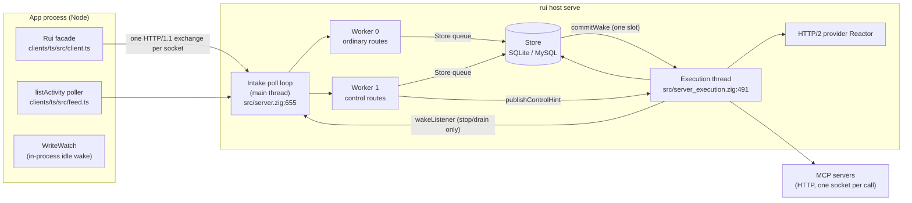
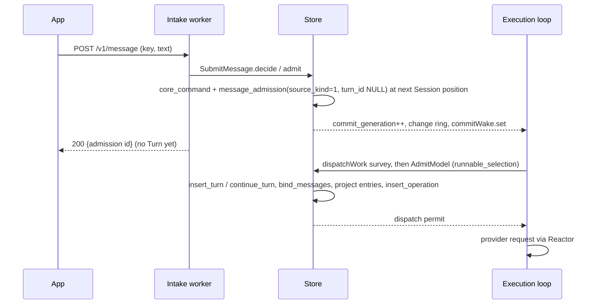
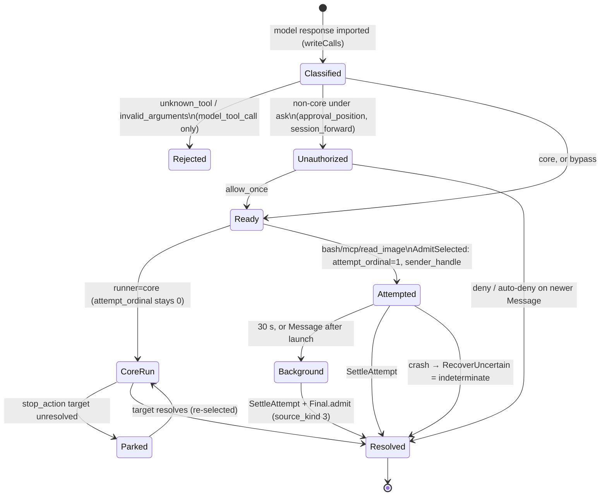

# How Rui records and delivers work today

The Host wire, activity feed, tool calls, Session input queue and Store, written up as grounding for four additions:

1. a connection an app holds open, on which the Host pushes Session events and client tool calls;
2. client tools that the app runs in its own process;
3. importing history that Rui did not run;
4. a reset that starts a new context and keeps the history.

**Sources.** This document combines three explorer traces (`wire.md`, `tools.md`, `store.md` in this folder). I checked the load-bearing claims and every contradiction against the working tree at `/home/user/rui`. That tree is on branch `research/pi-durable-surface`, HEAD `d93049f7d`. I read code and contracts and executed nothing. Each claim is marked as one of three kinds. **Read** means seen in source or contract text. **Inferred** means reasoned from what was read. **Unverified** means named, but nobody traced it. Citations are `path:line` relative to the repo root. Where an explorer's line number had drifted, I use the number I found.

---

## Overview

Rui is a single-process **Host** written in Zig. It owns one **Store**, which is SQLite or MySQL. Clients reach the Host over a Unix-socket HTTP/1.1 wire. The TypeScript client in `clients/ts` spawns the Host as a child process and speaks that wire. Three properties shape everything else, and each of them bears on one of the four additions.

1. **The Store is the only memory that counts.** All work is a set of rows: queued Messages, Turns, model Operations, tool calls, Actions, approvals, stops and forwards. Nothing that waits is held in Host memory. That covers a pending approval, a parked `stop_action`, a dormant Session and a background Action's final result. When the Host restarts, it re-derives what to do from those rows. The resident-memory invariant makes this a hard rule (`docs/contracts/resources.md:63-71`).

2. **Every observation is polled.** One HTTP request gets one reply, and then the connection closes (`docs/contracts/inspection.md:532`). The activity feed is a read-time projection over canonical rows, paged by a per-Session position cursor. A `since` token lets a poll return `not_modified` cheaply. Nothing in the Host ever tells a client that something changed. The TS client's idle "wake" only notices that client's own writes.

3. **One execution thread does all the work, and it learns about work through commits.** An admission commits and bumps an in-memory commit generation. A single atomic "commit wake" slot then wakes the execution loop. The loop surveys which kinds of work exist and runs each through a policy core. The wire side (an intake poll loop plus two blocking workers) never runs a Turn.

Today the four additions have these footholds:

| Addition | What already exists | What blocks it |
|---|---|---|
| Push connection | The intake loop is already a `poll()` event loop over any number of sockets. The change ring already records which Sessions each commit touched. | One exchange per connection, `Content-Length` framing only, no Transfer-Encoding. The commit wake has exactly one subscriber, the execution thread. |
| Client tools | Decided in #2039 (closed 2026-11-23). An Attempt runner template exists (MCP, read_image). So does a parked-core-call template (`stop_action`), and one settlement route serves every runner. | `Owner` and `Runner` are closed enums mirrored in SQL CHECKs. The Runner is derived in three places, with bash as the default. There is no second Attempt, so the "safe to repeat" replay rule is new Store behavior. |
| Import | Nothing. There is no door, and the contract forbids history transfer in V1. | Entry kinds are closed to four. Each kind's provenance is foreign-keyed to a real Admission, Operation, output item or Action. Positions only append. |
| Reset | `history_floor` plus `replay_recipe.Recipe{frontier, floor}` already shapes every request. The feed already has a `compacted` row. | The floor is allowed only on a compaction Operation (a schema CHECK). It is computed only by overflow escalation. The first Message is never dropped. There is no door. |

---

## Key Concepts

Each term below is used in the repository's sense.

- **Host.** The `rui host serve` process. It owns one Store through an ownership lock, plus one Unix socket at `<interface.dir>/rui.sock`.
- **Store.** The canonical database (`src/store/Store.zig`). Every mutation is one function, and every locked entry point runs through `Store.enter` / `Access.finish` (`src/store/Store.zig:2120-2136`, `:2058-2084`). If anything other than a declared ordinary outcome happens there, the Store is **fenced**.
- **Session.** A conversation with its own **position sequence**. The counter is `session.next_position`, and every ordered fact in the Session draws from it (`src/store/access.zig:15-31`).
- **Message admission.** A row in `message_admission`, which is the Session input queue. Each row has a `source_kind`: 1 person, 2 peer, 3 action_final, 4 action_value, or 5 server_event, which is reserved (`src/store/domain/sourced_input.zig:7`). A row is *queued* while `turn_id IS NULL`.
- **Turn.** One unit of answering. It starts when the execution loop binds queued input to a new Turn, and it ends with an `outcome_code`.
- **Operation** (model Operation). One model request inside a Turn. It has a frozen settings revision, a frozen **tool offer**, a `purpose` (assistant response or compaction), and optionally a `history_floor`.
- **Conversation entry.** One immutable history row. There are four kinds: 1 Message, 2 instruction, 3 assistant output item, 4 skill (`src/store/schema.zig:1723`).
- **Tool call / Action.** Each tool call in a model response becomes a `model_tool_call` row. An accepted call also gets an `action_operation` row, called an **Action**. An Action is either resolved directly (core tools) or through one **Attempt** (bash, MCP, read_image).
- **Runner.** Who runs an accepted call: `bash | read_image | core | mcp | provider` (`src/tool_record.zig:345-351`). It is derived from the tool name, never stored (`docs/contracts/execution.md:122`).
- **Active Capacity / custody.** A fixed array of credits, 100 by default. Every live Attempt holds one custody record, and custody is process-local (`docs/contracts/resources.md:14-20`).
- **Background Action.** An Action promoted out of its Turn, either automatically after 30 s or when a Message arrives after launch. Its final Resolution comes back as Session input with `source_kind = 3`.
- **Activity feed.** `POST /v1/activity-page`. It is a read-time projection over canonical rows, paged by `(position, ordinal)`. Every page also carries a work snapshot and a queue snapshot.
- **Change ring.** A 4,096-entry in-memory ring of `(generation, session, workspace)` (`src/change_ring.zig:37-120`). It backs the `since` / `not_modified` short-circuit.
- **Compaction Base / history floor.** A compaction Operation's accepted output becomes a *base*. Later requests replay from that base's anchor. A `history_floor` is a separate cut that drops whole history units below a position.
- **Fence.** The state the Store enters after a failed canonical read or save. From then on the Host establishes no new facts, and it stops (`docs/contracts/execution.md:392`).

---

## How It Works

### 1. Process and thread shape

A Host runs these threads (read): the main thread running the intake loop; exactly two intake workers (`src/server.zig:145-146`, spawned at `:545-549`, 1 MiB stacks at `:81`); one execution thread (`src/server_execution.zig:491`); one HTTP/2 provider Reactor (`:609-615`); and an optional auth worker (`:505-511`).

**Signals between threads** (read). There are only three.
- **Store → execution:** `Store.commitWake()` returns a single `std.atomic.Value(?*std.Io.Event)` (`src/store/Store.zig:456-459`). The execution thread installs `&host.dispatch_wake` into it (`src/server_execution.zig:607`). Each commit that changed rows bumps `commit_generation`, records the touched Sessions in the change ring, and sets that one event (`src/store/Store.zig:2094-2096`, and also `:1094-1096` for retry crossings). There is **one slot**, so there is exactly one subscriber today. This answers the wire explorer's open question 3.
- **Intake → execution:** `publishControlHint` (`src/server.zig:1393`), one per accepted control result (`docs/contracts/inspection.md:566`).
- **Execution → intake:** `wakeListener` writes a byte to `host.intake_wake` (`src/server_host.zig:653-655`). It is called only on stop, drain and fence paths (`src/server.zig:1854`, `src/server_execution.zig:696`, `src/server_host.zig:650`). No commit writes it.

### 2. The wire: connect, one exchange, close

**Connect (TS)** (read). `Rui.connect` (`clients/ts/src/client.ts:110-131`) makes a private runtime directory. It spawns `rui host serve --settings -` and writes a **launch frame** on stdin: a 4-byte big-endian length, then JSON (`:405-415`), which the Host reads at `src/host_start.zig:581-593`. The Host prints one line, `ready instance=<32 hex> …` (`src/server.zig:1356-1388`). The client then probes `/v1/host-info` with `store: ""`. `host_info` is the only request kind allowed an empty store (`matchesStore`, `src/server.zig:1758-1760`), so this probe is how the client discovers the canonical Store identity. From then on, every call sends `X-Rui-Host-Instance` and `X-Rui-Wire-Version: 24` (`src/wire_version.zig:1`). The default lifetime is `stdin`: when the Host sees EOF on stdin, it shuts down (`src/server.zig:632-650`).

**One exchange per connection** (read). The contract says it at `docs/contracts/inspection.md:532`: "Connections serve one exchange then close, without pipelining or idle keepalive." The rule is enforced by structure, not by one guard:
- `Exchange.State` runs `header → body → ready → working → reply → retired → closed` (`src/server.zig:185`), with no edge back to `header`. Retirement closes the fd.
- Every reply header writes `Content-Length` and `Connection: close` (`src/server.zig:2479`, and the raw-content header at `:2524`).
- `parseFields` rejects `Transfer-Encoding` (`src/server.zig:2329`) and requires `Content-Length`.
- `Reply.body` is a union of `none | json | report | content`, each with a fixed length (`src/server.zig:2430`).
- The Zig client sends `Connection: close` (`src/client.zig:3098`). The TS client opens a fresh `http.request` with `agent: false` for every call (`clients/ts/src/transport.ts:42`).
- Timeouts: 10 s absolute for the header phase (`src/server.zig:838`), then 60 s of inactivity for the body and for each reply window (`:430`, `:464`, `:2547`).

Neither the wire explorer nor I found a test that sends two pipelined requests and asserts that the second is ignored. The rule is implied by the state machine (wire open question 1, unverified).

**Serving** (read). `Intake.run` (`src/server.zig:655-799`) rebuilds a pollfd list on each pass: the listener, the wake pipe, one entry per live exchange, and stdin. It calls `poll()` with a deadline of **at most 1 s** (`:679`), advances each exchange, retires finished ones, and accepts up to 16 new sockets. Once the request line is complete, the exchange is classified into a route (`:366`). The work then goes to one of three places:
- `host_info`, `host_stop` and `host_pause` (`atomicOnly`, `:1541`) are prepared inline on the intake thread;
- control routes go to worker 1, and ordinary routes go to worker 0 (`:608-610`);
- filling the next 4 KiB of a large reply is also a worker job.

Workers block on the Store queue, which is why Store reads never happen on the intake thread. The capacity is `intake_capacity = 100` plus 3 control/discovery slots (`src/product_defaults.zig:5`, `src/server.zig:1013`). One surprise: the per-route quotas and the accept-side trimming apply only when `intake_capacity < 100` (`src/server.zig:368`, `:757`). On a default Host, nothing caps admission except descriptor exhaustion.

**Wire definition** (read). `src/protocol.zig` holds the wire shapes. `src/openapi.zig` renders them to `openapi.json` (29 routes, 125 schemas), and `openapi-typescript` turns that into `clients/ts/src/wire.ts`. `clients/ts/scripts/check.mjs` fails on drift. A unit test fails while `openapi.json` is stale (`src/openapi.zig:1379-1385`). The wire version is enforced through types: `WIRE_VERSION = "24"` is a literal type (`clients/ts/src/transport.ts:6`).

### 3. Session input: a Message is admitted, and no Turn is written

**Admission** (read). `server.submitMessageInput` (`src/server.zig:1590`) captures skills and the caller's Bash environment. A Message is the only route that reads `X-Rui-Environment-Bytes`, and it requires the header (`src/server.zig:410-414`). It then calls `command.SubmitMessage` (`src/store/domain/command.zig:370`). `decide` (`:489-534`) classifies the idempotency key as `fresh`, `conflict`, `rejected` or `accepted`. A replay returns the saved outcome. Only a fresh key reaches the live checks. `admit` (`:710-733`) writes Content, a `core_command` row, and calls `sourced_input.queue` (`src/store/domain/sourced_input.zig:87-129`). That function is **the single writer of `message_admission`**. It takes one Session position and inserts the row with `turn_id NULL`. Keys starting `rui.core/` are reserved for the Host and refused at the wire (`src/idempotency_key.zig:3`, `src/protocol.zig:3225-3226`).

**No Turn is written at admission** (read). `INSERT INTO turn` appears in only one place, `src/store/domain/model_admission.zig:821`. The contract would allow admission to start the Turn in the same transaction (`docs/contracts/conversation.md:24`), but the code keeps the two apart. The commit wakes the execution loop, and the loop finds the work through a bounded survey.

**The other Session input producers** (read).
- `sourced_input.Final.admit` (`src/store/domain/sourced_input.zig:77-85`) runs inside the settling transaction of a **background** Action's Resolution. It writes `source_kind = 3` under the key `rui.core/action-final/<id>`, referencing the existing Resolution content without copying it. If the Session is stopped, it writes nothing.
- `action_value.Publish` (`src/store/domain/action_value.zig:36-100`, `rui action publish`) lets a process outside the Host that holds a live Action handle push bytes as `source_kind = 4`. Each value is at most 16 KiB, and at most 32 can be pending. Publishing is accepted only once the Action is background.
- Peers (`source_kind = 2`) send from a Session's Bash, authenticated by the per-Attempt `RUI_SENDER_HANDLE`.
- `source_kind = 5` (`server_event`) is **declared but cannot be produced**. The enum names it (`sourced_input.zig:7`), and the schema CHECK admits it (`src/store/schema.zig:1451`, `:1463`, where it is grouped with 4 under "sender is NULL"). But the `Source` union that `queue` takes has no `server_event` arm (`sourced_input.zig:9-20`), so writing a kind-5 row needs new code. This is my reconciliation of store.md's "ready-made slot" against tools.md's "entirely unused". Both explorers are right: the schema allows it, and the code has no path to it. The consistency predicates in `sourced_input.zig:37-47` say nothing specific about kind 5 (store open question, unverified).

### 4. Selecting work and opening a Turn

`Store.admitModelAttemptStep` → `AdmitModel` (`src/store/domain/model_admission.zig:968-1267`). This is the **input boundary transaction** (read).

- **Selection** (`runnable_selection`, `:88-107`) takes the oldest queued admission whose Session's provider this Host serves, then groups that Session's eligible prefix up to `cutoff = max(admission_id)`. An admission is eligible when it is unbound, it is not stopped (`session_stop` cutoff or an unsettled `session_stop_owed`, shared with Actions at `src/store/domain/action.zig:175-178`), and either no Turn is active or the active Operation can take input (`:55-72`). Tool continuation (`turn_tool_continuation`) runs only when no queued input exists, so Messages always win.
- **Purpose** is decided *before* `BEGIN`, by `turn_policy.nextPurpose` (`src/turn_policy.zig:77-107`). The successor of a compaction always answers. An overflowing active Turn compacts. Otherwise the Turn compacts when the pressure estimate (usage plus bytes/4 plus image tokens plus reservation) reaches `compaction_trigger`. Admission may not read the bytes it appends, so a close decision runs twice. The first pass writes a `within_pressure` guard, which looks like a no-op `UPDATE`. If the guard fails, the transaction rolls back with `error.CompactionDue`, and the whole transition reruns with `.over` (`src/store/Store.zig:1216-1220`).
- **Writes, in order** (`:1186-1252`): the guard; `insert_turn` or `continue_turn`; `bind_messages` (sets `turn_id` on the prefix); `project_messages` (kind-1 entries); `project_skills` (kind 4); `project_instructions` (kind 2); and `insert_operation`. The Operation freezes the settings revision, input cutoff, purpose, trigger, history floor, tool offer and context window. A compaction binds no Message and projects nothing.
- **Tool offer** (read). `tool_offer.Freeze` (`src/store/domain/tool_offer.zig:79-99`) resolves the Session's tool intent against the Host's saved set and interns the result as `model_operation.tool_set_id`. **`tool_offer.zig` is the single projection owner.** #2039's resolution keeps it that way: client tools enter as Session-scoped records that this same projection reads.

A Turn ends through `turn.queueClose` (`src/store/domain/turn.zig:105-120`). That writes `outcome_code`, its content, and a Session position, and it queues a `session_forward` ending row so an attached parent can be told. After the close, any eligible pending input starts the next Turn with no new submission.

### 5. Tool calls end to end

**Admission of calls** (read). `model_settlement.Settlement.writeCalls` (`src/store/domain/model_settlement.zig:1646`) classifies each `(name, call_id, arguments)` against the **frozen** offer. `recordCall` writes `model_tool_call`, and a rejected call also gets its rejection text and an acceptance position. For an accepted call, `authorized = runner() == .core or permission_mode` (`:1725`), so **core tools are authorized at admission in both modes**. `insert_action` writes `action_operation`, and an unauthorized Action also gets an approval `session_forward`. All of this happens in one transaction with the rest of the response import (`docs/contracts/execution.md:45`).

**Selection, by runner** (read). Once per pass, the execution loop calls `runNextCoreAction` (`src/server_execution.zig:1439`) → `action.nextCoreWork` (`src/store/domain/action.zig:383`). One read batch picks the first of these that exists: an owed child stop, a child ending, a pending forward, the lowest-id MCP-ready Action, or a core/auto-deny/read_image Action. A literal switch dispatches it (`src/server_execution.zig:1444-1460`). Bash is selected separately (`admitBashAttempt`, `:1700`) because it needs a slot and the one shared preparation workspace. Eligibility is shared SQL (`eligibleSql`, `action.zig:216`). **Bash is the default in SQL**: `bashReadySql` is "authorized, unattempted, eligible and not `nonBashCallSql`" (`action.zig:159`, `:221`).

**Core tools** (read). These are `find_tools`, `message_agent`, `read_action`, `read_transcript`, `skill`, `start_agent` and `stop_action`. They never admit an Attempt. Each one validates its arguments, performs its Store effect, and settles through `tool_settle.deliver(.core)` → `ResolveCoreCall`, which writes `attempt_ordinal = 0` (`action.zig:632-639`), all in one transaction. **`stop_action` parks.** If its target is unresolved, the runner returns, and a `NOT EXISTS` clause in `next_core_action` (`action.zig:246`) hides the call until the target resolves. The wait is a row: it holds no credit, no custody and no Host memory, and it survives a restart. It is the only existing case of a tool call whose result depends on something that happens later.

**Attempt runners: bash, MCP, read_image** (read). They share one sequence:
1. `custody.reserve`;
2. `Store.admitActionAttempt` → `AdmitSelected`, which sets `attempt_ordinal = 1`, `attempt_at`, `attempt_timeout_ms` and a fresh `sender_handle`, but only `WHERE … attempt_ordinal=0` (`action.zig:425-430`);
3. `custody.attach`;
4. `readActionExecutionInput`, a comptime switch over Runner (`src/store/Store.zig:1283`);
5. `consumeLaunchAuthority`;
6. `withActionLaunchHandoff`, which revalidates under the Store lock;
7. launch, then `watchMessages`;
8. service on each pass, checking `actionSupersededByStop`;
9. settle through `tool_settle.result` → `deliverAttempt`, which allows at most one terminal delivery, → `action.SettleAttempt` (`action.zig:762`).

`SettleAttempt` substitutes a cancelled Resolution if the Action was stopped, writes the Resolution, calls `Final.admit`, queues stop completion and the Turn continuation, and decides whether the retained output spill is kept. `tool_fulfillment.contentSql` (`src/store/domain/tool_fulfillment.zig:5`) is the one owner of "what fulfills a call". History, the feed, reports and `read_action` all read through it.

**MCP specifics** (read). MCP is stateless per call. The whole HTTP request is serialized before the socket connects (`src/mcp/Call.zig:31`). There is no `initialize` and no session reuse, and each call gets one nonblocking socket (`src/mcp/Request.zig:33`). Sixteen calls can run at once (`src/server_mcp.zig:15`), and each pass polls them with a 0 ms timeout. A call that was sent and then expired is `indeterminate`. One that expired unsent is `spawn_failed`. The tool list is fetched once at startup with a 10 s deadline per server, falls back to the saved records, and stays immutable for the Host's life (`docs/contracts/model-io.md:483`). #1652 (open) proposes re-listing, which would change only the Host-wide set.

**Approvals** (read). No code path waits for an approval. `authorized = 0` keeps the Action out of every ready predicate. A client finds a pending approval by polling: work state `.approval` (`src/session_work.zig:147`) or the `approval_requested` feed row. It answers through `/v1/control/permission-decision` → `DecidePermission` (`src/store/domain/command.zig:2333`). If a newer person or peer Message arrives first, the approval is auto-denied (`action.zig:247-252`, `src/server_execution.zig:1463`).

**Backgrounding** (read). Backgrounding belongs to custody, not to any one tool. `custody.nextBackgroundDue` (`src/execution.zig:340`) promotes an Action after 30 s (`src/host_settings.zig:285`), and a Message arriving after launch promotes it at once. Promotion writes a receipt as the call's interim fulfillment so the Turn can continue. The final Resolution arrives later as `source_kind = 3` input. Core tools refuse promotion (`src/action_control.zig:21`).

**Crash recovery** (read). `RecoverUncertain` (`action.zig:880`) scans for `resolution_code IS NULL AND attempt_ordinal = 1`, skipping Actions the live Host still owns. It derives the runner in SQL (`attemptRunnerSql`, `:865-867`) and writes a terminal **`indeterminate`** Resolution. Nothing is replayed (`docs/contracts/execution.md:390`). Core calls have no Attempt, so after a restart they are simply selected and run again. Their replay safety comes from reserved `rui.core/...` command keys.

### 6. The activity feed

**Request** (read). `POST /v1/activity-page` takes `session, end?, position, ordinal?, direction, kinds, limit≤16, since?` (`src/activity_read.zig:10-57`). `Store.activityPage` (`src/store/Store.zig:947`) first tries a lock-free `unchangedSession(since)` answer of `delta: "not_modified"`. Otherwise it enters the Store queue, runs `reads.activityPage` (`src/store/domain/reads.zig:875-947`), and mints a new `since` only for a page that is forward, unpinned, fully caught up, and whose work is neither `retrying` nor `pending` (`Store.zig:971-977`).

**Positions** (read). Positions come from the Session's own `next_position` (`reads.zig:353-356`, `:888`). They are dense and totally ordered within one Session and mean nothing across Sessions. Ordinals break ties: Tool Result groups share their final position, and `approval_requested` takes ordinal 1 on its call's position. One deliberate exception to prefix stability is `model_call` (D219). It can appear inside a range a follower already passed, at its original admission position (`docs/contracts/inspection.md:234-243`).

**Row kinds** (read). There are fifteen: `admission, user, assistant, call, tool_result, hosted_call, turn_ended, stop, sent, send_failed, received, approval_requested, session_changed, compacted, model_call` (`src/activity_read.zig:8`). Every page also carries `work` (state, turn, operation, first_action, attention, read_version, …) and `queued` (count, oldest/newest). Both are filled **only when `kinds` is every kind** (`reads.zig:928-931`).

**TS polling** (read). `listActivity` (`clients/ts/src/feed.ts:199-283`) pages forward with `limit 16`. It resolves content through 16 KiB prefix reads of `/v1/activity-content`. When it finds no items while busy, it backs off from 250 ms to 2 s. When the Session is idle (queue empty and state `idle|finished|failed|stopped`), it sleeps with no timer on a `WriteWatch`. That watch is notified only by **this client object's own writes** (`clients/ts/src/notifications.ts`, `feed.ts:62-66`). Writes from another process or another `Rui` instance on the same Store do not wake it. A follower drops the `end` pin so it can see new work. A non-follower keeps the pin, which makes it replay-stable.

**Learning that a Turn ended** (read). There are three ways: the `turn_ended` row, which is the only durable per-Turn ending fact in the projection; the `work` snapshot on every page or `status()`; and the Zig CLI's `rui request wait`, which is also a client poll loop (`src/client.zig:1722-1761`). The contract gives the Host no server-side wait: "no new Host thread, resident waiter or held connection" (`docs/contracts/inspection.md:424`), and "control service permits admission and durable acknowledgment, not a connection held until stop or cancellation completion" (`:565`). #1626 (open) replaces the three poll loops with "wait for change on the existing reads".

### 7. History, compaction and the floor

**Conversation** is immutable and append-only. "No edit, deletion or compaction rewrites history" (`docs/contracts/conversation.md:14`). Content is never deleted (`docs/contracts/store.md:80`).

**Compaction** (read) is triggered either by pressure at admission or by `context_overflow` inside an active Turn. `compactAt` (`compaction_trigger`) has no lower bound beyond positivity, so `compactAt: 1` forces a compaction (inferred from `src/message_admission.zig:12` and `docs/contracts/model-io.md:200-203`). The replay recipe after a base is: every covered host User/System input in its original order, then the base's compaction item through the end of its output, then the later suffix (`docs/contracts/model-io.md:722-726`). **Compaction therefore drops model output and keeps every user Message.** It is not a reset.

**The history floor** (read) is what actually removes user-visible input. The request view keeps entries with `session_position > floor`, plus the Session's first Message, always (`src/store/domain/historical.zig:1119-1136`, `first_message_sql`). Today one thing sets the floor: overflow escalation on a compaction that itself overflowed. It works at three levels, walking whole drop units newest-first. A drop unit is a Message with its skills, or an Operation's output with all of its Tool Results (`src/store/domain/history_floor.zig:13-21`, `:118-135`). The `units` query excludes the first Message (`e.session_position!=?4`). The schema permits a floor only when `purpose=1`, that is, on a compaction Operation (`src/store/schema.zig:1684`). A later compaction inherits the base's floor when the models are replay-compatible (`history_floor.zig:150-170`). `replay_recipe.Recipe{frontier, floor}` (`src/replay_recipe.zig:10-31`) reduces the whole context selection to two numbers. The memo key includes the floor (`docs/contracts/model-io.md:418-419`), and the feed already reports `compacted{operation, dropped}` (`src/activity_facts.zig:60`).

**`/clear` is not a reset** (read). In the TUI, `/clear` and `/new` both start a **new Session** (`src/slash_commands.zig:69,88`, `src/SessionFrontend.zig:1752`).

### 8. Store formats, durability and fencing

**Format** (read). The format is `schema_version = 89` (`src/store/schema.zig:20`), and the oldest migratable format is `migration_baseline = 51` (`:88`). The format number lives in two places, the `store_meta` row and `PRAGMA user_version`. When the Store opens, the Host compares every table's and index's CREATE text against the DDL it renders. Each format change appends one `Migration{from, sqlite, mysql}` (`:90-96`). A comptime gate checks the sequence, and steps already on main are immutable (D226, `docs/contracts/store.md:81`). Closed value sets (entry kinds, Command kinds, resolution codes, `tool_kind`, `owner`) are fixed literals, so changing one is a format change (`docs/contracts/store.md:82`). For SQLite, the Host backs up the Store and migrates it in one `BEGIN EXCLUSIVE` (`src/store/schema.zig:2752-2774`). For MySQL, Rui runs no DDL: `rui store schema --engine mysql --from N` prints the steps, and the DB team applies them (`docs/contracts/store.md:40-43`).

**Durability** (read). SQLite runs with exclusive locking, WAL, and `synchronous=FULL`. One thread at a time holds the Store, back-to-back writes share one transaction and one fsync, and a failed COMMIT fences every write in the batch (`docs/contracts/store.md:276-291`).

**Fencing** (read). Three errors fence: `StoreConnectionLost`, `CommitOutcomeUnknown` and `OwnershipLost` (`src/store/pass_plan.zig:27-29`). `Store.enter` checks `isFenced()` before and after acquiring the Store. On the Host side, `fenceDispatch` (`src/server_host.zig:647-651`) moves the phase to stopping, prints the "do not resubmit uncertain work" line, and wakes intake. `launchAllowed()` then returns false. MySQL is the subtle case. After a lost connection around a COMMIT, the Store reconnects, retakes the lock and reads `store_owner.commit_seq` to learn whether the COMMIT landed. If it did not land, the batch reruns once, and a second loss fences (`docs/contracts/host.md:128-141`). There is a TLA+ model for this and a `verify-mysql-ownership` skill.

**What a client sees** (read; this reconciles wire §G with store §Fencing).
- An in-flight **mutation** gets HTTP 500 `{"answer":{"status":"infrastructure_failure","code":"canonical_store_failure"}}` (`src/mutation_answer.zig:604`).
- An in-flight **read** gets `500 invocation_error canonical_store_failure` (`refuseRead`, `src/server.zig:2406-2412`).
- `host-info` and `host-pause` then return `503 host_unavailable dispatch_fenced` (`src/server.zig:1828`, `:1845`).
- The TS client turns each of these into `RuiRequestError(type, code)` (`clients/ts/src/transport.ts:80-93`), which callers can tell apart.
- After the Host exits, the typed `store_fenced` start-error line goes to stdout. The TS client stopped reading stdout at readiness (`clients/ts/src/client.ts:371-377`), so callers see only `RuiUnavailableError`. The exception is a restart that also fails at start, in which case the code surfaces.

Neither explorer found a contract sentence that names `canonical_store_failure` as the stable storage-failure signal (store open question). `docs/research/pi-durable-surface.md:87` asks for a dedicated error delivered to every waiting caller.

### 9. Resident memory

The invariant (`docs/contracts/resources.md:63-71`, read): at fixed capacity and a fixed live-exchange population, retained memory and open handles do not grow with durable history or payload count. "Dormant Sessions and terminal Turns retain no resident graph, worker, socket or credit." "Dormant peers retain only saved facts" (`docs/contracts/model-io.md:113`). The resident structures are:
- the change ring: 4,096 entries, 90,136 bytes;
- the Session environment register: 4,096 Sessions and 128 environments, ≤1 MiB in total;
- the history memo: one index entry per unit of Active Capacity, ≤1 GiB of file bytes;
- 64 KiB per open Message exchange;
- fixed custody records.

The qualification targets measure 0, 100, 1,000 and 10,000 dormant Sessions at fixed capacity, each at ≤25,000,000 bytes (`docs/contracts/resources.md:257-263`).

---

## Where Things Live

| Concern | Owner |
|---|---|
| Wire shapes and parser | `src/protocol.zig` (parser `:762-860`), `src/wire_version.zig` |
| OpenAPI and TS types | `src/openapi.zig`, `openapi.json`, `clients/ts/src/wire.ts` (generated), `clients/ts/scripts/check.mjs` |
| Host HTTP server | `src/server.zig`: `Intake` `:140`, `Exchange` `:183`, `Route` `:1492`, `prepareReply` `:1784`, `HeaderReader` `:2232`, `Reply` `:2419` |
| Thread signals | `src/server_host.zig` (`wakeListener` `:653`, `fenceDispatch` `:647`), `src/server.zig:1393` (`publishControlHint`), `src/store/Store.zig:456` (`commitWake`) |
| Execution loop | `src/server_execution.zig` (`executionMain` `:491`, `runNextCoreAction` `:1439`, `advanceLiveBash` `:788`), `src/execution_turn.zig`, `src/execution.zig` (custody) |
| Message admission | `src/store/domain/command.zig` (`SubmitMessage` `:370`), `src/store/domain/sourced_input.zig` |
| Turn / model admission | `src/store/domain/model_admission.zig` (`AdmitModel` `:968`), `src/turn_policy.zig`, `src/store/domain/turn.zig` |
| Tool identity | `src/tool_record.zig` (`Owner` `:104`, `Runner` `:345`, `Runner.of` `:391`, `built_in_rows` `:402`), `src/built_in_tool.zig` |
| Tool offer | `src/store/domain/tool_offer.zig`, `src/store/domain/tool_set.zig` |
| Call import | `src/store/domain/model_settlement.zig` (`writeCalls` `:1646`, `recordCall` `:1702`) |
| Actions | `src/store/domain/action.zig`, `action_stop.zig`, `action_control.zig`, `action_value.zig`, `tool_fulfillment.zig` |
| Settlement | `src/tool_settle.zig`, `src/tool_result.zig` |
| Runner pools | `src/server_mcp.zig`, `src/server_read_image.zig` (the cleanest template), `src/mcp/*` |
| Feed | `src/activity_read.zig`, `src/activity_facts.zig`, `src/store/domain/reads.zig:875`, `src/change_ring.zig` |
| TS client | `clients/ts/src/client.ts`, `transport.ts`, `sessions.ts`, `feed.ts`, `notifications.ts`, `errors.ts` |
| History view, floor, compaction | `src/store/domain/historical.zig`, `src/store/domain/history_floor.zig`, `src/replay_recipe.zig`, `src/codecs/responses.zig` |
| Schema and migrations | `src/store/schema.zig` (the live table definitions run roughly `:1190-1900`, and the migration step text is in the `migrations` array earlier in the file) |
| Fencing | `src/store/pass_plan.zig`, `src/store/Store.zig:2120`, `src/server_host.zig:647` |
| Contracts | `docs/contracts/{inspection,execution,conversation,admission,sessions,model-io,store,resources,host}.md` |
| Prior mapping of the four asks | `docs/research/pi-durable-surface.md` (on this branch only) |

---

## Gotchas

1. **The runner is derived in three places, and bash is the default in two of them.** Zig `Runner.of` (`src/tool_record.zig:391-398`) returns `.bash` for any non-MCP, non-provider name that is not built in. SQL selection's `nonBashCallSql` (`src/store/domain/action.zig:159-161`) is "core or mcp or read_image". SQL recovery's `attemptRunnerSql` (`:865-867`) is "read_image, then mcp, ELSE bash". A new runner that misses either SQL site has its calls **selected and recovered as Bash Actions**.
2. **Two places cite `tool_record.owner`'s CHECK, and only one is live.** tools.md cited `src/store/schema.zig:322` and `:114`. Those are immutable migration-step texts (format 62 and the MySQL twin). The live table definition is `:1243` (`owner` tag `{rui, provider, mcp}`), plus the server-emptiness check at `:1247`. A change edits the live definition **and** appends a new migration step. It never edits old steps.
3. **Kind 5 exists in the schema but not in code.** The CHECK admits `source_kind = 5`, but the `Source` union has no arm for it (`src/store/domain/sourced_input.zig:9-20`).
4. **A Session stop keeps an arrived MCP result, but a per-Action stop discards it** (`src/store/domain/action.zig:791`, `found.runner != .mcp`). This is easy to get backwards for a new runner.
5. **Core tools are authorized at admission in both Permission Modes** (`src/store/domain/model_settlement.zig:1725`). They also have `excerpt_bytes = 0` and no retention (`src/tool_record.zig:353-360`). Modeling a client tool as a parked core call would skip approvals and result budgeting unless that changes.
6. **Validation happens at two times.** Shape errors are judged at admission (`invalid_arguments`). Everything else is judged when the runner runs, and settles the call `failed`.
7. **MCP retention follows the *frozen* offer's `bash`**, not the current settings (`resultProfile(bash_offered)`).
8. **`kinds` filtering also changes the snapshot.** A filtered page returns empty `call_activity` and `queued` (`src/store/domain/reads.zig:928-931`).
9. **`since` is a hint.** It is minted only on caught-up forward pages, it lives in a 4,096-entry ring that can wrap (`src/change_ring.zig:65-67`), and it does not survive a Host restart.
10. **`model_call` rows can appear behind a follower's cursor** (D219).
11. **The idle wake is local to the client object.** Two `Rui` instances on one Store never wake each other.
12. **The `openapi.json` description is stale about field order.** `src/openapi.zig:1176` says the Host refuses other orders, but the parser accepts any order (`src/protocol.zig:782-786`, D212).
13. **`src/http1/` is the outgoing MCP client**, not the Host's server. The Host's HTTP code is hand-written in `src/server.zig` and `src/client.zig`.
14. **In the contract, "import" means request-body ingestion** (`docs/contracts/inspection.md:550`), not history import.
15. **`within_pressure` looks like a no-op `UPDATE` but is a guard** whose failure forces a compaction rerun.
16. **The first Message survives every floor**, and it is part of the memo key.
17. **A post-readiness fence reaches the TS client only as `RuiUnavailableError`**, never as a typed start error.
18. **Admission quotas are skipped on a default Host** (`src/server.zig:368`, `:757`, gated on `intake_capacity < 100`).
19. **Issue status and the research page disagree.** #2039 ("Decide how app-defined tools run under Rui") was closed as completed on 2026-11-23 at 08:07 UTC, with the decision "client tools on Rui's own wire, declared per Session, recorded as Actions, pushed over an event stream". `docs/research/pi-durable-surface.md:46` still says the route is "open on a decision card" between #2039 and #838, and #838 is still open. I checked both issues through the GitHub REST API. Treat #2039 as the accepted decision and the research row as out of date. A designer should confirm whether #838's MCP route is still being considered.
20. **Contract line numbers in the explorer notes were a few lines off.** The verified numbers are `inspection.md:410` ("All waits observe work"), `:424` (no held connection for waits), `:532` (one exchange), `:565` (control service is not a held connection) and `:566` (control hint). tools.md cited `:531` and wire.md cited `:402` and `:573`. The text is the same.

---

## Open questions carried forward

These are still unresolved after the synthesis and are not verified by anyone.

- Whether any test asserts that a second pipelined request is ignored (wire).
- How `feed_window.zig`'s catch-up machinery (1,356 lines, used by the terminal frontend) maps onto a pushed cursor. Nobody read it (wire).
- The exact settings document that `prepareSettings` builds in the TS client (wire).
- Whether a client-tool wait limit reuses `attempt_timeout_ms`, which today is set only at `AdmitSelected` from a Host default or the Bash override, or needs a new column (tools).
- How "safe to repeat" replay should be represented. No second-Attempt mechanism exists, and `attempt_action` requires `attempt_ordinal = 0` (tools).
- Which reader consumes `actionConsistentSql` / `consistentSql`, and therefore what would reject a malformed imported or kind-5 admission (store).
- Whether a floor on a non-compaction Operation satisfies every reader. `floor_facts` and `base_floor_read` query `purpose=1` rows (`src/store/domain/history_floor.zig:70-99`, `:150-158`) (store).
- How many rounds a new import, reset or subscription door would cost. Every entry point has a pinned round budget (`docs/contracts/store.md:404`), and `AdmitModel` uses 2 (store).
- What MySQL dialect parity requires for a new `owner` value (`src/store/mysql_dialect_check.zig:745` probes `read_only`) (tools).
- How much resident memory per call MCP's pool (an arena plus a 4 MiB mapped answer buffer) or read_image's pool costs, measured against `resources.md` (tools).

---

## Constraints for the four additions

These are hard facts. Each is cited to the line I read. "Must" here means the design breaks a contract, a schema CHECK or an enforcement test otherwise.

### Wire and push connection

1. **Each connection carries one exchange.** It closes afterwards, with no pipelining or keepalive (`docs/contracts/inspection.md:532`). This is enforced by the state machine having no edge back to `header` (`src/server.zig:185`), by `Connection: close` on every reply (`src/server.zig:2479`, `:2524`), by rejecting `Transfer-Encoding` (`src/server.zig:2329`), and by the fixed-length `Reply.body` union (`src/server.zig:2430`). A push connection is therefore a contract change plus a new exchange state and a new body kind.
2. **Reply timeouts.** Every reply window has a 60 s inactivity rule (`src/server.zig:2547`), and the header phase has a 10 s absolute deadline (`src/server.zig:838`). A held connection needs an exemption, and the contract states that only positive byte progress renews inactivity (`docs/contracts/cli.md:285`).
3. **No server-side waits.** Today's contract says waits get "no new Host thread, resident waiter or held connection" (`docs/contracts/inspection.md:424`). Control service is "not a connection held until stop or cancellation completion" (`docs/contracts/inspection.md:565`). Waits "do not start or resume" work (`docs/contracts/inspection.md:410`).
4. **The intake loop and its workers.** The loop is one `poll()` thread that sleeps at most 1 s (`src/server.zig:655`, `:679`). It has exactly two blocking workers, worker 0 for ordinary routes and worker 1 for control routes (`src/server.zig:145-146`, `:608-610`). Ordinary work may not borrow control capacity (`docs/contracts/inspection.md:544-546`). Store reads must run on a worker, not on the intake thread, so each pushed batch occupies worker 0 (inferred from `src/server.zig:694-706`).
5. **The commit wake has one subscriber.** `commitWake()` is a single atomic `?*Event` owned by the execution thread (`src/store/Store.zig:456-459`, `src/server_execution.zig:607`). Intake is woken only on stop, drain and fence paths (`src/server_host.zig:653-655`). A push path must either add a second wake target or poll on the existing ≤1 s tick.
6. **Positions are per Session.** They come from `session.next_position` (`src/store/domain/reads.zig:353-356`, `src/store/access.zig:15-31`), and nothing orders events across Sessions. A connection that spans several Sessions needs one cursor per Session.
7. **Feed stability rules.** A filtered `kinds` request drops `queued` and `call_activity` (`src/store/domain/reads.zig:928-931`). `model_call` may appear behind a cursor (`docs/contracts/inspection.md:234-243`). `since` is a hint, minted only on caught-up forward pages (`src/store/Store.zig:971-977`), and backed by a 4,096-entry ring (`src/change_ring.zig:37-69`).
8. **Wire version and schema sync.** The version is the single literal `"24"` (`src/wire_version.zig:1`), and the Host refuses any other `X-Rui-Wire-Version`. `openapi.json` must be regenerated, or the Zig tests fail (`src/openapi.zig:1379-1385`). The TS `WIRE_VERSION` literal must be bumped (`clients/ts/src/transport.ts:6`).
9. **Store identity and instance pinning.** Only `host_info` may send an empty `store` (`src/server.zig:1758-1760`). Every other call is pinned by `X-Rui-Host-Instance`, and a mismatch answers `409 host_instance_changed` (`src/server.zig:1790-1797`).

### Client tools

10. **Owner and tool kind are closed sets in the schema.** `tool_record.owner` is `{rui, provider, mcp}` (`src/store/schema.zig:1243`), with a server-emptiness CHECK tied to `mcp` (`:1247`). `action_operation.tool_kind` must equal 1 (`:1850`). Changing either is a format change with a new migration step (`docs/contracts/store.md:82`). Migration steps already on main are immutable (`docs/contracts/store.md:81`).
11. **The Runner is derived, never stored** (`docs/contracts/execution.md:122`). It is **derived in three places that must agree**: `Runner.of` (`src/tool_record.zig:391-398`), `nonBashCallSql` / `builtinCallSql` (`src/store/domain/action.zig:152-161`) and `attemptRunnerSql` (`src/store/domain/action.zig:865-867`). Bash is the fallthrough in each.
12. **A new Runner variant forces these switches:** `resultProfile`, `beforeAdmissionStopText`, `stoppedText` and `indeterminateText` (`src/tool_record.zig:353-388`); the comptime `readActionExecutionInput` (`src/store/Store.zig:1283`); `CoreWork` and `nextCoreWork` (`src/store/domain/action.zig:294`, `:383`); and `ActiveSlots`, which keeps recovery away from live calls (`src/server_execution.zig:1361`, `:1380`). The non-MCP owner guard at `src/store/domain/model_settlement.zig:633` also changes.
13. **There is no second Attempt today.** `action_attempt_ordinal` is the constant `1` (`src/attempt.zig:3`). `attempt_action` requires `attempt_ordinal=0` (`src/store/domain/action.zig:425-430`). Recovery always writes a terminal `indeterminate` result (`src/store/domain/action.zig:880`, `docs/contracts/execution.md:390`). #2039's "re-send safe-to-repeat calls with the same call id" is therefore new Store behavior.
14. **One settlement route.** Results must go through `tool_settle` (`src/tool_settle.zig:30`, `:68`, `:85`), which delivers at most once (`claimTerminalDelivery`, `src/execution.zig:432`). Runners may not call the Store's settle functions directly; an `@embedFile` test enforces this (`src/tool_settle.zig:110`). Fulfillment is read only through `tool_fulfillment.contentSql` (`src/store/domain/tool_fulfillment.zig:5`).
15. **One projection owner for the offer.** `src/store/domain/tool_offer.zig` freezes the offer per Operation at admission (`src/store/domain/model_admission.zig:968`, `tool_offer.zig:79-99`). #2039's resolution keeps it as the single owner, with Session-scoped records added. Host tool-set changes never write Session intent (`docs/contracts/model-io.md:483-497`).
16. **Authorization and approvals.** Only core tools skip `ask` (`src/store/domain/model_settlement.zig:1725`). Approvals are rows, not waits, and a newer Message auto-denies a pending one (`src/store/domain/action.zig:197`, `:247-252`). The contract requires that `ask` keep requests durably "without a resident client or per-Session worker" (`docs/contracts/execution.md:153`).
17. **Every live Attempt holds an Active Capacity credit.** That is one custody record each, default 100 (`src/execution.zig:314-322`, `src/server.zig:1077`). Backgrounding happens after 30 s through custody (`src/execution.zig:340`, `src/host_settings.zig:285`). A parked core call holds no credit (`src/store/domain/action.zig:246`).
18. **Child narrowing.** A child may name only tools in the parent's *configured* set (`src/configuration_defaults.zig:141`). #2039 applies the same rule to app tools.
19. **Tool name bounds.** At most 128 tools and 129 offered. A name is ≤64 bytes of `[A-Za-z0-9_-]` (`src/tool_name.zig:6`).

### Session input and history import

20. **Entry kinds are closed to four** (`src/store/schema.zig:1723`). Each kind's provenance is forced by CHECK and foreign key. An assistant entry needs a real `model_output_item` with a non-null provider bag. An Operation must be resolved, with matching timestamps. A Turn needs a `message_admission` (`src/store/schema.zig:1514`).
21. **A tool result needs a rejected call or an Action.** The only rejection codes are `unknown_tool` and `invalid_arguments`. An Action is FK-tied to its call (`src/store/domain/tool_fulfillment.zig:5-7`, `src/store/schema.zig:1822`, `:1838-1839`, `:1880`).
22. **Positions only append.** There is one guarded counter per Session (`src/store/access.zig:27-31`). Imported history can fill only a fresh Session's prefix, or be appended at the end.
23. **The contract forbids history transfer today.** "V1 has no fork, history transfer or cross-provider handoff" (`docs/contracts/admission.md:75`). "No edit, deletion or compaction rewrites history" (`docs/contracts/conversation.md:14`). Content is never deleted (`docs/contracts/store.md:80`), so imported bytes are permanent.
24. **Replay verifies everything and fences on inconsistency.** It checks digests, part counts and bags (`docs/contracts/model-io.md:295-302`). Imported assistant items must round-trip through the pinned codec. A foreign summary has no Compaction Base slot (`docs/contracts/model-io.md:162-166`, `:728`).
25. **`sourced_input.queue` is the single writer of `message_admission`** (`src/store/domain/sourced_input.zig:87-129`). Admission does not write a Turn; only `AdmitModel` does (`src/store/domain/model_admission.zig:821`).
26. **source_kind 5 is reserved.** The schema admits it with a NULL sender (`src/store/schema.zig:1451`, `:1463`), and the enum names it `server_event` (`src/store/domain/sourced_input.zig:7`). The `Source` union has no arm for it (`src/store/domain/sourced_input.zig:9-20`), and nothing produces or reads it.
27. **`rui.core/` is the only key space clients cannot use.** Clients are refused it (`src/idempotency_key.zig:3`, `src/protocol.zig:3225-3226`). Host-written rows such as imports, pushes and resets should be keyed there. Idempotency keys share one Store-wide domain (`src/store/schema.zig:1457`).

### Reset

28. **A floor is allowed only on compaction Operations.** `history_floor IS NOT NULL AND purpose=1` (`src/store/schema.zig:1684`). It is set only by overflow escalation (`src/store/domain/history_floor.zig:13-21`). Floor readers query `purpose=1` rows (`src/store/domain/history_floor.zig:70-99`, `:150-158`).
29. **The first Message survives every floor.** See `first_message_sql` (`src/store/domain/historical.zig:1120-1121`) and `units`, which excludes it (`src/store/domain/history_floor.zig:123`).
30. **Compaction keeps every covered user input** (`docs/contracts/model-io.md:722-726`). A reset built on compaction alone would not change what the model sees.
31. **The successor of a compaction always answers** (`src/turn_policy.zig:80`). Purpose is decided before `BEGIN`, using the two-pass guard (`src/store/Store.zig:1216-1220`).
32. **The context selection is `(frontier, floor)`.** The recipe is `src/replay_recipe.zig:10-31`. The memo key includes the floor (`docs/contracts/model-io.md:418-419`). Anything placed *inside* the history span (up to `history_end`) costs every Session its provider cache once (`docs/contracts/model-io.md:425-426`).
33. **A per-Session or per-Operation setting is a format change.** It needs a new migration step, the bootstrap digest row and `tests/ci/schema_number.py --check` (`src/store/schema.zig:90-96`, `CODING_STANDARDS.md:14`). MySQL gets printed DDL that the DB team applies (`docs/contracts/store.md:40-43`).

### Fencing and failure (all four)

34. **A fence has no degraded mode.** "Required canonical read/save fails → … no degraded-service mode. Host fences dispatch" (`docs/contracts/execution.md:392`). Three errors fence (`src/store/pass_plan.zig:27-29`). Any new Store entry point goes through `Store.enter` / `Access.finish` with declared ordinary outcomes (`src/store/Store.zig:2058-2136`). Any new door must fit a pinned round budget (`docs/contracts/store.md:404`).
35. **After a fence, the Host stops.** `fenceDispatch` stops the Host and wakes intake (`src/server_host.zig:647-651`). `launchAllowed()` turns false, and info and pause answer `503 dispatch_fenced` (`src/server.zig:1828`, `:1845`). A push connection must end, or report the fence, rather than keep streaming.
36. **A failure does not prove noncommit.** A client may not conclude noncommit from a failure (`docs/contracts/admission.md:122`, `:225`). Recovery is a resend under the same key. A pushed tool call or event therefore needs a durable identity that the app can deduplicate.
37. **MySQL commit recovery.** The Store reads `commit_seq` and reruns at most once (`docs/contracts/host.md:128-141`). Any new write must be safe to rerun once with the same ids.

### Resident memory (all four)

38. **Memory must not grow with history or payload count.** Retained memory and handles may not grow with durable history or payload item count. Dormant Sessions hold no graph, worker, socket or credit (`docs/contracts/resources.md:63-71`). Dormant peers hold only saved facts (`docs/contracts/model-io.md:113`). A held app connection is a live exchange, which the invariant allows. A per-Session subscription structure or a per-waiting-tool-call buffer is not allowed.
39. **Existing bounded structures.** The change ring is 4,096 entries and 90,136 bytes. The environment register holds 4,096 Sessions and 128 environments, ≤1 MiB in total. Each open Message exchange costs 64 KiB. The memo has one entry per unit of Active Capacity (`docs/contracts/resources.md:101-106`). Discovery is bounded queries, not per-Session tasks, and an idle Host sends the Store no query (`docs/contracts/resources.md:32-38`).
40. **Qualification targets.** The bar is ≤25,000,000 bytes at 0, 100, 1,000 and 10,000 dormant Sessions (`docs/contracts/resources.md:257-263`). The figure for 100 collaborating peers is still `planned` (`docs/contracts/model-io.md:773`).
