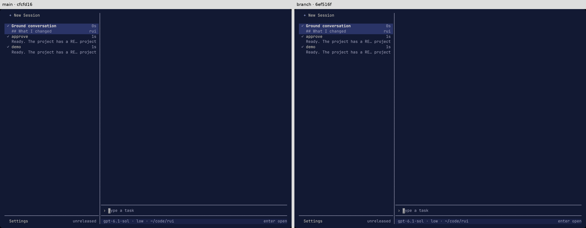
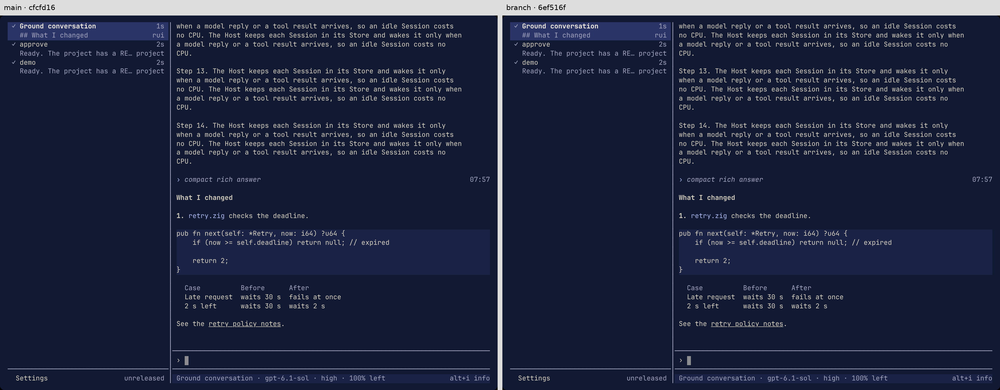

# AppScreen ground strips

Measured on Linux x86-64 on 2026-11-13, with Zig 0.17.1 ReleaseSafe.
Main is `cfcfd16cfc87f66523f0cfa626932f5bfb90ebcb`; the measured candidate is
`6ef516f9e34b7d44a8a9c9ed1b3b5fbae32ac65f`.
The later evidence-only commit does not change the measured source.

AppScreen keeps its base bufferless. Its transparent layouts are disjoint
vertical row bands and single-child padding. One local walk emits ground
surfaces for the gaps and side strips, stopping at opaque cell buffers.
This is not general overlapping-region subtraction: Layer still owns panels
and their ground, and its exact reserved slot is excluded from base grounding.
Original child origins, widgets, ordering, cursor and event handlers remain
intact; added strips have no event handlers. All added storage belongs to the
existing frame arena. Ordering references scale with visible children, not
pane cells; ground cells scale with genuinely uncovered area.

## Measured memory

The deep-dive `tui_mem.py` and a path-only adaptation of its `ab.sh` ran
main/branch alternating, three repetitions each, at both sizes and states.
The scratch Store used `verify-rui new --seed 3`, followed by the supplied
`seed.py RUN 60`, which reported 60/60 answered. Each sample used a new
private detached tmux pane and five seconds of settling. All 24 samples had
empty error lists and matching drawn row/character counts within each state.
The Host was the same pinned main Host for both clients.

Private_Dirty is in KiB; brackets are the observed minimum and maximum.

| Size | State | Main median [range] | Candidate median [range] | Saving |
| --- | --- | --- | --- | --- |
| 120×40 | idle | 5,628 [5,628–5,632] | 5,180 [5,176–5,180] | 448 |
| 120×40 | scrolled | 5,632 [5,632–5,636] | 5,180 [5,180–5,184] | 452 |
| 250×70 | idle | 12,140 [12,140–12,144] | 10,172 [10,172–10,176] | 1,968 |
| 250×70 | scrolled | 12,184 [12,184–12,188] | 10,220 [10,220–10,220] | 1,964 |

These are complete-fix measurements, not the deep dive's larger saving from
deleting the backdrop without replacing uncovered ground. Uncovered list
space must still be painted. Peak frame memory and streaming CPU were not
measured; no libvaxis source or dependency pin was changed.

## Frame evidence

The verify-rui skill's production PTY/committed-frame observer captured main
and candidate against one synthetic Store and deterministic provider. All
21 paired colored-cell frames are byte-identical: overview, conversation,
scrolled conversation, settings, chat info, command palette and approval card,
each at 120×40, 46×30 and 250×70. Three additional empty-overview frames from
the standard skill runner also match exactly. The 21 paired PNGs have
identical decoded pixels. The screenshots below place main on the left and
the candidate on the right.

The paired driver waits for populated sidebar previews and chat-info values,
then captures immutable frames when the live age fields agree. No cell,
style or age is normalized in the saved comparison. As with `capture-pane`,
the comparison excludes the terminal's retained cursor coordinate only while
the cursor is hidden; its visibility and every visible cursor position are
included. Raw terminal ANSI, including hidden cursor coordinates, is retained
separately. Independently seeded runs initially differed in live ages and
asynchronous loading, not in the ground painting. Those diagnostic attempts
are retained rather than counted as passing evidence.

This is L1 synthetic PTY layout evidence, not physical keyboard/wheel or macOS
qualification. It does not assert byte-identical raw output streams or
startup timing. Unit tests retain the previous full-frame golden hash, bound
cell allocation on all AppScreen parts across tiny/narrow/wide sizes, and
check every cell of gutter, short rows and empty space. Restoring a full-pane
buffer fails the allocation assertion; removing strip collection fails the
ground-style assertion.

All raw captures, PNGs, manifests, hashes, scripts, samples and check logs are
saved under `/mnt/project-files/libvaxis-memory/ground-fix/`, including
`paired-comparison.json`, `png-comparison.json`, `memory-ab.jsonl` and
`memory-summary.md`. This directory is an external local evidence archive,
not a repository dependency. Reproduction uses this repository's verify-rui
skill with `scenario.json` and `paired-frames.py`, then `sh ab.sh OUT 3 base
branch`; paths in the saved driver/manifests identify this machine's builds.
The saved compiler wrapper enforces `-j1` for helper and prepush builds.
